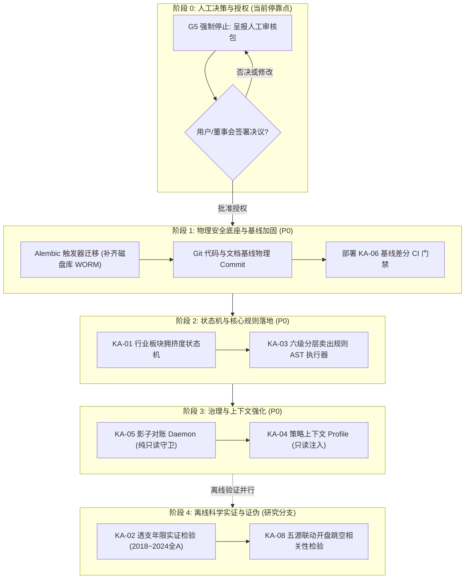

# 06B P0 实施顺序与依赖图

> **编制日期**：2026-10-01  
> **实施准则**：严格受控推进；每个阶段设立前置准入条件、验收交付物与回滚预案；**当前停留在阶段 0，严禁未经授权擅自进入阶段 1**。

---

## 一、 整体实施依赖架构图 (Mermaid)



---

## 二、 分阶段实施计划明细

### 阶段 0：人工审核与决策闭环（当前状态：STOPPED）
- **前置条件**：完成交付清单中全套审计与设计报告；
- **核心动作**：
  1. 呈报《08_G5_人工审核包.md》；
  2. 由用户对待决策事项（P0 范围、参数阈值、是否外购数据源）进行明确裁决；
  3. 签署授权令后，方可启动阶段 1。
- **Stop Gate**：未见用户明确批准前，保持当前只读停靠状态。

---

### 阶段 1：物理安全底座与基线加固（预计耗时：1 工日）
- **目标**：消除当前系统发现的重大物理安全隐患（WORM 触发器未安装）与版本漂移风险。
- **前置条件**：阶段 0 获得用户明确批准。
- **关键动作**：
  1. 编写 Alembic 迁移脚本 `002_install_sqlite_worm_triggers.py`，将 5 个原生 DDL 触发器永久安装至 `data/trading.db`，并运行回归测试验证；
  2. 将 Phase 2A Steps 1~6 成果及 20+ 篇开发文档进行规范化 Git Commit；
  3. 建立 `tests/test_baseline_diff.py`，将当前 148 个测试结果及关键快照固化为金样例基线。
- **阶段验收标准**：
  - `sqlite_master` 触发器数 $\ge 5$；
  - `git status` 工作区 clean；
  - 148 测试 100% PASS。
- **回滚预案**：若触发器导致现有合法操作异常，执行 `alembic downgrade -1`。

---

### 阶段 2：状态机与核心规则落地（预计耗时：2 工日）
- **目标**：在不改变核心架构的前提下，落地 KA-01（板块拥挤度）与 KA-03（分层卖出）。
- **前置条件**：阶段 1 验收全绿。
- **关键动作**：
  1. 在 `backend/app/cognition/observation/` 下增加 `SectorCrowdingState` 状态机计算模块，编写单元测试；
  2. 在 `backend/app/cognition/hypothesis/evaluator.py` 中扩展 `HierarchicalSellRuleEngine`，支持六级规则与优先级仲裁；
  3. 挂载 M3 持仓每日风险扫描只读输出端点。
- **阶段验收标准**：
  - 新增测试用例 $\ge 20$ 个，全量测试 $\ge 168$ 个且 100% PASS；
  - 触发硬止损与移动止盈的动作准确性 100%；
  - 盘外价格为 0 时防误触测试 100% 阻断。
- **回滚预案**：关闭 `ENABLE_SECTOR_CROWDING` 与 `ENABLE_SELL_RULES` 特性开关，代码 0 侵入回滚。

---

### 阶段 3：影子与上下文治理强化（预计耗时：1.5 工日）
- **目标**：落地 KA-05（影子对账）与 KA-04（策略上下文）。
- **前置条件**：阶段 2 验收全绿。
- **关键动作**：
  1. 实现 `ShadowReconciliationDaemon` 后台抽样对账进程，仅赋予只读连接；
  2. 实现 `StrategyContextProfile` 生成器，挂载至 M1 盘后与 M2 盘前，只读注入至 `EffectiveInferenceInput`。
- **阶段验收标准**：
  - 注入 0.1% 扰动时，影子对账器告警捕获率 100%；
  - 确认 Context 无法修改底层风险 Gate。
- **回滚预案**：关闭影子守护进程，解除只读注入。

---

### 阶段 4：离线科学实证与证伪（研究分支，预计耗时：持续）
- **目标**：对 KA-02（透支年限）与 KA-08（五源联动）进行样本外历史统计检验。
- **工作模式**：**纯离线研究脚本，绝不接入生产环境**。
- **关键动作**：
  1. 运行《06A 验证与证伪计划》中制定的实证检验脚本；
  2. 统计 $R^2$ 与方向准确率；
  3. 输出实证检验报告，若不达标直接签署放弃建议。

---

## 三、 依赖与门禁状态总表

```text
================================================================================
IMPLEMENTATION PHASE GATE TABLE:
Phase 0 (Human Sign-off): [PENDING USER APPROVAL] -> CURRENT STOP POINT
Phase 1 (Physical Hardening): BLOCKED BY PHASE 0
Phase 2 (State Machine & Rules): BLOCKED BY PHASE 1
Phase 3 (Shadow & Context): BLOCKED BY PHASE 2
Phase 4 (Offline Falsification): INDEPENDENT RESEARCH
================================================================================
```
