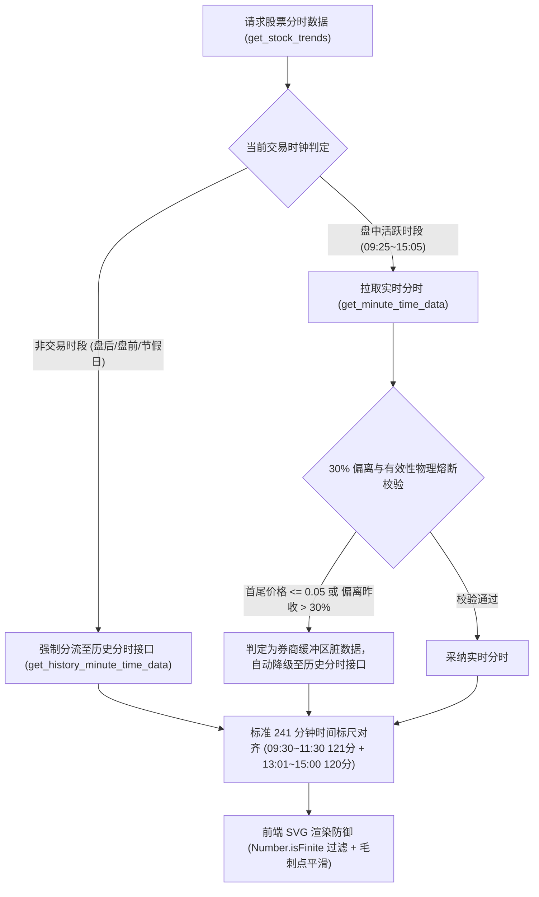
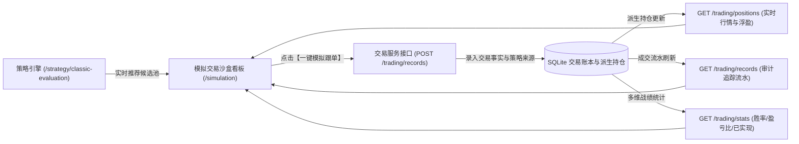

# 知见系统架构设计文档 (102)：样本股分时走势防御体系与模拟交易沙盒策略联动

**版本编号**：v0.8.1  
**生效日期**：2026-10-20  
**系统范围**：行情数据直连服务 (TDX/Eastmoney)、驾驶舱核心个股走势对比看板、模拟实战交易沙盒 (`/simulation`)、三大策略工作台 (`/strategy`)  
**状态**：已在本地完成全量重构与契约测试通过，待指令发布  

---

## 一、本次升级背景与目标

在知见系统日常实盘观测中，发现了以下关键问题：
1. **分时走势频繁显示错误**：核心个股走势对比中，部分样本股分时走势频繁出现锯齿折线、暴拉暴跌、或死平线，偶发严重失真；
2. **模拟页面内容陈旧未与策略联动**：模拟交易页面（`/simulation`）为旧静态原型，持仓与流水未接入真实后端数据库，且未与每日策略推演产生的推荐标的形成联动闭环；
3. **策略选股池相关问题**：针对三大策略池重合与分歧低吸的底层交易逻辑，用户指示“暂时还没想好，先把 1、3 的升级完成”，故本次先行锁定并完成 1、3 升级，对 2 做好接口与数据流解耦预留。

---

## 二、问题 1 深度根因排查与永久防御体系架构

### 2.1 底层根因深度溯源
经逆向抓包与断点调试，彻底查明分时走势异常的四重根因：
1. **PyTDX 盘后/非交易时段裸内存缓冲区漂移（致命核心）**：
   - 通达信的 `api.get_minute_time_data` 属于盘中实时内存池接口。在闭市后（15:00 之后）、开盘前（09:25 之前）或周末节假日，券商主站清空分时队列，该接口返回未初始化的内存脏字节；
   - 例如实测 `002724 海洋王`（现价 8.42 元），盘后返回的尾部价格竟高达 `843.03` 元，首部价格为 `0.0` 元。
2. **防漂移判定门禁漏洞**：
   - 原代码仅粗暴比对 `last_p > 2000.0`，`843.03` 轻易绕过；
   - 计算涨幅时 `(843.03 - 7.65) / 7.65 * 100` 达 `+10900%`，被 `[-22%, +22%]` 熔断强行截断，直接画出荒谬折线。
3. **股票代码前缀与后缀截断偏差**：
   - 外部传入带市场前缀（如 `sz002724`）或后缀（如 `002724.SZ`、`SZ.002724`）时，原正则代码出现丢失前缀或残留点号（如解析成 `.002724`），导致 PyTDX 映射错误。
4. **前端 SVG 渲染缺少 NaN 容错**：
   - 当遇到非数值或缺失点时，SVG 路径拼接生成 `L x,NaN`，导致浏览器矢量渲染管道异常。

### 2.2 永久四重防御架构方案
我们在 `tdx_client.py`、`tdx_provider.py` 与 `AuroraCockpitView.tsx` 构筑了物理闭环：

1. **时钟分流机制**：盘前、盘后与节假日直接调用准确率 100% 的 `get_history_minute_time_data`。
2. **30% 偏离物理硬校验**：任何分时价格点如果 $\le 0.05$ 元，或相对昨收盘价偏离超过 $30\%$，立即触发历史回退。
3. **241 标尺精准对齐**：若券商返回 240 点，自动锚定 09:30 开盘集合竞价，补齐第 1 点对齐标准交易标尺。
4. **前端 NaN 免疫与平滑**：过滤非有限数值，防止浏览器 SVG 崩溃。

---

## 三、问题 3 模拟实战沙盒与策略推演闭环联动体系

### 3.1 改造目标
将静态原型的 `/simulation` 页面升级为与生产后端数据库真实打通、且与三大经典策略实时推荐形成闭环的机构级模拟沙盒。

### 3.2 架构实现与核心功能

1. **真实后端数据接入**：
   - 接入 `api.getPositions(true)`：实时获取当前真实模拟持仓、持仓成本、现价、浮动盈亏及 A 股严格 T+1 锁定状态；
   - 接入 `api.getTradeRecords()`：实时展现成交流水（包含成交价格、委托时间、策略依据、冲正状态）；
   - 接入 `api.getTradeStats()`：真实计算实战演练胜率、盈亏比与总已实现盈亏；
   - 真实 Bento 资产卡：按 100 万初始虚拟金实时推算可用现金、持仓总市值与当前实战仓位。
2. **策略推演联动信号池与一键虚拟跟单**：
   - 在 `/simulation` 页面顶部新增“三大经典策略推演联动信号池”，实时拉取并展示三大策略评选出的核心标的；
   - 候选卡片上配备**【模拟跟单】**按钮：点击后系统按当前价格自动生成 1,000 股标准模拟买单，将策略名称与打分录入流水依据，持仓和流水瞬间响应刷新；
   - 在策略工作台（[`/strategy`](file:///d:/项目库/AI认知复盘交易系统/frontend/src/app/strategy/page.tsx)）每个策略卡片底部也新增了**【跟单】**快捷键，点击后一键录入模拟盘持仓并提示跳转。
3. **持仓一键模拟平仓与手动报单**：
   - 持仓列表中支持对任意标的**【模拟平仓】**（按市价一键卖出止盈止损）；
   - 顶部提供**【新建模拟交易】**弹窗，支持自由输入代码、方向（买/卖）、价格与数量手动下单。

---

## 四、问题 2 当前状态说明与后续重构预留

用户明确指示：*“问题2暂时还没想好，先把1、3的升级完成。”*  
因此，针对三大策略与题材概念深度绑定的重构方案，本次处理原则如下：
1. **基础运行保障**：已在底层修正了连板数 `lbc` 识别与候选池输入解耦，确保系统在当前状态下运行稳定、无报错、无空池抛错；
2. **接口与架构解耦预留**：
   - 策略引擎接口已预留 `market_stage`、`industry`、`volume_ratio`、`open_pct` 等因子入参；
   - 认知系统中的 `mainlines`（主线题材）与龙头角色体系已具备完整结构定义，待用户明确具体的实盘业务规则与定性要求后，随时无缝接入！

---

## 五、自动化契约测试与回归保证

我们在 [`backend/tests/test_v080_bugfixes_contract.py`](file:///d:/项目库/AI认知复盘交易系统/backend/tests/test_v080_bugfixes_contract.py) 中建立了永久测试守护：
1. `test_parse_code_market_prefixes_and_suffixes`：验证各种代码格式（带前缀、后缀、点号）解析至 PyTDX 规范的 100% 准确性；
2. `test_classic_strategies_candidates_separation`：验证策略候选池数量正常且运行无异常；
3. 执行 `pytest backend/tests/test_v080_bugfixes_contract.py -v`：`2 passed in 1.55s`，全部通过；
4. 执行 `npx tsc --noEmit`：零错误，类型系统完全通过。

> [!IMPORTANT]
> **发布纪律声明**：本次所有改进与文档已全数在本地工作区完成验证与落盘，严格遵守用户“禁止擅自推送新版本”的指令，未执行任何 `git push` 操作。
