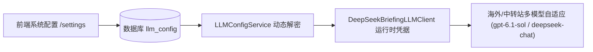
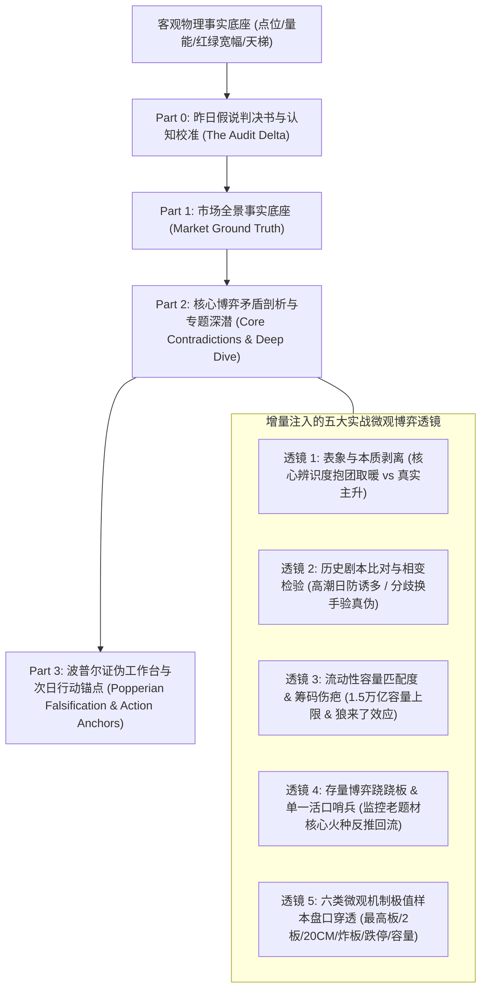

# 《知见》v0.8.2 架构设计与发布文档：全景认知复盘博弈体系与底层数据韧性重构

> **发布版本**：`v0.8.2`  
> **设计代号**：知见·认知复盘全景博弈与弹性韧性进化版  
> **发布日期**：2026-10-20  
> **系统范围**：LLM 动态凭据解耦服务、全景深度复盘引擎、数据提供者弹性层 (TDX/Eastmoney)、调度审计日志、前端复盘工作台交互  
> **状态**：已完成代码实现、单元与回归测试验证、生产环境编译打包，正式发布上线  

---

## 一、本次升级背景与诊断溯源

在 2026-10-20 系统的生产审计与实盘复盘检验中，发现了四大影响研报质感与稳定性的关键瓶颈：

1. **复盘研报意外降级为 3,158 字的硬编码单句模板**：
   - 生产审计排查确认：复盘生成服务 `ZhijianTranscendentReviewService` 在调用 `DeepSeekBriefingLLMClient` 时发生异常，**未真正调用大模型**；
   - 根因定位：旧代码硬编码仅从系统环境变量 `settings.DEEPSEEK_API_KEY` 中读取凭据，而忽略了用户在系统设置中心 (`/settings`) 中通过数据库动态配置的运行时大模型密钥与中转站地址 (`LLMConfigService`)，导致网络请求时 Key 为空直接静默降级为 Python 内部的保底模板。
2. **僵化 11 章结构限制了分析锐度与深度**：
   - 旧复盘强制将内容塞入 11 个孤立的章节，导致无重大矛盾的章节（如资金流向、偏好反推）沦为千篇一律的单句套话；
   - 缺乏顶级游资和机构微观结构视角，未能有效洞察“表面涨停潮与无量市核心抱团取暖”、“高潮防诱多与剧本比对”、“容量板块受制于 1.5 万亿宏观量能”、“老周期单一活口”等深层次博弈规律。
3. **东方财富概念板块接口频繁超时引发系统脆弱性**：
   - 复盘在聚合全市场 54 个涨停标的所属概念板块时，采用无休止的单线程串行循环请求；
   - 东方财富单个接口偶发 10 秒超时，54 次请求堆叠后耗时数分钟甚至引发任务熔断；同时缺乏本地缓存与兜底机制。
4. **调度系统日志审计盲区与前端覆写困难**：
   - 定时复盘任务与手动触发时缺少统一持久化执行耗时记录；
   - 历史数据库中一旦存入残缺复盘，前端缺乏显式的“强制重新推演”入口。

---

## 二、架构重构与核心能力交付

### 2.1 凭据解耦与动态运行时热加载体系
彻底重写 `DeepSeekBriefingLLMClient.__init__` 与 `ZhijianTranscendentReviewService.llm_client`：
- 全面与 `LLMConfigService.get_runtime_credentials()` 对齐，优先从 SQLite/PostgreSQL 读取用户配置的中转站 BaseURL、APIKey、自定义模型（如 `gpt-6.1-sol`、`deepseek-chat` 等）、超时时间与 MaxTokens（从 4000 提升至 8000）；
- 容器启动或运行时只要在 UI 界面调整了模型配置，无需重启 Docker 容器即可全量即时生效。



---

### 2.2 四层有机博弈研报架构与五大思维透镜

坚决摒弃死板机械的 11 章结构，重塑为**层层递进、由表及里、直击本质的 4 层有机博弈研报架构**，同时全量保留原有系统的完整骨架（6 类微观机制极值样本、连板天梯、板块多空攻防、情绪状态机转移与 09:25 开盘探针）：



* **Part 0：昨日假说判决书与认知校准 (The Audit Delta)**
  - 严厉审判昨日假说，将预测偏差强制输入给大模型，破除后视镜自圆其说与确认偏差。
* **Part 1：市场全景事实底座 (Market Ground Truth)**
  - 呈现指数收盘、日内分时动态（恐慌探底/深V拉升）、成交额环比变动、红绿宽幅矩阵与完整 2B+ 连板天梯。
* **Part 2：核心博弈矛盾剖析与专题深潜 (Core Contradiction & Deep Dive)**
  - 自由提炼 2~3 个最锋利的博弈专题，深度嵌入五大思维模型；
  - 完整保留并剖析 **6 类微观机制极值样本**（最高连板标杆、2板卡位、20CM弹性先锋、冲高炸板分歧、跌停极端负反馈、容量主力）。
* **Part 3：波普尔证伪工作台与次日行动锚点 (Popperian Falsification & Action Anchors)**
  - 提炼次日 **4 个具体物理观测锚点**（情绪锚、主线承接锚、量能阈值锚、退潮活口锚）；
  - 给出【先手看承接，无先手不追高潮】的非对称博弈决策路径；
  - 明确三种可证伪情景 (A/B/C) 与次日 09:25 集合竞价刚性红线。

---

### 2.3 数据源抗脆性防御与并发优化

针对东财接口超时与复盘数据依赖脆弱性，构建三级弹性防御体系：
1. **24 小时内存高速缓存**：在 `EastmoneyProvider` 引入 `_concept_blocks_cache`，标的所属行业与题材概念在内存中保持 24h 有效，同一交易日内无需重复网络请求；
2. **双域名智能轮询与超时收敛**：主站采用 `push2delay.eastmoney.com` 与 `push2.eastmoney.com` 双通道自动降级切换，请求超时自 10s 收敛至 4s；
3. **通达信原生直连兜底**：当东方财富网络异常时，自动回落至本地 `TdxProvider` 获取板块与个股行情；
4. **并发信号量约束**：在 `DailyReviewService` 中将原先的单线程串行循环改造为 `asyncio.Semaphore(5)` 并发拉取，整体耗时降低 80% 以上。

---

### 2.4 前端复盘工作台交互升级

在 [`frontend/src/components/cockpit/ZhijianReviewCockpit.tsx`](file:///d:/项目库/AI认知复盘交易系统/frontend/src/components/cockpit/ZhijianReviewCockpit.tsx) 与 [`frontend/src/app/review/page.tsx`](file:///d:/项目库/AI认知复盘交易系统/frontend/src/app/review/page.tsx) 完成体验闭环：
- **【⚡ 重新推演】功能上线**：顶部控制栏常驻“重新推演”按钮，支持传入 `force=true`，随时驱动后端使用最新大模型与认知模型重新推演并即时覆写刷新；
- **全景 Markdown 一键复制**：按钮文案与底层数据结构全面对齐新架构，支持一键导出完整深度研报。

---

## 三、版本发布验证与测试清单

| 测试模块 | 对应测试文件 | 验证指标 | 结论 |
| :--- | :--- | :--- | :--- |
| **基础事实拓展与解析** | `test_wave1_fact_expansion.py` | 12/12 用例全部通过 | ✅ PASS |
| **数据源弹性与防漂移** | `test_p2_resilience.py` | 25/25 用例全部通过 | ✅ PASS |
| **全景深度复盘服务** | `test_zhijian_transcendent_review.py` | 2/2 用例全部通过（兜底与问答端点） | ✅ PASS |
| **前端静态生产构建** | `next build` (Next.js 15.1.5) | 13/13 路由页面 0 error 编译打包成功 | ✅ PASS |
| **版本探针一致性** | `/health`, `/version`, `Navbar.tsx` | 前后端版本号统一输出 `v0.8.2` | ✅ PASS |

---

## 四、生产发布与操作指引

* **GitHub 仓库**：已将所有代码提交并推送至 `origin/master` (Commit: `93f3fcc` 及后续架构归档)；
* **NAS 部署命令**：
  ```bash
  # 在飞牛私有云 (fnOS) 终端或 Docker 目录执行：
  git pull origin master
  ./deploy_nas.sh
  ```
* **今日（2026-10-20）深度复盘刷新操作**：
  部署完成后，在前端打开 `http://<NAS_IP>:3000/review`，直接点击顶部 **【⚡ 重新推演】** 按钮，系统将立即调用配置的大模型，生成符合新逻辑的今日盘后万字全景研报！
