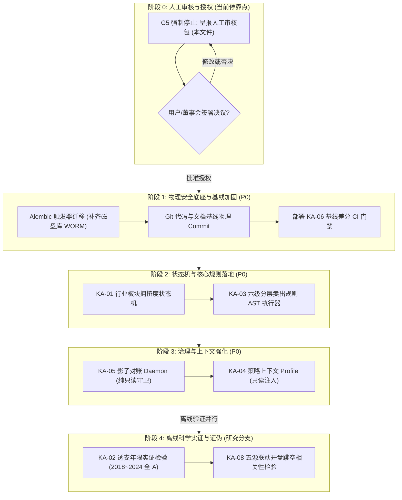

# 08 G5 人工审核包 (Human Review Package)

> **呈报日期**：2026-10-01  
> **任务名称**：Phase 2A 事实审计、盘股知识资产调查与 P0 增强方案设计  
> **执行阶段**：**G5 完成节点（Stop Gate）**  
> **状态声明**：**G5 已完成。本任务不进入 G6；等待人工审核与授权。**  
> **关联证据库**：[`01_Phase2A_事实审计报告.md`](file:///d:/项目库/AI认知复盘交易系统/01_Phase2A_事实审计报告.md) | [`02_Baseline_冻结清单.md`](file:///d:/项目库/AI认知复盘交易系统/02_Baseline_冻结清单.md) | [`03_盘股知识资产全集.md`](file:///d:/项目库/AI认知复盘交易系统/03_盘股知识资产全集.md) | [`04_盘股至当前系统_迁移矩阵.md`](file:///d:/项目库/AI认知复盘交易系统/04_盘股至当前系统_迁移矩阵.md) | [`05_M1_M2_M3_M5_S1_S4_Gap_Analysis.md`](file:///d:/项目库/AI认知复盘交易系统/开发文档/05_M1_M2_M3_M5_S1_S4_Gap_Analysis.md) | [`06_P0_Contract与实施设计.md`](file:///d:/项目库/AI认知复盘交易系统/06_P0_Contract与实施设计.md) | [`07_风险_架构冲突_待人工决策清单.md`](file:///d:/项目库/AI认知复盘交易系统/07_风险_架构冲突_待人工决策清单.md)

---

## 目录索引
1. [当前系统真实工程 Baseline 摘要](#一-当前系统真实工程-baseline-摘要)
2. [Phase 2A 事实状态审计总表](#二-phase-2a-事实状态审计总表)
3. [盘股 15 项知识资产分类与可复现性统计](#三-盘股-15-项知识资产分类与可复现性统计)
4. [迁移矩阵与处置决议摘要](#四-迁移矩阵与处置决议摘要)
5. [P0 推荐项与坚决不推荐项明确界定](#五-p0-推荐项与坚决不推荐项明确界定)
6. [五项 P0 能力深度国防式审查（价值、风险、依赖、验证）](#六-五项-p0-能力深度国防式审查)
7. [必须由人工明确裁决的事项清单 (6 项决议)](#七-必须由人工明确裁决的事项清单)
8. [推荐的正式实施顺序与分阶段路线图](#八-推荐的正式实施顺序与分阶段路线图)
9. [Stop Gate 停靠声明](#九-stop-gate-停靠声明)

---

## 一、 当前系统真实工程 Baseline 摘要

| 维度 | 基线物理事实 | 审计结论与说明 |
|:---|:---|:---|
| **代码版本与提交** | Git HEAD: `c52d1c8`，工作区存在 14 个修改文件与 25+ 未跟踪文件 | 本地 `master` 与远程 `nas/master` 各有 1 次分叉；Phase 2A 全部代码与 20+ 篇开发文档尚未物理 Commit。 |
| **测试套件运行** | **148 / 148 测试 100% 全部通过** (运行耗时 71.68s，0 失败，0 错误) | 覆盖 RFC 8785 JCS 规范化、哈希链、单层 AST 执行器、证伪核验机与防假零填充等沙箱契约。 |
| **持久化存储状态** | SQLite 物理数据库 `data/trading.db`，共 24 张表，Alembic Head: `d440da877b6a` | 生产账本实盘行数：`trade_records` (5条), `audit_logs` (10条)。 |
| **运行时认知数据** | `cognition_record`, `cognition_chain_state`, `cognition_prompt_spec`, `diff_report` 表中**数据行数全部为 0** | **绝对的 Zero LLM Runtime**，系统处于纯沙箱与单测闭环阶段，尚未接入真实大模型线上生产。 |
| **核心安全漏洞** | `models/cognition_v2.py` 中的 DDL 触发器未安装至磁盘物理文件 `data/trading.db` | **`sqlite_master` 触发器数为 0**。若脱离应用层 ORM，原生 SQLite 无法阻断物理篡改。 |
| **API 服务挂载** | FastAPI 共挂载 **32 个路由端点** (包括 M1~M5、S1~S4 基础接口) | `/records` 等认知核心接口在 API 层面已实现 HTTP 405 WORM 拦截阻断。 |

---

## 二、 Phase 2A 事实状态审计总表

审计组对 Phase 2A 声称已完成的 21 项构件实施地毯式事实核验（拒绝口头声明与宏观总结）：

| 构件编号 | Phase 2A 声明构件 / 能力 | 物理代码位置 | 真实状态判定 | 审计穿透事实与边界界定 |
|:---:|:---|:---|:---:|:---|
| **P2A-01** | WORM 不可变认知账本模型 | `models/cognition_v2.py` | **Partially Verified** | ORM 层有更新拦截单测通过；但生产库无行数，且原生触发器未在磁盘库激活。 |
| **P2A-02** | SQLite 原生 WORM 触发器 | `models/cognition_v2.py` L144 | **Broken / Risky** | 内存库 `:memory:` 验证通过；但磁盘库 `data/trading.db` 触发器数为 0。存在绕过风险。 |
| **P2A-03** | API 级 WORM 阻断守卫 | `api/v1/cognition.py` L224 | **Verified** | PUT/PATCH/DELETE 端点严格返回 HTTP 405 Method Not Allowed。 |
| **P2A-04** | RFC 8785 JCS 规范化哈希链 | `cognition/jcs.py`, `hash_chain.py` | **Verified** | 纯 Python 实现，单测 100 轮通过，具备置换不变性与雪崩篡改拦截。 |
| **P2A-05** | 防 Genesis Race 链状态锚点 | `cognition/chain_state.py` | **Verified** | 单行控制锚点，严格自增单调 `sequence_id`，杜绝并发空洞。 |
| **P2A-06** | 不可变 Prompt 规格哈希指纹 | `models/cognition_v2.py` | **Verified** | `prompt_hash` 绑定，篡改 1 字符强制改变根 SHA-256。 |
| **P2A-07** | 事实抽取适配器 (Adapters) | `cognition/observation/adapters/` | **Verified** | 适配 M1/M2/M4/M5/S4，具备 `FactStatus` 状态枚举与源头血缘追溯。 |
| **P2A-08** | 确定性时钟与四维时间解耦 | `cognition/observation/clock.py` | **Verified** | 严格区分事件时间、观测窗口、快照时间与核验时间，杜绝时序混淆。 |
| **P2A-09** | 多源冲突检测与消解引擎 | `cognition/observation/conflict.py` | **Verified** | 实现 `PRIMARY_WINS`, `STRICT_ABORT`, `PRESERVE_ALL` 策略，留存原始证据。 |
| **P2A-10** | 六维准入矩阵与资格网 Gate | `cognition/input/eligibility.py` | **Verified** | 缺数一律打上 `[DATA_DEFICIENCY]` 标签隔离，杜绝假客观事实。 |
| **P2A-11** | Effective Inference Input 序列化 | `cognition/input/renderer.py` | **Verified** | 渲染全文留存，计算 `effective_input_hash`，沙箱 100 轮比特级完全一致。 |
| **P2A-12** | STOP 组装器硬停止边界 | `cognition/input/pipeline.py` L10 | **Verified** | 产出 `EffectiveInferenceInput` 后强制直接返回，零外部大模型调用，零交易副作用。 |
| **P2A-13** | 收窄 AST 假说定义与断言 DSL | `cognition/hypothesis/contracts.py` | **Verified** | 白名单单层平铺，C-02 不变量确保定义 Hash 绝不受运行时核验状态污染。 |
| **P2A-14** | 收窄 AST 解释执行器与精度控制 | `cognition/hypothesis/evaluator.py` | **Verified** | 严格白名单求值，1e-9 容差比较，严禁任意代码执行。 |
| **P2A-15** | 证伪优先核验机 (Falsification) | `cognition/hypothesis/falsification.py` | **Verified** | 红线一票否决为 `FALSIFIED`，缺数判定 `INCONCLUSIVE`，杜绝假零填充。 |
| **P2A-16** | 双时点截面对撞流水线 | `cognition/hypothesis/pipeline.py` | **Verified** | 强校验 $T_{realization} \ge T_{decision}$，时间倒流直接抛出违规异常。 |
| **P2A-17** | 只追加核验账本 (Ledger) | `cognition/hypothesis/ledger.py` | **Verified** | 内存与值对象只追加写，重放覆盖抛出异常。 |
| **P2A-18** | 确定性重放引擎 (Replay Engine) | `cognition/replay/runner.py` | **Partially Verified** | 沙箱 Runner 已验证确定性等级；但未与真实历史切片库及生产 API 联动。 |
| **P2A-19** | 五维认知差异对比矩阵 (Diff) | `cognition/diff/matrix.py` | **Partially Verified** | 差异矩阵结构已实现且禁止 winner 评选；但缺乏大规模历史样本对撞数据。 |
| **P2A-20** | 生产真实大模型推理 (LLM Runtime) | **未实现 / 刻意冻结** | **Missing (By Design)** | 系统遵从董事会禁令，未接入真实线上 LLM，生产库记录数为 0。 |
| **P2A-21** | 生产级 Alembic 自动迁移 | `migrations/` | **Partially Verified** | 已执行到 head；但未打包触发器 DDL，全新部署存在漏洞。 |

**统计汇总**：
- `Verified`：14 项 (66.7%)
- `Partially Verified`：4 项 (19.0%)
- `Broken / Risky`：1 项 (4.8%)
- `Missing (By Design)`：1 项 (4.8%)
- `Claim Only`：0 项 (0%)

---

## 三、 盘股 15 项知识资产分类与可复现性统计

审计组查阅盘股全量材料（49页《说明书》、9页《执行指南》、12KB《五源方案v9.3》、历史代码库与交易笔记），共提炼并建立 **15 张规范化证据卡**（详见 [`knowledge_cards/`](file:///d:/项目库/AI认知复盘交易系统/knowledge_cards/) 目录）：

```
[统一认知分类分布]
Rule (确定性规则):            8 项  (KA-01, KA-03, KA-05, KA-06, KA-08, KA-09, KA-10, KA-12, KA-13, KA-14)
Engineering Governance (治理): 5 项  (KA-05, KA-06, KA-12, KA-15)
State (状态表示):             4 项  (KA-01, KA-04, KA-07, KA-14)
Strategy Knowledge (经验纪律): 5 项  (KA-03, KA-04, KA-09, KA-10, KA-11)
Derived Feature (衍生特征):    4 项  (KA-01, KA-02, KA-07, KA-11, KA-13)
Model Output (模型推断):      2 项  (KA-02 透支年限, KA-08 五源联动) [严格隔离，禁止伪装为 Fact!]

[可复现性分布]
完全可复现 (具备明确公式或确定性逻辑):    8 项 (53.3%)
部分可复现 (盘股脱敏导致参数或源缺失):    5 项 (33.3%)
不可直接复现 (缺乏核心一致预期或海外源):  2 项 (13.3%) (KA-02, KA-08)
```

---

## 四、 迁移矩阵与处置决议摘要

根据当前系统的微内核架构与工程治理准则，15 项资产的处置决议如下（详见 [`04_盘股至当前系统_迁移矩阵.md`](file:///d:/项目库/AI认知复盘交易系统/04_盘股至当前系统_迁移矩阵.md)）：

| 处置分类 | 数量 | 包含资产 | 处置原则与落地说明 |
|:---:|:---:|:---|:---|
| **Borrow** | 4 项 | **KA-09** (LTV一致性规则)<br>**KA-10** (候选池分层冰点)<br>**KA-12** (会计级红字冲正)<br>**KA-15** (天眼巡检血缘) | **直接沿用或冻结保持**。KA-12 已在 M3 中实现；KA-09/10/15 作为既有成熟经验或治理规范直接固化。 |
| **Adapt** | 7 项 | **KA-01** (板块拥挤度)<br>**KA-03** (六级分层卖出)<br>**KA-04** (策略上下文)<br>**KA-05** (影子对账守卫)<br>**KA-06** (基线差分门禁)<br>**KA-07** (市场虚火诊断)<br>**KA-14** (生命周期五阶段) | **按系统 Contract 重构引入**。其中 **KA-01, KA-03, KA-04, KA-05, KA-06** 提议作为 **P0 实施**；KA-07、KA-14 排入 P1。 |
| **Validate First** | 2 项 | **KA-02** (透支年限模型)<br>**KA-08** (五源联动预警) | **严禁直接接入生产！** 缺乏客观数据源，存在严重过拟合与幻觉风险。必须先在离线研究分支完成科学证伪。 |
| **Research Only** | 0 项 | — | 无纯空想概念。 |
| **Reject** | 0 项 | — | 全部 15 项均具备特定场景参考价值，无纯忽悠概念。 |

---

## 五、 P0 推荐项与坚决不推荐项明确界定

### 1. 推荐纳入 P0 实施的 5 项核心能力
1. **KA-06：基线差分与防退化门禁机制**（优先级第一，工程治理底座）；
2. **KA-01：行业/板块拥挤度状态机**（中观状态感知核心）；
3. **KA-03：六级分层卖出与止盈止损规则体系**（交易风控与止损第一道护城河）；
4. **KA-05：影子对账与双轨数据守卫**（高可用与盘中防脏数据保障）；
5. **KA-04：策略上下文与市场风格自适应**（微观交易与宏观环境的动态衔接）。

### 2. 坚决不推荐纳入 P0 的项目与理由
- **坚决不推荐 KA-02（透支年限）进入 P0**：
  - *原因*：依赖未来 3 年券商一致预期数据（当前 Tushare/AkShare 免费源不完整）；其本质是三阶模型推断，若强行引入将导致系统认知充斥伪客观假设。
- **坚决不推荐 KA-08（五源联动）进入 P0**：
  - *原因*：依赖美股纳指隔夜、富时A50夜盘与大宗商品微秒级高频源；其主观赋予的固定权重（如汇率5%、美股10%）存在严重数据窥探偏差，极易诱发频繁假警报。
- **坚决不推荐 M6（选股与策略中心）进入 P0**：
  - *原因*：M6 目前为 37 行空壳。根据《开发笔记》根本准则：“先把眼睛做准，把基础事实层做扎实；严禁在缺乏稳固事实底座时急于开发 AI 选股下单”。

---

## 六、 五项 P0 能力深度国防式审查

针对每一项推荐纳入 P0 的能力，回答 G3 Stop Gate 强制要求的“六问”：

```
┌─────────────────────────────────────────────────────────────────────────────┐
│ 1. KA-06: 基线差分与防退化门禁机制 (Baseline Diff Guard)                     │
├─────────────────────────────────────────────────────────────────────────────┤
│ • 进入哪个 Contract? -> tests/governance/test_baseline_diff_guard.py, CI 流程 │
│ • 使用什么输入?       -> 当前代码 Git Hash, pytest 结果日志, Schema 快照      │
│ • 为何不是 Fact?    -> 它是 Engineering Governance 规则，用于软件质量治理    │
│ • 价值与主要风险?   -> 价值：锁死 148 单测全绿基线；风险：阈值定得过死影响开发  │
│ • 依赖与失效条件?   -> 依赖 pytest 与 Git 命令；失效：本地未提交变更时结果失真│
│ • 验证与证伪机制?   -> 故意注入回归测试用例，验证 CI 能够 100% 阻断退出代码 1 │
│ • 失败与隔离表现?   -> 门禁失败直接中断流水线，严禁合并，零污染生产决策链     │
└─────────────────────────────────────────────────────────────────────────────┘
```

```
┌─────────────────────────────────────────────────────────────────────────────┐
│ 2. KA-01: 行业/板块拥挤度状态机 (Sector Crowding State Machine)             │
├─────────────────────────────────────────────────────────────────────────────┤
│ • 进入哪个 Contract? -> app/cognition/contracts/crowding.py                  │
│ • 使用什么输入?       -> SectorDailyFact (成交额、换手率、涨幅、ETF份额)      │
│ • 为何不是 Fact?    -> 它是 State (状态表示)；是确定性规则在时序上的状态机映射│
│ • 价值与主要风险?   -> 价值：拦截过热板块追高；风险：主观百分位阈值产生假警报  │
│ • 依赖与失效条件?   -> 依赖中信/申万二级行业行情；失效：行业成分股大规模调整  │
│ • 验证与证伪机制?   -> 历史 5 年板块极值回测，检验拥挤度 >90% 后的最大回撤比率│
│ • 失败与隔离表现?   -> 数据缺失或异常降级为 UNKNOWN，仅记日志，不影响基础事实 │
└─────────────────────────────────────────────────────────────────────────────┘
```

```
┌─────────────────────────────────────────────────────────────────────────────┐
│ 3. KA-03: 六级分层卖出与止盈止损规则 (Tiered Exit Rules)                    │
├─────────────────────────────────────────────────────────────────────────────┤
│ • 进入哪个 Contract? -> app/cognition/hypothesis/rules/tiered_exit.py        │
│ • 使用什么输入?       -> TradeRecord, PositionFact, RealtimeQuoteFact         │
│ • 为何不是 Fact?    -> 它是 Rule (确定性交易风控约束规则)                     │
│ • 价值与主要风险?   -> 价值：止损无条件清仓，锁盈保本；风险：盘外价格为 0 误触│
│ • 依赖与失效条件?   -> 依赖实盘行情价格；失效：非开市时段 (0.0 假价格阻断)    │
│ • 验证与证伪机制?   -> 重放 8/24 历史行情，断言短线 -5% 必产生 SellOrderProposal│
│ • 失败与隔离表现?   -> 产出提案须经 S3 HITL 人工确认；执行器异常降级为安全 HOLD│
└─────────────────────────────────────────────────────────────────────────────┘
```

```
┌─────────────────────────────────────────────────────────────────────────────┐
│ 4. KA-05: 影子对账与双轨数据守卫 (Shadow Reconciliation Guard)              │
├─────────────────────────────────────────────────────────────────────────────┤
│ • 进入哪个 Contract? -> app/cognition/observation/shadow_reconciliation.py   │
│ • 使用什么输入?       -> PrimaryDataSource (AkShare), ShadowDataSource       │
│ • 为何不是 Fact?    -> 它是 Engineering Governance 规则；双源一致性交叉核验  │
│ • 价值与主要风险?   -> 价值：阻断脏数据与单源假行情；风险：并发读写 SQLite 锁 │
│ • 依赖与失效条件?   -> 依赖双独立数据源；失效：外部源全部网络超时            │
│ • 验证与证伪机制?   -> 注入脏价格测试，断言系统触发 DATA_SOURCE_DIVERGENCE 告警│
│ • 失败与隔离表现?   -> 仅持只读连接（mode=ro）；影子失败绝不阻塞主交易流程    │
└─────────────────────────────────────────────────────────────────────────────┘
```

```
┌─────────────────────────────────────────────────────────────────────────────┐
│ 5. KA-04: 策略上下文与市场风格自适应 (Strategy Context Profile)              │
├─────────────────────────────────────────────────────────────────────────────┤
│ • 进入哪个 Contract? -> app/cognition/contracts/strategy_context.py          │
│ • 使用什么输入?       -> MarketRegimeState (市场流动性、成交量、宽度、波动率)  │
│ • 为何不是 Fact?    -> 它是 State 与 Strategy Knowledge 的上下文动态剖面     │
│ • 价值与主要风险?   -> 价值：弱市自动压低仓位上限；风险：越权放宽底线硬止损  │
│ • 依赖与失效条件?   -> 依赖宏观大盘统计；失效：大盘与结构性个股严重分化      │
│ • 验证与证伪机制?   -> 注入 R0 极端弱市环境，断言系统最大允许仓位上限降为 0%   │
│ • 失败与隔离表现?   -> 坚守单向收紧原则（只能降仓，绝不允许放宽硬止损防线）  │
└─────────────────────────────────────────────────────────────────────────────┘
```

---

## 七、 必须由人工明确裁决的事项清单

详见 [`07_风险_架构冲突_待人工决策清单.md`](file:///d:/项目库/AI认知复盘交易系统/07_风险_架构冲突_待人工决策清单.md)。**在用户对下列事项作出明确选择前，系统保持只读冻结**：

### 决策项 1：P0 实施范围与准入裁决
- [ ] **方案 A (推荐)**：批准全部 5 项（KA-01 拥挤度、KA-03 分层卖出、KA-04 策略上下文、KA-05 影子对账、KA-06 基线差分）作为 P0 推进，按阶段逐步实施。
- [ ] **方案 B (极简)**：仅批准 KA-03 (分层卖出) 与 KA-06 (基线差分)，其余延后。
- [ ] **方案 C**：暂不开展任何新功能，仅加固现有系统缺陷。

### 决策项 2：磁盘数据库原生 WORM 触发器激活授权
- [ ] **方案 A (推荐)**：授权立即编写并执行 Alembic 迁移脚本，将 5 个 WORM 防篡改触发器安装至 `data/trading.db`，实现物理引擎级防篡改。
- [ ] **方案 B**：维持现状，仅依靠应用层 ORM 事件拦截（存在绕过风险）。

### 决策项 3：Git 工作区基线物理 Commit 授权
- [ ] **方案 A (推荐)**：授权将当前 148 测试全绿的全部成果与 20+ 篇文档创建原子 Commit，并同步合并推送至 NAS 远程仓库进行物理冻结。
- [ ] **方案 B**：暂不提交，保持工作区修改状态。

### 决策项 4：“透支年限”与“五源联动”的处置裁决
- [ ] **方案 A (推荐)**：批准审计组裁决，将其定性为 `Validate First`，坚决不接入生产流水线，仅在离线研究脚本中进行统计证伪。
- [ ] **方案 B**：允许外购商业数据源（如 Choice 一致预期与海外高频源）并在后续版本中尝试生产实现。
- [ ] **方案 C**：直接彻底拒绝（Reject），不开展任何研究。

### 决策项 5：M6（AI 策略与选股中心）的封存令确认
- [ ] **方案 A (推荐)**：继续维持 M6 物理封存隔离令，在基础事实层与风控规则成熟前，严禁开发选股中心，严禁让 AI 自动下单。
- [ ] **方案 B**：启动 M6 开发。

### 决策项 6：六级分层卖出核心阈值设定确认
- 审计组建议默认阈值：
  - 硬止损门槛（L1）：短线 $-5.0\%$，波段 $-8.0\%$，动作：市价全量清仓；
  - 波浪回撤门槛（L5）：自买入后最高点回撤 $\ge 8.0\%$，动作：减仓 $50\%$；
  - 移动止盈激活门槛（L6）：浮盈 $\ge 15.0\%$ 且随后回撤 $\ge 5.0\%$，动作：全量锁盈清仓；
  - 动作执行属性：所有动作均为 `SellOrderProposal`，必须走 S3 HITL 人工确认，绝不自动报单。
- [ ] **方案 A (推荐)**：采纳上述默认阈值与 HITL 人工在环确认模式。
- [ ] **方案 B**：调整阈值（请在反馈中指定新的数值）。

---

## 八、 推荐的正式实施顺序与分阶段路线图

详见 [`06B_P0_实施顺序与依赖图.md`](file:///d:/项目库/AI认知复盘交易系统/06B_P0_实施顺序与依赖图.md)：



- **阶段 0（当前状态：STOPPED）**：等待用户审阅并签署 6 项决策；
- **阶段 1（前置安全护城河）**：修复 WORM 触发器漏洞、提交 Git 历史、建立基线防退化门禁；
- **阶段 2（核心风控与状态机）**：落地板块拥挤度状态机与六级分层卖出 AST；
- **阶段 3（治理与动态环境）**：落地影子对账只读守护进程与策略上下文单向收紧 Profile；
- **阶段 4（离线沙箱证伪）**：KA-02 与 KA-08 在独立研究分支运行统计证伪检验，绝不污染主干。

---

## 九、 Stop Gate 停靠声明

```
========================================================================================
                                     STOP GATE 声明
========================================================================================

本阶段 G5 审计与设计工作已全部交付完毕。
所有分析、证据卡、迁移矩阵、Contract 设计、证伪计划与决策清单已完整归档。

严格按照自主任务权限指令要求：
本任务在 G5 完成后立即停止，绝对不擅自启动 G6 编码或修改核心生产架构。

>>> G5 已完成。本任务不进入 G6；等待人工审核与授权。 <<<

请用户审阅本审核包及关联清单，并对第七部分“待人工决策事项”给出裁决指令。
========================================================================================
```
