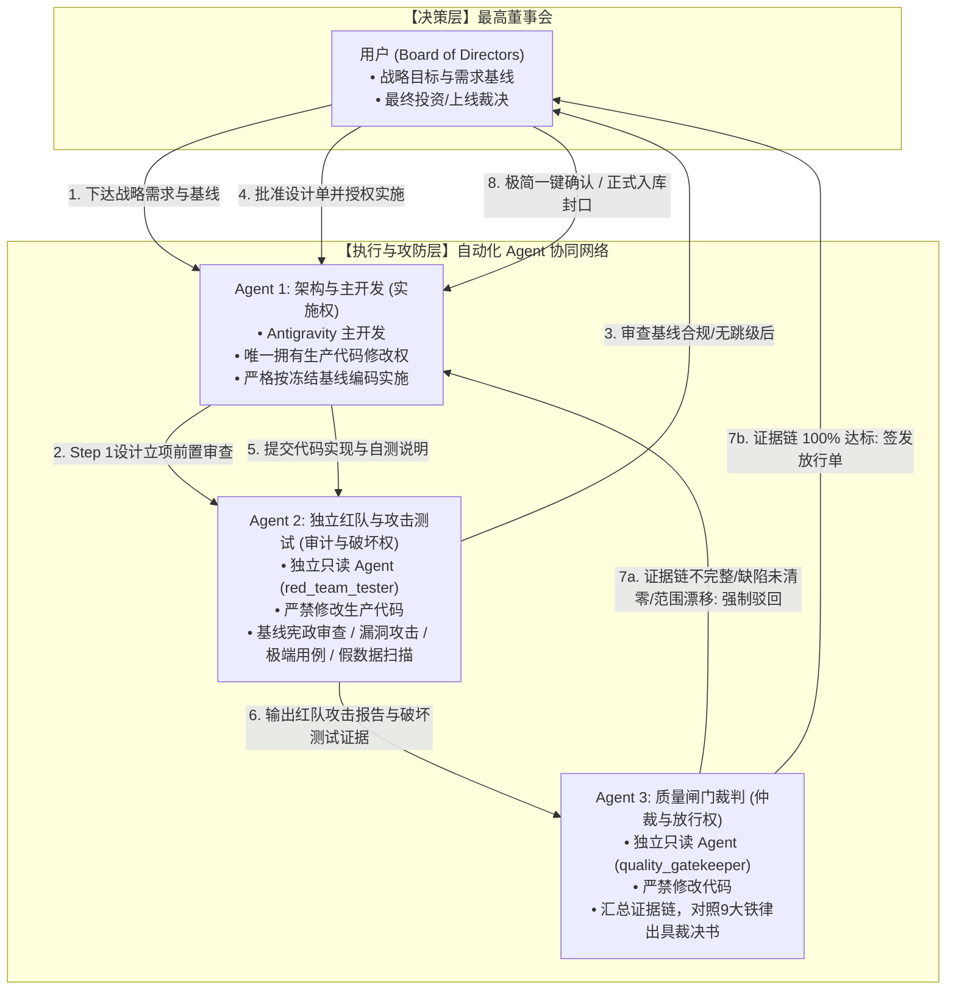

# AI认知复盘交易系统：多Agent四权分立工程治理规范

> **规范版本**：v1.1（开发纠偏与刚性补丁增强版）  
> **生效节点**：2026-09-25 最高董事会（用户）决议后即刻生效  
> **核心宗旨**：将用户从微观排查与心智消耗中彻底解放出来；通过架构分权与自动化攻防制衡，捍卫量化认知系统“需求不漂移、数据零伪造、逻辑抗塌缩、质量可追溯”的最高工程标准。

---

## 一、四权分立体系架构总览

针对金融量化与认知推演系统“指标污染隐蔽、数学极易塌缩、自测容易自欺、范围极易漂移”的特有风险，本项目在设计开发阶段正式确立**“四权分立、单向闭环、独立制衡”**的工程组织架构：

---

## 二、角色定义与权责清单

| 角色名称 | 实体指派 | 生产代码修改权 | 核心职责 | 考核/合格指标 |
| :--- | :--- | :---: | :--- | :--- |
| **最高董事会 (User)** | 项目所有者 / 最终用户 | 否 | 1. 制定核心业务需求与演进战略 2. 裁定高层架构分歧与范围漂移争议 3. 对最终《质量闸门放行单》进行一键签章 | 零微观心智损耗，聚焦战略决策 |
| **架构与主开发 (Implementer)** | Antigravity 主代理 | **唯一授权 (✅)** | 1. 负责技术方案草拟与架构落地 2. 严格按《G1需求基线》顺序与冻结设计单编写代码 3. 负责基础环境与代码工程健康度，严禁跳级与自嗨开发 | 交付高质量代码，无违背冻结基线与越级行为 |
| **独立红队与破坏测试 (Auditor & Tester)** | `red_team_tester` 子代理 | **严禁修改 (❌)** *(仅允许编写独立测试脚本)* | 1. **基线宪政审查**：核对《02-G1需求基线》条目与优先级，一票否决跳级、超前开发与范围漂移 2. 白盒代码攻击，寻找数学、逻辑、边界漏洞 3. 构造破坏性测试用例与极端压力场景 4. 验证真实数据源网络抓取与落库物理事实 5. **扫描全系统死代码、沉睡占位符与静态假数据** | 基线漂移阻断率、攻击深度、假数据与漏洞检出率 |
| **质量闸门裁判 (Gatekeeper)** | `quality_gatekeeper` 子代理 | **严禁修改 (❌)** | 1. 严格对照 **9 大铁律** 与验收标准核验证据链 2. 审查主开发与红队的对抗闭环结果 3. 检查 Git 提交规范与远程灾备状态 4. 独立签发《发布放行单》或《打回整改令》 | 裁决零人情、证据链 100% 完整性、基线不偏离 |

---

## 三、标准作业程序（SOP：五步闭环流程）

任何进入系统主干（Master）的里程碑、阶段任务或代码改动，必须完整流转以下 5 个步骤：

### Step 1：基线冻结与立项前置审查（Baseline Freeze & Scope Gate）
* **【补丁 2：立项前置双签闸门】**：
  * 主开发编制任何《技术设计单》前，必须在设计单开篇提供《G1 需求基线映射说明》，明确该模块在《02-G1需求基线》中的原始编号与优先级（P0/P1/P2）；
  * 独立红队特使执行第 0 步核验，确认无前序 P1 未闭环跳级，出具合法合规准核令后，才允许向最高董事会呈报设计单；
  * **设计单未获董事会正式批准前，严禁启动任何生产代码修改！**

### Step 2：受控实施（Controlled Implementation）
* 架构与主开发在本地受控修改代码。
* **【内部工序机制（Internal Plan Mechanism）】**：
  * Plan 仅作为主开发（Primary Developer）的内部实施工具，用于提升代码落地与验证的执行颗粒度；
  * **治理权力结构保持绝对不变**：不新增 Agent 权限，不改变各 Agent 职责边界，不改变用户审批节点，不改变 Red Team / Validation / Release Gate 的独立性；
  * Plan 产生的过程结果仅作为后续红队审计与质量闸门的辅助参考证据，原有裁决机制与一票否决权保持不变。
* 编写必要的业务逻辑与底层实现。
* 实施完成后，主开发生成自测说明与变更文件清单，触发移交。

### Step 3：红队破坏性攻击与基线审计（Red Team Attack & Baseline Audit）
* 独立子代理 `red_team_tester` 介入，执行攻击性测试：
  * **【补丁 1：基线宪政审查】**：严格比对交付范围与《G1需求基线》，若发现未授权扩展、超纲回放引擎或过度工程，直接签发 REJECT；
  * **【补丁 3：假数据全景体检】**：测试范围不仅覆盖代码 Diff，还必须对全系统 UI 页面进行全局扫描，一旦发现未接通 API 的硬编码 mock 数据、虚假常量或未授权占位，直接签发 REJECT；
  * **数学攻击**：检查权重计算是否归一、是否发生子域标量塌缩；
  * **数据攻击**：检查是否存在偷填 0 或虚假默认值；
  * **边界破坏**：模拟全市场极端行情（断流、暴跌、涨停潮）破坏系统；
  * **实盘硬证据**：调用真实网络数据源执行端到端断言测试。
* 输出结构化《红队攻击与测试报告》，给出初步裁决（PASS / REJECT）。

### Step 4：质量闸门终审（Gatekeeper Adjudication）
* 独立子代理 `quality_gatekeeper` 调阅全量证据链：
  * 主开发变更代码 Diff；
  * 红队攻击报告与测试日志；
  * Git Working Tree 与 NAS 灾备推送记录；
  * 对照《9 大铁律检查表》。
* **自动化仲裁规则**：
  * 存在任一 P0 / P1 缺陷、假数据残留或基线偏离 -> **直接驳回（REJECT）**，指令主开发限期整改，重新循环；
  * 全部条件 100% 满足 -> **签发准予放行单（APPROVED）**，提交最高董事会。

### Step 5：董事会极简签章（Board Sign-off）
* 最高董事会（用户）只需阅读 1 页极简《质量闸门放行单》。
* 用户确认后，正式封口归档，推进至下一里程碑。

---

## 四、质量闸门核验的“9 大铁律清单”

质量闸门裁判（Gatekeeper）在裁决时必须逐项核对、具有一票否决权：

1. **零填充防伪铁律（Zero-Falsification）**：
   在指标缺失或无数据时，严禁使用 `0`、`0.0` 或伪造均值填补，必须显式保持 `None` 并依规降级为 `PARTIAL` 或 `INVALID`。
2. **抗标量塌缩铁律（Anti-Scalar-Collapse）**：
   严禁将正交矛盾的多维特征强行压缩为单一标量分。D3 短线情绪与极端生态必须保持双子域正交表达，其核心 `score` 强制为 `None`。
3. **物理极性与交易信号隔离铁律（Polarity Isolation）**：
   `metric_polarity` 仅用于描述物理测量属性，绝不得被解释为多空信号、交易建议或买卖指令。
4. **分类标签客观化铁律（Objective Labeling）**：
   状态分类必须采用物理刻度（极弱收缩、偏弱整理、平稳中性、偏强扩散、极度亢奋），严禁使用“主升、退潮”等主观交易术语。
5. **真实数据端到端验证铁律（Real-Data Evidence）**：
   核心认知计算必须具备真实网络数据源的全量端到端抓取、落库、回读断言日志作为放行证据。
6. **零死代码与无侵入架构铁律（Clean Architecture）**：
   废弃的历史引用、死代码、未使用的 cross-dimension 字段必须彻底物理清除，不得残留隐式耦合。
7. **灾备同步与工作区干净铁律（Disaster Recovery）**：
   本地 Git 工作区必须 100% 干净（Working Tree Clean），所有版本提交在网络连通时必须已同步推送至 NAS 远程灾备库。
8. **需求基线不偏离铁律（Scope & Baseline Invariance）**：
   必须核验当前交付功能是否严格符合 G1 需求基线的优先级顺序，严禁越级超前开发，严禁存在未经验收的前置 P1 悬空断环，严禁私自引入未获批准的回测/回放等超纲系统。
9. **全局零假数据铁律（Zero Mock/Placeholder in Production）**：
   全工程面向用户呈现的页面中，严禁包含任何硬编码的假常量、假点位、假时间或假状态，缺失数据必须真实降级为 `--` 或显式未就绪提示，彻底杜绝虚假门面。

---

## 五、防推诿与抗死锁机制（Anti-Gridlock Protocol）

为防止多 Agent 协作时陷入“无限循环扯皮”或“死锁”，制定如下仲裁边界：
1. **测试边界锁定**：红队与测试 Agent 的测试用例必须以《冻结设计单》中的验收指标为唯一攻击基准，不得在测试阶段私自增加非设计单规定的业务范围；
2. **修复轮次上限**：若主开发与红队在同一任务上经过 **3 轮** 驳回仍无法达成 PASS，质量闸门必须立即介入形成《分歧仲裁报告》，上报最高董事会做人工架构裁决，严禁无限消耗 Token。

---

## 六、开发纠偏三道刚性补丁（Three Rigid Anti-Drift Patches）

依据 2026-09-25 董事会《开发纠偏确认》最高指令，正式设立三道不可逾越的刚性防御补丁：

### 刚性补丁 1：红队升级为“基线宪政审查官”（Scope Arbiter）
- **核心逻辑**：红队特使的职权范围不再被主开发给定的微观代码 Diff 所禁锢。
- **强制程序**：红队在进入任何代码攻击前，必须执行“第 0 步：需求基线审查”，将当前任务对照《02-G1需求基线》与《01-G0项目决策基线》进行溯源核验。若发现主开发跳过前置 P1、私自修改功能编号或引入未获批准的超纲设想，红队拥有一票否决权，直接出具 `REJECT - Scope Drift`。

### 刚性补丁 2：Step 1 立项前置双签闸门（Pre-Design Scope Gate）
- **核心逻辑**：杜绝“主开发私自越级立项 $\rightarrow$ 造成既成事实”的弊端。
- **强制程序**：主开发编制任何技术设计单前，必须在设计单第一章明确《G1 需求基线映射说明》，指明当前功能在 G1 中的原始位置与优先级。红队特使签署“基线合规确认”后，方可正式上报最高董事会（用户）审批；未经双签授权，严禁任何形式的预研或提前编码。

### 刚性补丁 3：沉睡代码与全局假数据常态化扫描（Legacy & Mock Scan）
- **核心逻辑**：杜绝“系统边缘越做越厚、核心门面全是写死假常量”的系统性偏科。
- **强制程序**：红队与质量闸门在每一轮验收时，必须对全系统前端页面（特别是首页 `app/page.tsx`、设置页 `app/settings/page.tsx` 以及各子页面占位符）执行全量静态常量扫描。一旦发现未经 API 驱动的写死数字、硬编码状态标签或虚假占位，视同 P0 阻塞性缺陷，实行一票否决。
