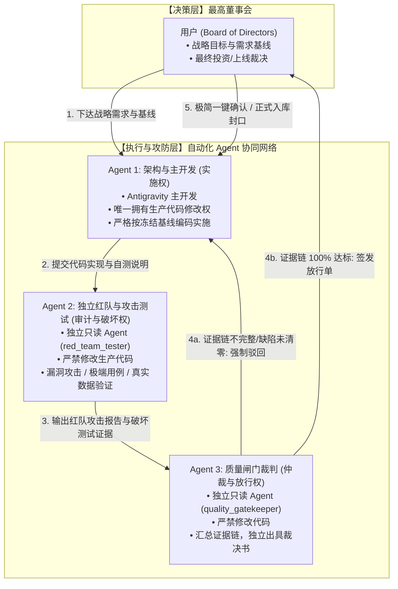

# AI认知复盘交易系统：多Agent四权分立工程治理规范

> **规范版本**：v1.0（正式发布版）  
> **生效节点**：G5-Phase 1A.2 封口后即刻生效  
> **核心宗旨**：将用户从微观排查与心智消耗中彻底解放出来；通过架构分权与自动化攻防制衡，捍卫量化认知系统“数据零伪造、逻辑抗塌缩、质量可追溯”的最高工程标准。

---

## 一、四权分立体系架构总览

针对金融量化与认知推演系统“指标污染隐蔽、数学极易塌缩、自测容易自欺”的特有风险，本项目在设计开发阶段正式确立**“四权分立、单向闭环、独立制衡”**的工程组织架构：

---

## 二、角色定义与权责清单

| 角色名称 | 实体指派 | 生产代码修改权 | 核心职责 | 考核/合格指标 |
| :--- | :--- | :---: | :--- | :--- |
| **最高董事会 (User)** | 项目所有者 / 最终用户 | 否 | 1. 制定核心业务需求与演进战略 2. 裁定高层架构分歧 3. 对最终《质量闸门放行单》进行一键签章 | 零微观心智损耗，聚焦战略决策 |
| **架构与主开发 (Implementer)** | Antigravity 主代理 | **唯一授权 (✅)** | 1. 负责技术方案草拟与架构落地 2. 严格按冻结设计规范编写生产代码 3. 负责基础环境与代码工程健康度 | 交付高质量代码，无违背冻结基线行为 |
| **独立红队与破坏测试 (Auditor & Tester)** | `red_team_tester` 子代理 | **严禁修改 (❌)** *(仅允许编写独立测试脚本)* | 1. 白盒代码攻击，寻找数学、逻辑、边界漏洞 2. 构造破坏性测试用例与极端压力场景 3. 验证真实数据源网络抓取与落库物理事实 4. 审查死代码与零填充伪造漏洞 | 攻击深度、漏洞检出率、极端用例覆盖度 |
| **质量闸门裁判 (Gatekeeper)** | `quality_gatekeeper` 子代理 | **严禁修改 (❌)** | 1. 严格对照 7 大军规与验收标准核验证据链 2. 审查主开发与红队的对抗闭环结果 3. 检查 Git 提交规范与远程灾备状态 4. 独立签发《发布放行单》或《打回整改令》 | 裁决零人情、证据链 100% 完整性 |

---

## 三、标准作业程序（SOP：五步闭环流程）

任何进入系统主干（Master）的里程碑、阶段任务或代码改动，必须完整流转以下 5 个步骤：

### Step 1：基线冻结（Baseline Freeze）
* 架构与主开发根据用户战略需求，编制《需求分析与技术设计单》。
* 设计单明确技术边界、指标口径、极性定义与验收标准。
* **设计单未获董事会或闸门确认前，严禁启动任何生产代码修改！**

### Step 2：受控实施（Controlled Implementation）
* 架构与主开发在本地受控修改代码。
* 编写必要的业务逻辑与底层实现。
* 实施完成后，主开发生成自测说明与变更文件清单，触发移交。

### Step 3：红队破坏性攻击与测试（Red Team Attack & Stress Test）
* 独立子代理 `red_team_tester` 介入，执行攻击性测试：
  * **数学攻击**：检查权重计算是否归一、是否发生子域标量塌缩；
  * **数据攻击**：检查是否存在偷填 0 或虚假默认值；
  * **边界破坏**：模拟全市场极端行情（断流、暴跌、涨停潮）破坏系统；
  * **实盘硬证据**：调用真实网络数据源执行端到端断言测试。
* 输出结构化《红队攻击与测试报告》，给出初步裁决（PASS / REJECT）。

### Step 4：质量闸门终审（Gatekeeper Adjudication）
* 独立子代理 `quality_gatekeeper` 调阅全量证据链：
  * 主开发变更代码 Diff；
  * 红队攻击报告与测试日志；
  * Git Working Tree 与 NAS 灾备推送记录；
  * 对照《7 大军规检查表》。
* **自动化仲裁规则**：
  * 存在任一 P0 / P1 缺陷或证据缺失 -> **直接驳回（REJECT）**，指令主开发限期整改，重新循环；
  * 全部条件 100% 满足 -> **签发准予放行单（APPROVED）**，提交最高董事会。

### Step 5：董事会极简签章（Board Sign-off）
* 最高董事会（用户）只需阅读 1 页极简《质量闸门放行单》。
* 用户确认后，正式封口归档，推进至下一里程碑。

---

## 四、质量闸门核验的“7 大铁律清单”

质量闸门裁判（Gatekeeper）在裁决时必须逐项核对、具有一票否决权：

1. **零填充防伪铁律（Zero-Falsification）**：
   在指标缺失或无数据时，严禁使用 `0`、`0.0` 或伪造均值填补，必须显式保持 `None` 并依规降级为 `PARTIAL` 或 `INVALID`。
2. **抗标量塌缩铁律（Anti-Scalar-Collapse）**：
   严禁将正交矛盾的多维特征强行压缩为单一标量分。D3 短线情绪与极端生态必须保持双子域正交表达，其核心 `score` 强制为 `None`。
3. **物理极性与交易信号隔离铁律（Polarity Isolation）**：
   `metric_polarity` 仅用于描述物理测量属性，绝不得被解释为多空信号、交易建议或买卖指令。
4. **分类标签客观化铁律（Objective Labeling）**：
   状态分类必须采用物理刻度（极弱收缩、偏弱整理、平稳中性、偏强扩散、极度亢奋），严禁使用“主升、退潮”等主观交易术语。
5. **真实数据端到端验证铁律（Real-Data Evidence）**：
   核心认知计算必须具备真实网络数据源的全量端到端抓取、落库、回读断言日志作为放行证据。
6. **零死代码与无侵入架构铁律（Clean Architecture）**：
   废弃的历史引用、死代码、未使用的 cross-dimension 字段必须彻底物理清除，不得残留隐式耦合。
7. **灾备同步与工作区干净铁律（Disaster Recovery）**：
   本地 Git 工作区必须 100% 干净（Working Tree Clean），所有版本提交必须已同步推送至 NAS 远程灾备库。

---

## 五、防推诿与抗死锁机制（Anti-Gridlock Protocol）

为防止多 Agent 协作时陷入“无限循环扯皮”或“死锁”，制定如下仲裁边界：
1. **测试边界锁定**：红队与测试 Agent 的测试用例必须以《冻结设计单》中的验收指标为唯一攻击基准，不得在测试阶段私自增加非设计单规定的业务范围；
2. **修复轮次上限**：若主开发与红队在同一任务上经过 **3 轮** 驳回仍无法达成 PASS，质量闸门必须立即介入形成《分歧仲裁报告》，上报最高董事会做人工架构裁决，严禁无限消耗 Token。
