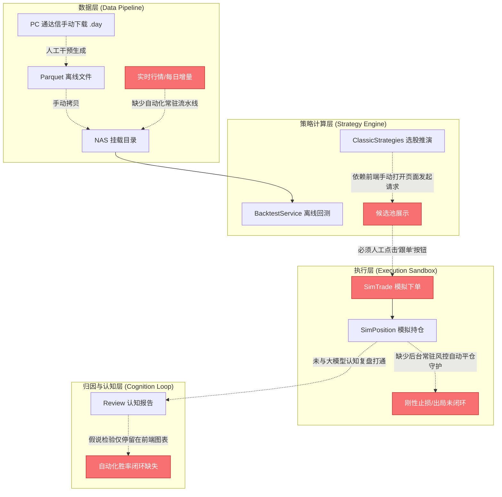
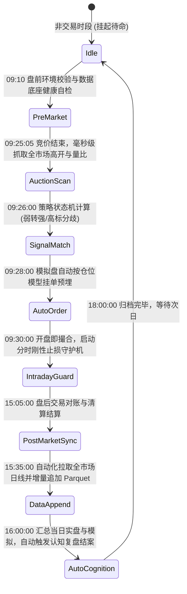

# 《知见》系统：端到端量化闭环工程审计与无人值守架构设计规范

> **文档性质**：工程真实性审计与顶层闭环架构设计  
> **版本**：v1.0-Engineering-Audit  
> **日期**：2026-10-25  
> **基线分支**：`master` (Commit: `ee27f2d`)  
> **核心原则**：不回避债务、不堆砌功能、以无人值守端到端闭环为唯一验收准绳

---

## 目录
1. [现状工程审计：剥离表象与断点清查](#一-现状工程审计剥离表象与断点清查)
2. [全生命周期无人值守架构设计 (Target Architecture)](#二-全生命周期无人值守架构设计)
3. [四大核心子系统闭环规格设计](#三-四大核心子系统闭环规格设计)
4. [《工程验收标准白皮书》(L0 ~ L3 验收测试矩阵)](#四-工程验收标准白皮书l0--l3-验收矩阵)
5. [实施路线图与待决策议题](#五-实施路线图与核心决策议题)

---

## 一、 现状工程审计：剥离表象与断点清查

经过对当前 `backend/`、`frontend/` 及 NAS 部署容器运行时的深度审计，系统目前的真实工程断点如下：



### 1.1 资产盘点现状

| 模块/资产 | 代码位置 | 现状评估 | 真实就绪度 |
| :--- | :--- | :--- | :--- |
| **离线量化回测引擎** | `backend/app/services/backtest_engine.py` | 纯数学向量与状态机，回测单次 6 秒，已就绪 | **90%** (算法就绪，但强依赖本地 Parquet 文件) |
| **三大经典策略实时选股** | `backend/app/services/selection.py` | 具备集合竞价抢筹、连板低吸、龙回头选股逻辑 | **75%** (缺乏竞价自动化定时触发任务) |
| **模拟盘沙盒底座** | `backend/app/services/simulation.py` | 具备账户、持仓、成交模型，支持冻结资金与盈亏结算 | **70%** (接口具备，但无自主撮合自动机) |
| **数据增量流水线** | `backend/app/services/data_fetcher.py` 等 | 依赖 pytdx/baostock，未集成自动追加 Parquet 流水线 | **30%** (严重欠缺盘后自动化增量能力) |
| **风控守护进程** | 无独立守护进程 | 止损逻辑写在回测里，模拟盘无盘中破位自动市价挂单 | **10%** (纯纸面规则，未落地为后台定时器) |
| **Docker 容器交付物** | `Dockerfile`, `docker-compose.yml` | 依赖缺失（曾缺 pyarrow）、国内 ghcr 网络极其脆弱 | **40%** (环境自愈能力低，依赖人工 SSH 排障) |

### 1.2 严重工程断点清单 (Engineering Gaps)

1. **断点一：数据自给断裂（非活水）**
   - 现存回测数据集截止于 `2026-10-22`。当系统进入 `2026-10-23` 及后续交易日时，没有一个常驻守护进程能自动在 15:35 从通达信主站拉取全市场当日 K 线与涨跌停池并完成清洗入库。
2. **断点二：策略信号与模拟沙盒脱节（非自动）**
   - 策略计算需要前端页面挂载才由浏览器触发 API 请求；
   - 信号产生后，必须靠交易员肉眼看界面、手动点“跟单”按钮，模拟盘才有一笔买入。这违背了自动化交易系统“无人值守、冷酷执行”的基本定义。
3. **断点三：持仓风控与出局离场断裂（只管买不管卖）**
   - 模拟持仓没有后台 Tick/分钟级或日终出局监测守护进程。标的即使连跌 3 个跌停，如果不人工去网页点“平仓”，系统不会自动执行波普尔刚性止损。
4. **断点四：复盘归因与认知检验断裂（孤岛化）**
   - `/review` 页面生成的认知研报与 `/simulation` 的模拟持仓处于逻辑隔离状态，未能自动统计“昨日认知假说 ➔ 今日实际交易 ➔ 假说是否被证伪 ➔ 胜率动态反馈”。
5. **断点五：生产镜像交付脆弱性（无自检与自愈）**
   - 镜像启动缺乏健康探针自愈机制。容器起来如果连不上数据库或找不到 Parquet，仅在特定接口调用时抛异常，没有系统级启动自检日志。

---

## 二、 全生命周期无人值守架构设计

为了实现真正意义上的无人值守闭环，系统必须重构成**基于交易日时钟（Trading Clock State Machine）驱动的确定性事件引擎**。

### 2.1 交易日时序状态机驱动模型



### 2.2 核心职责矩阵

| 时间窗口 | 执行模块 | 输入源 | 核心逻辑 | 产出物与副作用 |
| :--- | :--- | :--- | :--- | :--- |
| **09:10~09:20** | `PreMarketValidator` | 数据库、Parquet、网络探针 | 检查 NAS 数据完整度、券商/行情连通性、大盘阶段识别 | 写入系统就绪日志，异常触发告警 |
| **09:25~09:26** | `AuctionIngestionJob` | 通达信原生行情协议 (pytdx) | 全市场 5000 只股票竞价涨幅、成交额、量比秒级抓取 | 写入内存竞价快照表，不读磁盘 |
| **09:26~09:28** | `AutonomousStrategyEngine` | 竞价快照 + 连板池 | 运行弱转强抢筹、连板分歧低吸过滤规则，计算综合分 | 生成确定的 `BuySignal` 信号队列 |
| **09:28~09:30** | `AutonomousExecutor` | `BuySignal` 队列 | 检查账户可用资金、最大持仓上限，计算买入股数 | 写入 `sim_trades` (状态: PENDING) |
| **09:30~15:00** | `PopperRiskGuardian` | 分时行情、五档买卖 | • 9:30 开盘价撮合成交<br>• 日内跌破分时均线 2% 减半仓<br>• 炸板 3 分钟未回封强制平仓<br>• 达到 -5% 刚性止损立即触发市价平仓 | 自动更新 `sim_positions` 并生成对应平仓卖出单 |
| **15:05~15:30** | `SettlementService` | 当日成交流水 | 计算印花税、佣金、滑点，结算持仓浮盈亏与可用资金 | 生成日终净值点，刷新净值曲线 |
| **15:35~15:55** | `IncrementalDataPipeline` | 官方盘后日线 | 下载当日全市场日线、涨停封单、连板高度，追加到 Parquet | 保证底座数据集永不过期 |
| **16:00~16:30** | `CognitiveClosureEngine` | 模拟交割单 + 市场快照 | 结合大盘情绪状态机，调用认知模型结案，比对预测假说 | 生成每日结构化复盘研报与量化胜率卡片 |

---

## 三、 四大核心子系统闭环规格设计

### 3.1 子系统一：增量数据自给流水线 (`IncrementalDataPipeline`)

> **目标**：彻底告别“人工下载通达信数据 ➔ 人工转 Parquet ➔ 人工拷贝到 NAS”的原始方式。

- **工作机制**：
  1. 依托轻量级原生 `pytdx` 直连券商主站，无头无 GUI 运行；
  2. 每日 15:35 触发增量拉取任务；
  3. 仅拉取当日 1 条日线 Bar（5000+ 股票仅耗时约 40~60 秒，流量约 3MB，极轻负担）；
  4. 计算当日首板、连板高度、炸板标记，直接使用 `pyarrow` 追加（Append）至 `a_share_daily_2023_2026.parquet` 与 `zt_ladder_pool_2023_2026.parquet`；
  5. 自动维护数据快照，失败自动重试 3 次，网络熔断时告警并记录断点。

### 3.2 子系统二：无人值守策略计算与撮合引擎 (`AutonomousEngine`)

> **目标**：将当前的“选股建议看板”升级为真正的“自主执行沙盒”。

- **数据流闭环**：
  ```
  [09:25 竞价快照] ──> [大盘五阶段门禁校验] 
                             │ 
                      (非恐慌退潮期)
                             ▼
                   [三大策略算子并行过滤] 
                             │
                      (评分 Top N)
                             ▼
                  [动态仓位风控分配器]
                             │
            (单票 ≤ 20%, 同时持股 ≤ 5 只)
                             ▼
                  [自动写入模拟盘待撮合队列]
  ```
- **撮合约束规范**：
  - **开盘滑点模拟**：买入价为 `开盘价 * (1 + 0.1% 滑点)`；
  - **流动性校验**：若竞价一字涨停开盘（9:25 未开板），则判定为无法排入，自动废弃买入信号，防止虚假高收益；
  - **资金硬约束**：可用现金不足时，严格禁止杠杆超买。

### 3.3 子系统三：波普尔刚性风控守护机 (`PopperRiskGuardian`)

> **目标**：以确定性代码落地波普尔“可证伪性”出局纪律，实现全自动平仓。

- **守护规则树**：
  1. **T+1 刚性保护**：当日买入资产锁定（可用股数 = 0），次日 09:25 解锁为可卖状态；
  2. **次日竞价抢跑规则**：
     - 若次日 09:25 竞价低开超过 `-2.5%`，直接判定逻辑被证伪，09:30 开盘以市价自动全部平仓离场；
  3. **持股周期到期出局**：
     - 策略持股天数达到上限（如弱转强默认 2 天，龙回头默认 3 天），无论盈亏，尾盘 14:55 自动无条件市价平仓；
  4. **刚性止损线守护**：
     - 持仓累计亏损触及 `-5.0%`（可配置），触发风控熔断，自动执行平仓。

### 3.4 子系统四：认知假说自动化检验闭环 (`CognitiveClosureEngine`)

> **目标**：打破研报只是“给人类阅读的文字”，使其成为交易逻辑的自进化结案闭环。

- **闭环链路**：
  - 盘前假设：`Hypothesis(date=T, stage='弱势修复', focus='弱转强反包')`
  - 盘中实际：`Trades(count=2, buy=['002696'], pnl=+4.2%)`
  - 盘后自动对账：计算假设命中率，若今日连板大面积核按钮，大模型自动标注“假说被证伪”，并在系统状态机中将明日市场状态下调至“退潮恐慌”，自动关停明日早盘买入闸门。

---

## 四、 《工程验收标准白皮书》(L0 ~ L3 验收矩阵)

> **原则**：任何功能未通过白纸黑字的测试用例前，一律视为“未就绪”。

| 验收等级 | 验收项目 | 触发方式 | 判定通过标准 (Pass Criteria) |
| :--- | :--- | :--- | :--- |
| **L0: 底座健康验收** | 运行时环境自愈与数据挂载 | 容器启动时自动触发 | 1. 容器启动自检探针退出码为 0。<br>2. Python `pyarrow` 与 `sqlite` 双通。<br>3. `data/historical` 下 3 个 Parquet 文件存在且可被秒级读取。<br>4. 前端与后端网络连通（HTTP 200）。 |
| **L1: 算法单元验收** | 历史回测撮合引擎精度测试 | 执行专用回归测试用例 | 1. 给定 2024-01-01 至 2024-03-31 数据，输出确定性指标。<br>2. 严格核算佣金(万一)、印花税(万五)、滑点(0.1%)。<br>3. 不出现买入跌停板或一字涨停板穿透撮合。<br>4. 执行耗时 $\le 3$ 秒。 |
| **L2: 伪盘穿透验收** | 单交易日时序回放倍速测试 | 后台回放脚本模拟一个真实交易日（例如 2026-10-22） | 1. **09:25**: 竞价快照生成正常。<br>2. **09:26**: 策略自动输出 1~3 只推荐标的。<br>3. **09:30**: 模拟盘无需人工干预自动生成成交单，可用资金扣减正确。<br>4. **14:55**: 满足出局条件的持仓自动触发平仓，盈亏计入账本。<br>5. **15:30**: 日终净值自动刷新。 |
| **L3: 实盘长效验收** | 连续 3 个交易日无人值守实机运行 | 挂载于 NAS fnOS 生产 Docker 环境 | 1. 连续 3 个交易日，**零人工登录、零手动刷新**。<br>2. 每日数据自动增量落库。<br>3. 模拟账户流水与持仓每日自动更新。<br>4. 容器不发生 OOM、进程假死或磁盘溢出。 |

---

## 五、 实施路线图与核心决策议题

### 5.1 实施路线图 (4 步渐进交付)

```
[阶段一: 筑基与自愈探针] (消除环境脆弱性)
  ├─ 1.1 修复 Dockerfile 内置 pyarrow 与底层依赖 (已提交 master)
  ├─ 1.2 编写系统级一键健康体检探针 `doctor.py`
  └─ 1.3 达成 L0 级验收 (NAS 容器自检一键通)

[阶段二: 调度自动机与模拟闭环] (告别人工点'跟单')
  ├─ 2.1 引入后台交易时钟调度服务 (APScheduler Trading Clock)
  ├─ 2.2 串联 09:26 竞价策略计算 ➔ 模拟盘自动撮合建仓
  ├─ 2.3 部署波普尔风控平仓守护机 (出局自动化)
  └─ 2.4 达成 L1 & L2 级验收 (单日回放闭环跑通)

[阶段三: 数据活水自给工程] (告别手工导通达信)
  ├─ 3.1 编写盘后自动化增量日线抓取器 (pytdx 协议直连)
  ├─ 3.2 实现每日 Parquet 动态无损 Append
  └─ 3.3 跑通数据自动日更流水线

[阶段四: 认知研报与全景验收] (达成真正量化工业验收)
  ├─ 4.1 模拟交割账本与大模型认知复盘自动结案打通
  └─ 4.2 达成 L3 级实机连续无人值守验收
```

### 5.2 核心决策议题（需与用户对齐）

> [!IMPORTANT]
> 在正式编写具体业务代码前，请您针对以下 3 个工程方向决策提供指示：

1. **增量数据源选型决策**：
   - **方案 A（首选推荐）**：使用 NAS Docker 内原生集成的 `pytdx` 协议，在每个交易日 15:35 自动直连券商主站拉取全市场日线并追加到 Parquet。（**优势**：纯后台无人值守，完全脱离 PC 客户端；**考量**：需要几秒的网络瞬时连接）。
   - **方案 B**：保留 PC 通达信客户端下载，通过共享文件夹脚本监测，检测到新文件自动同步到 NAS。（**劣势**：依然需要每天人工打开电脑通达信）。
   - *您的倾向？*

2. **模拟盘建仓激进度决策**：
   - **全自动激进模式**：只要 09:26 策略评分达到阈值，后台守护进程直接以开盘价模拟全自动吃进，零人工提示。
   - **双轨缓冲模式**：后台默认自动建仓（满足无人值守），但如果交易员在 09:25~09:29 期间打开了网页，允许交易员一键“一票否决”。
   - *您希望采用哪种执行权限模式？*

3. **第一阶段攻坚入口**：
   - 是否同意按照路线图，**首先攻坚「阶段一：筑基与健康体检探针」**，写出白纸黑字的自检脚本，在 NAS 上一次性把 Python 依赖、Parquet 数据、数据库全部验证通过，打牢地基后再启动自动调度？
