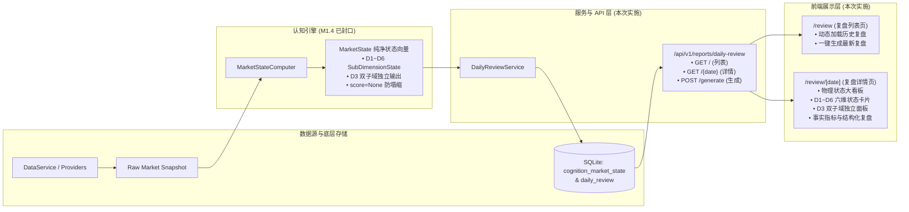

# G5-Phase 1A.3 收盘复盘全链路产品化闭环设计单

> **文件版本**：v1.0（正式发布版）  
> **上位依据**：  
> 1. 《02-G1需求基线（正式冻结版）》M1 每日收盘复盘模块  
> 2. 《04-G3架构与详细设计（正式版）》分层架构与认知层状态机  
> 3. 《08-G5-Phase-1A.2市场状态配置与语义微调设计单》D1~D6纯净状态向量基线  
> 4. 《10-项目多Agent四权分立工程治理规范》SOP流转与质量闸门契约  
> **核心军规**：**本阶段严禁变更数据库 Schema；严禁在前端或服务层向状态向量注入伪造默认值（无数据必须显式为 null / '--'）；D3 必须严格作为双子域在 UI 呈现，绝不允许在前端擅自将其平均为单一综合分；极性元数据必须标注为“客观物理属性”，严禁展示为交易建议。**

---

## 一、阶段目标与定位

在 G5-Phase 1A.2 中，我们已完成了 M1.4 底层市场状态语义校准与状态向量解耦，确立了抗标量塌缩、客观物理分级与零填充防伪等关键数学特性。
**G5-Phase 1A.3 的唯一目标是“产品化全链路闭环”**：
将底层打磨完毕的 M1.4 纯净状态向量（D1~D6 向量、D3 双子域事实、物理刻度标签、极性元数据），无损传递并交付至收盘复盘服务层与终端前端页面，形成一个**真实数据驱动、认知深度可见、开箱即用**的生产级复盘产品。

---

## 二、架构设计与数据流契约



### 1. 后端 API 接口契约补全
在 `backend/app/api/v1/reports.py` 与 `daily_review.py` 中补充以下端点与能力：
* **`GET /api/v1/reports/daily-review`（新增列表端点）**：
  * **参数**：`limit: int = 30`, `offset: int = 0`
  * **响应**：
    ```json
    {
      "code": 200,
      "data": {
        "items": [
          {
            "date": "2026-09-24",
            "state_label": "平稳中性",
            "data_quality": "partial",
            "composite_score": null,
            "generated_at": "2026-09-24T15:30:00"
          }
        ],
        "total": 1
      }
    }
    ```
* **`GET /api/v1/reports/daily-review/{date}`（增强详情契约）**：
  * 返回完整的 `market_overview`, `limit_up_analysis`, `market_state`（包含 D1~D6 的 `sub_domains`, `metric_polarity`, `semantics_desc`, `reference_score`）, `report_content`, `data_quality`。
* **`POST /api/v1/reports/daily-review/generate`（已有，增强幂等性与错误处理）**：
  * 支持可选参数 `date: Optional[str]`。

### 2. 前后端数据契约对齐（TypeScript Types）
在 `frontend/src/types/report.ts` 中彻底重构旧的 mock 接口，使其严格契合后端生产输出：
* `IndicatorDetail`: 指标名称、物理值、标准化得分、权重、子域归属、显示名称。
* `SubDomainState`: 子域标识、名称、独立得分、质量、指标明细。
* `DimensionState`: 维度标识、名称、核心得分（D3 为 null）、参考分、物理状态标签、极性元数据、语义说明、双子域字典 `sub_domains`。
* `MarketStateVector`: 综合得分、全局物理标签、全局质量、缺失指标列表、6 维字典 `dimensions`。
* `DailyReviewDetail`: 完整的复盘响应对象模型。

---

## 三、前端产品化交互与视觉规范

### 1. 列表页（`/review`）
* **动态数据绑定**：移除原有写死的 3 条 mock 数据，在组件挂载时调用 `api.getDailyReviews()`。
* **空状态与首屏一键生成**：若当前无复盘记录，提示“暂无复盘数据”，并提供突出的“立即生成最新复盘”按钮。
* **卡片元数据**：展示复盘日期、物理状态标签徽章（如“偏弱整理”、“平稳中性”）、数据质量状态徽标（Full 绿 / Partial 黄 / Invalid 红）。

### 2. 详情页（`/review/[date]`）
* **大标题与全局体检区**：
  * 显示复盘日期与生成时间。
  * **全局物理状态徽章**：采用大字客观物理标签（如“平稳中性 / 极度亢奋”）。
  * **数据质量警示条**：若质量为 `partial`，黄色提示条列出具体缺失项；若为 `invalid`，红色警示并明确说明“数据不满足全网有效性，综合分已依法置空，严禁作为推演依据”。
* **Section 1：核心状态向量看板（State Vector Dashboard，最核心区域）**：
  * **6 大维度卡片网格（Grid 布局）**：
    * **D1 市场整体（Market Aggregate）**：四大指数涨跌幅贡献与得分。
    * **D2 纯粹广度（Market Breadth）**：仅展示上涨、下跌、涨跌家数比，彻底不含涨跌停事实。
    * **D3 短线情绪与极端生态（Short-term Speculation & Extremes）—— 特别展示**：
      * 顶部醒目标注：“双子域独立正交表达 · 核心综合分：无（正交防塌缩）”
      * 拆分为左右两栏独立展示：
        * **子域 A：投机高标结构事实**（连板最高高度、连板晋级率，带独立得分与质量）
        * **子域 B：尾部极端博弈事实**（涨停家数、跌停家数、涨跌停差、真实炸板率，带独立得分与质量）
      * 底部折叠/展开“诊断参考分（Reference Score）”，并明确标注“仅供历史回溯参考，未参与任何加权”。
    * **D4 风格偏好（Style Preference）**：微盘股超额与风格代理表现。
    * **D5 外部环境（External Environment）**：富时 A50 变动。
    * **D6 流动性活跃度（Liquidity Activity）**：全市场成交额与量能变化率，客观反映活跃度。
  * **极性提示浮窗（Tooltip）**：每个卡片标题旁提供极性元数据小图标，悬浮提示其客观物理含义，并固定附带系统警告：“注意：此极性仅代表指标物理测量方向，绝非多空买卖信号”。
* **Section 2：大盘与指数全景**：四大核心指数（上证、深成、创业板、科创50）行情卡片。
* **Section 3：涨停与极端生态明细**：涨停梯队、炸板率、跌停家数事实表格/指标组。
* **Section 4：客观结构化复盘摘要**：基于各维度客观事实生成的结构化文字总结，严格杜绝主观玄学黑话。

---

## 四、铁律合规性自查表（对齐 10-工程治理规范）

| 军规条目 | 本阶段落地约束 | 闸门验收断言 |
| :--- | :--- | :--- |
| **1. 零填充防伪** | 接口与前端遇到缺失指标严禁填 0，必须渲染为 `--` 或 `null` | 前端组件包含 null-safe 守卫，无任何 `?? 0` 伪造 |
| **2. 抗标量塌缩** | D3 在 UI 上必须呈现双子域独立卡片，绝不允许计算或显示 D3 单一核心分 | 检查 D3 标题区明确标注 `core_score: null`，Sub-A/Sub-B 独立得分 |
| **3. 极性元数据隔离** | 前端卡片极性文案必须注明“客观物理属性，非买卖信号” | UI 上展示 Tooltip 或文字标明该免责语义 |
| **4. 分类标签客观化** | 前端完全淘汰“主升/退潮”等主观词汇，统一渲染物理客观标签 | 页面文本仅出现“极弱收缩/偏弱整理/平稳中性/偏强扩散/极度亢奋” |
| **5. 真实数据验证** | 全量端到端验证覆盖 API 生成与页面数据消费 | 编写自动化测试跑通 API 请求并断言返回字段的完整性 |
| **6. 架构整洁无死代码** | 彻底淘汰旧的前端 mock 假数据与废弃接口定义 | 前端无旧 mock 残留，TypeScript 编译 0 报错 |
| **7. 灾备同步** | 代码提交规范且工作区干净，灾备同步 NAS | Git Commit 遵照 Conventional Commits 并推送远程 |

---

## 五、验收标准与 SOP 流程

1. **Step 1：设计单冻结**（当前节点）：完成本设计单，提交用户审批。
2. **Step 2：受控实施**：
   - 后端：补充 `GET /reports/daily-review` 列表端点，丰富 `daily_review.py` 的结构化状态封装；
   - 前端：更新 `report.ts` 契约，更新 `api.ts`，重构 `/review` 列表页与 `/review/[date]` 详情页；
   - 构建测试：Next.js 构建通过（`npm run build`），后端 API 测试通过。
3. **Step 3：红队破坏性测试**：
   - 移交 `red_team_tester` 子代理，检查 D3 前端是否发生偷偷合并、是否填 0 伪造、缺失指标是否导致前端崩溃。
4. **Step 4：质量闸门终审**：
   - 移交 `quality_gatekeeper` 子代理，逐项比对 7 大铁律清单，出具裁决书。
5. **Step 5：董事会一键签章**：
   - 呈报用户最终放行单，入库归档。
