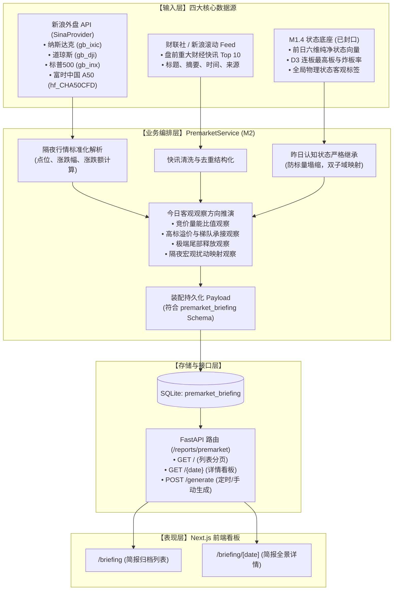

# G5-Phase 1B M2 盘前简报系统技术设计单

> **文件版本**：v1.0（实施前设计审查稿）  
> **上位依据**：  
> 1. [《02-G1需求基线（正式冻结版）》](file:///d:/项目库/AI认知复盘交易系统/开发文档/02-G1需求基线（正式冻结版）.md) M2.1～M2.5 盘前简报需求  
> 2. [《04-G3架构与详细设计（正式版）》](file:///d:/项目库/AI认知复盘交易系统/开发文档/04-G3架构与详细设计（正式版）.md) 分层架构与报表服务设计  
> 3. [《10-项目多Agent四权分立工程治理规范.md》](file:///d:/项目库/AI认知复盘交易系统/开发文档/10-项目多Agent四权分立工程治理规范.md)  
> 4. [《12-G5-Phase-1A.3封口与边界冻结决议.md》](file:///d:/项目库/AI认知复盘交易系统/开发文档/12-G5-Phase-1A.3封口与边界冻结决议.md) 8项核心冻结边界  
> **核心军规**：**本设计单严格遵循“先设计、后实施”铁律。在获得最高董事会正式批准前：严禁修改任何生产代码、严禁变更数据库 Schema、严禁向状态向量注入未授权改动。**

---

## 一、系统定位与业务场景

### 1. 业务定位
* **服务场景**：每个交易日早盘开盘前（推荐 **08:00**），系统自动执行数据抓取与认知编排，生成结构化的当日《盘前简报（Premarket Briefing）》。
* **目标用户**：系统交易 Owner。
* **业务价值**：在集合竞价（09:15）开始前 1 小时，帮助 Owner 快速获取隔夜宏观外盘冲击、重大资讯事件，并无缝继承昨日已封口的 M1.4 六维纯净状态事实，建立理性、客观的盘前观察维度，坚决拒绝任何追涨杀跌的主观情绪化冲动。

### 2. 核心架构约束与铁律继承
1. **直接消费 M1 纯净状态向量**：
   - 盘前简报直接消费前一交易日已封口归档的 `CognitionMarketState` 与 `DailyReview` 记录；
   - 严禁在 M2 服务中重新计算或篡改昨日市场状态；
   - 坚决杜绝标量塌缩：昨日 D3 情绪状态在简报中必须继续以双子域（投机连板空间 + 极端尾部博弈事实）独立表达，其核心综合分保持为 `None`。
2. **零填充防伪铁律（Zero-Falsification）**：
   - 隔夜美股指数、A50 期货若因网络故障或非开市日发生数据缺失，必须显式保持为 `None` / `'--'`，严禁使用 `|| 0` 或默认均值假冒平盘。
3. **极性与交易信号严格隔离**：
   - 今日关注要点推演仅限于客观“观察维度提示（如观察竞价量能放量比、观察高标溢价表现、观察跌停修复力度）”，**严禁输出任何买卖操作建议、开平仓指令或主观预测性结论**。
4. **数据库 Schema 零变更**：
   - 严格在既有的 `premarket_briefing` 数据表结构下通过 JSON 序列化存储，不进行任何数据库表结构迁移。

---

## 二、四大核心输入源与数据流架构



### 1. 隔夜外盘解析增强（SinaProvider 规范升级）
* **纳斯达克 (`gb_ixic`)**：解析最新价 (`parts[1]`)、涨跌幅 (`parts[2]`)、涨跌额 (`parts[4]`)、行情时间 (`parts[3]`)。
* **道琼斯 (`gb_dji`)**：同上。
* **标普500 (`gb_inx`)**：同上。
* **富时中国 A50 期货 (`hf_CHA50CFD`)**：
  * 最新价：`parts[0]`
  * 昨收结算价：`parts[7]`
  * 涨跌幅计算：`pct_change = (latest - pre_close) / pre_close * 100`（精确到保留 2 位小数）
  * 行情时间：`parts[12] + " " + parts[6]`
* **恒生指数 (`int_hangseng`)**：备用亚太参考。
* **防御性断言**：解析时强制执行 `float()` 校验，异常时返回 `None`，严禁抛出未捕获异常。

### 2. 财经快讯摘要（News Digest 规范）
* **抓取目标**：提取盘前最新 **10 条** 重大财经资讯。
* **清洗规范**：
  * 字段标准化：`title`（标题）、`brief`（内容提要）、`publish_time`（发布时间）、`source`（数据源标识 `cls` 或 `sina`）；
  * 标题缺省补全：若标题为空，安全截取 `content` 前 35 字符加省略号；
  * 空安全防御：杜绝空记录混入。

### 3. 昨日复盘回顾（Yesterday Review Summary 规范）
* **提取逻辑**：
  * 查询条件：`DailyReview.date < today`，按 `date.desc()` 倒序 limit 1；
  * 提取数据项：
    - 日期：`prev_date`
    - 全局物理状态标签：`state_label`（如“平稳中性 / 偏弱整理”）
    - D1 市场整体涨跌概况与 D6 两市总成交额
    - D2 纯粹广度事实：上涨家数、下跌家数、涨跌家数比
    - D3 双子域事实：连板最高高度（Sub-A）、真实炸板率（Sub-B）、涨跌停净差（Sub-B）
    - 铁律约束：严禁对 D3 擅自求均值，核心综合分显式标明为 `None`。

### 4. 今日重点关注方向推演（Today Focus Deduction 规范）
依据量化认知的客观映射原则，输出 4 个标准维度的结构化观察要点：
1. **集合竞价量能观察点（Liquidity Opening Observation）**：
   - 逻辑：结合昨日成交额与量能变化率，提示今日 09:25 核心指数开盘成交金额的承接阈值，判断市场交投是缩量观望还是放量博弈。
2. **短线高标溢价观察点（Speculative Premium Observation）**：
   - 逻辑：根据昨日连板最高板（`max_board_height`）及核心连板股，提示开盘是延续高溢价冲高，还是高开低走出现分歧。
3. **极端尾部风险释放观察点（Tail Risk Observation）**：
   - 逻辑：根据昨日跌停家数（`limit_down_count`）与真实炸板率（`broken_limit_ratio`），提示开盘跌停板封单是否有资金撬板，极端情绪是否迎来物理修复。
4. **隔夜宏观扰动映射观察点（Macro Disturbance Observation）**：
   - 逻辑：结合 A50 隔夜涨跌幅及美股科技股（纳斯达克）涨跌，提示早盘指数开盘方向与权重受扰动情况。
* **声明约束**：所有推演条目顶部与底部必须包含免责声明：“仅供盘前客观观察维度提示，不构成任何交易买卖信号”。

---

## 三、数据模型与存储契约（保持 DB Schema 零改动）

完全复用已有的 `PremarketBriefing` 表结构：

```python
class PremarketBriefing(Base):
    __tablename__ = "premarket_briefing"

    id = Column(Integer, primary_key=True, autoincrement=True)
    date = Column(String, nullable=False, unique=True, index=True)
    overnight_summary = Column(Text)        # 结构化存储外盘列表 JSON
    news_digest = Column(Text)              # 结构化存储快讯列表 JSON
    yesterday_review_summary = Column(Text) # 结构化存储昨日六维状态与关键事实快照 JSON
    today_focus = Column(Text)              # 结构化存储 4 维观察方向推演 JSON
    generated_at = Column(DateTime, server_default=func.now())
```

### JSON 存储格式规范：
1. **`overnight_summary`**:
   ```json
   [
     { "code": "ixic", "name": "纳斯达克", "price": 26936.04, "pct_change": -1.13, "change_val": -308.24, "time": "2026-09-24 05:30:00" },
     { "code": "dji", "name": "道琼斯", "price": 51511.59, "pct_change": -0.68, "change_val": -352.10, "time": "2026-09-24 04:36:43" },
     { "code": "inx", "name": "标普500", "price": 7706.03, "pct_change": -0.75, "change_val": -58.61, "time": "2026-09-24 04:36:43" },
     { "code": "CHA50CFD", "name": "富时中国A50期货", "price": 14435.70, "pct_change": -0.68, "change_val": -98.30, "time": "2026-09-24 10:39:10" }
   ]
   ```
2. **`news_digest`**:
   ```json
   [
     { "title": "重大资讯标题...", "brief": "摘要内容...", "publish_time": "1727140000", "source": "cls" }
   ]
   ```
3. **`yesterday_review_summary`**:
   ```json
   {
     "date": "2026-09-23",
     "state_label": "平稳中性",
     "total_amount_wan": 1990878.0,
     "breadth": { "up_count": 2800, "down_count": 2100, "ratio": 1.33 },
     "sub_a_structure": { "max_board_height": 4, "promotion_rate": 0.33 },
     "sub_b_extremes": { "limit_up_count": 51, "limit_down_count": 13, "broken_limit_ratio": 0.3377 },
     "composite_score": null
   }
   ```
4. **`today_focus`**:
   ```json
   [
     { "dimension": "竞价量能", "focus_title": "开盘两市量能承接", "detail": "观察 09:25 开盘成交额比值...", "observation_metric": "开盘成交比" },
     { "dimension": "高标溢价", "focus_title": "昨日 4 板高标溢价持续性", "detail": "重点关注最高空间标的开盘溢价与封单量...", "observation_metric": "高标开盘溢价" },
     { "dimension": "尾部极端", "focus_title": "炸板与跌停释放修复", "detail": "昨日炸板率较高，观察早盘跌停撬板意愿...", "observation_metric": "跌停撬板家数" },
     { "dimension": "外盘扰动", "focus_title": "纳斯达克与 A50 承压映射", "detail": "隔夜美股科技股回调，关注早盘科技权重低开承接力...", "observation_metric": "科技指数低开承接" }
   ]
   ```

---

## 四、服务层与 API 接口契约设计

### 1. 新增与增强 API 端点（`backend/app/api/v1/reports.py`）

* **端点 1：`GET /api/v1/reports/premarket`（历史简报列表分页）**
  * **入参**：`limit: int = 30`, `offset: int = 0`
  * **返回结构**：
    ```json
    {
      "code": 200,
      "data": {
        "items": [
          {
            "id": 1,
            "date": "2026-09-24",
            "overnight_summary": [...],
            "yesterday_state_label": "平稳中性",
            "generated_at": "2026-09-24T08:00:00"
          }
        ],
        "total": 1
      }
    }
    ```
* **端点 2：`GET /api/v1/reports/premarket/{date}`（获取指定日期简报全景）**
  * **入参**：`date: str`
  * **返回结构**：
    ```json
    {
      "code": 200,
      "data": {
        "id": 1,
        "date": "2026-09-24",
        "overnight_summary": [...],
        "news_digest": [...],
        "yesterday_review_summary": { ... },
        "today_focus": [...],
        "generated_at": "2026-09-24T08:00:00"
      }
    }
    ```
* **端点 3：`POST /api/v1/reports/premarket/generate`（生成指定/今日简报）**
  * **入参**：`date: Optional[str] = None`
  * **返回结构**：`{"code": 200, "message": "Premarket briefing generated successfully", "date": "2026-09-24"}`

---

## 五、前端产品化交互与视觉规范

### 1. 契约模型重构（`frontend/src/types/report.ts`）
淘汰原有简单的占位接口，全面升级为生产级强类型契约：
* `OvernightIndexItem`: 代码、名称、价格、涨跌幅、涨跌额、更新时间。
* `NewsDigestItem`: 标题、提要、发布时间、来源标识。
* `YesterdayReviewSnapshot`: 继承的昨日日期、物理状态标签、纯广度指标、D3 双子域事实。
* `TodayFocusItem`: 观察维度标签、标题、分析逻辑、指标观察点。
* `PremarketBriefingDetail`: 完整简报详情响应。
* `PremarketBriefingSummaryItem`: 简报归档列表项。

### 2. 列表页（`frontend/src/app/briefing/page.tsx`）
* **动态数据绑定**：移除原有写死的 2023 年 mock 数据，在组件挂载时调用 `api.getPremarketBriefings()`。
* **首屏空状态与一键生成**：若当前无简报记录，显示清晰空状态并提供“一键生成今日盘前简报”按钮（带加载动画）。
* **卡片元数据**：展示日期、外盘涨跌概括徽章、前日物理状态标签、生成时间。

### 3. 详情看板（`frontend/src/app/briefing/[date]/page.tsx`）
* **顶部导航与标题区**：日期、返回列表按钮、生成时间戳。
* **Section 1：隔夜全球市场全景（Overnight Global Markets）**：
  * 美股道指、纳指、标普500，富时中国 A50 期货，恒生指数 4～5 块网格卡片。
  * 真实点位、涨跌幅红绿色块（涨红/跌绿）、更新时间。
  * **严格空安全**：无数据显式为 `'--'`，严禁使用 `|| 0` 假冒平盘。
* **Section 2：昨日收盘认知底座继承（Yesterday Review Inheritance）**：
  * 醒目展示昨日客观物理状态徽章（如【平稳中性】），两市成交额。
  * D2 纯粹广度展示（上涨/下跌/涨跌比）。
  * **D3 双子域正交展现**：连板最高高度（Sub-A）、真实炸板率与涨跌停数（Sub-B），明确注明“状态继承自 M1.4，杜绝标量塌缩”。
* **Section 3：盘前财经要闻 Top 10（News Digest）**：
  * 结构化时间轴/卡片列表展示财联社/新浪快讯要闻，带发布时间与来源标签。
* **Section 4：今日核心观察方向推演（Today Objective Focus）**：
  * 4 大观察要点卡片：竞价量能比值、高标溢价表现、尾部极端修复、外盘宏观扰动映射。
  * **醒目系统认知免责文案**：“系统准则：本推演仅为盘前客观观察维度提示，不构成任何投资交易信号或买卖建议”。

---

## 六、工程军规对齐核验表（对照 10-工程治理规范）

| 军规条目 | M2 盘前简报落地约束 | 验证断言方式 |
| :--- | :--- | :--- |
| **1. 零填充防伪铁律** | 外盘指数、快讯、前日数据缺失时显式为 `None` / `'--'`，严禁使用 `|| 0` 伪造平盘假象 | 前端 null-safe 断言，后端断流测试保持 null |
| **2. 抗标量塌缩铁律** | 对昨日复盘回顾的消费必须保持 D3 双子域正交表达，禁止擅自压缩为单一分数 | 断言简报输出中 D3 核心得分坚决为 None |
| **3. 物理极性与交易信号隔离** | 今日关注方向推演严格限定为“客观观察维度”，严禁包含买入/卖出/建仓等非法词汇 | 文本关键词黑名单扫描（严禁“建议买入/全仓做多”） |
| **4. 分类标签客观化** | 继承昨日复盘标签，采用客观物理标签，彻底消除“主升/退潮”玄学黑话 | 文本与标签断言仅限物理刻度 |
| **5. 真实数据验证** | 外盘行情与快讯具备真实网络接口抓取与回读断言日志 | 编写真实网络抓取集成测试并断言字段完整性 |
| **6. 架构整洁无死代码** | 彻底清除前端旧 mock 假数据；数据库 Schema 保持零改动 | Next.js 构建 0 报错，SQLite 无 Schema 迁移 |
| **7. 四权分立受控实施** | 严格执行五步流转 SOP，先设计、后实施，必须经红队攻击与质量闸门裁判放行 | 必须具备红队 PASS 与闸门 APPROVED 裁决书 |

---

## 七、实施计划与 SOP 流转路径

1. **Step 1：设计单冻结（当前节点）**：
   - 编制本技术设计单，呈报最高董事会（用户）审查批准。
2. **Step 2：受控实施（待董事会授权启动）**：
   - 后端：优化 `SinaProvider.get_overnight_data` 返回标准浮点数与涨跌幅；重构 `PremarketService`，完成 M1 状态继承与 4 维观察推演；补齐 `reports.py` 列表与详情接口；
   - 前端：升级 `report.ts` 强类型契约，更新 `api.ts`，重构 `/briefing` 列表页与 `/briefing/[date]` 详情看板；
   - 自动化构建与单测跑通。
3. **Step 3：独立红队破坏性攻击与测试**：
   - 移交 `red_team_tester` 审查外盘零填充防伪、昨日状态防塌缩继承、推演文案无信号违规、空数据健壮性。
4. **Step 4：质量发布闸门终审**：
   - 移交 `quality_gatekeeper` 逐项对照 7 大铁律清单与设计单进行独立穿透核验，出具裁决书。
5. **Step 5：最高董事会极简签章**：
   - 呈报用户一键确认封口。
