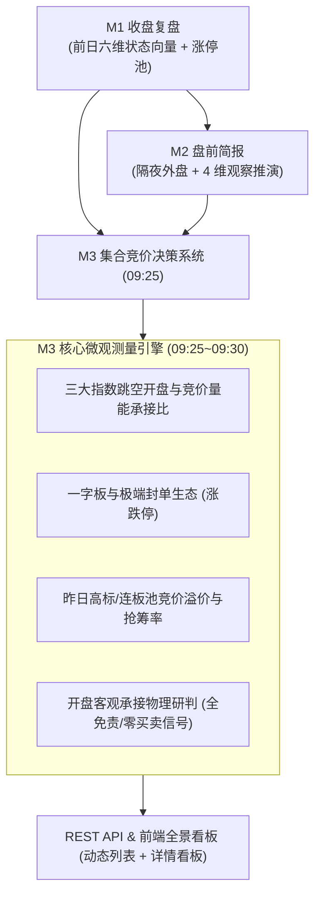

# G5-Phase 1C：M3 集合竞价决策系统技术设计单 (v1.0)

> **设计单编号**：DESIGN-G5-PHASE-1C-M3-01  
> **编制日期**：2026-09-24  
> **编制机构**：Antigravity 主开发团队  
> **上位依据**：  
> 1. [《开发文档/10-项目多Agent四权分立工程治理规范.md》](file:///d:/项目库/AI认知复盘交易系统/开发文档/10-项目多Agent四权分立工程治理规范.md)  
> 2. [《开发文档/12-G5-Phase-1A.3封口与边界冻结决议.md》](file:///d:/项目库/AI认知复盘交易系统/开发文档/12-G5-Phase-1A.3封口与边界冻结决议.md)（8项核心边界冻结）  
> 3. [《开发文档/14-G5-Phase-1B封口与边界冻结决议.md》](file:///d:/项目库/AI认知复盘交易系统/开发文档/14-G5-Phase-1B封口与边界冻结决议.md)（8项核心边界冻结）  
> 4. 原则：“先设计、后实施；治理结构不动，执行颗粒度提升”  

---

## 一、系统定位与业务场景

### 1.1 业务时序与承接闭环
集合竞价决策系统（M3, Call Auction Decision System）是交易系统在每个交易日 **09:25 ~ 09:30** 关键微观决策窗口的客观测量引擎：
- **前置依赖（M1 + M2 承接）**：
  - 继承 M1（昨日收盘状态向量）：前日全市场总成交额、最高空间板、连板晋级率、跌停家数、真实炸板率；
  - 核验 M2（盘前简报 4 维推演）：验证“竞价量能比值、高标溢价、尾部释放修复、外盘映射”在 09:25 的实际兑现度。
- **后置输出（Phase 2 盘中监控底座）**：
  - 输出 09:25 集合竞价全市场开盘多空承接物理事实、指数跳空幅度和高标竞价溢价生态，为开盘后 09:30~10:00 的早盘异动监控提供物理基准。



---

## 二、架构设计与契约约束（零 Schema 变更原则）

### 2.1 数据库持久化（零 Schema 变更）
系统严格复用 SQLite 中已存在的 `auction_report` 表结构，严禁破坏性迁移：

```python
class AuctionReport(Base):
    """竞价观察报告 (复用已有模型)"""
    __tablename__ = "auction_report"

    id = Column(Integer, primary_key=True, autoincrement=True)
    date = Column(String, nullable=False, unique=True, index=True)
    index_open_data = Column(Text)          # 指数开盘数据 JSON (包含上证/深证/创业板/科创/北证及量能承接比)
    one_word_count = Column(Integer, default=0) # 一字涨跌停统计 (含一字涨停家数)
    high_open_stats = Column(Text)          # 高开与生态统计 JSON (高标溢价、高开率、极端核按钮等)
    emotion_judgment = Column(String)       # 开盘客观承接物理研判 JSON 或 标签描述
    generated_at = Column(DateTime, server_default=func.now())
```

### 2.2 数据采集与指标清洗规范
1. **三大指数与宽基指数开盘快照 (`index_open_data`)**：
   - 采集标的：上证指数 (`s_sh000001`)、深证成指 (`s_sz399001`)、创业板指 (`s_sz399006`)、科创50 (`s_sh000688`)、北证50 (`s_bj899050`)；
   - 提取字段：开盘点位 (`price`)、开盘涨跌幅 (`pct_change`)、开盘涨跌额 (`change`)、竞价成交额 (`amount_wan`)；
   - **竞价量能比值 (`bidding_volume_ratio`)**：
     $$\text{两市竞价总金额} = \text{上证竞价金额} + \text{深证竞价金额} \quad (\text{亿元})$$
     $$\text{竞价量能承接比} = \frac{\text{两市竞价总金额}}{\text{前日两市全天总成交额}} \times 100\%$$
     - 若承接比 $\ge 1.5\%$：表征“竞价活跃放量承接”；
     - 若 $1.0\% \le \text{比值} < 1.5\%$：表征“竞价平量承接”；
     - 若 $\text{比值} < 1.0\%$：表征“竞价缩量观望”。
2. **昨日高标/连板梯队竞价溢价 (`high_open_stats`)**：
   - 数据源：继承前日 M1 复盘中的 `limit_up_analysis.pool`（昨日涨停/连板个股列表）；
   - 通过 `sina.get_stock_quotes` 批量查询 09:25 开盘快照：
     - 开盘价格 $P_{open}$（`parts[1]`）、昨日收盘价 $P_{prev}$（`parts[2]`）；
     - 开盘涨跌幅 $\text{open\_pct} = \frac{P_{open} - P_{prev}}{P_{prev}} \times 100\%$；
     - 最高空间板开盘溢价：昨日最高空间连板股的开盘涨幅与封单特征；
     - 高标平均溢价率：样本池标的竞价涨幅均值；
     - 高开比例：开盘涨幅 $> 0\%$ 的标的占比；
     - 抢筹与核按钮标的：高开 $> 4\%$ 或低开 $< -4\%$ 的极端异动标的列表。
3. **一字板与极端封单统计 (`one_word_count`, `high_open_stats`)**：
   - 一字涨停判定：$P_{open} = High = Low$ 且 $\text{open\_pct} \ge 9.8\%$（主板）或 $\ge 19.8\%$（创业板/科创板）；
   - 一字跌停判定：$P_{open} = High = Low$ 且 $\text{open\_pct} \le -9.8\%$（主板）或 $\le -19.8\%$（创业板/科创板）；
   - 真实炸板个股修复情况：核验前日炸板个股早盘有无低开低走或弱转强修复。
4. **开盘多空承接客观研判 (`emotion_judgment`)**：
   - 综合指数跳空度、竞价成交量比、高标平均溢价与极端一字板数量，映射为客观物理承接状态：
     - 【放量高开偏强承接】
     - 【平开中性震荡分化】
     - 【缩量低开承接偏弱】
     - 【极端低开流动性释放】
   - 严禁产生任何主观买卖指令，输出 100~200 字客观事实综述，并在界面醒目标注免责声明。

---

## 三、前后端数据契约定义

### 3.1 后端 REST API 契约补全
在 `backend/app/api/v1/reports.py` 中新增/强化以下端点：

1. **`GET /api/v1/reports/auction`（归档列表）**：
   - 入参：`limit: int = 30, offset: int = 0`
   - 返回：
     ```json
     {
       "code": 200,
       "data": {
         "items": [
           {
             "id": 1,
             "date": "2026-09-24",
             "emotion_judgment": "平开中性震荡分化",
             "bidding_amount_yi": 85.6,
             "bidding_ratio": 1.15,
             "one_word_up_count": 3,
             "one_word_down_count": 0,
             "generated_at": "2026-09-24T09:25:30"
           }
         ],
         "total": 1
       }
     }
     ```
2. **`GET /api/v1/reports/auction/{date}`（全景详情）**：
   - 返回结构化反序列化的完整对象：
     ```json
     {
       "code": 200,
       "data": {
         "id": 1,
         "date": "2026-09-24",
         "index_open_data": {
           "indices": [
             { "code": "000001", "name": "上证指数", "price": 3120.5, "change": 2.3, "pct_change": 0.07, "amount_wan": 450000 },
             { "code": "399001", "name": "深证成指", "price": 10500.2, "change": -10.5, "pct_change": -0.10, "amount_wan": 520000 },
             { "code": "399006", "name": "创业板指", "price": 2150.8, "change": -3.2, "pct_change": -0.15, "amount_wan": 210000 }
           ],
           "total_bidding_amount_yi": 97.0,
           "yesterday_total_amount_yi": 8500.0,
           "bidding_volume_ratio": 1.14
         },
         "one_word_count": 3,
         "high_open_stats": {
           "one_word_up_count": 3,
           "one_word_down_count": 0,
           "tested_count": 12,
           "high_open_count": 8,
           "low_open_count": 4,
           "high_open_ratio": 66.7,
           "avg_premium_pct": 2.45,
           "max_board_info": {
             "symbol": "600XXX",
             "name": "某高标",
             "board_height": 5,
             "open_pct": 5.2,
             "is_one_word": false
           },
           "extreme_stocks": [
             { "symbol": "000XXX", "name": "抢筹股A", "open_pct": 9.9, "tag": "竞价顶板抢筹" },
             { "symbol": "600YYY", "name": "分歧股B", "open_pct": -4.5, "tag": "大幅低开分歧" }
           ]
         },
         "emotion_judgment": {
           "label": "平开中性震荡分化",
           "narrative": "今日早盘两市竞价总金额约 97 亿元，占前日全天成交额比值为 1.14%，竞价交投意愿处于中性平稳区间。昨日 5 板最高空间标的高开 5.2% 保持承接，昨日涨停梯队平均溢价 2.45%，高开率 66.7%。一字涨停 3 家，无一字跌停核按钮，尾部极端情绪维持收敛，开盘整体呈现平开震荡分化格局。",
           "disclaimer": "客观观察维度提示，非买卖建议"
         },
         "generated_at": "2026-09-24T09:25:30"
       }
     }
     ```
3. **`POST /api/v1/reports/auction/generate`（一键生成）**：
   - 触发 09:25 实时或指定日期的竞价报告生成与落库。

### 3.2 前端 TypeScript 强类型契约 (`frontend/src/types/report.ts`)
```typescript
export interface IndexOpenItem {
  code: string;
  name: string;
  price: number | null;
  change: number | null;
  pct_change: number | null;
  amount_wan: number | null;
}

export interface IndexOpenOverview {
  indices: IndexOpenItem[];
  total_bidding_amount_yi: number | null;
  yesterday_total_amount_yi: number | null;
  bidding_volume_ratio: number | null;
}

export interface HighTierAuctionStock {
  symbol: string;
  name: string;
  board_height?: number | null;
  open_pct: number | null;
  is_one_word?: boolean;
  tag?: string;
}

export interface AuctionHighOpenStats {
  one_word_up_count: number;
  one_word_down_count: number;
  tested_count: number;
  high_open_count: number;
  low_open_count: number;
  high_open_ratio: number | null;
  avg_premium_pct: number | null;
  max_board_info?: HighTierAuctionStock | null;
  extreme_stocks?: HighTierAuctionStock[];
}

export interface AuctionEmotionJudgment {
  label: string;
  narrative: string;
  disclaimer: string;
}

export interface AuctionReportDetail {
  id?: number;
  date: string;
  index_open_data: IndexOpenOverview;
  one_word_count: number;
  high_open_stats: AuctionHighOpenStats;
  emotion_judgment: AuctionEmotionJudgment;
  generated_at?: string | null;
}

export interface AuctionReportSummaryItem {
  id: number;
  date: string;
  emotion_label: string;
  bidding_amount_yi: number | null;
  bidding_ratio: number | null;
  one_word_up_count: number;
  one_word_down_count: number;
  generated_at: string | null;
}
```

---

## 四、前端全景看板产品化设计

### 4.1 归档列表页 (`frontend/src/app/auction/page.tsx`)
- 淘汰现有占位符，升级为生产级动态归档看板：
  - 头部导航、一键生成今日竞价报告按钮、刷新按钮；
  - 列表卡片展示：日期、开盘客观承接标签（徽章颜色对齐 5 级客观物理刻度）、两市竞价金额、量能承接比（活跃/平量/缩量状态指示）、一字涨停/跌停数、生成时间、点击进入全景详情。

### 4.2 全景详情页 (`frontend/src/app/auction/[date]/page.tsx`)
打造面向专业交易员的 09:25 集合竞价作战看板，划分为四大核心功能卡片：
1. **模块一：全景指数开盘跳空与竞价量能比值网格**：
   - 上证指数、深证成指、创业板指、科创50 卡片，呈现开盘点位、跳空幅度与竞价成交额；
   - 核心量能承接柱状/指标：两市竞价成交总额（亿元）及其占前日比例（%），直观标识量能充盈度；
2. **模块二：09:25 开盘客观情绪承接研判与 M2 推演核验**：
   - 顶部全景免责风险横幅（“客观观察维度提示，非买卖建议”）；
   - 客观承接物理标签大徽章（如【放量高开偏强承接】）；
   - M2 盘前 4 维推演回看与兑现核验述评；
3. **模块三：高标梯队竞价溢价与连板生态看板**：
   - 最高连板股开盘溢价与封单表现；
   - 昨日连板梯队平均溢价率、高开比例（%）；
   - 一字涨停家数 vs 一字跌停（核按钮）家数对比；
4. **模块四：开盘竞价异动池（抢筹与核按钮关注）**：
   - 竞价大幅高开抢筹标的 vs 大幅低开分歧标的列表（代码、名称、开盘幅、异动特征说明）。

---

## 五、合规与工程铁律保障方案（7 大铁律对照）

1. **零填充防伪铁律 (Zero-Falsification)**：
   - 指数开盘点位、竞价额、个股溢价率在数据源未就绪或未开盘时，严格保持 `None`，前端统一显示 `'--'`；
   - 真实 0% 开盘（平开）与 0 跌停严格显示为 `0.00%` 或 `0 家`，严禁伪造默认值。
2. **抗标量塌缩与正交继承 (Anti-Scalar-Collapse)**：
   - M3 消费 M1 状态向量时，严格只读引用，坚决不在 M3 对 D1~D6 进行重新加权或标量均值压缩；
   - D3 核心得分在 M3 中继续保持为 `None`。
3. **物理极性与交易信号隔离 (Polarity Isolation)**：
   - 严禁在竞价报告中出现“建议买入、开盘打板、挂单卖出、积极做多”等诱导性交易黑话；
   - 所有承接研判统一表述为“客观多空物理承接测量”，全网逐项绑定免责声明。
4. **分类标签客观化 (Objective Labeling)**：
   - 情绪研判统一采用客观物理描述，淘汰主观情绪化词汇。
5. **真实数据端到端验证 (Real-Data Evidence)**：
   - 接入新浪官方真实接口获取开盘数据，编写 `verify_m3_auction.py` 自动化端到端测试脚本。
6. **零 Mock 残留与纯净架构 (Clean Architecture)**：
   - 物理清除 `frontend/src/app/auction/page.tsx` 中的“Coming in Phase 2”占位符；
   - Next.js 生产构建 (`next build`) 保持 100% 编译通过，0 错误，0 警告。
7. **严格遵循四权分立治理规范**：
   - 实施完成后提交本地 Git，依次移交独立红队特使（`red_team_tester`）攻击渗透与独立质量发布闸门裁判（`quality_gatekeeper`）终审放行，最终呈递董事会封口。

---

## 六、实施分工与执行工序（Plan 实施层排期）

- **Task 1: 后端数据与计算增强**
  - 在 `backend/app/data/providers/sina.py` 补充完善开盘多标的批处理与量能提取；
  - 在 `backend/app/services/auction.py` 实现完整 M3 业务编排（指数聚合、量能承接比计算、高标溢价统计、一字板识别与承接研判）；
- **Task 2: API 契约补全与自动化单测**
  - 在 `backend/app/api/v1/reports.py` 实现 `/auction` 列表分页、详情反序列化与生成接口；
  - 编写 `backend/tests/test_api.py` 与 `backend/scripts/verify_m3_auction.py` 自动化验证脚本；
- **Task 3: 前端强类型与全景看板重构**
  - 更新 `frontend/src/types/report.ts` 契约定义；
  - 更新 `frontend/src/lib/api.ts` 新增竞价 API 方法；
  - 重写 `frontend/src/app/auction/page.tsx`（归档列表）与 `frontend/src/app/auction/[date]/page.tsx`（全景作战看板）；
  - 运行 `npm run build` 确保 100% 编译成功；
- **Task 4: 四权分立审计与闭环**
  - 提交本地 Git commit；
  - 唤醒 `red_team_tester` 执行 Step 3 攻击渗透测试；
  - 唤醒 `quality_gatekeeper` 执行 Step 4 终审裁决；
  - 呈报最高董事会做最终签章。
