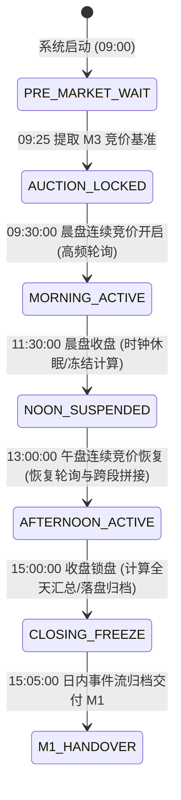
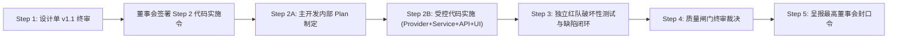

# G5-Phase 2：M4 盘中动态监控与异动感知系统技术设计单 (v1.1)

> **设计单编号**：DESIGN-G5-PHASE-2-M4-01 (v1.1 终审修订版)  
> **编制日期**：2026-09-24  
> **编制机构**：Antigravity 主开发团队  
> **上位依据**：  
> 1. [《开发文档/10-项目多Agent四权分立工程治理规范.md》](file:///d:/项目库/AI认知复盘交易系统/开发文档/10-项目多Agent四权分立工程治理规范.md)  
> 2. [《开发文档/12-G5-Phase-1A.3封口与边界冻结决议.md》](file:///d:/项目库/AI认知复盘交易系统/开发文档/12-G5-Phase-1A.3封口与边界冻结决议.md)（M1 边界冻结决议）  
> 3. [《开发文档/14-G5-Phase-1B封口与边界冻结决议.md》](file:///d:/项目库/AI认知复盘交易系统/开发文档/14-G5-Phase-1B封口与边界冻结决议.md)（M2 边界冻结决议）  
> 4. [《开发文档/16-G5-Phase-1C封口与边界冻结决议.md》](file:///d:/项目库/AI认知复盘交易系统/开发文档/16-G5-Phase-1C封口与边界冻结决议.md)（M3 边界冻结决议）  
> 5. **最高董事会（用户）核心批示**：“落实 M4-v1.1 唯一必修清单（7+1 铁律项），生成 v1.1 设计单后正式签署 Step 2 代码实施令”。

---

## 修订记录 (Revision History)

| 版本 | 修订日期 | 修订人 | 修订性质 | 核心修订内容摘要 |
| :--- | :--- | :--- | :--- | :--- |
| **v1.0** | 2026-09-24 | 主开发团队 | 初始编制 | 确立 M4 系统定位、时序状态机、四元组异动数学定义、反报警器三层过滤漏斗及轻量双层解耦架构。 |
| **v1.1** | 2026-09-24 | 主开发团队 | 董事会审定 | **全量落实董事会“7+1 铁律必修清单”**：<br/>1. 统一契约与 None 零填充防伪（Schema 统计字段及 TS 接口统一为可空类型）；<br/>2. 明确量能投影 $W(T)$ 累积函数与 09:30~09:45 强制 None 冷启动；<br/>3. 补齐数学指标冷启动（09:30~10:00 流动性脉冲比率 $R_{vol}$ 统一输出 None 并标记 `BASELINE_NOT_READY`）；<br/>4. 规范事件触发语义为边沿跃迁触发（Edge Trigger），持续封板不重复插入；<br/>5. 简化系统性共振为透明布尔规则（指数同向 $\ge 0.15\%$ 或板块同向标的数 $\ge 2$）；<br/>6. 锁定白名单边界与排除项（行业前3取当日涨幅榜前3、中军限定市值 $\ge 1000$ 亿且成交 Top 20、显式排除 ST/\*ST/停牌/退市标的）；<br/>7. 补充午休跨段窗口（13:00~13:05 跨段取 11:25~11:30）与轮询防封指数退避 + SQLite 异步批处理写入。 |

---

## 目录
- [一、系统定位与职责限权（监测器 vs 执行器）](#一系统定位与职责限权监测器-vs-执行器)
- [二、M1 → M2 → M3 → M4 只读单向承接架构](#二m1--m2--m3--m4-只读单向承接架构)
- [三、时间序列作为核心设计对象（时序工程体系）](#三时间序列作为核心设计对象时序工程体系)
- [四、“异动”的严格数学定义与计算模型](#四异动的严格数学定义与计算模型)
- [五、反报警器哲学：记录 vs 提醒 vs 呈现三层过滤漏斗](#五反报警器哲学记录-vs-提醒-vs-呈现三层过滤漏斗)
- [六、数据模型与持久化方案设计（落实契约与 None 防伪）](#六数据模型与持久化方案设计落实契约与-none-防伪)
- [七、API 接口契约与前端作战看板设计](#七api-接口契约与前端作战看板设计)
- [八、数据采集防封与高并发持久化兜底（新增机制）](#八数据采集防封与高并发持久化兜底新增机制)
- [九、四权分立质量闸门与红队攻防验收规划](#九四权分立质量闸门与红队攻防验收规划)
- [十、实施阶段规划与工序安排](#十实施阶段规划与工序安排)

---

## 一、系统定位与职责限权（监测器 vs 执行器）

### 1.1 法定工程定位：盘中事实雷达与时序显微镜
M4 系统（法定工程全称：**M4 盘中动态监控与异动感知系统**，Intraday Dynamic Monitoring & Anomaly Perception System）在系统认知全链路中覆盖交易日 **09:30:00 ～ 15:00:00** 的连续交易时间窗口。

- **核心定位**：
  - M4 是盘中客观事实的**「时序雷达（Radar）」**与微观变化的**「显微镜（Microscope）」**；
  - M4 的唯一使命是高保真度、低延迟地感知、测量和记录盘中市场宏观广度、结构梯队与核心标的微观物理演化事实，捕捉流动性与价格动量的显著变化；
  - 为盘后的 M1 收盘复盘提供完整、可追溯的**「日内事实证据链（Intraday Fact Chain）」**。

### 1.2 绝不承担交易执行的负面清单（Prohibition List）
依据董事会第一条刚性边界（**“M4 是监测器，不是交易执行器”**），M4 设立严格的权力负面清单：
1. 🚫 **严禁产生买卖执行指令**：严禁输出任何 `BUY`、`SELL`、`BUY_LIMIT`、`SELL_MARKET` 等交易信号；
2. 🚫 **严禁输出主观操作暗示与投资黑话**：
   - 严禁出现诸如“建仓机会”、“买点已现”、“抢反弹”、“主力吸筹”、“洗盘结束”、“清仓出逃”等主观引导性措辞；
   - 严禁对股票标注买卖评级或估值高低评判；
3. 🚫 **严禁干涉仓位控制与自动化下单**：M4 绝不挂接任何交易网关接口（CTP/QMT/PTrade 等），绝不包含自动化跟单、止损止盈自动触发逻辑；
4. 🚫 **强制置顶客观测量免责声明**：所有 M4 API 接口数据返回与前端看板页面，均强制包含并显式呈现：
   > “【客观物理事实测量提示】本看板仅对盘中市场量价与流动性数据进行客观时间序列观测与统计记录，不构成任何投资建议或交易执行指令。市场有风险，决策须自主。”

### 1.3 盘中事实观测的正面职责清单（Positive List）
1. ✅ **连续多尺度时序切片观测**：在 09:30~15:00 期间，以标准快照采样频率持续捕捉宽基指数、黄白线走势、全市场涨跌家数与两市动态量能；
2. ✅ **高标与结构核心追踪**：持续跟踪继承自前序阶段的最高空间板、连板池、大市值趋势中军在盘中的开合状态与换手节奏；
3. ✅ **微观物理异动测量与事件沉淀**：依据严谨数学定义，精准捕获瞬时动量突变、流动性脉冲放量、涨停炸板/回封等拓扑相变事件，并生成带精确时间戳的事件日志；
4. ✅ **为认知链路提供只读数据支撑**：输出结构化、强类型的只读数据契约，让盘中人类交易员能够清晰洞察“市场现在发生了什么客观变化”。

---

## 二、M1 → M2 → M3 → M4 只读单向承接架构

### 2.1 状态与时序拓扑流动图
系统严格遵循董事会第四条边界（**“M1 → M2 → M3 → M4 只读承接，单向流动”**）：

```mermaid
flowchart TD
    subgraph M1_STAGE ["M1 收盘复盘 (前日基线) - 已冻结"]
        M1_STATE["D1~D6 纯净状态向量<br/>(含昨日两市全天总成交 amount)"]
        M1_POOL["昨日涨停梯队与连板池<br/>(含最高空间板 height 与个股 lbc)"]
    end

    subgraph M2_STAGE ["M2 盘前简报 (隔夜冲击与假设) - 已冻结"]
        M2_OVERNIGHT["隔夜外盘五大标的浮点清洗数据"]
        M2_HYPO["4 维早盘关注与观察假设<br/>(量能比、高标溢价、尾部修复、外盘映射)"]
    end

    subgraph M3_STAGE ["M3 集合竞价观测 (09:25 开盘微观事实) - 已冻结"]
        M3_OPEN["09:25 指数跳空幅度与竞价总额/量能比"]
        M3_HIGH["最高空间板真实开盘溢价与高标样本溢价"]
        M3_EXTREME["一字涨跌停家数与极端多空封单"]
        M3_STATE["开盘客观承接物理标签"]
    end

    subgraph M4_STAGE ["M4 盘中动态监控系统 (09:30～15:00) - 本设计单"]
        M4_INIT["09:30 继承 M3 开盘事实作为起点基线 t0<br/>继承 M1 连板高标与 M2 关注方向作为监控核心池"]
        M4_ENGINE["盘中时序引擎 (30s采样 / 1min切片 / 多尺度窗口)"]
        M4_FILTER["异动数学感知 + 认知降噪三层过滤漏斗"]
        M4_EVENTS["盘中显著事件流水 (Event Stream)"]
        M4_UI["盘中实时全景作战看板 (Monitor Dashboard)"]
    end

    M1_STATE -.->|只读消费| M2_STAGE
    M1_STATE -.->|只读消费| M3_STAGE
    M1_POOL -.->|只读消费| M3_STAGE

    M1_STATE ==>|只读消费 (前日成交额基准)| M4_INIT
    M1_POOL ==>|只读消费 (重点跟踪标的池)| M4_INIT
    M2_HYPO ==>|只读消费 (宏观映射背景)| M4_INIT
    M3_OPEN ==>|只读消费 (日内物理原点 t0)| M4_INIT
    M3_HIGH ==>|只读消费 (开盘溢价锚点)| M4_INIT

    M4_INIT --> M4_ENGINE --> M4_FILTER --> M4_EVENTS --> M4_UI
```

### 2.2 前序契约只读消费规范
1. **消费 M1 状态向量**：
   - 提取昨日两市全天总成交金额（`D6.metrics.total_amount`），作为盘中“分时累计量能投影对比（Volume Projection Baseline）”的对比基准；
   - 提取昨日连板池股票列表（`limit_up_analysis.pool`），将昨日连板股、最高空间板自动载入 M4 的**「重点监测核心池（Watchlist）」**；
2. **消费 M2 观察假设**：
   - 仅将 M2 的 4 维观察维度作为盘中宏观视角的只读上下文展示，不参与任何算法打分；
3. **消费 M3 集合竞价微观事实**：
   - 提取 09:25 指数开盘点位、高标开盘溢价、竞价量能比作为日内时间序列的 **物理原点（$t_0$）**；
   - 盘中所有分时涨跌变化，严格以昨日收盘价 $P_{prev}$ 计算累计涨幅，同时以 $P_{open}$（09:25 集合竞价价格）计算日内连续竞价涨幅。

### 2.3 零逆向篡改铁律（隔离原则）
- **单向只读依赖**：M4 只能调用 M1、M2、M3 已经暴露的只读查询 API 或读取对应的数据库表；
- **零逆向修改**：M4 严禁向 `daily_review`、`premarket_briefing`、`auction_report` 表写入或更新任何字段；
- **版本隔离**：M4 的任何逻辑调整或指标扩充，绝不引发 M1/M2/M3 代码修改。

---

## 三、时间序列作为核心设计对象（时序工程体系）

依据董事会第三条刚性边界（**“时间序列必须成为核心设计对象”**），连续盘中监控必须在时间尺度、数据质量、乱序防御与异常处理上建立完备的工程保障体系。

### 3.1 盘中时钟与生命周期状态机
A股交易日盘中具有严格的离散交易时段划分，M4 状态机严格依此调度：



- **午间休市（11:30:00 ～ 13:00:00）处理规范**：
  - 调度器进入 `NOON_SUSPENDED` 状态，停止一切网络数据采集；
  - 冻结所有滑动窗口与时间差计算，**严禁**将 11:30~13:00 计入时间流速，杜绝产生虚假的“90分钟零换手”或“长周期缩量”错误。
- **午休跨段窗口向前拼接规范（【v1.1 必修项 7】）**：
  - 针对 13:00~13:05 启动的 5 分钟滑动窗口，其向前查找样本点时，**直接跨过 11:30~13:00 的休市空白，无缝回溯取 11:25~11:30 的晨盘收盘前切片**；
  - 在计算时间差 $\Delta t$ 时，**午间休市的有效交易时间差严格计为 0 分钟**，使得 13:02 相较于 11:28 的物理有效交易时间跨度准确计算为 4 分钟，消除时间轴断裂或虚假断流。
- **盘后锁盘（15:00:00）处理规范**：
  - 15:00:00 后不再接收盘中异动计算，完成全天日内快照序列化与最终校验，进入只读归档状态。

### 3.2 采样频率与滑动窗口设计
1. **采样频率标准（Sampling Rates）**：
   - **微观轮询采样（Polling Frequency）**：
     * 盘中核心宽基指数（上证、深证、创业板、科创50、北证50）：**30 秒 / 次**；
     * 重点跟踪核心池（昨日连板高标、最高空间板、成交额 Top 20 权重中军）：**30 秒 / 次**；
     * 全市场涨跌统计与涨跌停池（来自同花顺/东财接口）：**60 秒 / 次**；
   - **快照持久化频率（Snapshot Archiving）**：
     * **1 分钟标准切片**：内存中保留日内全量 1 分钟点位（全天共 240 个点），用于绘制分时折线与量能柱；
     * **持久化策略**：每 5 分钟或关键事件发生时执行增量持久化落盘，避免单日海量行写入击穿 SQLite 性能。
2. **多尺度滑动窗口体系（Multi-Scale Windows）**：
   - **微观脉冲窗口（Micro Window，$\Delta t = 1\text{min}$ / $3\text{min}$）**：用于捕捉瞬间放量抢筹、闪崩跳水与秒级炸板；
   - **短周期观察窗口（Short Window，$\Delta t = 5\text{min}$ / $15\text{min}$）**：用于计算分时动量斜率、多空力量推移；
   - **日内累积窗口（Cumulative Window，从 $09:30$ 至当前时刻 $T$）**：用于计算累计成交金额与量能投影。

### 3.3 时间戳一致性与双轨校准规范
1. **时间戳定义与统一格式**：
   - 所有时间戳严格采用 ISO-8601 标准本地时区格式：`YYYY-MM-DD HH:MM:SS`（时区：`Asia/Shanghai`）；
2. **双轨时间戳机制（Dual Timestamps）**：
   - 每个采集到的数据切片均包含两个时间戳：
     * $T_{source}$：行情源服务器返回的行情真实撮合时间（例如新浪行情字符串中 `parts[30]` 的日期与 `parts[31]` 的时间）；
     * $T_{local}$：本地系统采集收到该切片的系统时间（`datetime.now()`）；
3. **时钟偏差校准与安全阈值**：
   - 测量时间差：$\delta = |T_{local} - T_{source}|$；
   - 若 $\delta \le 10\text{s}$：认定数据时间完全一致，以 $T_{source}$ 为准进行时序排布；
   - 若 $10\text{s} < \delta \le 60\text{s}$：标记数据存在轻微公网抖动延迟（`SLIGHT_DELAY`）；
   - 若 $\delta > 60\text{s}$：判定行情源或本地系统时钟发生重大偏差，触发数据异常预警，界面展示黄标提示。

### 3.4 网络抖动、数据延迟与“数据新鲜度”监控
1. **数据新鲜度指标（Data Freshness Index）**：
   $$\text{Freshness}(T) = T_{now} - T_{latest\_received}$$
2. **三级降级防御机制**：
   - 🟢 **正常（Fresh）**：$\text{Freshness} \le 15\text{s}$，前端作战看板显示绿色脉冲，正常刷新；
   - 🟡 **延迟预警（Stale）**：$15\text{s} < \text{Freshness} \le 60\text{s}$，前端提示“行情存在网络延迟”，保持当前展示；
   - 🔴 **停滞降级（Frozen）**：$\text{Freshness} > 60\text{s}$，前端看板整体置灰，并在顶部醒目提示“【数据源停滞】当前数据已超过 1 分钟未更新，暂停触发异动计算”，严禁使用停滞数据误报异动。

### 3.5 数据缺失、丢包与“零填充防伪”铁律
1. **显式空位记录（Explicit Gaps）**：
   - 在轮询周期内若因网络超时或 Provider 异常未取得数据切片，时序序列中该时间点显式记录为 `None` / `null`；
   - **严禁**使用前一分钟价格（Forward Fill）伪造当前分钟数据，**严禁**填 `0.0` 伪造假平盘；
2. **有效度门槛（Validity Threshold）**：
   - 在计算 5 分钟滑动均值或斜率时，若窗口内有效样本数占比 $< 60\%$（例如 5 个点中丢失超过 2 个点），则该滑动计算直接输出 `None`，标记状态为 `INSUFFICIENT_DATA`，绝不强行计算。

### 3.6 去重、乱序与幂等性保证
1. **时序唯一键约束**：
   - 时序快照逻辑主键由 `(symbol, timestamp_minute)` 联合确定；
2. **防乱序滑动环形缓冲（Ring Buffer）**：
   - 内存中维护固定容量的有序时序滑动队列；
   - 当接收到晚于当前最新时间戳的乱序迟到包（Out-of-order Packet）时，若其滞后时间 $> 3\text{min}$，直接作为过期包废弃；若在 3 分钟容忍窗口内，按时间戳插入有序槽位，重新校正该分钟指标。

### 3.7 个股临时停牌与恢复处理
1. **停牌状态自动检测**：
   - 标的在连续交易时间内连续 3 个采样周期（90秒）出现：最新价非涨跌停、买卖五档无申报或成交量绝对增量恒等于 0，且无新成交时间戳推进，自动标记为 `SUSPECTED_HALTED`；
2. **停牌期间计算冻结**：
   - 停牌期间，该标的从异动扫描池中隔离，不再参与任何速率与动量计算；
3. **复牌跳空承接**：
   - 标的恢复交易后，以复牌首笔撮合价作为新原点，重置其滑动窗口基线，防止因停牌跨越导致的错误假动量。

---

## 四、“异动”的严格数学定义与计算模型

依据董事会第二条刚性边界，异动形式化为四元组：
$$\text{Anomaly} = \langle \mathcal{E}, \mathcal{B}, \Delta t, \Theta \rangle$$

### 4.1 传统误区与异动的严格定义
- **传统错误认知**：把“涨幅达到 +7%”或“跌幅达到 -5%”当作盘中异动。
  * 反例：某股开盘即涨 7%，随后全天在 7% 附近窄幅横盘波动 0.1%，它在盘中是极度平静的，没有任何“动量突变”；若系统在盘中不断报“该股大涨 7%”，纯属无意义的交易噪声。
- **科学定义**：异动是指标的在确定的微观观测窗口 $\Delta t$ 内，其状态变量相较于动态基准的偏离程度超越显著性阈值，或触发市场拓扑相变。

---

### 4.2 动量突变模型（Velocity Anomaly / Price Spike）
1. **观测窗口与基准定义**：
   - 观测窗口：$\Delta t = 3\text{分钟}$（微观速动）；
   - 动态基准：当前时刻 $T$ 的价格相对于 $T - \Delta t$ 时刻价格的变化率：
     $$v_{3\text{min}}(T) = \frac{P(T) - P(T - 3\text{min})}{P(T - 3\text{min})} \times 100\%$$
2. **显著性阈值 $\Theta_v$**：
   - **主板标的（10% 限制）**：$|v_{3\text{min}}| \ge 3.0\%$ 且 窗口内成交额 $A_{3\text{min}} \ge 2000\text{万元}$；
   - **双创标的（20% 限制）**：$|v_{3\text{min}}| \ge 5.0\%$ 且 窗口内成交额 $A_{3\text{min}} \ge 3000\text{万元}$；
   - **宽基指数**：$|v_{5\text{min}}| \ge 0.50\%$。
3. **数据质量过滤**：成交额 $< 500\text{万元}$ 的脉冲判定为流动性枯竭杂波，直接剔除。

---

### 4.3 流动性脉冲模型与冷启动保护（【v1.1 必修项 3】）
1. **观测窗口与动态基准定义**：
   - 观测窗口：$\Delta t = 5\text{分钟}$；
   - 动态基准 $\bar{A}_{30\text{min}}(T)$（过去 30 分钟均值）：
     $$\bar{A}_{30\text{min}}(T) = \frac{1}{6} \sum_{i=1}^{6} A_{5\text{min}}(T - i \times 5\text{min})$$
2. **量能爆发比率（Volume Surge Ratio, $R_{vol}$）**：
   $$R_{vol}(T) = \frac{A_{5\text{min}}(T)}{\bar{A}_{30\text{min}}(T)}$$
3. **开盘 30 分钟冷启动保护规则（Cold-Start Grace Period）**：
   - **时段限制**：**在 09:30:00 ～ 10:00:00 期间**，由于系统开盘尚不足 30 分钟，缺少完整的过去半小时滚动样本点；
   - **计算规则**：该时段内 $R_{vol}(T)$ **统一强制输出为 `None`**；
   - **状态标识**：内部计算状态显式置为 `BASELINE_NOT_READY`，彻底杜绝开盘前几分钟因分母极小造成的虚假爆量告警；
   - **10:00 恢复计算**：自 10:00:00 起，基准窗口样本满额（6个5分钟切片），正式开启 $R_{vol}$ 判定（$R_{vol} \ge 3.0$ 且 $A_{5\text{min}} \ge 3000\text{万元}$ 触发）。

---

### 4.4 市场结构相变点与“边沿跃迁触发”（【v1.1 必修项 4】）
盘中最具物理确定性的离散事件，**严格规范为 Edge Trigger（边沿跃迁触发）语义**：

```text
前一切片状态 S(t-1) --------(离散跃迁)--------> 当前切片状态 S(t)
    [NORMAL]                  ---->                 [SEALED]  ==> 触发 1 次：LIMIT_UP_LOCK 事件
    [SEALED]                  ---->                 [SEALED]  ==> 状态持续，0 触发，不插入记录！
    [SEALED]                  ---->                 [BROKEN]  ==> 触发 1 次：LIMIT_UP_BREAK 事件
```

1. **封死涨停事件（LIMIT_UP_LOCK）**：
   - **边沿触发条件**：$S(t-1) \neq \text{SEALED}$ 且 $S(t) = \text{SEALED}$（即 $P(T) = P_{limit\_up}$，$Ask_1 = 0$，且买一封单金额 $\ge 1000\text{万元}$）；
   - **持续期防刷屏**：若标的维持封死状态（$S(t-1) = \text{SEALED}$ 且 $S(t) = \text{SEALED}$），后续所有采样周期**绝对不再重复插入任何事件记录**，防止事件表爆炸。
2. **涨停炸板事件（LIMIT_UP_BREAK）**：
   - **边沿触发条件**：$S(t-1) = \text{SEALED}$ 且 $S(t) \neq \text{SEALED}$（即价格脱离涨停价）；
   - 记录炸板瞬间时间戳、回落幅度与成交量。
3. **最高空间板更迭事件（LEADER_SHIFT）**：
   - **边沿触发条件**：全市场实际最高板高度或最高板代码发生变化瞬间触发一次。
4. **跌停撬板与核按钮下杀（LIMIT_DOWN_UNLOCK / PLUNGE）**：
   - 撬板：从跌停封死状态到脱离跌停跃迁瞬间触发；
   - 核按钮：5 分钟内自红盘下砸跌停瞬间触发。

---

### 4.5 两市量能投影 $W(T)$ 数学模型与冷启动（【v1.1 必修项 2】）
日内全天成交量投影严禁使用简单的“当前成交 $\times (240 / t)$”线性外推（因为 A 股成交极不均匀，早盘集中而午后清淡）：

1. **日内成交累积分布函数 $W(T)$ 定义**：
   $$W(T) = \int_{09:30}^{T} w(t) dt, \quad T \in [09:30, 15:00], \quad W(15:00) = 1.0$$
   基于 A 股全市场历史大数据统计的典型分时成交累积基准权重曲线：
   - 09:30:00：$W = 0.00$
   - 09:45:00：$W \approx 0.15$
   - 10:00:00：$W \approx 0.25$
   - 10:30:00：$W \approx 0.38$
   - 11:30:00：$W \approx 0.55$（早盘累计成交约占全天 55%）
   - 13:00:00：$W \approx 0.55$（午休冻结）
   - 14:00:00：$W \approx 0.78$
   - 14:30:00：$W \approx 0.88$
   - 15:00:00：$W = 1.00$
2. **投影计算公式**：
   $$\text{volume\_proj\_yi}(T) = \frac{\text{CumAmount}(T)}{W(T)}$$
3. **冷启动与噪声屏蔽规则**：
   - **强制 None 窗口**：**在 09:30:00 ～ 09:45:00（开盘前 15 分钟）期间**，由于 $W(T) \le 0.15$，开盘集合竞价集中释放与瞬间冲击会导致分母极小且方差极大，投影极易失真。因此该时段内 `volume_proj_yi` **强制输出为 `None`**；
   - 自 09:45:01 起输出正式投影估算值；
4. **前端显式标签**：
   - 前端展示量能投影值时，必须显式附加 **`ESTIMATED` 估算标签**（例如：“18,530 亿元 (ESTIMATED)”），绝不伪装为确定性成交事实。

---

## 五、反报警器哲学：记录 vs 提醒 vs 呈现三层过滤漏斗

依据董事会第五条核心边界，确立严格的三层过滤漏斗：

### 5.1 第一层：什么变化值得被系统记录？（事实沉淀层）
- **核心原则**：宽进严出，全息忠实，零打扰；
- **记录内容**：
  * 所有 Edge Trigger 边沿跃迁的涨跌停、炸板、撬板事件；
  * 满足数学定义的动量突变与量能脉冲；
  * 5 分钟采样的大盘指数宏观切片；
- **动作**：静默写入持久化事件库，为复盘提供全息因果链，**0 弹窗、0 声音、0 打扰人类**。

### 5.2 第二层：什么变化值得提醒？（认知过滤层）
- **核心原则**：严格限权，去粗取精，剔除杂毛。必须同时穿透以下三重网筛：

#### 筛子 1：锁定白名单边界与排除项（【v1.1 必修项 6】）
只有处于以下白名单池内的标的，才有资格进入 Level 2 提醒候选：
1. **最高空间板梯队**：全市场实际最高连板标的及其直接竞争标的；
2. **高标连板池**：继承自 M1 的连板池且当前连板数 $\ge 2$ 的标的；
3. **日内领涨行业前 3 龙头**：**严格限定为“当日实时涨幅榜排名前 3 的申万/同花顺二级行业”中涨幅第一的领涨标的**；
4. **核心容量中军**：**严格限定为“A 股总市值 $\ge 1000$ 亿元 且 当日日内成交金额排名前 20”的大市值中军标的**；
- 🚫 **显式排除清单（Exclusion List）**：
  * **全面显式排除 ST / \*ST 标的**；
  * **全面排除已停牌标的与退市整理期标的**；
  * 普通边缘首板杂毛、冷门微盘股，一律留在 Level 1 记录，严禁进入 Level 2 提醒！

#### 筛子 2：简化系统性共振的透明布尔规则（【v1.1 必修项 5】）
拒绝模糊黑盒与多层加权评分，采用确定性的布尔条件：
$$\text{Resonance} = \text{IndexCoMove} \lor \text{SectorCoMove}$$
- **`IndexCoMove`（指数同向联动）**：
  * 标的异动方向与大盘指数（主板看上证，双创看创业板指）过去 5 分钟波动方向一致，且指数波动幅值 $|v_{5\text{min}}| \ge 0.15\%$；
- **`SectorCoMove`（板块同向异动）**：
  * 标的所属申万/同花顺二级行业板块在过去 15 分钟内，同向异动标的数 $\ge 2$ 家；
- **判定结果**：满足以上任意一条即判定为“具备系统性共振”；若两条均不满足，判定为孤立个股杂音，直接丢弃，不予提醒。

#### 筛子 3：15 分钟冷却期防刷屏机制
- 同一标的同方向异动，**15 分钟内绝对只提醒 1 次**，彻底消除涨跌停临界点震荡造成的告警泛滥。

### 5.3 第三层：提醒通过什么方式呈现？（低侵入视觉层）
- 🚫 **绝无模态弹窗拦截**；
- 🚫 **绝无声音警报**；
- ✅ **看板呼吸微标（Subtle Pulse Badges）**：
  * 🔴 深红微标：恶性结构破坏（最高板炸板天地板、指数断崖跳水）；
  * 🟡 橙黄微标：结构性转折共振（容量中军放量拉升、新最高板上位）；
- ✅ **右侧折叠时序事件流**：时间轴滚动客观流水，默认静音折叠；
- ✅ **一键全静音总开关**：看板顶部支持一键屏蔽全部视觉脉冲。

---

## 六、数据模型与持久化方案设计（落实契约与 None 防伪）

### 6.1 契约统一与 None 防伪改造（【v1.1 必修项 1】）
为彻底贯彻“零填充防伪”，数据库 Schema 中所有统计指标**统一去除默认值 0，改为显式可空 `nullable=True, default=None`**。

```python
# backend/app/models/market.py 或 monitor.py (待 Step 2 受控实施)

from sqlalchemy import Column, Integer, Float, String, Text, DateTime, UniqueConstraint, func
from ..core.database import Base

class IntradayMarketSnapshot(Base):
    """盘中市场宏观时序快照表 (每5分钟采样一条，单日48条)"""
    __tablename__ = "intraday_market_snapshot"

    id = Column(Integer, primary_key=True, autoincrement=True)
    date = Column(String, nullable=False, index=True)        # 交易日 YYYY-MM-DD
    timestamp = Column(String, nullable=False, index=True)   # 精确时间 HH:MM:SS
    minute_index = Column(Integer, nullable=False)           # 盘中有效分钟 1~240

    # 宏观指数与量能切片 (统一 nullable=True, default=None)
    sh_index_price = Column(Float, nullable=True, default=None)
    sh_index_pct = Column(Float, nullable=True, default=None)
    sz_index_price = Column(Float, nullable=True, default=None)
    sz_index_pct = Column(Float, nullable=True, default=None)
    cy_index_pct = Column(Float, nullable=True, default=None)
    total_amount_yi = Column(Float, nullable=True, default=None)
    volume_proj_yi = Column(Float, nullable=True, default=None)  # 09:30~09:45 强制为 None

    # 市场多空广度 (统一 nullable=True, default=None 杜绝 0 伪造)
    up_count = Column(Integer, nullable=True, default=None)
    down_count = Column(Integer, nullable=True, default=None)
    limit_up_count = Column(Integer, nullable=True, default=None)
    limit_down_count = Column(Integer, nullable=True, default=None)
    broken_limit_count = Column(Integer, nullable=True, default=None)

    # 核心高标结构 (统一 nullable=True, default=None)
    max_height = Column(Integer, nullable=True, default=None)
    leader_stock = Column(String, nullable=True, default=None)
    created_at = Column(DateTime, server_default=func.now())

    __table_args__ = (
        UniqueConstraint("date", "timestamp", name="uix_intraday_snapshot_date_time"),
    )


class IntradayAnomalyEvent(Base):
    """盘中显著物理异动与相变事件表 (边沿触发，单日约20~80条)"""
    __tablename__ = "intraday_anomaly_event"

    id = Column(Integer, primary_key=True, autoincrement=True)
    date = Column(String, nullable=False, index=True)        # 交易日 YYYY-MM-DD
    timestamp = Column(String, nullable=False, index=True)   # 事件精确时间 HH:MM:SS
    minute_index = Column(Integer, nullable=False)           # 发生分钟 1~240

    # 事件分类与标的
    event_category = Column(String, nullable=False)          # LIMIT_UP_LOCK / LIMIT_UP_BREAK / VELOCITY_SPIKE / VOLUME_SURGE / LEADER_SHIFT / BREADTH_PULSE
    severity_level = Column(String, nullable=False)          # CRITICAL / TRANSITION / INFO
    symbol = Column(String, nullable=True, index=True)       # 涉及股票代码 (如 000001)
    name = Column(String, nullable=True)                     # 股票名称

    # 量化事实度量 (统一 nullable=True, default=None)
    price = Column(Float, nullable=True, default=None)
    pct_change = Column(Float, nullable=True, default=None)
    window_delta_pct = Column(Float, nullable=True, default=None)
    window_amount_wan = Column(Float, nullable=True, default=None)
    surge_ratio = Column(Float, nullable=True, default=None) # 09:30~10:00 强制为 None
    details = Column(Text, nullable=True, default=None)      # 结构化明细 JSON

    created_at = Column(DateTime, server_default=func.now())
```

---

## 七、API 接口契约与前端作战看板设计

### 7.1 后端 REST API 规划
系统规划在 `/api/v1/monitor` 命名空间下提供标准只读端点：

| HTTP 方法 | 路径 | 描述 | 请求参数 | 响应主要字段 |
| :--- | :--- | :--- | :--- | :--- |
| `GET` | `/api/v1/monitor/realtime` | 获取盘中最新微观综合切片 | `date` (可选) | 指数行情、两市成交额、量能投影(ESTIMATED)、涨跌家数比、最高板状态、数据新鲜度 |
| `GET` | `/api/v1/monitor/series` | 获取日内分时宏观时序曲线 | `date` (可选) | 1 分钟 / 5 分钟采样的指数走势、累计成交柱状序列、涨跌家数曲线 |
| `GET` | `/api/v1/monitor/events` | 获取盘中客观事件流 | `date`, `severity`, `limit` | 显著事件列表（时间戳、类别、级别、标的、速动量度、明细） |
| `GET` | `/api/v1/monitor/watchlist`| 获取核心高标梯队盘中状态 | `date` (可选) | 继承自 M1 的高标在盘中的实时涨跌幅、最新换手、封单/炸板状态 |

### 7.2 前端强类型 TypeScript 契约模型设计（【v1.1 必修项 1】）
前端类型定义全部与后端的 `nullable=True, default=None` 严格同构对齐：

```typescript
// frontend/src/types/monitor.ts

export type TradingSessionState = "PRE_MARKET" | "ACTIVE" | "NOON_BREAK" | "CLOSED";
export type AnomalySeverity = "CRITICAL" | "TRANSITION" | "INFO";
export type AnomalyCategory = 
  | "LIMIT_UP_LOCK" 
  | "LIMIT_UP_BREAK" 
  | "VELOCITY_SPIKE" 
  | "VOLUME_SURGE" 
  | "LEADER_SHIFT" 
  | "BREADTH_PULSE";

export interface MacroSnapshotItem {
  timestamp: string;
  minute_index: number;
  sh_price: number | null;
  sh_pct: number | null;
  total_amount_yi: number | null;
  volume_proj_yi: number | null; // 09:30~09:45 严格为 null，前端显示 '--' 并标 ESTIMATED
  is_proj_estimated: boolean;    // 是否带 ESTIMATED 标签
  up_count: number | null;
  down_count: number | null;
  limit_up_count: number | null;
  limit_down_count: number | null;
  broken_count: number | null;
  max_height: number | null;
  leader_stock: string | null;
}

export interface IntradayAnomalyEventItem {
  id: number;
  timestamp: string;
  minute_index: number;
  category: AnomalyCategory;
  severity: AnomalySeverity;
  symbol: string | null;
  name: string | null;
  price: number | null;
  pct_change: number | null;
  window_delta_pct: number | null;
  window_amount_wan: number | null;
  surge_ratio: number | null;    // 09:30~10:00 严格为 null (BASELINE_NOT_READY)
  details_desc: string | null;
}

export interface MonitorRealtimeResponse {
  session_state: TradingSessionState;
  freshness_seconds: number;
  is_delayed: boolean;
  timestamp: string;
  macro: MacroSnapshotItem;
  watchlist: Array<{
    symbol: string;
    name: string;
    board_count: number | null;
    open_pct: number | null;     // 来自 M3 竞价继承
    current_pct: number | null;
    status: "SEALED" | "BROKEN" | "NORMAL" | "HALTED";
    amount_yi: number | null;
  }>;
  recent_events: IntradayAnomalyEventItem[];
  disclaimer: string;
}
```

---

## 八、数据采集防封与高并发持久化兜底（新增机制）

依据董事会第七条必修项（**“Provider 层配置指数退避降级，SQLite 写入配置异步批处理”**），确立以下基础设施级兜底防护：

### 8.1 行情采集 Provider 指数退避与防封限流（【v1.1 必修项 7】）
1. **分批与并发限流**：
   - 重点监控池标的（约 30~50 只）查询，严格按每批次 15 只切分；
   - 批次之间强制增加 $150\text{ms} \sim 300\text{ms}$ 的随机 Jitter 间隔，严禁短时间并发轰炸公共免费行情源；
2. **指数退避降级（Exponential Backoff with Jitter）**：
   - 当遇到 HTTP 403、429、502 或连续网络超时时：
     * 第 1 次重试：等待 $1.0\text{s} + \text{random}(0, 0.5\text{s})$；
     * 第 2 次重试：等待 $2.0\text{s} + \text{random}(0, 1.0\text{s})$；
     * 第 3 次重试：等待 $4.0\text{s} + \text{random}(0, 2.0\text{s})$；
     * 连续 3 次失败：本轮采样放弃，切片数据安全置为 `None`，触发数据延迟降级，严禁无限循环重试挂死主线程。

### 8.2 SQLite 写入异步批处理队列（Async Batch Queue）
1. **写操作解耦**：
   - 盘中时序快照与异动事件**严禁同步阻塞写入 SQLite**；
   - 采集引擎计算出的数据切片与事件，推入 `asyncio.Queue` 内存写入队列；
2. **批量合并落盘（Batch Flush）**：
   - 后台守护 Task 每 10 秒唤醒一次，或队列堆积达到 10 条记录时，执行一次 `session.add_all()` 批量落盘事务提交；
   - 彻底避免单日高频写 I/O 锁死 SQLite 数据库，确保读写并发顺畅。

---

## 九、四权分立质量闸门与红队攻防验收规划

### 9.1 红队攻防测试用例规划（Step 3 重点验证）
1. **【零买卖信号渗透测试】**：扫描 M4 全代码与 UI 文本，断言买卖操作词检出率为 0；
2. **【伪异动与杂毛压测（Spam Attack）】**：注入 100 只 ST 股及小微盘股，断言 Level 2 认知过滤层拦截率 100%；
3. **【数据延迟与停滞欺骗测试】**：断网 120 秒，验证系统是否准确置灰、标记 `STALE` 并停滞异动计算；
4. **【午休与跨时段拼接攻击】**：验证 11:30~13:00 时钟冻结，以及 13:00~13:05 跨段向前无缝抓取 11:25~11:30 切片；
5. **【冷启动防护攻击】**：在 09:30~09:45 注入请求，断言 `volume_proj_yi` 100% 严格为 `None`；在 09:30~10:00 断言 $R_{vol}$ 100% 为 `None`；
6. **【Edge Trigger 防刷屏攻击】**：模拟标的持续封死 60 个采样周期，断言数据库与事件流仅有且只有 1 条记录。

### 9.2 质量发布闸门 7 大铁律核验规划
质量发布闸门裁判（`quality_gatekeeper`）在终审时将核验：
1. **零买卖交易信号**（铁律 1）；
2. **异动数学四元组完备性**（基准、窗口、阈值、质量 4 要素齐全，铁律 2）；
3. **时序一致性与 None 防伪**（可空类型对齐、无前值伪造、无假 0，铁律 3）；
4. **前序契约只读单向消费**（M1/M2/M3 表结构 0 修改，铁律 4）；
5. **反报警器三层漏斗闭环**（Edge Trigger、冷启动保护、白名单排除项、15分钟冷却，铁律 5）；
6. **架构整洁与零死代码**（淘汰原有占位符，TypeScript 生产编译 0 报错，铁律 6）；
7. **自动化全覆盖与灾备同步**（端到端验证脚本 100% 通过，Git 工作区 Clean，铁律 7）。

---

## 十、实施阶段规划与工序安排

依据最高董事会指示，**本设计单 (v1.1) 提交董事会签署代码实施令后，进入受控工序实施**：



1. **Step 1（当前节点已完成）**：编制完成《G5-Phase 2：M4 盘中动态监控与异动感知系统技术设计单 (v1.1)》，提交最高董事会签发 Step 2 实施令；
2. **Step 2（待实施令下达）**：
   - 制定内部工序 Plan；
   - 实施数据模型（支持可空 None）、异步批处理队列与指数退避 Provider；
   - 实施轻量时序内存环、冷启动保护、量能投影 $W(T)$ 与 Edge Trigger 异动感知引擎；
   - 实施后端 REST API 路由与自动化集成验证测试；
   - 重构前端作战看板 `frontend/src/app/monitor/page.tsx`；
3. **Step 3**：移交独立红队特使执行攻击性破坏测试；
4. **Step 4**：移交独立质量发布闸门裁判执行终审裁决；
5. **Step 5**：呈报最高董事会签署正式封口决议。
