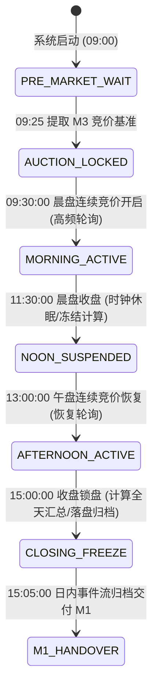
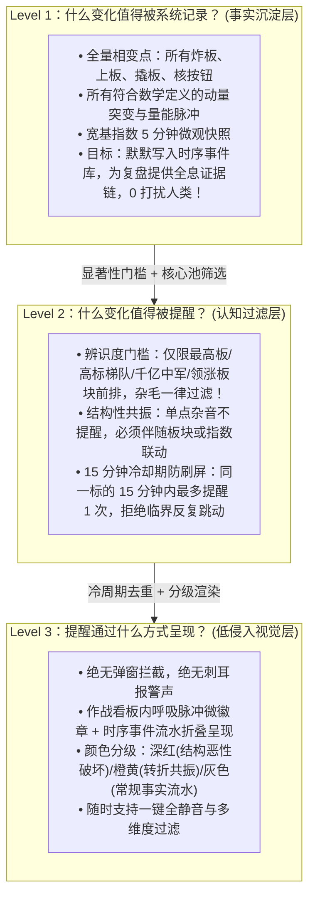
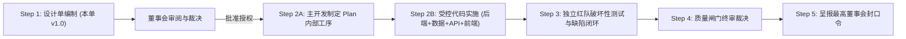

# G5-Phase 2：M4 盘中动态监控与异动感知系统技术设计单 (v1.0)

> **设计单编号**：DESIGN-G5-PHASE-2-M4-01 (v1.0)  
> **编制日期**：2026-09-24  
> **编制机构**：Antigravity 主开发团队  
> **上位依据**：  
> 1. [《开发文档/10-项目多Agent四权分立工程治理规范.md》](file:///d:/项目库/AI认知复盘交易系统/开发文档/10-项目多Agent四权分立工程治理规范.md)  
> 2. [《开发文档/12-G5-Phase-1A.3封口与边界冻结决议.md》](file:///d:/项目库/AI认知复盘交易系统/开发文档/12-G5-Phase-1A.3封口与边界冻结决议.md)（M1 边界冻结决议）  
> 3. [《开发文档/14-G5-Phase-1B封口与边界冻结决议.md》](file:///d:/项目库/AI认知复盘交易系统/开发文档/14-G5-Phase-1B封口与边界冻结决议.md)（M2 边界冻结决议）  
> 4. [《开发文档/16-G5-Phase-1C封口与边界冻结决议.md》](file:///d:/项目库/AI认知复盘交易系统/开发文档/16-G5-Phase-1C封口与边界冻结决议.md)（M3 边界冻结决议）  
> 5. **最高董事会（用户）核心批示**：“启动 G5-Phase 2 M4 技术设计单编制；当前只授权 Step 1 设计，不授权代码实施；严格守住 5 条核心边界”。

---

## 目录
- [一、系统定位与职责限权（监测器 vs 执行器）](#一系统定位与职责限权监测器-vs-执行器)
- [二、M1 → M2 → M3 → M4 只读单向承接架构](#二m1--m2--m3--m4-只读单向承接架构)
- [三、时间序列作为核心设计对象（时序工程体系）](#三时间序列作为核心设计对象时序工程体系)
- [四、“异动”的严格数学定义与计算模型](#四异动的严格数学定义与计算模型)
- [五、反报警器哲学：记录 vs 提醒 vs 呈现三层过滤漏斗](#五反报警器哲学记录-vs-提醒-vs-呈现三层过滤漏斗)
- [六、数据模型与持久化方案设计（建议 Schema）](#六数据模型与持久化方案设计建议-schema)
- [七、API 接口契约与前端作战看板设计](#七api-接口契约与前端作战看板设计)
- [八、四权分立质量闸门与红队攻防验收规划](#八四权分立质量闸门与红队攻防验收规划)
- [九、实施阶段规划与工序安排](#九实施阶段规划与工序安排)

---

## 一、系统定位与职责限权（监测器 vs 执行器）

### 1.1 法定工程定位：盘中事实雷达与时序显微镜
M4 系统（法定工程全称：**M4 盘中动态监控与异动感知系统**，Intraday Dynamic Monitoring & Anomaly Perception System）在系统认知全链路中覆盖交易日 **09:30:00 ～ 15:00:00** 的连续交易时间窗口。

- **核心定位**：
  - M4 是盘中客观事实的**「时序雷达（Radar）」**与微观变化的**「显微镜（Microscope）」**；
  - M4 的唯一使命是高保真度、低延迟地感知、测量和记录盘中市场宏观广度、结构梯队与核心标的微观物理演化事实，捕捉流动性与价格动量的显著变化；
  - 为盘后的 M1 收盘复盘提供完整、可追溯的**「日内事实证据链（Intraday Fact Chain）」**。

### 1.2 绝不承担交易执行的负面清单（Prohibition List）
依据董事会第一条刚性边界（**“M4 是监测器，不是交易执行器”**），M4 设立严格的权力负面清单：
1. 🚫 **严禁产生买卖执行指令**：严禁输出任何 `BUY`、`SELL`、`BUY_LIMIT`、`SELL_MARKET` 等交易信号；
2. 🚫 **严禁输出主观操作暗示与投资黑话**：
   - 严禁出现诸如“建仓机会”、“买点已现”、“抢反弹”、“主力吸筹”、“洗盘结束”、“清仓出逃”等主观引导性措辞；
   - 严禁对股票标注买卖评级或估值高低评判；
3. 🚫 **严禁干涉仓位控制与自动化下单**：M4 绝不挂接任何交易网关接口（CTP/QMT/PTrade 等），绝不包含自动化跟单、止损止盈自动触发逻辑；
4. 🚫 **强制置顶客观测量免责声明**：所有 M4 API 接口数据返回与前端看板页面，均强制包含并显式呈现：
   > “【客观物理事实测量提示】本看板仅对盘中市场量价与流动性数据进行客观时间序列观测与统计记录，不构成任何投资建议或交易执行指令。市场有风险，决策须自主。”

### 1.3 盘中事实观测的正面职责清单（Positive List）
1. ✅ **连续多尺度时序切片观测**：在 09:30~15:00 期间，以标准快照采样频率持续捕捉宽基指数、黄白线走势、全市场涨跌家数与两市动态量能；
2. ✅ **高标与结构核心追踪**：持续跟踪继承自前序阶段的最高空间板、连板池、大市值趋势中军在盘中的开合状态与换手节奏；
3. ✅ **微观物理异动测量与事件沉淀**：依据严谨数学定义，精准捕获瞬时动量突变、流动性脉冲放量、涨停炸板/回封等拓扑相变事件，并生成带精确时间戳的事件日志；
4. ✅ **为认知链路提供只读数据支撑**：输出结构化、强类型的只读数据契约，让盘中人类交易员能够清晰洞察“市场现在发生了什么客观变化”。

---

## 二、M1 → M2 → M3 → M4 只读单向承接架构

### 2.1 状态与时序拓扑流动图
系统严格遵循董事会第四条边界（**“M1 → M2 → M3 → M4 只读承接，单向流动”**）：

```mermaid
flowchart TD
    subgraph M1_STAGE ["M1 收盘复盘 (前日基线) - 已冻结"]
        M1_STATE["D1~D6 纯净状态向量<br/>(含昨日两市全天总成交 amount)"]
        M1_POOL["昨日涨停梯队与连板池<br/>(含最高空间板 height 与个股 lbc)"]
    end

    subgraph M2_STAGE ["M2 盘前简报 (隔夜冲击与假设) - 已冻结"]
        M2_OVERNIGHT["隔夜外盘五大标的浮点清洗数据"]
        M2_HYPO["4 维早盘关注与观察假设<br/>(量能比、高标溢价、尾部修复、外盘映射)"]
    end

    subgraph M3_STAGE ["M3 集合竞价观测 (09:25 开盘微观事实) - 已冻结"]
        M3_OPEN["09:25 指数跳空幅度与竞价总额/量能比"]
        M3_HIGH["最高空间板真实开盘溢价与高标样本溢价"]
        M3_EXTREME["一字涨跌停家数与极端多空封单"]
        M3_STATE["开盘客观承接物理标签"]
    end

    subgraph M4_STAGE ["M4 盘中动态监控系统 (09:30～15:00) - 本设计单"]
        M4_INIT["09:30 继承 M3 开盘事实作为起点基线 t0<br/>继承 M1 连板高标与 M2 关注方向作为监控核心池"]
        M4_ENGINE["盘中时序引擎 (30s采样 / 1min快照 / 多尺度窗口)"]
        M4_FILTER["异动数学感知 + 认知降噪三层过滤漏斗"]
        M4_EVENTS["盘中显著事件流水 (Event Stream)"]
        M4_UI["盘中实时全景作战看板 (Monitor Dashboard)"]
    end

    M1_STATE -.->|只读消费| M2_STAGE
    M1_STATE -.->|只读消费| M3_STAGE
    M1_POOL -.->|只读消费| M3_STAGE

    M1_STATE ==>|只读消费 (前日成交额基准)| M4_INIT
    M1_POOL ==>|只读消费 (重点跟踪标的池)| M4_INIT
    M2_HYPO ==>|只读消费 (宏观映射背景)| M4_INIT
    M3_OPEN ==>|只读消费 (日内物理原点 t0)| M4_INIT
    M3_HIGH ==>|只读消费 (开盘溢价锚点)| M4_INIT

    M4_INIT --> M4_ENGINE --> M4_FILTER --> M4_EVENTS --> M4_UI
```

### 2.2 前序契约只读消费规范
1. **消费 M1 状态向量**：
   - 提取昨日两市全天总成交金额（`D6.metrics.total_amount`），作为盘中“分时累计量能投影对比（Volume Projection Baseline）”的分母参考基准；
   - 提取昨日连板池股票列表（`limit_up_analysis.pool`），将昨日连板股、最高空间板自动载入 M4 的**「重点监测核心池（Watchlist）」**；
2. **消费 M2 观察假设**：
   - 仅将 M2 的 4 维观察维度作为盘中宏观视角的只读上下文展示，不参与任何算法打分；
3. **消费 M3 集合竞价微观事实**：
   - 提取 09:25 指数开盘点位、高标开盘溢价、竞价量能比作为日内时间序列的 **物理原点（$t_0$）**；
   - 盘中所有分时涨跌变化，严格以昨日收盘价 $P_{prev}$ 计算累计涨幅，同时以 $P_{open}$（09:25 集合竞价价格）计算日内连续竞价涨幅。

### 2.3 零逆向篡改铁律（隔离原则）
- **单向只读依赖**：M4 只能调用 M1、M2、M3 已经暴露的只读查询 API 或读取对应的数据库表；
- **零逆向修改**：M4 严禁向 `daily_review`、`premarket_briefing`、`auction_report` 表写入或更新任何字段；
- **版本隔离**：M4 的任何逻辑调整或指标扩充，绝不引发 M1/M2/M3 代码修改。

---

## 三、时间序列作为核心设计对象（时序工程体系）

依据董事会第三条刚性边界（**“时间序列必须成为核心设计对象”**），连续盘中监控必须在时间尺度、数据质量、乱序防御与异常处理上建立完备的工程保障体系。

### 3.1 盘中时钟与生命周期状态机
A股交易日盘中具有严格的离散交易时段划分，M4 状态机严格依此调度：



- **午间休市（11:30:00 ～ 13:00:00）处理规范**：
  - 调度器进入 `NOON_SUSPENDED` 状态，停止一切网络数据采集；
  - 冻结所有滑动窗口与时间差计算，**严禁**将 11:30~13:00 计入时间流速，杜绝产生虚假的“90分钟零换手”或“长周期缩量”错误；
  - 13:00:00 唤醒时，以 11:30:00 的最后切片作为前置点无缝对接，时间轴在逻辑上直接跳跃。
- **盘后锁盘（15:00:00）处理规范**：
  - 15:00:00 后不再接收盘中异动计算，完成全天日内快照序列化与最终校验，进入只读归档状态。

### 3.2 采样频率与滑动窗口设计
1. **采样频率标准（Sampling Rates）**：
   - **微观轮询采样（Polling Frequency）**：
     * 盘中核心宽基指数（上证、深证、创业板、科创50、北证50）：**30 秒 / 次**；
     * 重点跟踪核心池（昨日连板高标、最高空间板、成交额 Top 20 权重中军）：**30 秒 / 次**；
     * 全市场涨跌统计与涨跌停池（来自同花顺/东财接口）：**60 秒 / 次**；
   - **快照持久化频率（Snapshot Archiving）**：
     * **1 分钟标准切片**：内存中保留日内全量 1 分钟点位（全天共 240 个点），用于绘制分时折线与量能柱；
     * **持久化策略**：每 5 分钟或关键事件发生时执行增量持久化落盘，避免单日海量行写入击穿 SQLite 性能。
2. **多尺度滑动窗口体系（Multi-Scale Windows）**：
   - **微观脉冲窗口（Micro Window，$\Delta t = 1\text{min}$ / $3\text{min}$）**：用于捕捉瞬间放量抢筹、闪崩跳水与秒级炸板；
   - **短周期观察窗口（Short Window，$\Delta t = 5\text{min}$ / $15\text{min}$）**：用于计算分时动量斜率、多空力量推移；
   - **日内累积窗口（Cumulative Window，从 $09:30$ 至当前时刻 $T$）**：用于计算累计成交金额、量能投影比例与日内 VWAP（成交量加权平均价）。

### 3.3 时间戳一致性与双轨校准规范
1. **时间戳定义与统一格式**：
   - 所有时间戳严格采用 ISO-8601 标准本地时区格式：`YYYY-MM-DD HH:MM:SS`（时区：`Asia/Shanghai`）；
2. **双轨时间戳机制（Dual Timestamps）**：
   - 每个采集到的数据切片均包含两个时间戳：
     * $T_{source}$：行情源服务器返回的行情真实撮合时间（例如新浪行情字符串中 `parts[30]` 的日期与 `parts[31]` 的时间）；
     * $T_{local}$：本地系统采集收到该切片的系统时间（`datetime.now()`）；
3. **时钟偏差校准与安全阈值**：
   - 测量时间差：$\delta = |T_{local} - T_{source}|$；
   - 若 $\delta \le 10\text{s}$：认定数据时间完全一致，以 $T_{source}$ 为准进行时序排布；
   - 若 $10\text{s} < \delta \le 60\text{s}$：标记数据存在轻微公网抖动延迟（`SLIGHT_DELAY`）；
   - 若 $\delta > 60\text{s}$：判定行情源或本地系统时钟发生重大偏差，触发数据异常预警，界面展示黄标提示。

### 3.4 网络抖动、数据延迟与“数据新鲜度”监控
1. **数据新鲜度指标（Data Freshness Index）**：
   $$\text{Freshness}(T) = T_{now} - T_{latest\_received}$$
2. **三级降级防御机制**：
   - 🟢 **正常（Fresh）**：$\text{Freshness} \le 15\text{s}$，前端作战看板显示绿色脉冲，正常刷新；
   - 🟡 **延迟预警（Stale）**：$15\text{s} < \text{Freshness} \le 60\text{s}$，前端提示“行情存在网络延迟”，保持当前展示；
   - 🔴 **停滞降级（Frozen）**：$\text{Freshness} > 60\text{s}$，前端看板整体置灰，并在顶部醒目提示“【数据源停滞】当前数据已超过 1 分钟未更新，暂停触发异动计算”，严禁使用停滞数据误报异动。

### 3.5 数据缺失、丢包与“零填充防伪”铁律
1. **显式空位记录（Explicit Gaps）**：
   - 在轮询周期内若因网络超时或 Provider 异常未取得数据切片，时序序列中该时间点显式记录为 `None` / `null`；
   - **严禁**使用前一分钟价格（Forward Fill）伪造当前分钟数据，**严禁**填 `0.0` 伪造假平盘；
2. **有效度门槛（Validity Threshold）**：
   - 在计算 5 分钟滑动均值或斜率时，若窗口内有效样本数占比 $< 60\%$（例如 5 个点中丢失超过 2 个点），则该滑动计算直接输出 `None`，标记状态为 `INSUFFICIENT_DATA`，绝不强行计算。

### 3.6 去重、乱序与幂等性保证
1. **时序唯一键约束**：
   - 时序快照逻辑主键由 `(symbol, timestamp_minute)` 联合确定；
2. **防乱序滑动环形缓冲（Ring Buffer）**：
   - 内存中维护固定容量的有序时序滑动队列；
   - 当接收到晚于当前最新时间戳的乱序迟到包（Out-of-order Packet）时，若其滞后时间 $> 3\text{min}$，直接作为过期包废弃；若在 3 分钟容忍窗口内，按时间戳插入有序槽位，重新校正该分钟指标。

### 3.7 个股临时停牌与恢复处理
1. **停牌状态自动检测**：
   - 标的在连续交易时间内连续 3 个采样周期（90秒）出现：最新价非涨跌停、买卖五档无申报或成交量绝对增量恒等于 0，且无新成交时间戳推进，自动标记为 `SUSPECTED_HALTED`；
2. **停牌期间计算冻结**：
   - 停牌期间，该标的从异动扫描池中隔离，不再参与任何速率与动量计算；
3. **复牌跳空承接**：
   - 标的恢复交易后，以复牌首笔撮合价作为新原点，重置其滑动窗口基线，防止因停牌跨越导致的错误假动量。

---

## 四、“异动”的严格数学定义与计算模型

依据董事会第二条刚性边界（**“明确‘异动’的数学定义，不能把涨跌得多等同于异动，必须明确基准、窗口、阈值和数据质量”**），本节确立一套严密的量化形式化规范。

### 4.1 传统误区与异动的严格定义
- **传统错误认知**：把“涨幅达到 +7%”或“跌幅达到 -5%”当作盘中异动。
  * 反例：某股开盘即涨 7%，随后全天在 7% 附近窄幅横盘波动 0.1%，它在盘中是极度平静的，没有任何“动量突变”；若系统在盘中不断报“该股大涨 7%”，纯属无意义的交易噪声。
- **异动的核心科学定义**：
  > **异动（Anomaly / Kinetic Event）是指：标的在确定的微观观测窗口 $\Delta t$ 内，其状态变量（价格变动速度、成交量能爆发比率、盘口拓扑结构）相较于动态基准（Baseline）的偏离程度，在统计学或动力学上超越了预设显著性阈值 $\theta$，或者触发了市场状态相变边界的确定性物理事件。**

每一种异动必须严格由 **四元组 (Entity, Baseline, Window, Threshold)** 唯一定义：
$$\text{Anomaly} = \langle \mathcal{E}, \mathcal{B}, \Delta t, \Theta \rangle$$

---

### 4.2 动量突变模型（Velocity Anomaly / Price Spike）
用于捕捉盘中短时间内价格快速拉升或脉冲跳水。

1. **观测窗口与基准定义**：
   - 观测窗口：$\Delta t = 3\text{分钟}$（微观速动）或 $\Delta t = 5\text{分钟}$（波段速动）；
   - 动态基准：当前时刻 $T$ 的价格相对于 $T - \Delta t$ 时刻价格的变化率：
     $$v_{\Delta t}(T) = \frac{P(T) - P(T - \Delta t)}{P(T - \Delta t)} \times 100\%$$
2. **显著性阈值 $\Theta_v$**：
   - **主板标的（10% 涨跌幅限制）**：
     * 急速拉升：$v_{3\text{min}} \ge +3.0\%$ 且 窗口内成交额 $A_{3\text{min}} \ge 2000\text{万元}$；
     * 急速跳水：$v_{3\text{min}} \le -3.0\%$ 且 窗口内成交额 $A_{3\text{min}} \ge 2000\text{万元}$；
   - **创业板 / 科创板标的（20% 涨跌幅限制）**：
     * 急速拉升：$v_{3\text{min}} \ge +5.0\%$ 且 $A_{3\text{min}} \ge 3000\text{万元}$；
     * 急速跳水：$v_{3\text{min}} \le -5.0\%$ 且 $A_{3\text{min}} \ge 3000\text{万元}$；
   - **宽基指数（上证/深证/创业板指）**：
     * 指数脉冲：$|v_{5\text{min}}| \ge 0.50\%$（对应大盘 5 分钟急拉或跳水，具备系统性影响力）。
3. **数据质量与伪异动过滤**：
   - 必须满足**成交量确认原则**：若价格变动仅由一手或几十手小单撮合造成（$A_{\Delta t} < 500\text{万元}$），判定为“流动性枯竭杂波”，直接丢弃，不计为异动。

---

### 4.3 流动性脉冲模型（Liquidity Pulse / Volume Surge）
用于捕捉资金突然集中进出导致的成交量异常放大。

1. **观测窗口与动态基准定义**：
   - 观测窗口：$\Delta t = 5\text{分钟}$；
   - 动态基准 $\bar{A}_{baseline}(T)$：
     * 优先采用：该标的在过去 $K$ 个 5 分钟窗口的移动平均成交额（$K = 6$，即过去 30 分钟平均值）：
       $$\bar{A}_{30\text{min}}(T) = \frac{1}{6} \sum_{i=1}^{6} A_{5\text{min}}(T - i \times 5\text{min})$$
2. **量能爆发比率（Volume Surge Ratio, $R_{vol}$）**：
   $$R_{vol}(T) = \frac{A_{5\text{min}}(T)}{\bar{A}_{30\text{min}}(T)}$$
3. **显著性判定条件**：
   - $R_{vol}(T) \ge 3.0$（即当前 5 分钟成交额放大至过去半小时均值的 3 倍以上）；
   - 且绝对成交金额 $A_{5\text{min}}(T) \ge 3000\text{万元}$（中大盘股）或 $\ge 1500\text{万元}$（高弹性小盘股）；
   - 输出标签：【放量脉冲】（若 $P(T) > P(T-5\text{min})$）或【放量下杀】（若 $P(T) < P(T-5\text{min})$）。

---

### 4.4 市场结构相变点模型（Structural Topological Transitions）
盘中最具物理确定性与博弈意义的离散相变事件：

1. **封死涨停事件（Limit-Up Lock Event）**：
   - 判定条件：$P(T) = P_{limit\_up}$，且卖一委托档位为 0（$Ask_1 = 0$），且买一封单金额 $\text{BidOrderValue}_1 \ge 1000\text{万元}$；
   - 记录属性：标的代码、时间戳、封单金额、换手率、是否为首板/连板。
2. **涨停炸板事件（Limit-Up Break Event）**：
   - 判定条件：$T-1$ 时刻标的处于涨停状态（$P(T-1) = P_{limit\_up}$ 且 $Ask_1 = 0$），$T$ 时刻最新价脱离涨停价（$P(T) < P_{limit\_up}$）；
   - 记录属性：炸板时间戳、回落幅度、炸板瞬间成交量、承接状态。
3. **最高空间板更迭事件（Space Leader Shift Event）**：
   - 判定条件：昨日最高连板标的发生炸板，或今日有新的更高板标的完成晋级封死，导致市场全市场实际最高连板数发生动态变化；
   - 记录属性：新最高板代码、连板高度、原最高板当前状态。
4. **跌停撬板与核按钮事件（Limit-Down Unlock / Plunge Event）**：
   - 跌停撬板：$P(T-1) = P_{limit\_down}$，$T$ 时刻打开跌停板并伴随成交量激增；
   - 核按钮下杀：标的在 5 分钟内从平盘或红盘直线下砸至跌停板。

---

### 4.5 市场广度与宏观剪刀差脉冲（Breadth & Divergence Pulse）
用于测量全市场多空情绪的宏观共振：
1. **涨跌家数比率斜率（Breadth Momentum）**：
   - 统计当前全市场上涨家数 $N_{up}(T)$ 与下跌家数 $N_{down}(T)$；
   - 在 15 分钟窗口内：$\Delta N_{up} = N_{up}(T) - N_{up}(T - 15\text{min})$；
   - 若 $|\Delta N_{up}| \ge 800\text{家}$，判定为全市场级别的宏观情绪共振脉冲（【全市场普涨拉升】或【全市场快速跳水】）。
2. **黄白线剪刀差异动（Divergence Pulse）**：
   - 上证指数白线（权重走势 $I_{white}$）与黄线（全市场等权走势 $I_{yellow}$）的差值：
     $$\text{Spread}_{diff}(T) = I_{yellow}(T) - I_{white}(T)$$
   - 若 $|\text{Spread}_{diff}(T)| \ge 1.5\%$，标记为【八二分化极值】（中小盘暴涨权重走弱，或权重护盘中小盘惨跌）。

---

## 五、反报警器哲学：记录 vs 提醒 vs 呈现三层过滤漏斗

依据董事会第五条核心边界（**“不要一开始就设计报警器！先回答什么变化值得记录，再回答什么变化值得提醒，最后才考虑提醒如何呈现，防止告警泛滥与噪声”**），M4 确立三层递进漏斗设计。



### 5.1 第一层：什么变化值得被系统记录？（事实沉淀层 / Passive Event Log）
- **核心原则**：**宽进严出，全息忠实，零打扰**。
- **记录范围**：
  1. 所有标的在盘中发生的上板、炸板、撬板瞬间；
  2. 所有符合第 4 节数学定义的 $\Delta t$ 动量突变与量能爆发；
  3. 宽基指数每个 5 分钟区间的关键拐点；
  4. 行业板块在 15 分钟内前 3 只涨停标的的接力时序。
- **存储机制**：直接作为不可篡改的时序事件（`EventLog`）写入持久化存储，不触发任何界面推送，专供盘后 M1 系统复盘时追溯日内因果。

### 5.2 第二层：什么变化值得提醒？（显著性认知过滤层 / Cognitive Filtering）
- **核心原则**：**严格限权，去粗取精，剔除杂毛**。
- **三大过滤铁律**：
  1. **标的辨识度门槛（High Recognition Filter）**：
     * 仅当事件发生在以下三类标的上时，方有资格进入待提醒队列：
       - ① **全市场最高空间连板股及其竞争标的**；
       - ② **昨日连板池股票及当前连板 $\ge 2$ 的高标样本**；
       - ③ **日内领涨前 3 行业板块的龙头标的，或成交额 Top 20 的市场容量中军**；
     * 普通无辨识度的首板杂毛、边缘个股异动，**一律留在 Level 1 记录，严禁进入 Level 2 提醒**！
  2. **系统性共振要求（Systemic Resonance Filter）**：
     * 单只个股无由来的秒拉或秒砸，若没有所属行业板块或指数的量价共振，视为个股资金博弈杂音，降低提醒级别或予以忽略；
  3. **15 分钟冷周期防刷屏机制（Cooldown / Debounce）**：
     * 同一只标的在相同方向的异动，**15 分钟内绝对只提醒 1 次**；
     * 坚决消除在涨跌停临界点（如 9.9% 反复震荡开合）造成的“1分钟内连续触发10次告警”的灾难性噪声。

### 5.3 第三层：提醒通过什么方式呈现？（低侵入视觉层 / Non-intrusive Visual Presentation）
- **核心原则**：**静水流深，低侵入，零干扰**。
- **呈现规范**：
  1. 🚫 **绝不使用模态弹窗（No Modal Dialogs）**：绝不阻断用户的当前浏览与分析视角；
  2. 🚫 **绝不使用声音警报（No Audio Alarms）**：保持分析环境的冷静与理智；
  3. ✅ **作战看板“呼吸脉冲徽章（Subtle Pulse Badges）”**：
     - 在标的代码或看板卡片旁，以柔和的色彩呼吸点展示异动；
  4. ✅ **三级视觉分色体系**：
     - 🔴 **高危结构破坏（Critical Structural Event）**：深红底色微标（如最高空间板炸板跳水、指数断崖跳水）；
     - 🟡 **结构性转折共振（Structural Transition）**：橙黄底色微标（如容量中军放量拉升、新高标上位晋级）；
     - ⚪ **客观事实事件流（Neutral Event Stream）**：时间轴右侧平缓滚动的灰色小字流水，默认折叠，供随时展开查阅；
  5. ✅ **一键静音与过滤控制器**：
     - 顶部常设快捷开关：`[全部]`、`[仅看最高板/高标]`、`[仅看指数/宏观]`、`[一键静音所有视觉脉冲]`。

---

## 六、数据模型与持久化方案设计（建议 Schema）

本节为架构设计预研，**在 Step 1 阶段不写入代码，不执行数据库变更**，待董事会审阅批准后在 Step 2 受控实施。

### 6.1 持久化分层策略：轻量时序与事件分离
盘中数据若按每秒或每30秒全量写入 SQLite，会导致单日产生数十万条碎片记录，极易引发 SQLite 锁表与磁盘 I/O 恶化。为此设计**“双层解耦架构”**：

1. **热时序数据层（In-Memory Hot RingBuffer / Redis）**：
   - 在后端进程内存中维护一个双端循环队列（Ring Buffer），保存当日全市场宽基指数与重点池标的的最新 240 分钟序列；
   - 盘中实时 API 查询直接从内存中极速切片返回，耗时 $< 5\text{ms}$，零数据库读写压力；
2. **持久化事件与快照层（SQLite Cold Archive）**：
   - 仅落盘两张结构化表：
     * `intraday_market_snapshot`：盘中每 5 分钟采样一次的宏观大盘快照（单日仅 48 条记录）；
     * `intraday_anomaly_event`：通过 Level 1 过滤的盘中确定性客观事件（单日约 50～200 条记录）。

### 6.2 建议数据库表 Schema 设计

```python
# 建议新建模型 (待董事会批准 Step 2 时实施): backend/app/models/market.py 或 monitor.py

class IntradayMarketSnapshot(Base):
    """盘中市场宏观时序快照表 (每5分钟采样一条，单日48条)"""
    __tablename__ = "intraday_market_snapshot"

    id = Column(Integer, primary_key=True, autoincrement=True)
    date = Column(String, nullable=False, index=True)        # 交易日 YYYY-MM-DD
    timestamp = Column(String, nullable=False, index=True)   # 精确时间 HH:MM:SS
    minute_index = Column(Integer, nullable=False)           # 盘中分钟索引 1~240

    # 宏观指数与量能切片
    sh_index_price = Column(Float)                           # 上证指数价格
    sh_index_pct = Column(Float)                             # 上证涨跌幅
    sz_index_price = Column(Float)                           # 深证成指价格
    sz_index_pct = Column(Float)                             # 深证涨跌幅
    cy_index_pct = Column(Float)                             # 创业板涨跌幅
    total_amount_yi = Column(Float)                          # 两市累计成交额(亿元)
    volume_proj_yi = Column(Float, nullable=True)            # 日内预测全天成交额(亿元)

    # 市场多空广度
    up_count = Column(Integer, default=0)                    # 上涨家数
    down_count = Column(Integer, default=0)                  # 下跌家数
    limit_up_count = Column(Integer, default=0)              # 涨停家数
    limit_down_count = Column(Integer, default=0)            # 跌停家数
    broken_limit_count = Column(Integer, default=0)          # 炸板家数

    # 核心高标结构
    max_height = Column(Integer, default=0)                  # 当前全市场最高连板高度
    leader_stock = Column(String, nullable=True)             # 当前最高空间板代码及名称
    created_at = Column(DateTime, server_default=func.now())

    __table_args__ = (
        UniqueConstraint("date", "timestamp", name="uix_intraday_snapshot_date_time"),
    )


class IntradayAnomalyEvent(Base):
    """盘中显著物理异动与相变事件表 (单日约50~200条)"""
    __tablename__ = "intraday_anomaly_event"

    id = Column(Integer, primary_key=True, autoincrement=True)
    date = Column(String, nullable=False, index=True)        # 交易日 YYYY-MM-DD
    timestamp = Column(String, nullable=False, index=True)   # 事件精确时间 HH:MM:SS
    minute_index = Column(Integer, nullable=False)           # 发生分钟 1~240

    # 事件分类与标的
    event_category = Column(String, nullable=False)          # LIMIT_UP_LOCK / LIMIT_UP_BREAK / VELOCITY_SPIKE / VOLUME_SURGE / LEADER_SHIFT / BREADTH_PULSE
    severity_level = Column(String, nullable=False)          # CRITICAL / TRANSITION / INFO
    symbol = Column(String, nullable=True, index=True)       # 涉及股票代码 (如 000001)
    name = Column(String, nullable=True)                     # 股票名称

    # 量化事实度量
    price = Column(Float, nullable=True)                     # 事件发生时价格
    pct_change = Column(Float, nullable=True)                # 当日累计涨跌幅
    window_delta_pct = Column(Float, nullable=True)          # 窗口内速动变化率 (如 3分钟 +4.2%)
    window_amount_wan = Column(Float, nullable=True)         # 窗口内成交额 (万元)
    surge_ratio = Column(Float, nullable=True)               # 量能爆发倍数 (如 3.5倍)
    details = Column(Text, nullable=True)                    # 结构化明细 JSON (封单额、关联板块等)

    created_at = Column(DateTime, server_default=func.now())
```

---

## 七、API 接口契约与前端作战看板设计

### 7.1 后端 REST API 规划
系统规划在 `/api/v1/monitor` 命名空间下提供标准只读端点：

| HTTP 方法 | 路径 | 描述 | 请求参数 | 响应主要字段 |
| :--- | :--- | :--- | :--- | :--- |
| `GET` | `/api/v1/monitor/realtime` | 获取盘中最新微观综合切片 | `date` (可选) | 指数行情、涨跌家数比、两市成交额、量能投影、最高板状态、新鲜度 |
| `GET` | `/api/v1/monitor/series` | 获取日内分时宏观时序曲线 | `date` (可选) | 1 分钟 / 5 分钟采样的指数走势、累计成交柱状序列、涨跌家数曲线 |
| `GET` | `/api/v1/monitor/events` | 获取盘中客观事件流 | `date`, `severity`, `limit` | 显著事件列表（时间戳、类别、级别、标的、速动量度、明细） |
| `GET` | `/api/v1/monitor/watchlist`| 获取核心高标梯队盘中状态 | `date` (可选) | 继承自 M1 的高标在盘中的实时涨跌幅、最新换手、封单/炸板状态 |

### 7.2 前端作战看板规划（`frontend/src/app/monitor/page.tsx`）
彻底淘汰原有的 `"Coming in Phase 2"` 占位符，构建**“09:30～15:00 盘中事实全景作战看板”**：

1. **顶部状态栏（Header & Status Bar）**：
   - 交易时钟指示器（盘前等待 / 盘中活跃 / 午间休市 / 盘后已锁盘）；
   - 数据新鲜度脉冲徽章（$\text{Freshness} \le 15\text{s}$ 绿灯呼吸，超时黄灯提示）；
   - 醒目置顶免责声明横条。
2. **宏观量能与广度观测卡片区（Macro & Breadth Grid）**：
   - **两市动态量能卡片**：当前累计成交额、同比昨日同期变化、全天量能投影估算（以昨日 M1.4 为基准）；
   - **全市场多空广度卡片**：上涨家数 / 下跌家数动态对比条，平盘家数；
   - **涨跌停与连板极值卡片**：涨停家数、跌停家数、炸板家数、实时炸板率、当前最高连板空间。
3. **分时多空走势全景图（Intraday Timeline Chart）**：
   - 上证指数与黄白分时双线；
   - 分时成交量放大/缩量柱状图；
   - 异动事件发生点在时间轴上的微型锚点标记。
4. **核心高标与结构雷达（High-Tier Ecosystem Radar）**：
   - 继承自 M1 的重点连板池表格：实时价格、日内涨幅、开盘溢价（来自 M3）、换手率、当前状态（连板封死 / 炸板分歧 / 冲高回落）；
   - 空间板最高标置顶突出。
5. **客观异动事件流抽屉（Anomaly Event Timeline Stream）**：
   - 采用右侧或底部时间轴流动组件；
   - 按时间由新到旧排列，支持按级别（Critical / Transition）筛选；
   - 纯粹客观物理叙事实录，绝无交易信号。

### 7.3 前端强类型 TypeScript 契约模型设计

```typescript
// frontend/src/types/monitor.ts

export type TradingSessionState = "PRE_MARKET" | "ACTIVE" | "NOON_BREAK" | "CLOSED";
export type AnomalySeverity = "CRITICAL" | "TRANSITION" | "INFO";
export type AnomalyCategory = 
  | "LIMIT_UP_LOCK" 
  | "LIMIT_UP_BREAK" 
  | "VELOCITY_SPIKE" 
  | "VOLUME_SURGE" 
  | "LEADER_SHIFT" 
  | "BREADTH_PULSE";

export interface MacroSnapshotItem {
  timestamp: string;
  minute_index: number;
  sh_price: number;
  sh_pct: number;
  total_amount_yi: number;
  volume_proj_yi: number | null;
  up_count: number;
  down_count: number;
  limit_up_count: number;
  limit_down_count: number;
  broken_count: number;
}

export interface IntradayAnomalyEventItem {
  id: number;
  timestamp: string;
  minute_index: number;
  category: AnomalyCategory;
  severity: AnomalySeverity;
  symbol: string;
  name: string;
  price: number;
  pct_change: number;
  window_delta_pct: number | null;
  window_amount_wan: number | null;
  surge_ratio: number | null;
  details_desc: string;
}

export interface MonitorRealtimeResponse {
  session_state: TradingSessionState;
  freshness_seconds: number;
  is_delayed: boolean;
  timestamp: string;
  macro: MacroSnapshotItem;
  watchlist: Array<{
    symbol: string;
    name: string;
    board_count: number;
    open_pct: number | null;     // 来自 M3 竞价继承
    current_pct: number;
    status: "SEALED" | "BROKEN" | "NORMAL";
    amount_yi: number;
  }>;
  recent_events: IntradayAnomalyEventItem[];
  disclaimer: string;
}
```

---

## 八、四权分立质量闸门与红队攻防验收规划

### 8.1 红队攻防测试用例规划（Step 3 重点验证）
在进入实施阶段后，红队特使将针对 M4 进行以下专门白盒与黑盒渗透：

1. **【零买卖信号渗透测试】**：
   - 攻击手段：扫描 M4 后端服务、API 响应及前端界面所有文本，断言不得出现 `买入/卖出/打板/做多/做空/止损` 等字样；
2. **【伪异动与杂毛压测（Spam Attack）】**：
   - 攻击手段：模拟注入 100 只 ST 股或成交额不足 500 万的小盘股急速涨幅变动，验证 Level 2 认知过滤层是否能 100% 拦截杂毛，绝不产生界面提醒；
3. **【数据延迟与停滞欺骗测试】**：
   - 攻击手段：人工断流行情源 120 秒，验证系统是否准确置灰、标记 `STALE`/`DELAYED`，且绝不使用过期数据误报虚假脉冲；
4. **【午休与跨时段时钟攻击】**：
   - 攻击手段：在 11:30~13:00 模拟发送请求，验证调度器与时序窗口是否正确冻结，下午 13:00 唤醒时是否无缝拼接；
5. **【乱序与重复包幂等测试】**：
   - 攻击手段：向时序缓冲队列倒序乱序推入快照切片，验证 Ring Buffer 的幂等过滤机制是否坚如磐石。

### 8.2 质量发布闸门 7 大铁律核验规划
质量发布闸门裁判（`quality_gatekeeper`）在终审时将核验：
1. **零买卖交易信号**（铁律 1）；
2. **异动数学形式化完备性**（基准、窗口、阈值、质量 4 要素齐全，铁律 2）；
3. **时序一致性与空安全**（无前值伪造、无假 0、双轨时间戳，铁律 3）；
4. **前序契约只读单向消费**（M1/M2/M3 表结构 0 修改，铁律 4）；
5. **反报警器三层过滤闭环**（记录/提醒/呈现分层清晰，无弹窗，铁律 5）；
6. **架构整洁与零死代码**（淘汰原有占位符，TypeScript 生产编译 0 报错，铁律 6）；
7. **自动化全覆盖与灾备同步**（端到端验证脚本 100% 通过，Git 工作区 Clean，铁律 7）。

---

## 九、实施阶段规划与工序安排

依据董事会指令，**当前仅完成 Step 1 架构设计，严禁擅自开始代码实施**。

后续推进工序严格受控如下：



1. **Step 1（当前节点）**：完成《G5-Phase 2：M4 盘中动态监控与异动感知系统技术设计单 (v1.0)》，提交最高董事会审阅；
2. **Step 2（待董事会正式授权）**：
   - Primary Developer 制定内部实施 Plan；
   - 实施轻量时序内存队列与滑动窗口计算服务；
   - 实施异动数学模型与三层认知过滤；
   - 实施后端 REST API 路由与自动化集成测试；
   - 重构前端 `frontend/src/app/monitor/page.tsx` 全景作战看板；
3. **Step 3**：移交独立红队特使执行攻击性破坏测试；
4. **Step 4**：移交独立质量发布闸门裁判执行终审裁决；
5. **Step 5**：呈报最高董事会签署正式封口决议。
