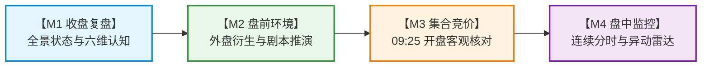

# G5-Phase 2 封口与边界冻结决议

> **决议编号**：BOARD-DECISION-20260925-01  
> **决议日期**：2026-09-25  
> **裁决机构**：最高董事会（用户）  
> **执行机构**：Antigravity 主开发、独立红队特使、独立质量发布闸门裁判  
> **对应里程碑**：G5-Phase 2（M4 盘中动态监控与异动感知系统）  

---

## 一、最高董事会正式裁决

最高董事会正式确认签署发布令：  
**G5-Phase 2「M4 盘中动态监控与异动感知系统」正式通过全面质量验收与红队两轮白盒攻防对抗，7+1 铁律必修清单全量合规，准予正式封口并发布入库！**

至此，系统核心认知四大基石已正式构筑完成并全面固化：
$$\text{M1 收盘事实} \longrightarrow \text{M2 盘前环境} \longrightarrow \text{M3 竞价事实} \longrightarrow \text{M4 盘中动态}$$

---

## 二、法定冻结边界清单（8 项铁律边界）

依据最高董事会指示，以下 8 项核心边界即刻进入**绝对冻结状态**，未经正式技术设计单与四权分立变更闸门流程，任何 Agent 均不得擅自突破或改写：

1. **M4 物理定位与限权边界冻结**：
   - M4 法定定位严格限定为“**盘中连续交易微观物理事实观测仪与异动状态感知雷达**”，绝不承担任何交易买卖决策；
   - 严禁产生任何买入、卖出、加仓、减仓、止损、打板建议或仓位配置等主观交易指令与诱导性建议；
   - 前后端全链路与作战看板逐项强制绑定“【客观物理事实测量提示】本看板仅对盘中市场量价与流动性数据进行客观时间序列测量，严禁作为投资或买卖操作建议”醒目免责声明。
2. **统一契约与 None 零填充防伪冻结**：
   - DB Schema（`IntradayMarketSnapshot`、`IntradayAnomalyEvent`）中所有数据统计字段统一保持 `nullable=True, default=None`；
   - 前端 TypeScript 接口全面同步为可空类型（`number | null`, `string | null`），指标缺失或未就绪时显式保持为 `None`（前端统一渲染为 `'--'`），严禁用 0、0.0 或历史均值伪造数据。
3. **科学量能投影 $W(T)$ 与开盘 15 分钟冷启动冻结**：
   - 基于 A 股真实成交占比累积分布函数 $W(T)$ 进行日内量能线性无偏外推；
   - 09:30~09:45（$T \le 15$）处于微观噪声期，量能投影必须强制输出 `None`；
   - 09:45 之后输出测算值，且数据库与前端必须显式标明 `is_proj_estimated = True`（Card 2 必须呈现 `ESTIMATED 估算` 徽标）。
4. **数学指标 30 分钟冷启动保护冻结**：
   - 09:30~10:00（$T \le 30$）期间流动性脉冲比率 $R_{vol}$ 统一输出 `None`，内部状态标为 `BASELINE_NOT_READY`，坚决杜绝因开盘基准样本不足引发的微观伪脉冲误报。
5. **边沿跃迁触发 Edge Trigger 与日切隔离冻结**：
   - 涨跌停封死与炸板事件采用严格边沿跃迁触发（Edge Trigger），仅在状态改变瞬间插入 1 次事件记录，持续封死状态严禁重复触发或写入日志，杜绝日志爆炸；
   - 必须通过 `_ensure_date_cache` 实施交易日日切隔离清理，跨交易日自动清空内存时序环与状态缓存，彻底杜绝次日开盘对昨日涨停标的误报假炸板；历史时序查询强制穿透数据库。
6. **严格同向系统性共振规则冻结**：
   - 系统性共振判定严格断言指数同向性：$(v_{\text{stock}} \times v_{\text{index}}) > 0$ 且 $|v_{\text{index}}| \ge 0.15\%$；
   - 双创标的（300/688）共振计算严格接入创业板指，主板接入上证指数；补齐 `SectorCoMove`（同向标的数 $\ge 2$）；坚决杜绝大盘狂泻个股逆势抽升被颠倒误判为大盘共振。
7. **重点池白名单与高危垃圾股全景排除冻结**：
   - 监控池仅纳入行业领涨前 3 板块龙头与千亿中军 Top20；
   - 全链路严密过滤排除 ST、*ST、S*ST、SST 及退市整理期个股（如 `xx退`）以及停牌标的，杜绝垃圾股污染重点池。
8. **午休跨段时钟拼接与后台异步批处理落盘冻结**：
   - 11:30~13:00 休市时间差严格计 0，13:00~13:05 跨段向前逆序滑动探测 11:25~11:30 切片，具备丢包容错韧性；
   - 定时调度器（`TaskScheduler`）每 60 秒自主轮询盘中数据，FastAPI `lifespan` 挂接后台异步写入 Daemon（每 10 秒批量提交 SQLite），杜绝人工手动点击依赖，保障数据库高频并发无锁。

---

## 三、交付成果与证据链归档

| 交付领域 | 关键文件 / 模块 | 验收状态 | 证据链证明 |
| :--- | :--- | :---: | :--- |
| **技术设计单** | `开发文档/17-G5-Phase-2-M4盘中动态监控与异动感知系统技术设计单.md` (v1.1) | 冻结 | 7+1 铁律必修项全量定义，盘中连续时间序列测量规范 |
| **工程决议** | `开发文档/18-G5-Phase-2封口与边界冻结决议.md` | 签署生效 | 最高董事会正式签署封口与 8 项边界冻结令 (BOARD-DECISION-20260925-01) |
| **数据库模型** | `backend/app/models/market.py` | 验收通过 | 新增 `IntradayMarketSnapshot` 与 `IntradayAnomalyEvent`，字段统一可空 |
| **服务层编排** | `backend/app/services/monitor.py` `backend/app/api/v1/monitor.py` | 验收通过 | 时钟状态机、量能投影、冷启动、Edge Trigger、同向共振、日切清理、异步批处理队列 |
| **调度与Daemon**| `backend/app/tasks/scheduler.py` `backend/app/main.py` | 验收通过 | 盘中 60 秒轮询作业，FastAPI lifespan 挂接每 10 秒落盘消费 Daemon |
| **数据源提供者** | `backend/app/data/providers/eastmoney.py` `backend/app/data/providers/sina.py` | 验收通过 | 排除 ST/退市整理期，构建前3领涨与千亿Top20池，买一封单 1000 万门槛 |
| **前端契约与UI** | `frontend/src/types/monitor.ts` `frontend/src/app/monitor/page.tsx` | 验收通过 | 强类型契约、Card 1~4 作战看板、`ESTIMATED 估算` 徽标、异动客观明细、全屏免责声明 |
| **全链路回归测试**| `backend/tests/test_api.py` | 100% 成功 | 18 步端到端测试 100% 通过（Code 0），覆盖 M1~M4 全部核心接口 |
| **专用自动化验证**| `backend/scripts/verify_m4_monitor.py` | 100% 成功 | 8 项 M4 专用验证 100% 通过（时钟、W(T)、None防伪、白名单、EdgeTrigger、跨段拼接、批处理、零买卖信号） |
| **前端生产构建** | Next.js 生产构建 (`next build`) | 100% 成功 | 12/12 页面编译成功，0 类型报错，0 语法警告 |
| **红队攻防对抗** | `red_team_audit_report_phase2_m4.md` (v2.0) | PASS | 独立红队特使签发放行令（RED-TEAM-G5-PHASE-2-M4-02），5项 P1 + 3项 P2 全部闭环清零 |
| **质量闸门裁决** | `quality_gatekeeper` 裁决书 | APPROVED | 独立质量发布闸门裁判签发准予封口放行裁决书 (GATEWAY-DECISION-G5-PHASE-2-M4-01) |
| **版本库与灾备** | Git 本地与局域网 NAS 远端 | 已同步 | Commit `45f8320` 提交并推送到 NAS 远程灾备库（`nas/master`） |

---

## 四、四块基石体系全景与后续演进

随着 M4 盘中动态监控与异动感知系统正式入库封口，系统完成了一期基础设施的全面闭环：

至此，系统已经拥有完整的、全日周期的客观事实感知与状态观测能力，且全链路守住了“零主观交易指令”的物理测量底线。
下一步可平稳进入更高阶的认知决策与模拟推演阶段。
