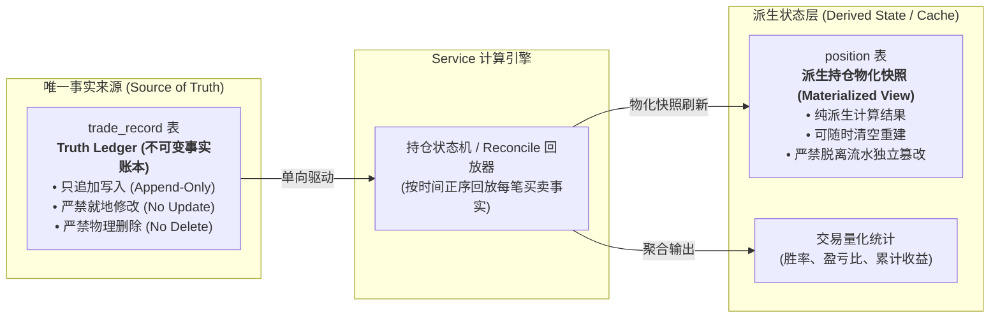
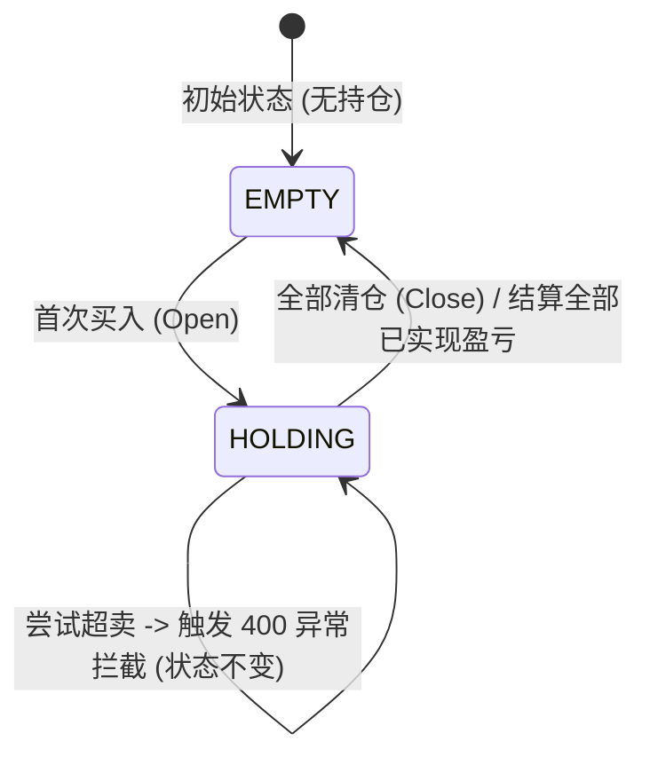
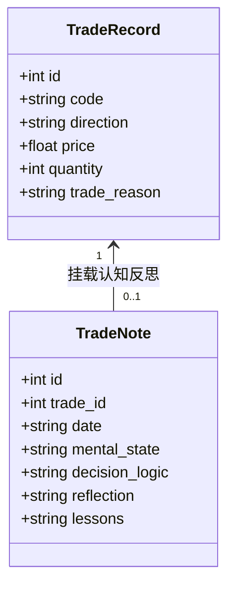
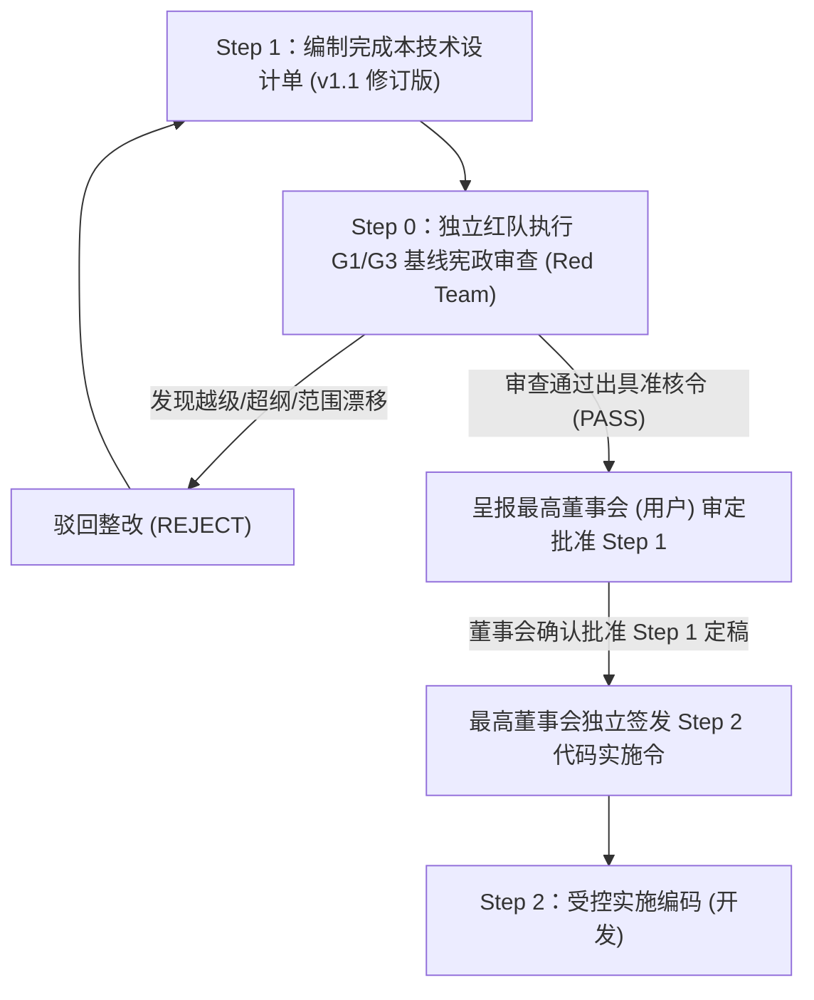

# G1-M3 交易记录与持仓管理系统技术设计单 (v1.1 董事会审定修订版)

> **设计单编号**：DESIGN-G1-M3-TRADING-01 (v1.1)  
> **编制日期**：2026-09-25（初始编制） / 2026-09-26（v1.1 修订）  
> **编制机构**：Antigravity 主开发团队  
> **当前流程阶段**：Step 1 技术设计单带条件修订（已获董事会立项授权，**未授权实施编码**）  
> **上位依据**：  
> 1. [《开发文档/01-项目决策基线（G0-正式版）.md》](file:///d:/项目库/AI认知复盘交易系统/开发文档/01-项目决策基线（G0-正式版）.md)  
> 2. [《开发文档/02-G1需求基线（正式冻结版）.md》](file:///d:/项目库/AI认知复盘交易系统/开发文档/02-G1需求基线（正式冻结版）.md)（第 3.3 节 M3 交易记录条款）  
> 3. [《开发文档/04-G3架构与详细设计（正式版）.md》](file:///d:/项目库/AI认知复盘交易系统/开发文档/04-G3架构与详细设计（正式版）.md)（第 1.1/2.2/3.2/4.2/6.1 节）  
> 4. [《开发文档/10-项目多Agent四权分立工程治理规范（v1.1）.md》](file:///d:/项目库/AI认知复盘交易系统/开发文档/10-项目多Agent四权分立工程治理规范.md)  
> 5. [《开发文档/19-G1-M3恢复执行前基线核对报告.md》](file:///d:/项目库/AI认知复盘交易系统/开发文档/19-G1-M3恢复执行前基线核对报告.md)  
> 6. **最高董事会审阅意见**：“设计单原则上通过，但需带条件修订 5 项关键治理与基线一致性条款，暂不授权编码；修订后由红队复核再呈报批准 Step 1，随后另行签发 Step 2 实施令。”

---

## 修订记录 (Revision History)

| 版本 | 修订日期 | 修订人 | 修订性质 | 核心修订内容摘要 |
| :--- | :--- | :--- | :--- | :--- |
| **v1.0** | 2026-09-25 | 主开发团队 | 初始编制 | 确立 G1-M3 需求基线映射、极简账本定位、持仓状态机、加权成本均价与已实现盈亏公式、API 契约及前端看板布局。 |
| **v1.1** | 2026-09-26 | 主开发团队 | 董事会审定修订 | **全量落实最高董事会“5 项关键治理与基线一致性修订意见”**：<br/>1. **Truth Ledger / Position 架构关系锁死**：明确 `TradeRecord` 为系统中唯一事实来源，`Position` 严格定性为高性能派生状态（Materialized View / Cache），严禁平级或独立修改；<br/>2. **交易事实更正机制锁死**：明确**绝对禁止对已入库流水进行就地 UPDATE 或物理 DELETE**，错账纠正严格执行会计红字冲正机制（Reversal Record）与流水全量顺序重放（Reconcile）；<br/>3. **行情 Provider 解耦（对齐 G3）**：废除 M3 自行指定底层 Provider 的越权表述，M3 Service 仅面向 Data Layer 的 `StockQuoteCapability` 抽象契约编程，由底层降级链与调度引擎负责调度；<br/>4. **统计口径严密数学定义**：严格定义平仓结算胜率（未平仓浮盈亏严格不计入胜率分子分母，分母为 0 输出 None）、盈亏比数学公式（总盈利/总亏损，单侧为 0 输出 None）、累计已实现盈亏 vs 总浮动盈亏（断流标注降级）；<br/>5. **Git/NAS 验收服从现行治理**：M3 验收标准全面服从《10-项目多Agent四权分立工程治理规范 (v1.1)》铁律 7，不设私有规则。 |

---

## 目录
- [一、需求基线映射与上位依据](#一需求基线映射与上位依据)
- [二、系统定位与边界负面清单（边界锁死）](#二系统定位与边界负面清单边界锁死)
- [三、架构拓扑与数据模型设计（Truth Ledger 与派生持仓）](#三架构拓扑与数据模型设计truth-ledger-与派生持仓)
- [四、持仓状态机与数学运算规则（核心引擎）](#四持仓状态机与数学运算规则核心引擎)
- [五、行情联动与浮动盈亏计算机制（Quote & PnL Engine）](#五行情联动与浮动盈亏计算机制quote--pnl-engine)
- [六、认知闭环：复盘笔记与反思体系设计](#六认知闭环复盘笔记与反思体系设计)
- [七、API 接口契约与输入防御设计（API Layer）](#七api-接口契约与输入防御设计api-layer)
- [八、前端产品化看板与交互设计（Presentation Layer）](#八前端产品化看板与交互设计presentation-layer)
- [九、可执行验收方案（AC-1 ~ AC-6 测试矩阵）](#九可执行验收方案ac-1--ac-6-测试矩阵)
- [十、上位基线未定义项与边界冻结声明](#十上位基线未定义项与边界冻结声明)
- [十一、四权分立流转与工序安排](#十一四权分立流转与工序安排)

---

## 一、需求基线映射与上位依据

依据《02-G1需求基线（正式冻结版）.md》第 3.3 节，**M3 交易记录**属于 **P1 核心闭环需求**。此前开发流程中因历史命名偏差（将竞价误称为 Phase 1C-M3，将盘中误称为 Phase 2-M4），导致真正的 G1-M3 基础记账与持仓管理被跳过。本设计单旨在严格落实 G1 条款，补齐这一不可或缺的基础闭环。

### 1.1 G1 需求条款对齐表

| G1 条款 | 条款名称 | G1 原始验收标准 | 本设计单实现承接 |
|:---:|---|---|---|
| **M3.1** | 手动录入交易记录 | 支持录入：股票代码、买卖方向、价格、数量、时间、交易理由 | 见第 7.2 节 `POST /api/v1/trading/records` 与第 8.2 节录入弹窗 |
| **M3.2** | 标准化写入接口 | 提供标准 API，外部 Agent 可通过 OCR/信息提取后写入，但不作为系统硬依赖 | 见第 7.1 节标准化 RESTful 协议与数据结构，支持 `source='agent_api'` 标记 |
| **M3.3** | 盈亏自动计算 | 根据买入/卖出记录自动计算单笔盈亏、持仓成本、总盈亏 | 见第 4.2 节加仓成本均价核算、减仓/平仓已实现盈亏核算算法 |
| **M3.4** | 持仓管理 | 展示当前持仓列表及浮动盈亏 | 见第 3.1 节派生状态架构、第 5 节联动真实行情计算浮动盈亏、第 8.2 节持仓台账卡片 |
| **M3.5** | 交易复盘笔记 | 每笔交易可附加复盘笔记：交易时心理状态、决策逻辑、事后反思 | 见第 6 节 `TradeNote` 领域模型与抽屉式反思编辑器 |
| **M3.6** | 交易记录查询 | 按日期、股票、盈亏等维度查询历史交易 | 见第 7.2 节多维过滤分页接口 `GET /api/v1/trading/records` |
| **M3.7** | 交易统计 | 胜率、平均盈亏比、最大回撤等基础统计 | 见第 4.4 节严密数学口径与第 7.2 节 `GET /api/v1/trading/stats` 接口 |

---

## 二、系统定位与边界负面清单（边界锁死）

### 2.1 系统法定定位：事实账本与反思载体
G1-M3 是系统的**「交易事实账本（Truth Ledger）」**与**「主观认知反思载体（Reflection Carrier）」**：
1. **真实记录**：完整、不可篡改地记录真实账户发生的每一笔买卖操作；
2. **客观核算**：基于真实成交数据，按照严格数学公式核算持仓均价、已实现盈亏与最新市值浮动盈亏；
3. **心路沉淀**：将交易行为与投资者的心理状态、决策依据及经验教训紧密绑定，为后续系统认知画像提供第一手事实语料。

### 2.2 绝对禁止的负面清单（Prohibition List）
为防止功能边界发散，M3 实施以下刚性禁令：
- 🚫 **严禁接入券商实盘交易接口**：本系统绝不做自动委托、自动报单、自动撤单或实盘账户登录对接；
- 🚫 **严禁引入任何选股策略、买卖信号推荐或 AI 交易指令**：严禁给出“推荐买入/卖出”提示，选股属于 M6 独立职责，严禁偷跑；
- 🚫 **严禁引入模拟撮合账户或复杂保证金利息计算**：模拟交易属于 M8 前向模拟职责，严禁混入真实交易账本；
- 🚫 **严禁开发任何形式的历史分时回放或回测系统**：G1 需求基线已永久移除 M7 回测系统；
- 🚫 **严禁修改任何已封口的 M1~M4 现有代码与表结构**；
- 🚫 **严禁在此功能未获用户端完整操作与红队放行前，自动开启下一个模块**。

---

## 三、架构拓扑与数据模型设计（Truth Ledger 与派生持仓）

### 3.1 核心架构原则：Truth Ledger 与派生状态（修订项 1）
依据董事会审查意见第 1 项，必须从架构根基上彻底锁死账本与持仓的关系，消除数据分叉（Split-Brain）隐患：



- **`trade_record`（Truth Ledger）**：是系统中关于交易的**唯一事实来源（Source of Truth）**。每笔交易入库即形成物理历史事实，具备时序不可变性；
- **`position`（Derived State）**：被法定定义为**派生状态 / 物化视图缓存（Materialized View / High-Performance Cache）**。其存在意义是为前端查询提供高性能快照，其本身不具备独立意志；
- **单向决定性**：任何时候清空 `position` 表，只要执行一次流水全量正序回放，均能 100% 精确无误地还原整个持仓表。**严禁任何外部 API、前端或管理后台绕过 `trade_record` 直接向 `position` 表写入或修改数据！**

### 3.2 核心持久化表结构（SQLite）

```sql
-- 1. 交易流水记录表（Truth Ledger，事实凭据）
CREATE TABLE trade_record (
    id INTEGER PRIMARY KEY AUTOINCREMENT,
    code TEXT NOT NULL,                     -- 股票代码（如 600519）
    name TEXT,                              -- 股票名称（如 贵州茅台）
    direction TEXT NOT NULL,                -- 买卖方向：buy / sell
    price REAL NOT NULL,                    -- 成交单价（元，必须 > 0）
    quantity INTEGER NOT NULL,              -- 成交股数（正整数，必须 > 0）
    amount REAL NOT NULL,                   -- 成交金额（price * quantity）
    trade_time TEXT NOT NULL,               -- 成交时间（YYYY-MM-DD HH:MM:SS）
    trade_reason TEXT,                      -- 交易理由简述（若为红字冲正需标注 [冲正: 流水#ID]）
    source TEXT DEFAULT 'manual',           -- 来源：manual / agent_api
    created_at TEXT DEFAULT (datetime('now'))
);

-- 2. 派生持仓快照表（Materialized View，由流水单向计算派生）
CREATE TABLE position (
    id INTEGER PRIMARY KEY AUTOINCREMENT,
    code TEXT NOT NULL UNIQUE,              -- 股票代码（唯一索引）
    name TEXT,                              -- 股票名称
    quantity INTEGER NOT NULL,              -- 当前持仓股数（>= 0，由买卖流水加减派生）
    avg_cost REAL NOT NULL,                 -- 持仓加权成本均价（由流水加权计算）
    total_cost REAL NOT NULL,               -- 持仓总成本（avg_cost * quantity）
    current_price REAL,                     -- 最新市价（由行情能力获取，非交易时段或断流为 NULL）
    floating_pnl REAL,                      -- 浮动盈亏（(current_price - avg_cost) * quantity，现价有效时派生）
    updated_at TEXT DEFAULT (datetime('now'))
);

-- 3. 交易认知反思笔记表（承接 G0/G1 认知闭环）
CREATE TABLE trade_note (
    id INTEGER PRIMARY KEY AUTOINCREMENT,
    trade_id INTEGER,                       -- 关联交易流水 ID（外键，可为空）
    date TEXT NOT NULL,                     -- 笔记日期（YYYY-MM-DD）
    mental_state TEXT,                      -- 交易时心理状态（恐慌、亢奋、执行纪律等）
    decision_logic TEXT,                    -- 决策逻辑（符合预案、盘中临时起意等）
    reflection TEXT,                        -- 事后反思（做得好的地方、偏差所在）
    lessons TEXT,                           -- 经验教训与规则固化
    created_at TEXT DEFAULT (datetime('now')),
    FOREIGN KEY (trade_id) REFERENCES trade_record(id)
);
```

---

## 四、持仓状态机与数学运算规则（核心引擎）

### 4.1 持仓状态机定义
持仓标的在生命周期中严格遵循如下双态模型：
- **`EMPTY`（无仓/已清仓）**：`quantity == 0`，不出现在默认有效持仓列表中；
- **`HOLDING`（持仓中）**：`quantity > 0`，正常参与浮动盈亏计算。



### 4.2 核心数学计算公式

#### 1. 首次建仓与加仓（Buy Action）
- 当标的为首次买入（原持仓不存在或 `quantity == 0`）：
  $$quantity_{new} = buy\_qty$$
  $$total\_cost_{new} = buy\_price \times buy\_qty$$
  $$avg\_cost_{new} = buy\_price$$
- 当标的处于加仓中（原持仓 `quantity_{old} > 0`），采用**加权移动平均法**：
  $$quantity_{new} = quantity_{old} + buy\_qty$$
  $$total\_cost_{new} = total\_cost_{old} + (buy\_price \times buy\_qty)$$
  $$avg\_cost_{new} = \frac{total\_cost_{new}}{quantity_{new}}$$

#### 2. 减仓与清仓（Sell Action）与超卖防御
- **超卖强校验（Overselling Prohibition）**：
  在执行卖出前，严格检查：
  $$\text{IF } sell\_qty > quantity_{old} \implies \text{RAISE 400 INSUFFICIENT\_POSITION}$$
  系统必须立即中断事务并回滚，绝对禁止持仓扣减为负数。
- **已实现盈亏核算（Realized PnL Calculation）**：
  基于出场价与当前持仓成本均价的差额结算：
  $$realized\_pnl = (sell\_price - avg\_cost_{old}) \times sell\_qty$$
  $$realized\_pnl\_pct = \frac{sell\_price - avg\_cost_{old}}{avg\_cost_{old}} \times 100\%$$
- **持仓与成本核减**：
  - 若为部分减仓（$sell\_qty < quantity_{old}$）：
    $$quantity_{new} = quantity_{old} - sell\_qty$$
    $$avg\_cost_{new} = avg\_cost_{old} \quad \text{（持仓均价保持不变）}$$
    $$total\_cost_{new} = quantity_{new} \times avg\_cost_{new}$$
  - 若为全部清仓（$sell\_qty == quantity_{old}$）：
    $$quantity_{new} = 0$$
    $$avg\_cost_{new} = 0.0$$
    $$total\_cost_{new} = 0.0$$
    $$current\_price = \text{None}$$
    $$floating\_pnl = 0.0$$

### 4.3 交易事实更正机制（修订项 2：严禁修改原始事实）
依据董事会审查意见第 2 项，彻底消灭“修改/删除历史流水”的逻辑矛盾：

1. **绝对不可篡改铁律（No In-Place Mutation / No Physical Deletion）**：
   - 系统**坚决不提供**针对已生效 `trade_record` 的 `PUT /records/{id}` 或 `DELETE /records/{id}` 接口；
   - 任何已写入的数据均代表物理世界的历史操作，不能被直接抹除或原地修改。
2. **错账纠正标准机制：会计红字冲正（Reversal Trade）**：
   - 若用户出现录入错误（如代码填错、买卖方向反了、价格或数量输入有误）：
     - 用户在前端发起“冲正”操作；
     - 系统自动生成一条**等量反向对冲流水**：
       * 例如：原记录为 `买入 贵州茅台 100股 @ 1600`，冲正记录为 `卖出 贵州茅台 100股 @ 1600`，`trade_reason` 显式注明 `[冲正对冲: 流水#ID]`；
     - 对冲记录作为新事实追加录入 Truth Ledger，驱动持仓派生状态自然回归；
     - 用户随后录入正确的交易流水，账本逻辑永远保持单向时序闭环。
3. **持仓对账重算机制（Reconcile Engine）**：
   - 提供服务接口 `POST /api/v1/trading/reconcile`；
   - 当怀疑派生持仓与事实流水有偏差时，系统按 `trade_time ASC, id ASC` 顺序拉取全量流水，从零状态重新回放状态机，重写刷新 `position` 派生表，并输出差额对账单。

### 4.4 交易统计量化口径严格数学定义（修订项 4）
依据董事会审查意见第 4 项，补齐量化统计指标的严密数学定义，消除模糊地带：

#### 1. 结算交易样本集定义（Closed Trade Round-trips）
- 统计的样本集以**卖出行为（$direction == 'sell'$）**作为一笔交易完成结算的触发点；
- 未平仓的持仓（仅有买入、尚未卖出）属于浮动敞口，**其浮动盈亏严格不计入胜率与盈亏比的统计样本**。

#### 2. 胜率（Win Rate, $P_{win}$）
$$P_{win} = \begin{cases} \frac{N_{profit}}{N_{closed}} \times 100\%, & \text{if } N_{closed} > 0 \\ \text{None}, & \text{if } N_{closed} = 0 \end{cases}$$
- $N_{closed}$：累计已平仓/减仓结算笔数（即所有 $direction == 'sell'$ 的记录数）；
- $N_{profit}$：已结算交易中已实现盈亏 $realized\_pnl > 0$ 的记录数；
- **边界防御**：当 $N_{closed} == 0$（尚未发生任何卖出结算）时，$P_{win}$ 输出为 `None`，前端显示 `--`，**绝对禁止显示 0.0% 或 100.0% 产生伪造误导**。

#### 3. 盈亏比（Payoff Ratio / Profit-Loss Ratio, $R_{pl}$）
衡量平均盈利交易幅度与平均亏损交易幅度的相对比例：
$$R_{pl} = \begin{cases} \frac{\overline{PnL}_{profit}}{|\overline{PnL}_{loss}|} = \frac{\sum PnL_{profit} / N_{profit}}{|\sum PnL_{loss} / N_{loss}|}, & \text{if } N_{profit} > 0 \text{ and } N_{loss} > 0 \\ \text{None}, & \text{otherwise} \end{cases}$$
- $PnL_{profit}$：所有盈利单笔的 $realized\_pnl$；
- $PnL_{loss}$：所有亏损单笔的 $realized\_pnl$；
- **边界防御**：若无亏损笔数（$N_{loss} == 0$）或无盈利笔数（$N_{profit} == 0$），$R_{pl}$ 必须输出为 `None`（前端显示 `--`）。

#### 4. 盈亏汇总指标
- **累计已实现盈亏（Total Realized PnL）**：
  $$\text{Total Realized PnL} = \sum_{i \in \text{All Sells}} realized\_pnl_i$$
- **当前持仓总浮动盈亏（Total Floating PnL）**：
  $$\text{Total Floating PnL} = \sum_{p \in \text{Positions, qty} > 0} floating\_pnl_p$$
  *若持仓中任一标的因行情断流导致现价缺失，总浮盈亏标注 `PARTIAL` 降级提示，绝不补零；*
- **账户总盈亏（Total Aggregate PnL）**：
  $$\text{Total Aggregate PnL} = \text{Total Realized PnL} + \text{Total Floating PnL}$$

---

## 五、行情联动与浮动盈亏计算机制（Quote & PnL Engine）

### 5.1 面向 Capability 抽象设计（修订项 3：严格对齐 G3 解耦架构）
依据董事会审查意见第 3 项与《04-G3架构与详细设计》第 2 节铁律（**“上层业务依赖 Capability，不依赖具体 Provider”**）：

- **禁止硬编码 Provider**：M3 的 `TradingService` 严格面向 Data Layer 提供的通用能力契约编程，**绝对禁止在业务代码中硬编码任何特定 Provider（如 Sina/Eastmoney/Baostock）**；
- **标准能力调用**：
  ```python
  # M3 TradingService 中的标准调用方式：面向抽象数据服务
  data_result = await self.data_service.get_stock_quotes(codes=holding_stock_codes)
  ```
- **职责下沉**：具体由哪个 Provider 响应、网络超时与指数退避重试、以及 Primary $\rightarrow$ Fallback 降级链，全部由 Data Layer 的 `CapabilityResolver` 与 `ProviderRegistry` 自行处理，业务层保持纯净。

### 5.2 浮动盈亏计算公式
对于有效持仓（$quantity > 0$）：
- 当成功获取到有效市价（$current\_price > 0$）时：
  $$floating\_pnl = (current\_price - avg\_cost) \times quantity$$
  $$floating\_pnl\_pct = \frac{current\_price - avg\_cost}{avg\_cost} \times 100\%$$
  $$market\_value = current\_price \times quantity$$

### 5.3 真实数据防伪与网络降级策略（落实铁律 9）
- **绝不填充假价格**：若在非交易时段、网络断流或股票停牌时行情接口不可用，`current_price` 显式设为 `None`，`floating_pnl` 显式设为 `None`；
- **前端防御渲染**：
  - 当现价或浮动盈亏为 `None` 时，界面统一呈现 `--` 或“待更新”，绝不允许偷填 0.0 或虚假数字误导用户；
  - 显式展示“行情更新时间”或“休市中（昨日收盘价）”，杜绝产生虚假安全感。

---

## 六、认知闭环：复盘笔记与反思体系设计

### 6.1 反思维度的结构化建模
为彻底承接 G0 认知复盘原则，将投资反思从散漫日记转变为结构化沉淀：



- **心理状态（Mental State）**：记录操作时刻的主观情绪（如：恐慌、贪婪、亢奋、犹豫、冷静执行纪律等）；
- **决策逻辑（Decision Logic）**：记录当时支撑买卖的客观事实或预案（如：突破昨日高点确认、情绪冰点博弈反弹、跌破止损位果断止损等）；
- **事后反思（Reflection）**：收盘后或交易结束后回头看（如：进场过早、未等待右侧信号、止盈合理锁定利润等）；
- **经验教训（Lessons）**：沉淀为长期可复用的认知规则。

---

## 七、API 接口契约与输入防御设计（API Layer）

统一路由前缀：`/api/v1/trading`

### 7.1 Pydantic 输入强校验契约

```python
# backend/app/schemas/trading.py

from pydantic import BaseModel, Field, validator
from typing import Optional, List
import re

class TradeRecordCreate(BaseModel):
    code: str = Field(..., description="6位A股纯数字代码，如 600519 或 000001")
    name: Optional[str] = Field(None, description="股票名称")
    direction: str = Field(..., description="交易方向：buy 或 sell")
    price: float = Field(..., gt=0, description="成交单价，必须大于0")
    quantity: int = Field(..., gt=0, description="成交股数，必须为正整数（买入建议整百）")
    trade_time: str = Field(..., description="成交时间，格式 YYYY-MM-DD HH:MM:SS")
    trade_reason: Optional[str] = Field(None, max_length=500, description="交易理由简述")
    source: str = Field("manual", description="来源渠道：manual 或 agent_api")

    @validator("code")
    def validate_code(cls, v):
        if not re.match(r"^\d{6}$", v):
            raise ValueError("股票代码必须为6位纯数字")
        return v

    @validator("direction")
    def validate_direction(cls, v):
        d = v.lower().strip()
        if d not in ("buy", "sell"):
            raise ValueError("交易方向只能为 buy 或 sell")
        return d

class ReversalTradeCreate(BaseModel):
    target_record_id: int = Field(..., description="待红字冲正的原始交易流水ID")
    reason: str = Field(..., min_length=5, description="冲正原因说明")

class TradeNoteCreate(BaseModel):
    trade_id: Optional[int] = Field(None, description="关联的具体交易ID")
    date: str = Field(..., description="记录日期 YYYY-MM-DD")
    mental_state: Optional[str] = Field(None, max_length=200, description="心理状态")
    decision_logic: Optional[str] = Field(None, max_length=1000, description="决策逻辑")
    reflection: Optional[str] = Field(None, max_length=1000, description="事后反思")
    lessons: Optional[str] = Field(None, max_length=1000, description="经验教训")
```

### 7.2 端点定义清单

| 方法 | 路径 | 功能说明 | 关键查询参数 / 请求体 | 返回数据 |
|:---:|---|---|---|---|
| `GET` | `/records` | 多维查询历史交易流水 | `code`, `direction`, `start_date`, `end_date`, `page=1`, `limit=20` | `{items: [...], total, page, limit}` |
| `POST` | `/records` | 录入交易事实并驱动派生持仓更新 | Request Body: `TradeRecordCreate` | 录入成功的记录详情与最新持仓快照 |
| `POST` | `/records/reverse` | 对指定流水生成反向红字冲正记录 | Request Body: `ReversalTradeCreate` | 冲正记录及更新后的派生持仓 |
| `GET` | `/records/{id}` | 查询单笔交易明细及关联笔记 | Path Param: `id` | 交易详情及附带的 `TradeNote` |
| `GET` | `/positions` | 查询当前派生持仓快照 | `refresh_quote=true` (可选是否实时刷现价) | `{positions: [...], total_market_value, total_floating_pnl}` |
| `GET` | `/stats` | 获取严密定义的交易量化统计指标 | 无 | `{total_trades, closed_trades, win_rate, total_realized_pnl, payoff_ratio, ...}` |
| `POST` | `/notes` | 提交/更新交易复盘反思笔记 | Request Body: `TradeNoteCreate` | 保存成功的笔记详情 |
| `GET` | `/notes/{trade_id}` | 获取指定交易的复盘笔记 | Path Param: `trade_id` | 笔记内容 |
| `POST` | `/reconcile` | 对账与持仓状态全量顺序重算 | Query: `code` (可选指定股票) | 对账差额报告与更新结果 |

### 7.3 统一错误响应结构
当触发输入校验失败或业务拦截（如超卖）时，统一返回标准 JSON：
```json
{
  "code": 400,
  "message": "当前持仓数量不足以卖出：持仓 500 股，申请卖出 1000 股",
  "detail": {
    "error_type": "INSUFFICIENT_POSITION_ERROR",
    "code": "600519",
    "current_qty": 500,
    "requested_sell_qty": 1000
  },
  "timestamp": "2026-09-26T08:00:00"
}
```

---

## 八、前端产品化看板与交互设计（Presentation Layer）

### 8.1 彻底消灭虚假占位符
彻底废除当前 `frontend/src/app/trading/page.tsx` 中 `Coming in Phase 3` 占位代码，重构为真实、交互完整、数据驱动的产品化看板。

### 8.2 页面整体布局架构

```text
┌────────────────────────────────────────────────────────────────────────┐
│  交易记录与持仓管理看板 (Trading & Position Portfolio)                  │
├────────────────────────────────────────────────────────────────────────┤
│ 【统计概览卡片】 (Top Metrics Cards)                                   │
│  [ 总持仓市值: ¥128,450.00 ]  [ 当日/总浮动盈亏: +¥4,250.00 (+3.4%) ] │
│  [ 累计已实现盈亏: +¥18,200 ] [ 胜率: 62.5% (10/16) ] [ 盈亏比: 1.85 ]│
├────────────────────────────────────────────────────────────────────────┤
│ 【当前持仓台账 (Active Positions)】                     [+ 手工录入买卖]│
│  ┌──────────┬──────────┬──────────┬──────────┬────────────┬─────────┐ │
│  │ 股票代码 │ 股票名称 │ 持仓股数 │ 成本均价 │ 最新现价   │ 浮动盈亏│ │
│  ├──────────┼──────────┼──────────┼──────────┼────────────┼─────────┤ │
│  │ 600519   │ 贵州茅台 │ 200 股   │ 1620.00  │ 1650.50    │ +¥6,100 │ │
│  │ 000001   │ 平安银行 │ 1000 股  │ 10.50    │ 10.45      │ -¥50.00 │ │
│  └──────────┴──────────┴──────────┴──────────┴────────────┴─────────┘ │
├────────────────────────────────────────────────────────────────────────┤
│ 【历史交易流水与复盘台账 (Trade Ledger & Notes)】                       │
│  [筛选: 全部/买入/卖出] [代码搜索: _____ ] [日期筛选: _________ ]        │
│  ┌──────────────────────────────────────────────────────────────────┐  │
│  │ 2026-09-25 14:15 | 买入 贵州茅台 100 股 @ 1620.00 | 理由: 回踩支撑 │  │
│  │ 📝 复盘笔记: [心态: 冷静执行] [逻辑: 5日线企稳] [反思: 节奏适中]   │  │
│  ├──────────────────────────────────────────────────────────────────┤  │
│  │ 2026-09-24 10:30 | 卖出 平安银行 500 股 @ 11.20 | 结算盈亏: +¥350 │  │
│  └──────────────────────────────────────────────────────────────────┘  │
└────────────────────────────────────────────────────────────────────────┘
```

### 8.3 交互细节与状态设计
1. **手工录入买卖抽屉/弹窗（Trade Entry Modal）**：
   - 输入股票代码，自动调用行情能力接口预填名称与现价参考；
   - 买入/卖出单选切换；卖出时自动显示当前可用最大持仓股数；
   - 支持勾选“同步填写复盘笔记”，一次性完成心路记录。
2. **红字冲正安全抽屉（Reversal Drawer）**：
   - 若某笔流水录错，点击流水上的“冲正对冲”按钮，二次确认并录入冲正原因后，生成对冲红字流水，界面清晰标红提示；
   - 彻底告别直接就地修改历史流水的坏味道。
3. **复盘反思抽屉（Note Drawer）**：
   - 点击流水卡片上的“📝 撰写/查看反思”，右侧滑出抽屉，支持对心理状态、决策依据、事后得失与经验教训进行追加或编辑。
4. **真实空状态（Empty States）**：
   - 无持仓时显示：`“当前账户无持仓，点击右上角【录入买卖】建立首笔交易记录”`；
   - 彻底杜绝使用静态 Mock 常量。

---

## 九、可执行验收方案（AC-1 ~ AC-6 测试矩阵）

在功能最终交付前，必须 100% 达成以下 6 项刚性指标：

| 验收编号 | 验收项 | 测试方法与操作步骤 | 预期输出与断言判定 |
|:---:|---|---|---|
| **AC-1** | 真实记账与盈亏闭环 | 1. 录入买入 600519，价格 1600.00，数量 200；<br/>2. 验证派生持仓生成数量 200，成本 1600.00；<br/>3. 加仓买入 100 股，价格 1660.00；<br/>4. 验证持仓数量变为 300，成本均价变为 1620.00；<br/>5. 卖出 150 股，单价 1700.00。 | 1. 卖出已实现盈亏准确断言为 `(1700 - 1620) * 150 = +12,000.00`；<br/>2. 剩余派生持仓准确断言为 150 股，成本均价保持 1620.00 不变。 |
| **AC-2** | 认知笔记回显 | 针对某笔交易提交复盘笔记（心态、逻辑、反思），刷新页面或调用 GET 接口。 | 笔记完整持久化落库，接口与前端组件均能无缝完整回显。 |
| **AC-3** | 前端零假数据（铁律 9） | 1. 全局静态扫描 `frontend/src/app/trading/`；<br/>2. 检查空状态与有数据状态。 | 1. 彻底清零 `Coming in Phase 3` 占位；<br/>2. 零写死 mock 数据，行情断流时展示 `--`。 |
| **AC-4** | 接口防御与抗超卖 | 1. 针对持有 150 股的标的，发起卖出 200 股的 POST 请求；<br/>2. 发起单价 $\le 0$ 或数量 $\le 0$ 的请求。 | 1. 超卖请求被后端 100% 拦截并返回 `400 Bad Request`，持仓股数不变；<br/>2. 非法参数触发 Pydantic 校验拒绝。 |
| **AC-5** | 自动化测试与构建 | 1. 运行后端自动化测试 `pytest backend/tests/test_trading.py`；<br/>2. 运行前端构建 `npm run build`。 | 1. 后端单元与集成测试 100% 通过；<br/>2. 前端 0 语法报错、0 类型错误通过编译。 |
| **AC-6** | 现行工程治理服从性（修订项 5） | 1. 执行 `git status`；<br/>2. 执行 `git push nas master`。 | **严格服从《10-工程治理规范 v1.1》铁律 7**：Working Tree 100% Clean；局域网连通时同步推送 NAS，不自创私有规则。 |

---

## 十、上位基线未定义项与边界冻结声明

严格遵守董事会特别指示：**“不要重新设计系统，如果 G1/G3 没有规定某项能力，标记「上位基线未定义，暂不扩展。」不要自行补充。”**

1. **券商实盘直连与自动委托下单**：
   - 标注：**「上位基线未定义，暂不扩展。」**（遵循 G0/G1 纯手工/只读记录边界）
2. **融资融券（信用账户）与多币种外汇折算**：
   - 标注：**「上位基线未定义，暂不扩展。」**（当前仅支持 A 股现货普通账户）
3. **个股期权、可转债套利与复杂衍生品**：
   - 标注：**「上位基线未定义，暂不扩展。」**（当前标的范围限于 A 股现货）
4. **盘中自动止损触发通知与短信推送**：
   - 标注：**「上位基线未定义，暂不扩展。」**（系统为事后/盘中客观观测，不做侵入式报警推送）
5. **策略候选池买卖推荐引擎**：
   - 标注：**「此为 M6 范围，本模块坚决不予包含。」**

---

## 十一、四权分立流转与工序安排

按照董事会四权分立 v1.1 治理规约与审阅意见，后续工序严格规定如下：



> ⚠️ **当前工程状态声明（绝对冻结）**：  
> 本 v1.1 修订版设计单编制完成，**主开发团队依然处于绝对代码冻结状态，严禁进入代码编写**。  
> 立即将本设计单提交独立红队特使 `red_team_tester` 执行 **Step 0：G1/G3 基线宪政审查**。待红队特使复核出具 PASS 后，再次呈报董事会审定。
