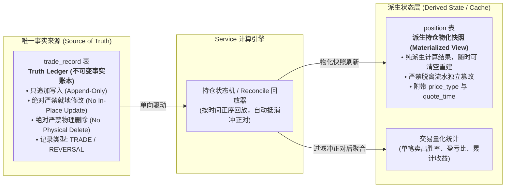
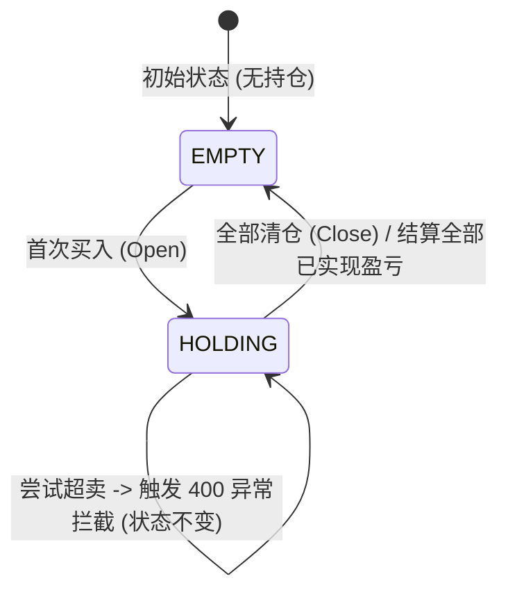
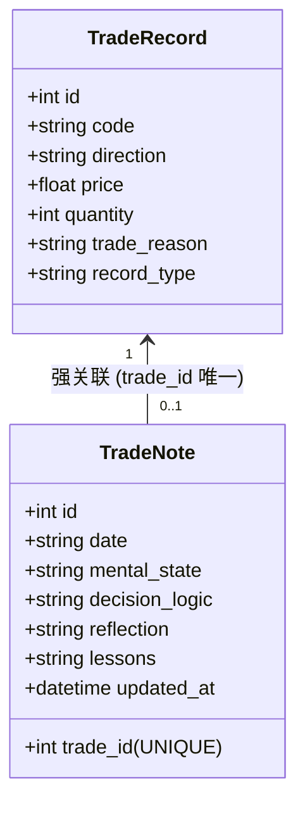
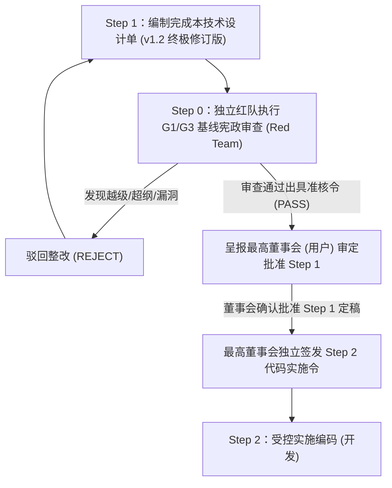

# G1-M3 交易记录与持仓管理系统技术设计单 (v1.2 终极修订版)

> **设计单编号**：DESIGN-G1-M3-TRADING-01 (v1.2 终极修订版)  
> **编制日期**：2026-09-25（初始编制） / 2026-09-26（v1.2 终极修订）  
> **编制机构**：Antigravity 主开发团队  
> **当前流程阶段**：Step 1 技术设计单终极修订（已获董事会立项授权，**未授权实施编码，代码绝对冻结**）  
> **上位依据**：  
> 1. [《开发文档/01-项目决策基线（G0-正式版）.md》](file:///d:/项目库/AI认知复盘交易系统/开发文档/01-项目决策基线（G0-正式版）.md)  
> 2. [《开发文档/02-G1需求基线（正式冻结版）.md》](file:///d:/项目库/AI认知复盘交易系统/开发文档/02-G1需求基线（正式冻结版）.md)（第 3.3 节 M3 交易记录条款）  
> 3. [《开发文档/04-G3架构与详细设计（正式版）.md》](file:///d:/项目库/AI认知复盘交易系统/开发文档/04-G3架构与详细设计（正式版）.md)（第 1.1/2.2/3.2/4.2/6.1 节）  
> 4. [《开发文档/10-项目多Agent四权分立工程治理规范（v1.1）.md》](file:///d:/项目库/AI认知复盘交易系统/开发文档/10-项目多Agent四权分立工程治理规范.md)  
> 5. [《开发文档/19-G1-M3恢复执行前基线核对报告.md》](file:///d:/项目库/AI认知复盘交易系统/开发文档/19-G1-M3恢复执行前基线核对报告.md)  
> 6. **最高董事会 6 项边界穿透审查令** 与 **红队特使《G1-M3 6项边界穿透审查报告 (REJECT-v1.1)》**

---

## 修订记录 (Revision History)

| 版本 | 修订日期 | 修订人 | 修订性质 | 核心修订内容摘要 |
| :--- | :--- | :--- | :--- | :--- |
| **v1.0** | 2026-09-25 | 主开发团队 | 初始编制 | 确立 G1-M3 需求基线映射、极简账本定位、持仓状态机、加权成本均价与已实现盈亏公式、API 契约及前端看板布局。 |
| **v1.1** | 2026-09-26 | 主开发团队 | 董事会审定修订 | 落实最高董事会“5 项关键治理与基线一致性修订意见”（Truth Ledger 派生关系、禁止就地篡改、行情解耦、统计严密化、服从治理）。 |
| **v1.2** | 2026-09-26 | 主开发团队 | 红队审查终极钉死 | **全量落实红队特使针对董事会 6 大边界审查令的硬性阻断补丁**：<br/>1. **冲正记录硬隔离（P1 漏洞修复）**：新增 `record_type` 与 `reversed_record_id`，统计与盈亏引擎显式剔除冲正对，杜绝冲正污染胜率与凭空核算虚假利润；<br/>2. **amount 强制服务端派生与 CHECK 约束（P2 修复）**：统一为服务端强计算列，前端传入强制忽略，表结构增加严格算术 CHECK 校验；<br/>3. **胜率明确为「单笔卖出胜率 (Closed Leg Win Rate)」（P1 缺陷修复）**：严密定义统计边界为即时出场决策质量，宏观回合胜率明确标注「上位基线未定义，暂不扩展」；<br/>4. **TradeNote 严格 1:1 与时间戳增量追加（P2 修复）**：`trade_id` 设为 UNIQUE 约束，定义 Upsert 语义并支持 `[HH:MM 追加]` 前缀拼接；<br/>5. **POST /records 幂等性与 60s 指纹防重（P1 漏洞修复）**：支持 `idempotency_key`，引入 MD5 五元组 60 秒指纹去重，防止并发/重试持仓翻倍；<br/>6. **现价真实性边界与防伪微标（P2 修复）**：新增 `price_type`（REALTIME / PREV_CLOSE / UNAVAILABLE）与 `quote_time`，盘后强制显示 `[昨收参考]` 与 `[上一交易日结余]`。 |

---

## 目录
- [一、需求基线映射与上位依据](#一需求基线映射与上位依据)
- [二、系统定位与边界负面清单（边界锁死）](#二系统定位与边界负面清单边界锁死)
- [三、架构拓扑与数据模型设计（Truth Ledger 与派生持仓）](#三架构拓扑与数据模型设计truth-ledger-与派生持仓)
- [四、持仓状态机与数学运算规则（核心引擎）](#四持仓状态机与数学运算规则核心引擎)
- [五、行情联动与浮动盈亏计算机制（Quote & PnL Engine）](#五行情联动与浮动盈亏计算机制quote--pnl-engine)
- [六、认知闭环：复盘笔记与反思体系设计](#六认知闭环复盘笔记与反思体系设计)
- [七、API 接口契约与输入防御设计（API Layer）](#七api-接口契约与输入防御设计api-layer)
- [八、前端产品化看板与交互设计（Presentation Layer）](#八前端产品化看板与交互设计presentation-layer)
- [九、可执行验收方案（AC-1 ~ AC-6 测试矩阵）](#九可执行验收方案ac-1--ac-6-测试矩阵)
- [十、上位基线未定义项与边界冻结声明](#十上位基线未定义项与边界冻结声明)
- [十一、四权分立流转与工序安排](#十一四权分立流转与工序安排)

---

## 一、需求基线映射与上位依据

依据《02-G1需求基线（正式冻结版）.md》第 3.3 节，**M3 交易记录**属于 **P1 核心闭环需求**。此前开发流程中因历史命名偏差（将竞价误称为 Phase 1C-M3，将盘中误称为 Phase 2-M4），导致真正的 G1-M3 基础记账与持仓管理被跳过。本设计单旨在严格落实 G1 条款，补齐这一不可或缺的基础闭环。

### 1.1 G1 需求条款对齐表

| G1 条款 | 条款名称 | G1 原始验收标准 | 本设计单实现承接 |
|:---:|---|---|---|
| **M3.1** | 手动录入交易记录 | 支持录入：股票代码、买卖方向、价格、数量、时间、交易理由 | 见第 7.2 节 `POST /api/v1/trading/records` 与第 8.2 节录入弹窗 |
| **M3.2** | 标准化写入接口 | 提供标准 API，外部 Agent 可通过 OCR/信息提取后写入，但不作为系统硬依赖 | 见第 7.1 节标准化 RESTful 协议与数据结构，支持 `source='agent_api'` 标记与幂等防重 |
| **M3.3** | 盈亏自动计算 | 根据买入/卖出记录自动计算单笔盈亏、持仓成本、总盈亏 | 见第 4.2 节加仓成本均价核算、减仓/平仓已实现盈亏核算算法（冲正对自动剥离） |
| **M3.4** | 持仓管理 | 展示当前持仓列表及浮动盈亏 | 见第 3.1 节派生状态架构、第 5 节联动真实行情计算浮动盈亏、第 8.2 节持仓台账卡片 |
| **M3.5** | 交易复盘笔记 | 每笔交易可附加复盘笔记：交易时心理状态、决策逻辑、事后反思 | 见第 6 节 `TradeNote` 1:1 强绑定与时间戳增量追加机制 |
| **M3.6** | 交易记录查询 | 按日期、股票、盈亏等维度查询历史交易 | 见第 7.2 节多维过滤分页接口 `GET /api/v1/trading/records` |
| **M3.7** | 交易统计 | 胜率、平均盈亏比、最大回撤等基础统计 | 见第 4.4 节严密数学口径（单笔卖出胜率，未平仓不计入）与第 7.2 节 stats 接口 |

---

## 二、系统定位与边界负面清单（边界锁死）

### 2.1 系统法定定位：事实账本与反思载体
G1-M3 是系统的**「交易事实账本（Truth Ledger）」**与**「主观认知反思载体（Reflection Carrier）」**：
1. **真实记录**：完整、不可篡改地记录真实账户发生的每一笔买卖操作；
2. **客观核算**：基于真实成交数据，按照严格数学公式核算持仓均价、已实现盈亏与最新市值浮动盈亏；
3. **心路沉淀**：将交易行为与投资者的心理状态、决策依据及经验教训紧密绑定，为后续系统认知画像提供第一手事实语料。

### 2.2 绝对禁止的负面清单（Prohibition List）
为防止功能边界发散，M3 实施以下刚性禁令：
- 🚫 **严禁接入券商实盘交易接口**：本系统绝不做自动委托、自动报单、自动撤单或实盘账户登录对接；
- 🚫 **严禁引入任何选股策略、买卖信号推荐或 AI 交易指令**：严禁给出“推荐买入/卖出”提示，选股属于 M6 独立职责，严禁偷跑；
- 🚫 **严禁引入模拟撮合账户或复杂保证金利息计算**：模拟交易属于 M8 前向模拟职责，严禁混入真实交易账本；
- 🚫 **严禁开发任何形式的历史分时回放或回测系统**：G1 需求基线已永久移除 M7 回测系统；
- 🚫 **严禁修改任何已封口的 M1~M4 现有代码与表结构**；
- 🚫 **严禁在此功能未获用户端完整操作与红队放行前，自动开启下一个模块**。

---

## 三、架构拓扑与数据模型设计（Truth Ledger 与派生持仓）

### 3.1 核心架构原则：Truth Ledger 与派生状态
依据董事会审查意见与红队审查要求，彻底锁死账本与持仓的关系，消除数据分叉（Split-Brain）隐患：



- **`trade_record`（Truth Ledger）**：是系统中关于交易的**唯一事实来源（Source of Truth）**。每笔交易入库即形成物理历史事实，具备时序不可变性；
- **`position`（Derived State）**：被法定定义为**派生状态 / 物化视图缓存（Materialized View / High-Performance Cache）**。其存在意义是为前端查询提供高性能快照，其本身不具备独立意志；
- **单向决定性**：任何时候清空 `position` 表，只要执行一次流水全量正序回放，均能 100% 精确无误地还原整个持仓表。**严禁任何外部 API、前端或管理后台绕过 `trade_record` 直接向 `position` 表写入或修改数据！**

### 3.2 核心持久化表结构（SQLite 落实补丁）

```sql
-- 1. 交易流水记录表（Truth Ledger，事实凭据，落实补丁 1、2、5）
CREATE TABLE trade_record (
    id INTEGER PRIMARY KEY AUTOINCREMENT,
    code TEXT NOT NULL,                     -- 股票代码（如 600519，6位纯数字）
    name TEXT,                              -- 股票名称（如 贵州茅台）
    direction TEXT NOT NULL,                -- 买卖方向：buy / sell
    price REAL NOT NULL,                    -- 成交单价（元，必须 > 0）
    quantity INTEGER NOT NULL,              -- 成交股数（正整数，必须 > 0）
    amount REAL NOT NULL,                   -- 成交金额（服务端强制计算 round(price * quantity, 2)）
    trade_time TEXT NOT NULL,               -- 成交时间（YYYY-MM-DD HH:MM:SS）
    trade_reason TEXT,                      -- 交易理由简述（冲正记录注明 [系统冲正: 抵消流水#ID]）
    source TEXT DEFAULT 'manual',           -- 来源：manual / agent_api
    record_type TEXT DEFAULT 'TRADE',       -- 【补丁 1】记录类型：TRADE (真实交易) / REVERSAL (冲正对冲)
    reversed_record_id INTEGER,             -- 【补丁 1】关联的被冲正记录 ID（仅 REVERSAL 记录非空）
    idempotency_key TEXT,                   -- 【补丁 5】客户端幂等唯一键（防并发重试重复插入）
    created_at TEXT DEFAULT (datetime('now')),
    -- 【补丁 2】强制服务端强校验派生约束，严防前端传入错误金额或浮点污染
    CHECK (amount > 0 AND abs(amount - round(price * quantity, 2)) < 0.01)
);

-- 2. 派生持仓快照表（Materialized View，由流水单向计算派生，落实补丁 6）
CREATE TABLE position (
    id INTEGER PRIMARY KEY AUTOINCREMENT,
    code TEXT NOT NULL UNIQUE,              -- 股票代码（唯一索引）
    name TEXT,                              -- 股票名称
    quantity INTEGER NOT NULL,              -- 当前持仓股数（>= 0，由买卖流水加减派生）
    avg_cost REAL NOT NULL,                 -- 持仓加权成本均价（由流水加权计算）
    total_cost REAL NOT NULL,               -- 持仓总成本（avg_cost * quantity）
    current_price REAL,                     -- 最新市价（可为空）
    price_type TEXT DEFAULT 'UNAVAILABLE',  -- 【补丁 6】现价类型：REALTIME / PREV_CLOSE / UNAVAILABLE
    quote_time TEXT,                        -- 【补丁 6】行情快照时间戳（YYYY-MM-DD HH:MM:SS）
    floating_pnl REAL,                      -- 浮动盈亏（现价有效时派生）
    updated_at TEXT DEFAULT (datetime('now'))
);

-- 3. 交易认知反思笔记表（承接 G0/G1 认知闭环，落实补丁 4）
CREATE TABLE trade_note (
    id INTEGER PRIMARY KEY AUTOINCREMENT,
    trade_id INTEGER NOT NULL UNIQUE,       -- 【补丁 4】严格 1:1 唯一外键约束，禁止多行失控
    date TEXT NOT NULL,                     -- 笔记日期（YYYY-MM-DD）
    mental_state TEXT,                      -- 交易时心理状态（恐慌、亢奋、执行纪律等）
    decision_logic TEXT,                    -- 决策逻辑（符合预案、盘中临时起意等）
    reflection TEXT,                        -- 事后反思（支持带时间戳增量追加 [HH:MM 追加]）
    lessons TEXT,                           -- 经验教训与规则固化
    created_at TEXT DEFAULT (datetime('now')),
    updated_at TEXT DEFAULT (datetime('now')),
    FOREIGN KEY (trade_id) REFERENCES trade_record(id)
);
```

---

## 四、持仓状态机与数学运算规则（核心引擎）

### 4.1 持仓状态机定义
持仓标的在生命周期中严格遵循如下双态模型：
- **`EMPTY`（无仓/已清仓）**：`quantity == 0`，不出现在默认有效持仓列表中；
- **`HOLDING`（持仓中）**：`quantity > 0`，正常参与浮动盈亏计算。



### 4.2 核心数学计算公式与 amount 派生（落实补丁 2）

#### 0. 金额派生与入库铁律（补丁 2）
- 任何记录入库前，服务端**强制计算**金额：
  $$amount = \text{round}(price \times quantity, 2)$$
  前端传入的任何 `amount` 字段均被服务端显式覆盖，彻底杜绝浮点误差与前端篡改。

#### 1. 首次建仓与加仓（Buy Action）
- 当标的为首次买入（原持仓不存在或 `quantity == 0`）：
  $$quantity_{new} = buy\_qty$$
  $$total\_cost_{new} = buy\_price \times buy\_qty$$
  $$avg\_cost_{new} = buy\_price$$
- 当标的处于加仓中（原持仓 `quantity_{old} > 0`），采用**加权移动平均法**：
  $$quantity_{new} = quantity_{old} + buy\_qty$$
  $$total\_cost_{new} = total\_cost_{old} + (buy\_price \times buy\_qty)$$
  $$avg\_cost_{new} = \frac{total\_cost_{new}}{quantity_{new}}$$

#### 2. 减仓与清仓（Sell Action）与超卖防御
- **超卖强校验（Overselling Prohibition）**：
  在执行卖出前，严格检查：
  $$\text{IF } sell\_qty > quantity_{old} \implies \text{RAISE 400 INSUFFICIENT\_POSITION}$$
  系统必须立即中断事务并回滚，绝对禁止持仓扣减为负数。
- **已实现盈亏核算（Realized PnL Calculation）**：
  基于出场价与当前持仓成本均价的差额结算：
  $$realized\_pnl = (sell\_price - avg\_cost_{old}) \times sell\_qty$$
  $$realized\_pnl\_pct = \frac{sell\_price - avg\_cost_{old}}{avg\_cost_{old}} \times 100\%$$
- **持仓与成本核减**：
  - 若为部分减仓（$sell\_qty < quantity_{old}$）：
    $$quantity_{new} = quantity_{old} - sell\_qty$$
    $$avg\_cost_{new} = avg\_cost_{old} \quad \text{（持仓均价保持不变）}$$
    $$total\_cost_{new} = quantity_{new} \times avg\_cost_{new}$$
  - 若为全部清仓（$sell\_qty == quantity_{old}$）：
    $$quantity_{new} = 0$$
    $$avg\_cost_{new} = 0.0$$
    $$total\_cost_{new} = 0.0$$
    $$current\_price = \text{None}$$
    $$floating\_pnl = 0.0$$

### 4.3 交易事实更正机制与冲正硬隔离（落实补丁 1）
依据红队审查结论，彻底解决冲正记录污染统计与核算虚假利润的漏洞：

1. **绝对不可篡改铁律（No In-Place Mutation / No Physical Deletion）**：
   - 系统坚决不提供针对已生效 `trade_record` 的 `PUT /records/{id}` 或 `DELETE /records/{id}` 接口；
   - 任何已写入的数据均代表历史操作，不能被直接抹除或原地修改。
2. **标准会计红字冲正机制（Reversal Trade 补丁 1 落地）**：
   - 若用户出现录入错误（例如：误录入 `买入 贵州茅台 100股 @ 1600`，流水 ID 为 #101）：
     - 系统自动生成反向对冲记录 $R_{rev}$：
       * `code = 600519`, `name = 贵州茅台`
       * `direction = 'sell'`, `price = 1600.00`, `quantity = 100`, `amount = 160000.00`
       * `record_type = 'REVERSAL'`（显式标记为冲正对冲）
       * `reversed_record_id = 101`（外键指回被冲正的原始记录）
       * `trade_reason = '[系统冲正: 抵消流水#101] 用户录入笔误'`
   - **持仓与盈亏回放抵消算法**：
     - 在状态机回放与对账（`reconcile`）时，系统预先扫描所有 `record_type = 'REVERSAL'` 的记录，提取出其 `reversed_record_id` 集合 $S_{rev}$；
     - 在时序回放流水计算持仓时，凡是 $id \in S_{rev}$ 及其对应的冲正记录，**均直接成对从持仓计算序列中抵消剔除**！
     - **防御效果**：
       * 若原账户已有低成本持仓，误买并冲正绝不会触发以老持仓成本结算差价，**彻底杜绝虚假产生数万元“已实现暴利”的账本穿透漏洞**；
       * 标的的最终持仓股数与加权均价完全恢复到未发生该笔误录时的状态。

### 4.4 交易统计量化口径严格数学定义（落实补丁 3）
依据红队审查意见，严密定义统计指标口径，彻底杜绝“胜率刷单失真”：

#### 1. 统计有效样本集定义（Filtered Trade Sample）
- **冲正记录硬隔离**：
  $$\text{Effective Trades} = \{ r \in trade\_record \mid r.record\_type = 'TRADE' \land r.id \notin S_{rev} \}$$
  所有冲正对及其被冲正的错账流水，**100% 物理隔离于统计样本集之外**！
- **平仓结算出场样本集（Closed Legs）**：
  $$\text{Closed Legs} = \{ r \in \text{Effective Trades} \mid r.direction = 'sell' \}$$
  仅以实际发生卖出的有效记录作为统计样本。未平仓的浮动持仓严格不计入统计。

#### 2. 单笔卖出胜率（Closed Leg Win Rate, $P_{win}$ 补丁 3 明确界定）
系统显式命名并向前端展示为**「单笔卖出胜率」**（衡量交易者历次出场决策的即时获利概率）：
$$P_{win} = \begin{cases} \frac{N_{profit}}{N_{closed}} \times 100\%, & \text{if } N_{closed} > 0 \\ \text{None}, & \text{if } N_{closed} = 0 \end{cases}$$
- $N_{closed} = |\text{Closed Legs}|$：累计有效卖出结算笔数；
- $N_{profit}$：其中结算盈亏 $realized\_pnl > 0$ 的有效卖出笔数；
- **边界与非目标声明**：
  * 当 $N_{closed} == 0$ 时，胜率输出为 `None`，前端显示 `--`，严禁偷填 0.0% 或 100.0%；
  * 针对分批建仓/分批止盈的完整持仓生命周期回合胜率（Round-trip Win Rate），**「上位基线未定义，暂不扩展。」**

#### 3. 盈亏比（Payoff Ratio, $R_{pl}$）
$$R_{pl} = \begin{cases} \frac{\overline{PnL}_{profit}}{|\overline{PnL}_{loss}|} = \frac{\sum PnL_{profit} / N_{profit}}{|\sum PnL_{loss} / N_{loss}|}, & \text{if } N_{profit} > 0 \text{ and } N_{loss} > 0 \\ \text{None}, & \text{otherwise} \end{cases}$$
- 单侧样本缺失时严格输出 `None`（前端渲染 `--`）。

#### 4. 盈亏汇总指标
- **累计已实现盈亏（Total Realized PnL）**：
  $$\text{Total Realized PnL} = \sum_{r \in \text{Closed Legs}} realized\_pnl_r$$
- **当前持仓总浮动盈亏（Total Floating PnL）**：
  $$\text{Total Floating PnL} = \sum_{p \in \text{Positions, qty} > 0} floating\_pnl_p$$
  *若持仓中任一标的因行情断流导致现价缺失，总浮盈标注 `PARTIAL` 降级提示，绝不补零；*
- **账户总盈亏（Total Aggregate PnL）**：
  $$\text{Total Aggregate PnL} = \text{Total Realized PnL} + \text{Total Floating PnL}$$

---

## 五、行情联动与浮动盈亏计算机制（Quote & PnL Engine）

### 5.1 面向 Capability 抽象设计（严格对齐 G3 解耦架构）
依据 G3 架构原则（**“上层业务依赖 Capability，不依赖具体 Provider”**）：
- **禁止硬编码 Provider**：M3 的 `TradingService` 严格面向 Data Layer 提供的通用能力契约编程，绝对禁止在业务代码中硬编码任何特定 Provider（如 Sina/Eastmoney/Baostock）；
- **标准能力调用**：
  ```python
  # M3 TradingService 中的标准调用方式：面向抽象数据服务
  data_result = await self.data_service.get_stock_quotes(codes=holding_stock_codes)
  ```
- **职责下沉**：具体由哪个 Provider 响应、网络超时与指数退避重试、以及 Primary $\rightarrow$ Fallback 降级链，全部由 Data Layer 的 `CapabilityResolver` 与 `ProviderRegistry` 自行处理，业务层保持纯净。

### 5.2 浮动盈亏计算公式
对于有效持仓（$quantity > 0$）：
- 当成功获取到有效市价（$current\_price > 0$）时：
  $$floating\_pnl = (current\_price - avg\_cost) \times quantity$$
  $$floating\_pnl\_pct = \frac{current\_price - avg\_cost}{avg\_cost} \times 100\%$$
  $$market\_value = current\_price \times quantity$$

### 5.3 现价类型与非交易时段真实性边界（落实补丁 6）
依据红队审查意见，彻底消灭盘后把昨收假冒为实时行情的伪造隐患（铁律 9）：

1. **现价类型三态契约（`price_type` 补丁 6）**：
   - **`REALTIME`**：仅在 A 股交易时间（09:30~11:30, 13:00~15:00 交易日）且行情 API 实时返回当前撮合价时标记；
   - **`PREV_CLOSE`**：在非交易时段（夜间、周末、节假日），若行情接口返回上一交易日结算收盘价，明确标记为 `PREV_CLOSE`；
   - **`UNAVAILABLE`**：在行情断流、网络故障或个股停牌未返回数据时，`current_price = None`，`price_type = 'UNAVAILABLE'`。
2. **前端视觉呈现强制隔离**：
   - **实时时段**：现价展示正常数字，带实时红绿变动提示；
   - **非交易时段**：
     * 现价旁边强制展示浅灰色醒目微标 **`[昨收参考]`**；
     * 浮动盈亏旁边强制展示 **`[上一交易日结余]`**；
     * 明确展示 `quote_time: YYYY-MM-DD 15:00:00`，杜绝用户误以为盘后仍在跳动；
   - **行情断流**：统一显示 `--`，杜绝偷填 0.0。

---

## 六、认知闭环：复盘笔记与反思体系设计

### 6.1 反思维度建模与 1:1 增量追加（落实补丁 4）
依据红队审查意见，消除 0..1 类图与“事后追加”文本之间的逻辑冲突：



1. **唯一对应约束**：`trade_note.trade_id` 增加 `UNIQUE` 约束，确保单笔流水全局最多只有 1 条聚合反思记录，避免 `MultipleResultsFound` 崩溃；
2. **增量追加规范（Append Protocol 补丁 4）**：
   - 用户在盘中首次录入交易时，记录 `mental_state`（如“突破跟进，心跳加速”）与 `decision_logic`；
   - 收盘后或次日进行复盘反思时，前端调用 `POST /notes`（支持 `append_mode=True`）：
     * 系统保留原始心理与逻辑，在 `reflection` 或 `lessons` 字段自动增加时间戳前缀进行增量拼接：
       ```text
       [09:45 开盘纪律]: 严格按突破预案买入。
       [15:10 收盘反思]: 午后冲高回落，买点稍显急躁，未等待日内分时结构确认。
       ```
     * 更新 `updated_at` 时间戳，实现心路演化的高清时间轴记录。

---

## 七、API 接口契约与输入防御设计（API Layer）

统一路由前缀：`/api/v1/trading`

### 7.1 Pydantic 输入强校验与幂等防重契约（落实补丁 5）

```python
# backend/app/schemas/trading.py

from pydantic import BaseModel, Field, validator
from typing import Optional, List
import re

class TradeRecordCreate(BaseModel):
    code: str = Field(..., description="6位A股纯数字代码，如 600519 或 000001")
    name: Optional[str] = Field(None, description="股票名称")
    direction: str = Field(..., description="交易方向：buy 或 sell")
    price: float = Field(..., gt=0, description="成交单价，必须大于0")
    quantity: int = Field(..., gt=0, description="成交股数，必须为正整数（买入建议整百）")
    trade_time: str = Field(..., description="成交时间，格式 YYYY-MM-DD HH:MM:SS")
    trade_reason: Optional[str] = Field(None, max_length=500, description="交易理由简述")
    source: str = Field("manual", description="来源渠道：manual 或 agent_api")
    idempotency_key: Optional[str] = Field(None, max_length=64, description="【补丁5】客户端幂等唯一键")

    @validator("code")
    def validate_code(cls, v):
        if not re.match(r"^\d{6}$", v):
            raise ValueError("股票代码必须为6位纯数字")
        return v

    @validator("direction")
    def validate_direction(cls, v):
        d = v.lower().strip()
        if d not in ("buy", "sell"):
            raise ValueError("交易方向只能为 buy 或 sell")
        return d

class ReversalTradeCreate(BaseModel):
    target_record_id: int = Field(..., description="待红字冲正的原始交易流水ID")
    reason: str = Field(..., min_length=5, max_length=200, description="冲正原因说明")
    idempotency_key: Optional[str] = Field(None, max_length=64, description="客户端幂等唯一键")

class TradeNoteCreate(BaseModel):
    trade_id: int = Field(..., description="关联的具体交易ID（1:1唯一对应）")
    date: str = Field(..., description="记录日期 YYYY-MM-DD")
    mental_state: Optional[str] = Field(None, max_length=200, description="心理状态")
    decision_logic: Optional[str] = Field(None, max_length=1000, description="决策逻辑")
    reflection: Optional[str] = Field(None, max_length=2000, description="事后反思")
    lessons: Optional[str] = Field(None, max_length=1000, description="经验教训")
    append_mode: bool = Field(True, description="【补丁4】是否为增量时间戳追加模式")
```

### 7.2 端点定义清单与幂等防重拦截（落实补丁 5）

| 方法 | 路径 | 功能说明 | 关键查询参数 / 请求体 | 幂等与防御机制 |
|:---:|---|---|---|---|
| `GET` | `/records` | 多维查询历史交易流水 | `code`, `direction`, `record_type`, `page=1`, `limit=20` | 支持过滤冲正记录，分页查询 |
| `POST` | `/records` | 录入交易事实并驱动派生持仓 | Request Body: `TradeRecordCreate` | **【补丁 5】双重防重**：1. 检查 `idempotency_key` 唯一性；2. 60秒指纹 $MD5(code+direction+price+quantity+trade\_time)$ 防重，重复返回 409 或已有记录；服务端强算 amount |
| `POST` | `/records/reverse` | 对指定流水生成反向红字冲正 | Request Body: `ReversalTradeCreate` | **【补丁 1】**自动生成 REVERSAL 记录，被冲正记录标记，持仓重放排除抵消 |
| `GET` | `/records/{id}` | 查询单笔交易明细及关联笔记 | Path Param: `id` | 交易详情及附带的 `TradeNote` |
| `GET` | `/positions` | 查询当前派生持仓快照 | `refresh_quote=true` (可选是否实时刷现价) | **【补丁 6】**返回 `positions`（含 `price_type`、`quote_time`）、总市值、总浮盈（标注 FULL/PARTIAL） |
| `GET` | `/stats` | 获取严密定义的量化统计指标 | 无 | **【补丁 3】**返回 `closed_leg_win_rate`、`payoff_ratio`、`total_realized_pnl`（冲正对物理隔离） |
| `POST` | `/notes` | 提交/增量追加反思笔记 | Request Body: `TradeNoteCreate` | **【补丁 4】**Upsert 机制，`append_mode=True` 自动加时间戳增量合并 |
| `GET` | `/notes/{trade_id}` | 获取指定交易的复盘笔记 | Path Param: `trade_id` | 1:1 准确回显单条完整反思 |
| `POST` | `/reconcile` | 对账与持仓状态全量顺序重算 | Query: `code` (可选指定股票) | 扫描剔除冲正对后重新回放状态机，输出对账报告 |

### 7.3 统一错误响应结构
```json
{
  "code": 400,
  "message": "当前持仓数量不足以卖出：持仓 500 股，申请卖出 1000 股",
  "detail": {
    "error_type": "INSUFFICIENT_POSITION_ERROR",
    "code": "600519",
    "current_qty": 500,
    "requested_sell_qty": 1000
  },
  "timestamp": "2026-09-26T08:20:00"
}
```

---

## 八、前端产品化看板与交互设计（Presentation Layer）

### 8.1 彻底消灭虚假占位符
彻底废除当前 `frontend/src/app/trading/page.tsx` 中 `Coming in Phase 3` 占位代码，重构为真实、交互完整、数据驱动的产品化看板。

### 8.2 页面整体布局架构（落实补丁 6 视觉隔离）

```text
┌────────────────────────────────────────────────────────────────────────┐
│  交易记录与持仓管理看板 (Trading & Position Portfolio)                  │
├────────────────────────────────────────────────────────────────────────┤
│ 【统计概览卡片】 (Top Metrics Cards)                                   │
│  [ 总持仓市值: ¥128,450.00 ]  [ 当日/总浮动盈亏: +¥4,250.00 (+3.4%) ] │
│  [ 累计已实现盈亏: +¥18,200 ] [ 单笔卖出胜率: 62.5% ] [ 盈亏比: 1.85 ] │
├────────────────────────────────────────────────────────────────────────┤
│ 【当前持仓台账 (Active Positions)】                     [+ 手工录入买卖]│
│  ┌──────────┬──────────┬──────────┬──────────┬────────────┬─────────┐ │
│  │ 股票代码 │ 股票名称 │ 持仓股数 │ 成本均价 │ 最新现价   │ 浮动盈亏│ │
│  ├──────────┼──────────┼──────────┼──────────┼────────────┼─────────┤ │
│  │ 600519   │ 贵州茅台 │ 200 股   │ 1620.00  │ 1650.50 实时│ +¥6,100 │ │
│  │ 000001   │ 平安银行 │ 1000 股  │ 10.50    │ 10.45 昨收*│ -¥50.00*│ │
│  └──────────┴──────────┴──────────┴──────────┴────────────┴─────────┘ │
│  *注: [昨收*] 表示非交易时段参考收盘价，浮动盈亏为[上一交易日结余]        │
├────────────────────────────────────────────────────────────────────────┤
│ 【历史交易流水与复盘台账 (Trade Ledger & Notes)】                       │
│  [筛选: 全部/买入/卖出/冲正] [代码搜索: _____ ] [日期筛选: _________ ]   │
│  ┌──────────────────────────────────────────────────────────────────┐  │
│  │ 2026-09-25 14:15 | 买入 贵州茅台 100 股 @ 1620.00 | 理由: 回踩支撑 │  │
│  │ 📝 复盘笔记: [09:45 纪律买入] [15:10 追加: 节奏适中] [操作: 追加反思]│  │
│  ├──────────────────────────────────────────────────────────────────┤  │
│  │ 2026-09-24 10:30 | 卖出 平安银行 500 股 @ 11.20 | 结算盈亏: +¥350 │  │
│  ├──────────────────────────────────────────────────────────────────┤  │
│  │ 2026-09-23 09:35 | 🔴冲正抵消 平安银行 500 股 @ 11.20 | [冲正流水#8]│  │
│  └──────────────────────────────────────────────────────────────────┘  │
└────────────────────────────────────────────────────────────────────────┘
```

### 8.3 交互细节与状态设计
1. **手工录入买卖抽屉/弹窗（Trade Entry Modal）**：
   - 输入股票代码，自动调用行情接口预填名称与现价参考；
   - 买入/卖出单选切换；卖出时自动显示当前可用最大持仓股数；
   - 支持防抖与防重复点击锁定。
2. **红字冲正安全抽屉（Reversal Drawer 补丁 1 落地）**：
   - 仅限在交易流水卡片上发起“申请冲正”；
   - 弹窗显式提示：`“冲正操作将生成一条反向对冲流水抵消错账，并成对排除在统计胜率与盈亏核算之外，持仓成本将完全复原。请输入冲正理由”`；
   - 提交后流水列表中该记录标红显示并打上 `[已冲正]` 标签。
3. **复盘反思抽屉（Note Drawer 补丁 4 落地）**：
   - 单击“📝 撰写/追加反思”，右侧滑出抽屉；
   - 显式展示历史记录时间线，底部输入框直接输入新反思，系统自动追加 `[HH:MM 追加]` 前缀，无需用户手动拼接。

---

## 九、可执行验收方案（AC-1 ~ AC-6 测试矩阵）

在功能最终交付前，必须 100% 达成以下 6 项刚性指标：

| 验收编号 | 验收项 | 测试方法与操作步骤 | 预期输出与断言判定 |
|:---:|---|---|---|
| **AC-1** | 真实记账与盈亏闭环 (含冲正隔离) | 1. 录入买入 600519，价格 1600.00，数量 200；<br/>2. 误买入 000001 100 股并立即发起红字冲正；<br/>3. 正常加仓 600519 100 股 @ 1660.00，随后卖出 150 股 @ 1700.00。 | 1. 000001 持仓归零，冲正对完全不计入卖出胜率分母与已实现盈亏；<br/>2. 600519 卖出已实现盈亏断言为 `+12,000.00`，剩余持仓 150 股，均价 1620.00。 |
| **AC-2** | 认知笔记 1:1 追加回显 | 针对某笔交易初次提交笔记，随后以 `append_mode=True` 追加一条反思。 | 数据库 `trade_note` 严格保持 1 行记录，反思内容成功追加时间戳前缀，接口完整回显。 |
| **AC-3** | 前端零假数据与防伪微标 | 1. 全局静态扫描 `frontend/src/app/trading/`；<br/>2. 检查非交易时间下的现价渲染。 | 1. 彻底清零 `Coming in Phase 3` 占位；<br/>2. 非交易时间下现价强制带 `[昨收参考]` 标签，浮盈带 `[上一交易日结余]`。 |
| **AC-4** | 接口防御、抗超卖与幂等防重 | 1. 发起卖出超量请求（持有 150 卖 200）；<br/>2. 连续发送两笔相同 `idempotency_key` 或指纹请求。 | 1. 超卖被后端 100% 拦截返回 `400 Bad Request`，持仓不变；<br/>2. 重复请求触发防重拦截，绝对不产生双重持仓。 |
| **AC-5** | 自动化测试与构建 | 1. 运行自动化测试 `pytest backend/tests/test_trading.py`；<br/>2. 运行前端构建 `npm run build`。 | 1. 后端涵盖冲正、均价、超卖、防重、统计等用例 100% 通过；<br/>2. 前端 0 语法报错、0 类型错误通过编译。 |
| **AC-6** | 现行工程治理服从性 | 1. 执行 `git status`；<br/>2. 执行 `git push nas master`。 | **严格服从《10-工程治理规范 v1.1》铁律 7**：Working Tree 保持 100% Clean；局域网连通时同步推送 NAS，不自创私有规则。 |

---

## 十、上位基线未定义项与边界冻结声明

严格遵守董事会特别指示：**“不要重新设计系统，如果 G1/G3 没有规定某项能力，标记「上位基线未定义，暂不扩展。」不要自行补充。”**

1. **券商实盘直连与自动委托下单**：
   - 标注：**「上位基线未定义，暂不扩展。」**（遵循 G0/G1 纯手工/只读记录边界）
2. **多回合生命周期胜率（Round-trip Win Rate）**：
   - 标注：**「上位基线未定义，暂不扩展。」**（本期严格限定为单笔出场胜率 Closed Leg Win Rate）
3. **融资融券（信用账户）与多币种外汇折算**：
   - 标注：**「上位基线未定义，暂不扩展。」**（当前仅支持 A 股现货普通账户）
4. **个股期权、可转债套利与复杂衍生品**：
   - 标注：**「上位基线未定义，暂不扩展。」**（当前标的范围限于 A 股现货）
5. **盘中自动止损触发通知与短信推送**：
   - 标注：**「上位基线未定义，暂不扩展。」**（系统为事后/盘中客观观测，不做侵入式报警推送）
6. **策略候选池买卖推荐引擎**：
   - 标注：**「此为 M6 范围，本模块坚决不予包含。」**

---

## 十一、四权分立流转与工序安排

按照董事会四权分立 v1.1 治理规约与审阅意见，后续工序严格规定如下：



> ⚠️ **当前工程状态声明（绝对冻结）**：  
> 本 v1.2 终极修订版设计单编制完成，**主开发团队依然处于绝对代码冻结状态，严禁进入代码编写**。  
> 立即将本设计单提交独立红队特使 `red_team_tester` 执行 **Step 0 复核审查**。待红队特使复核出具 PASS 后，再次呈报董事会审定。
