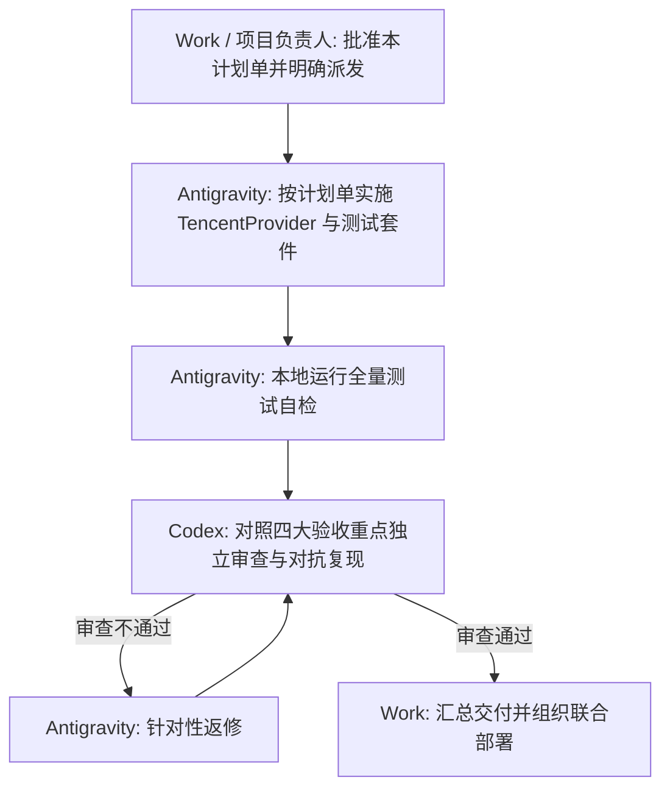

# T03-02 接入腾讯备用个股报价源与多源容灾加固任务计划单

- **任务编号**：T03-02
- **任务名称**：接入腾讯备用个股报价源与多源容灾加固
- **提出方**：Work / 项目负责人
- **实施方**：Antigravity
- **审查方**：Codex
- **基线版本**：`v0.9.0`（Git Commit `7da6c0bc4914cd372f41c3d8edebf21b8ab2f25a`，分支 `implement_quality_log_isolation`）
- **当前状态**：**已立项起草；方案待验证；未派发、未修改代码、未部署**
- **关联依据**：
  - 《开发文档/63-a-stock-data上游事实底盘扩容技术设计单.md》
  - 《开发文档/2026-10-29-T03-01-质量日志事务与风控失败隔离任务计划单.md》
  - 《开发文档/2026-10-29-T03-01-Codex独立审查记录.md》（第七轮）
  - 《开发文档/2026-10-29-T03-01-Antigravity实施报告.md》（v8）
  - 《开发文档/2026-10-30-建议案-引入腾讯行情作为stock_quote备用源以闭环多源容灾.md》

---

## 一、 任务背景与目标

在 T03-01 任务（质量日志事务与风控隔离）闭环后，全量 81 项专项测试已全部通过。然而 Codex 第七轮审查明确指出了当前系统的客观保障边界：
> **当前个股实时报价（`stock_quote`）仅注册了 Sina 一个主力源；TDX 原生快照因协议缺乏日期无法通过风控准入。若生产环境 Sina 发生网络抖动、DNS 故障或反爬限制，波普尔风控守护机将因无可用可信行情而跳过（SKIPPED），期间无法保障自动止损。**

项目负责人已裁决采用**选项 A**：
1. **T03-01 收口交付**：指定返修及 81 项专项验证通过，进入发布等待，明确发布限制（Sina 不可用时自动风控跳过，期间无法保障自动止损）；
2. **另立 T03-02 优先推进**：基于 `a-stock-data` 规范接入腾讯行情作为 `stock_quote` 的 Secondary 备用源，实现多源热备容灾；
3. **两项任务独立验收**：等 T03-02 通过后一起部署，但保持两张任务单独立验收。

> [!IMPORTANT] 工程纪律红线
> 1. **严禁浮夸承诺**：腾讯源接入方案处于方案待验证阶段，绝对不能预先承诺“半天完成”或“双源热备已可用”。
> 2. **自证时间戳不等于天然免疫陈旧行情**：报文“带完整时间戳”仅提供了时态校验的基础证据，不等于天然免疫陈旧行情；网络延迟、上游 CDN 缓存未刷、历史数据重放等仍会导致拿到带旧时间戳的数据，必须实施严格的日期与时效检查。
> 3. **本次状态确认**：本次仅作方案计划制定，未派发、未修改业务代码、未部署。

---

## 二、 核心验收重点（四项刚性门禁）

根据项目负责人与 Codex 审查规范，T03-02 实施与独立验收必须闭环满足以下四项重点：

### 1. 报文协议与代码映射核验
- **报文时间字段分析**：核实腾讯行情接口（`http://qt.gtimg.cn/q=...`）响应切片各字段索引。第 30 字段（0-indexed 或 1-indexed 需以真实抓包为准，如 `parts[30]`）的格式（`YYYYMMDDHHMMSS`，如 `20261029145530`）、时区（CST/UTC+8）及毫秒/秒级精度。
- **市场前缀转换规则**：核对个股代码与腾讯证券前缀的映射对应关系：
  - 沪市主板/科创板（`60`, `68`, `90`） $\rightarrow$ `sh`
  - 深市主板/创业板（`00`, `30`, `20`） $\rightarrow$ `sz`
  - 北交所（`8`, `4`, `92`） $\rightarrow$ `bj`（需核验腾讯网关是否原生支持北交所或返回空）
- **异常报文防御**：处理停牌标的、未上市标的、空响应、畸形切片等边缘情况，确保解析异常不导致整个批次崩溃。

### 2. 完整时间戳必须经过日期和新鲜度双重核验
- **原则定性**：“带完整时间戳”是准入的必要条件，但绝非充分条件。即使腾讯快照自身带有完整时间戳，旧行情仍必须被风控断然拒绝。
- **两道刚性检验**：
  1. **当日交易日对齐**：快照中的日期部分（`YYYY-MM-DD`）必须严格等于系统当前交易日。若为昨日或历史日期，必须判定为 `Freshness.STALE` 或 `Freshness.UNAVAILABLE`；
  2. **采样时差秒级核验**：快照中的时分秒必须与系统当前时间进行比对，若时差超出容忍阈值（$\Delta t > 300\text{s}$），必须判定为 `Freshness.STALE`。
- **拒单不变量**：任何未通过上述双重核验的报价，一律不得赋予 `Freshness.REALTIME`，风控守护机坚决拒单。

### 3. 多源容灾五大矩阵全覆盖场景验证
在 `backend/tests/` 中必须新增完备的容灾测试用例，覆盖以下全矩阵：
1. **主源故障腾讯接替（Sina Fail $\rightarrow$ Tencent Takeover）**：Sina 返回 HTTP 500/403/Timeout，`DataService` 自动通过 Fallback 机制调度腾讯源；腾讯返回可信实时行情，风控顺利准入并完成撮合。
2. **双源同时失效（Dual Failure）**：Sina 与腾讯同时断流或异常，系统优雅降级，标记为 `DataQuality.FAILED` / `Freshness.UNAVAILABLE`，风控安全跳过（`Risk: skipped`），**零成交**。
3. **腾讯时间缺失或格式异常（Corrupted Timestamp）**：腾讯返回的报文缺失时间戳、时间格式错误或字段越界，系统将其标记为不可用，阻止平仓，**零成交**。
4. **跨日陈旧缓存防线（Cross-Day Stale Cache Blocked）**：前一交易日的腾讯行情缓存或昨日历史行情，次日触发风控巡检时必须被拦截，坚决阻止基于旧价平仓。
5. **主源自动恢复探针（Primary Recovery）**：当 Sina 恢复后，系统能够按断路器探针逻辑重新以 Sina 为主，不发生无序震荡。

### 4. 风控与撮合执行闭环验证
- **有效备用报价闭环**：验证通过腾讯源获取的有效实时行情（当日且 300 秒内，价格有效）能够完全替代 Sina，在标的触碰止损阈值时正常触发波普尔平仓，完整生成委托单、成交记录并扣减仓位。
- **无效报价零成交铁律**：验证任何不满足时效、缺失字段、价格非正或带有历史时间戳的备用报价，风控守护机坚决跳过，持仓股数与账户资金分文不差，**零成交**。

---

## 三、 实施范围与模块设计

| 模块 | 涉及文件 | 预定改动内容 |
|---|---|---|
| **腾讯数据适配器** | `backend/app/data/providers/tencent.py`（新设） | 实现 `TencentProvider(BaseProvider, StockQuoteCapability)`，封装 `get_stock_quotes`，解析 `http://qt.gtimg.cn/q=...`，严格提取 `parts[30]` 解析完整时间戳。 |
| **提供方注册中心** | `backend/app/data/providers/__init__.py` | 注册腾讯源为个股报价备用源：`registry.register("stock_quote", "tencent", tencent, is_primary=False)`。 |
| **能力与服务容灾** | `backend/app/data/service.py` | 确保 `get_stock_quotes` 接入 `execute_with_fallback`，支持主备源自动降级与质量日志关联。 |
| **多源容灾自动化测试** | `backend/tests/test_quote_failover_tencent.py`（新设） | 覆盖报文解析、主备切换、双源失效、时间戳时效核验、异常报文与风控零成交等场景。 |

---

## 四、 任务推进流程与工序约束

依据项目多 Agent 协作规范（Work 拆单 $\rightarrow$ Antigravity 实施 $\rightarrow$ Codex 审查 $\rightarrow$ Work 汇总交付）：

1. **工序纪律**：当前本计划单由 Antigravity 整理归档，呈报 Work 与项目负责人。在收到正式派发指令前，不修改任何业务代码。
2. **基线保护**：必须继续在 `implement_quality_log_isolation` 工作区推进，主工作区 `D:\项目库\AI认知复盘交易系统` 的未提交修改严禁触碰。
3. **版本号统一**：统一以基线 `v0.9.0`（Commit `7da6c0b`）为准，严禁自创版本号。

---

## 五、 当前交付状态汇总

| 任务编号 | 任务名称 | 当前状态 | 发布与部署依赖 |
|---|---|---|---|
| **T03-01** | 质量日志事务与风控失败隔离 | **收口交付；81 项专项验证全过；具备独立发布条件** | 发布报告必须注明：“Sina 不可用时自动风控跳过，期间无法保障自动止损”。 |
| **T03-02** | 腾讯备用报价源接入与多源容灾 | **立项起草；方案待验证；未派发、未修改代码、未部署** | 等 T03-02 独立通过后，与 T03-01 一同部署 NAS；两任务独立验收。 |
