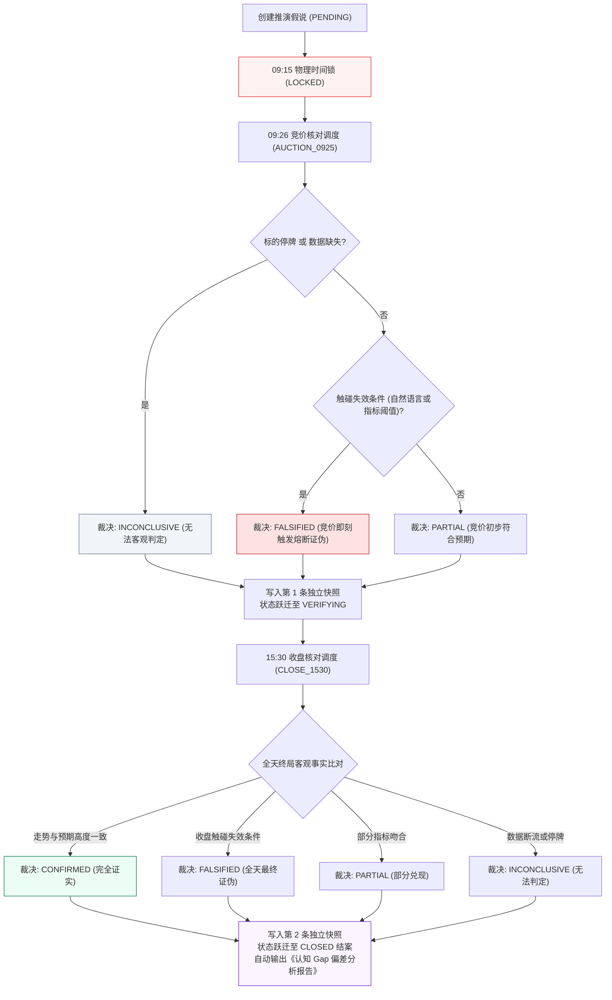

# G1-Cognition 验证闭环增强技术设计单 (v1.2 终极修订版)
## Cognitive Validation Loop MVP Technical Specification (v1.2)

> **设计单编号**：DESIGN-G1-COG-VALIDATION-01 (v1.2 红队前审终极版)  
> **编制日期**：2026-09-26  
> **编制机构**：Antigravity 主开发团队  
> **当前流程阶段**：Step 1 技术设计单编制完成，提请独立红队 Step 0 白盒前审（**未授权实施编码，代码绝对冻结**）  
> **上位依据**：  
> 1. [《开发文档/01-项目决策基线（G0-正式版）.md》](file:///d:/项目库/AI认知复盘交易系统/开发文档/01-项目决策基线（G0-正式版）.md)  
> 2. [《开发文档/02-G1需求基线（正式冻结版）.md》](file:///d:/项目库/AI认知复盘交易系统/开发文档/02-G1需求基线（正式冻结版）.md)（S2 认知架构边界 / S3 人机回环 / M1~M5 事实基石）  
> 3. [《开发文档/04-G3架构与详细设计（正式版）.md》](file:///d:/项目库/AI认知复盘交易系统/开发文档/04-G3架构与详细设计（正式版）.md)（第 1.1/3.1/3.4 节 Cognition 与 Human Layer 独立分层）  
> 4. [《开发文档/10-项目多Agent四权分立工程治理规范.md》](file:///d:/项目库/AI认知复盘交易系统/开发文档/10-项目多Agent四权分立工程治理规范.md)  
> 5. **最高董事会终审裁决与 7 项刚性契约修正令**（2026-09-26）

---

## 修订记录 (Revision History)

| 版本 | 修订日期 | 修订主体 | 核心修订内容摘要 |
| :--- | :--- | :--- | :--- |
| **v1.0** | 2026-09-26 | 主开发团队 | 初始编制：提出单笔诊断、推演假说、事实验证与个人戒律库。原计划周末 48 小时极速封口。 |
| **v1.1** | 2026-09-26 | 董事会审定 / 主开发 | 重大哲学校准：废除 48 小时盲目封口，去除直接定罪；切分事实层与解释层（打上待确认标）；收敛周复盘为三维度量；锁定假说跟踪器；确立周一真实闭环为终极业务验收门。 |
| **v1.2** | 2026-09-26 | 董事会终审 / 主开发 | **全量落实最高董事会 7 项刚性契约修正令（进入红队前全面闭环）**：<br/>1. **修复验证表唯一键物理冲突**：移除单列 unique，改为 `UniqueConstraint("hypothesis_id", "verification_stage")` 联合唯一约束，保障早盘与收盘两条独立快照追加；<br/>2. **重构状态机与增加 INCONCLUSIVE 枚举**：假说状态收敛为生命周期 `PENDING / LOCKED / VERIFYING / CLOSED`；核对结论新增 `INCONCLUSIVE`（数据缺失或停牌无法判定），杜绝强行三选一；<br/>3. **彻底降级拍脑袋标量打分**：移除或可空化 `accuracy_score` 与 `env_match_score`（`nullable=True, default=None`），拒绝无公式支撑的伪精确打分；<br/>4. **锁死未确认隔离铁律与周报数学契约**：未确认诊断绝不计入周报；周报严格仅统计 `CONFIRMED / MODIFIED` 样本；严格规定 EMD、LRD、ODD 的精确数学公式，样本为空安全输出 `None`；<br/>5. **补齐双轨可执行断言结构**：假说支持 `assertion_metrics` 轻量结构化阈值绑定，实现“自然语言 + 确定性指标阈值”双轨客观核对；<br/>6. **物理时间与调度时间严格解耦**：精确锁死 `09:15`（假说只读锁定）、`09:25`（竞价事实）与 `09:26`（竞价调度）、`15:00`（连续竞价收盘事实）与 `15:30`（收盘核对调度）；<br/>7. **彻底清理越界残留范围**：本期 MVP 彻底砍掉 `cognitive_rule` 表与规则接口，绝对聚焦打透三大核心切片。 |

---

## 目录
- [一、需求基线映射与治理边界（为何做？边界在哪？）](#一需求基线映射与治理边界为何做边界在哪)
- [二、认知工程哲学与 10 大核心架构不变量（锁死设计）](#二认知工程哲学与-10-大核心架构不变量锁死设计)
- [三、架构拓扑与数据流设计（Cognitive Loop 最小垂直切片）](#三架构拓扑与数据流设计cognitive-loop-最小垂直切片)
- [四、数据模型与持久化设计（Persistence Layer）](#四数据模型与持久化设计persistence-layer)
- [五、核心状态机、数学契约与核对算法（Engine Rules）](#五核心状态机数学契约与核对算法engine-rules)
- [六、API 接口契约设计（API Layer）](#六api-接口契约设计api-layer)
- [七、前端交互与产品化看板设计（Presentation Layer）](#七前端交互与产品化看板设计presentation-layer)
- [八、可执行验收方案（AC-1 ~ AC-6 测试矩阵）](#八可执行验收方案ac-1--ac-6-测试矩阵)
- [九、周一（2026-09-28）真实市场首战业务验收规程](#九周一2026-09-28真实市场首战业务验收规程)
- [十、四权分立流转与工序安排](#十四权分立流转与工序安排)

---

## 一、需求基线映射与治理边界（为何做？边界在哪？）

### 1.1 现状痛点与核心动因
当前系统已完成 M1 收盘复盘、M2 盘前简报、M4 竞价观察、M5 盘中异动以及 G1-M3 真实交易账本（5 大模块全部封口交付）。系统拥有极其扎实的**“客观事实观测底座”**与**“真实交易记账能力”**。
然而，系统此前始终缺乏一个将“客观事实”与“主观决策”进行对照、且能**被未来真实市场结果检验**的闭环机制。

依据最高董事会决议，本次开发**不脱离既有 G1/G3 基线，不临时创造脱离基线的新架构层**，而是以 **M3 真实交易事实 + M1~M5 市场事实为输入**，实施 **G1-Cognition 验证闭环增强（Cognitive Validation Loop MVP）**。

### 1.2 优先级调整的法定依据
在系统总依赖拓扑中，原规划路线为：
$$\text{M1~M5 / M3 (已完成)} \longrightarrow \text{M6 策略与选股} \longrightarrow \text{M8 模拟交易} \longrightarrow \text{Cognition 闭环}$$
**董事会正式裁决调整实施顺序为**：
$$\text{M1~M5 / M3 (已完成)} \longrightarrow \text{Cognition 验证闭环增强 (MVP)} \longrightarrow \text{M6 策略与选股} \longrightarrow \text{M8 模拟交易}$$

**调整的底层逻辑**：
当前系统最急需的并不是扩充更多选股算法或虚拟账户，而是**验证现有认知模型是否具备被未来真实市场结果校验的能力**。利用 M1~M5 和 M3 已封口的事实数据，以最小垂直切片建立验证闭环，能以极高信噪比获得真实市场反馈，反哺 M6 的策略规则设计。

### 1.3 边界“三做与三不做”（负面清单绝对锁死）

- **✅ 本期必须做（MVP 范围）**：
  1. **切片 1：单笔交易认知诊断卡**（物理切分事实层与解释层，AI 诊断标记“待人工确认”，未确认不进统计）；
  2. **切片 2：周度认知复盘（Weekly Cognitive Audit）**（锁死样本池，统计“逻辑兑现度、环境匹配度、结果偏离度”三维客观度量）；
  3. **切片 3：盘前/跨日推演假说追踪器（Pre-market Hypothesis Tracker）**（支持双轨客观核对与 `INCONCLUSIVE` 状态，建立“判断 $\to$ 未来结果 $\to$ 证伪/验证 $\to$ 认知修正”前向闭环）；
  4. **周一（9月28日）真实开盘与收盘全链路业务验收**。
- **❌ 本期坚决不做（严防武断与范围越界）**：
  1. **严禁由 AI 直接下达绝对定性结论或直接定罪**；
  2. **严禁周末极速 48 小时盲目封口**（以周一真实全天业务链路跑通为第一道验收门）；
  3. **彻底砍掉 `cognitive_rule` 戒律库与规则接口**（聚焦核心三大切片，杜绝过度工程）；
  4. **不提前编写 M6 选股算法或生成自动买卖信号**；
  5. **不构建 M8 虚拟盘撮合交易与滑点仿真**。

---

## 二、认知工程哲学与 10 大核心架构不变量（锁死设计）

### 2.1 核心认知工程哲学：去武断化与人机回环

```text
       【错误路线 (已废除)】
       事实 ──→ AI 机械判定 ──→ 直接写死定罪 (容易沦为事后诸葛亮玄学)

       【正确路线 (本设计单确立)】
       事实 ──→ 诊断假设 (候选分析) ──→ 人工确认 (Human Review) ──→ 真实结果校验 ──→ 经验固化
```

### 2.2 10 大核心架构不变量

1. **事实层与解释层物理分离（Fact-Interpretation Segregation）**：
   - 数据展示与存储必须严格区分“客观物理事实”（价格、时间、D1~D6、买入后真实走势、持仓浮动盈亏）与“认知解释”（环境匹配度、逻辑归因、偏差分析）。
2. **AI 诊断待确认隔离铁律（Unconfirmed Isolation Invariant）**：
   - 所有 AI 给出的单笔诊断初始状态一律标记为 **`【AI 诊断 / 待人工确认】(human_status == "UNCONFIRMED")`**。未确认的草案**绝对禁止计入周度复盘统计**！
3. **只读派生性（Read-only Derivation Invariant）**：
   - 诊断与事实验证均为只读派生分析，绝对禁止反向污染或篡改原始 `trade_record`（真实流水）和 `cognition_market_state`（市场状态）。
4. **度量去绝对化与无伪精确打分（Empirical Metrics Without Pseudo-scores）**：
   - 周度复盘收敛为客观可度量的三维指标：**逻辑兑现度、环境匹配度、结果偏离度**；删除或留白强制标量分数（`nullable=True, default=None`），拒绝无公式支撑的 `0~100` 伪精确打分。
5. **联合唯一键防物理冲突（Stage-Unique Verification Invariant）**：
   - 验证表物理约束严格绑定为 `UniqueConstraint("hypothesis_id", "verification_stage")`，确保同一假说能追加记录早盘（`AUCTION_0925`）与收盘（`CLOSE_1530`）两条独立事实快照，严禁覆盖历史快照。
6. **推演假说生命周期单向跃迁（Hypothesis Lifecycle State Machine）**：
   - `MarketHypothesis.status` 严格按时间驱动单向跃迁：`PENDING`（待锁） $\to$ `LOCKED`（09:15 只读冻结） $\to$ `VERIFYING`（竞价核对完毕，待收盘） $\to$ `CLOSED`（终局结案）。越过 09:15 严禁修改假说内容。
7. **事实验证客观性与 INCONCLUSIVE 防伪（Objective Verification & Inconclusive Guard）**：
   - 假说验证必须完全基于后续真实产生的市场客观数据断言；若因数据源中断或标的停牌无法客观裁决，必须显式判定为 **`INCONCLUSIVE`**，严禁强行三选一。
8. **证伪优先原则与双轨核对（Falsification Priority & Dual-track Assertion）**：
   - 假说支持“自然语言描述 + 可选指标阈值（`assertion_metrics`）”双轨核对。一旦触碰预设的失效条件，系统必须坚决判定为 `FALSIFIED`（证伪）。
9. **零伪造与无零填充（Zero Fake Data Invariant）**：
   - 待验证假说显式保持为 `PENDING`，样本为空时三维指标统一输出 `None`（前端渲染 `--`），绝无 `0.0` 假填充。
10. **周一真实链路验收闸门（Monday Operational Gate）**：
    - 不承诺周末一次性封口；以 **2026-09-28（周一）能否完整跑通“周末假说 $\to$ 09:25 兑现 $\to$ 收盘结果 $\to$ Gap $\to$ 复盘”真实链路** 作为第一道也是终极的业务验收红线。

---

## 三、架构拓扑与数据流设计（Cognitive Loop 最小垂直切片）

### 3.1 架构分层拓扑（彻底清除越界规则表）

```text
┌─────────────────────────────────────────────────────────────────┐
│                     Presentation Layer                          │
│     /trading (集成单笔交易事实层 + AI认知解释抽屉[待确认/已确认])     │
│     /review  (集成周度认知复盘面板 + 跨日推演假说跟踪看板)          │
└──────────────────────────┬──────────────────────────────────────┘
                           │ HTTP RESTful API
┌──────────────────────────┴──────────────────────────────────────┐
│                        API Layer                                │
│       POST /api/v1/cognition/diagnosis/trade/{trade_id}         │
│       GET  /api/v1/cognition/diagnosis/trade/{trade_id}         │
│       PUT  /api/v1/cognition/diagnosis/trade/{trade_id}/confirm │
│       GET  /api/v1/cognition/audit/weekly                       │
│       POST /api/v1/cognition/hypotheses                         │
│       GET  /api/v1/cognition/hypotheses                         │
│       POST /api/v1/cognition/hypotheses/{id}/verify             │
└──────────────────────────┬──────────────────────────────────────┘
                           │
┌──────────────────────────┴──────────────────────────────────────┐
│                      Service Layer                              │
│                 CognitionReviewService                          │
│     ├─ TradeDiagnosisEngine (单笔双层诊断与人机确认流)           │
│     ├─ WeeklyAuditEngine (严格三维量化度量计算与未确认隔离)     │
│     ├─ HypothesisTracker (跨日推演假说生命周期管理)             │
│     └─ FactVerificationEngine (基于真实行情的双轨核对状态机)     │
└─────────┬──────────────────┬──────────────────┬─────────────────┘
          │                  │                  │
┌─────────┴────────┐ ┌───────┴────────┐ ┌───────┴─────────────────┐
│  M1~M5 客观事实  │ │  M3 交易事实   │ │  Persistence Layer      │
│  (Market State   │ │  (TradeRecord  │ │  SQLite 表结构扩展:     │
│   D1~D6 / M4/M5) │ │   + TradeNote) │ │  - cognitive_diagnosis  │
│                  │ │                │ │  - market_hypothesis    │
│                  │ │                │ │  - hypothesis_verify    │
└──────────────────┘ └────────────────┘ └─────────────────────────┘
```

### 3.2 严格区分“物理市场事实时间”与“系统调度核对时间”

| 时间节点 | 物理市场事实事件 | 系统调度与工程动作 | 状态机跃迁 |
| :---: | :--- | :--- | :---: |
| **周末 / 收盘后** | 市场休市，数据沉淀完毕 | 用户/AI 基于 M1~M5 事实创建《推演假说》 | 创建进入 `PENDING` |
| **09:15** | A 股集合竞价开始 | **系统执行只读时间锁（Time-lock）**，物理冻结假说内容 | `PENDING -> LOCKED` |
| **09:25** | A 股集合竞价结束，开盘价与竞价量能物理敲定 | 市场事实已就绪 | 处于 `LOCKED` |
| **09:26** | M4 竞价数据落库完毕 | **系统调度触发首轮核对 (`AUCTION_0925`)**，写入第一条独立快照 | `LOCKED -> VERIFYING` |
| **15:00** | A 股连续竞价全天交易结束 | 当日全天行情物理封盘 | 处于 `VERIFYING` |
| **15:30** | M1 收盘复盘数据与六维状态向量落库完毕 | **系统调度触发终局核对 (`CLOSE_1530`)**，写入第二条独立快照，产出 Gap 报告 | `VERIFYING -> CLOSED` |

---

## 四、数据模型与持久化设计（Persistence Layer）

严格遵循 SQLAlchemy 与 SQLite 架构标准，在既有数据库中仅新增 3 张轻量实体表：

### 4.1 单笔交易认知诊断表 (`cognitive_trade_diagnosis`)

```python
class CognitiveTradeDiagnosis(Base):
    """单笔交易认知行为诊断 (与 trade_record 1:1 纯派生绑定)"""
    __tablename__ = "cognitive_trade_diagnosis"

    id = Column(Integer, primary_key=True, autoincrement=True)
    trade_id = Column(Integer, ForeignKey("trade_record.id"), nullable=False, unique=True, index=True)
    date = Column(String(10), nullable=False, index=True)          # 交易日期 YYYY-MM-DD
    
    # ---------------- 事实层 (Fact Layer - 客观不可推翻) ----------------
    trade_price = Column(Float, nullable=False)                    # 成交单价
    trade_quantity = Column(Integer, nullable=False)               # 成交股数
    trade_amount = Column(Float, nullable=False)                   # 成交金额
    trade_direction = Column(String(10), nullable=False)           # buy / sell
    market_d1_d6_snapshot = Column(Text, nullable=False)           # 当日 D1~D6 完整快照 (JSON)
    post_trade_mdd = Column(Float, nullable=True)                  # 买入后至清仓前最大回撤 %
    post_trade_max_profit = Column(Float, nullable=True)           # 买入后持有期最大浮盈 %
    
    # ------------ 认知解释层 (Interpretation Layer - 待人工确认) ----------
    env_match_type = Column(String(30), nullable=False)           # HIGH_MATCH(高度顺势), LOW_MATCH(逆势博弈), EMO_DRIVEN(情绪驱动), AMBIGUOUS(环境模糊)
    env_match_score = Column(Float, nullable=True, default=None)  # 留白或预留，一期严禁输出伪精确分数
    logic_realization = Column(String(30), nullable=False)        # REALIZED(预案兑现), UNREALIZED(预案落空), ACCIDENTAL(偏离预案但意外)
    cognitive_gap_analysis = Column(Text, nullable=False)         # 认知 Gap 剖析 (AI 诊断草案)
    
    # 人工审定状态 (HITL) - 隔离铁律载体
    human_status = Column(String(20), default="UNCONFIRMED")      # UNCONFIRMED(待确认), CONFIRMED(已确认), MODIFIED(人工修正)
    human_comment = Column(Text, nullable=True)                   # 用户修正意见或补充反思
    
    created_at = Column(DateTime, server_default=func.now())
    updated_at = Column(DateTime, server_default=func.now(), onupdate=func.now())
```

### 4.2 跨交易日推演假说表 (`market_hypothesis`)

```python
class MarketHypothesis(Base):
    """跨交易日市场推演假说"""
    __tablename__ = "market_hypothesis"

    id = Column(Integer, primary_key=True, autoincrement=True)
    created_date = Column(String(10), nullable=False, index=True) # 假说生成日期 YYYY-MM-DD
    target_date = Column(String(10), nullable=False, index=True)  # 目标验证日期 YYYY-MM-DD (如周一)
    
    # 假说分类与标的
    hypothesis_type = Column(String(30), nullable=False)          # INDEX_TREND(大盘), SECTOR_LEADER(板块核心), SENTIMENT_CYCLE(情绪周期)
    target_asset = Column(String(50), nullable=False)             # 标的名称/代码 (如"全市场/连板梯队/半导体/000001")
    expected_scenario = Column(String(30), nullable=False)        # ACCELERATION(加速), DIVERGENCE(分歧), REBOUND(修复), ROTATION(轮动)
    
    # 双轨核对支撑结构
    premise_logic = Column(Text, nullable=False)                  # 前置支撑事实 (基于 M1~M5 既有数据)
    expected_phenomenon = Column(Text, nullable=False)            # 自然语言预期客观现象
    invalidation_condition = Column(Text, nullable=False)         # 刚性证伪失效条件 (自然语言)
    assertion_metrics = Column(Text, nullable=True)               # 可选确定性指标阈值 JSON (如 {"sh_open_pct_min": -0.5, "max_height_min": 4})
    
    # 生命周期状态 (落实修正项 2)
    status = Column(String(20), default="PENDING", nullable=False)# PENDING(待锁) / LOCKED(已锁) / VERIFYING(核对中) / CLOSED(已结案)
    created_at = Column(DateTime, server_default=func.now())
```

### 4.3 客观事实验证记录表 (`hypothesis_verification`)

```python
class HypothesisVerification(Base):
    """推演假说客观事实验证记录 (联合唯一键支持早盘与收盘双独立快照)"""
    __tablename__ = "hypothesis_verification"
    __table_args__ = (
        UniqueConstraint("hypothesis_id", "verification_stage", name="uq_hypo_verify_stage"),
    )

    id = Column(Integer, primary_key=True, autoincrement=True)
    hypothesis_id = Column(Integer, ForeignKey("market_hypothesis.id"), nullable=False, index=True)
    
    verification_stage = Column(String(20), nullable=False)       # AUCTION_0925(竞价核对), CLOSE_1530(收盘全景核对)
    actual_data_snapshot = Column(Text, nullable=False)           # 真实抓取的数据快照 JSON (不可覆盖)
    
    # 客观裁决枚举 (落实修正项 2: 新增 INCONCLUSIVE)
    outcome = Column(String(20), nullable=False)                  # CONFIRMED / FALSIFIED / PARTIAL / INVALID / INCONCLUSIVE
    accuracy_score = Column(Float, nullable=True, default=None)   # 一期留白，拒绝伪精确打分
    
    deviation_analysis = Column(Text, nullable=False)             # 偏差剖析 (为什么偏离预期？)
    gap_summary = Column(String(200), nullable=False)             # 一句话 Gap 总结
    verified_at = Column(DateTime, server_default=func.now())
```

---

## 五、核心状态机、数学契约与核对算法（Engine Rules）

### 5.1 周度复盘数学契约与未确认隔离铁律（落实修正项 4）

周度复盘（`WeeklyAuditEngine`）坚决遵守以下数学定义与样本过滤规则：

#### 1. 样本池隔离规则
- 仅纳入本周周期内：`human_status IN ("CONFIRMED", "MODIFIED")` 的已审定交易诊断；
- **若本周有效样本数 $N_{\text{confirmed}} = 0$，则 `EMD`、`LRD`、`ODD` 全部返回 `None`（前端统一渲染为 `'--'`），严禁填充 0.0。**

#### 2. 三大核心度量严密公式
1. **环境匹配度 (Environment Match Degree, EMD)**：
   $$\text{EMD} = \frac{\text{Count}(\text{env\_match\_type} == \text{"HIGH\_MATCH"})}{N_{\text{confirmed}}} \times 100\%$$
2. **逻辑兑现度 (Logic Realization Degree, LRD)**：
   $$\text{LRD} = \frac{\text{Count}(\text{logic\_realization} == \text{"REALIZED"} \land \text{direction} == \text{"buy"})}{N_{\text{confirmed\_buys}}} \times 100\%$$
   *(若已确认买入笔数 $N_{\text{confirmed\_buys}} = 0$，则 $\text{LRD} = \text{None}$)*
3. **结果偏离度 (Outcome Deviation Degree, ODD)**：
   - 仅对 `TradeNote` 中明确记录了预期目标收益率 $R_{\text{target}}$ 的交易计算偏差：
     $$\text{Gap}_i = R_{\text{actual}, i} - R_{\text{target}, i}$$
   - 若有效样本数为 $M$（$M > 0$），则：
     $$\text{ODD} = \frac{1}{M} \sum_{i=1}^M \text{Gap}_i$$
   - **若没有任何交易记录预期目标收益（$M = 0$），则 $\text{ODD}$ 严格输出 `None`（渲染为 `'--'`），严禁假算。**

---

### 5.2 假说双轨核对与证伪状态机（落实修正项 2 & 5）



---

## 六、API 接口契约设计（API Layer）

接口收敛为 7 个标准端点，彻底清除规则表接口：

### 6.1 单笔交易诊断
- `POST /api/v1/cognition/diagnosis/trade/{trade_id}`：触发生成单笔诊断（默认状态 `UNCONFIRMED`）；
- `GET /api/v1/cognition/diagnosis/trade/{trade_id}`：获取双层诊断（含事实层与待确认解释层）；
- `PUT /api/v1/cognition/diagnosis/trade/{trade_id}/confirm`：人工确认或修正诊断（提交 `human_status` 与 `human_comment`）。

### 6.2 周度认知复盘
- `GET /api/v1/cognition/audit/weekly?week_offset=0`：调取本周三维量化复盘（严格执行未确认隔离与空样本返回 `None`）。

### 6.3 跨日推演假说跟踪器
- `POST /api/v1/cognition/hypotheses`：创建推演假说（支持 `expected_phenomenon`、`invalidation_condition` 及可选 `assertion_metrics`）；
- `GET /api/v1/cognition/hypotheses`：列表查询（按 `status` / `target_date` 筛选，呈现早盘与收盘双快照）；
- `POST /api/v1/cognition/hypotheses/{id}/verify?stage=AUCTION_0925`：触发客观事实验证（调度或手动调用）。

---

## 七、前端交互与产品化看板设计（Presentation Layer）

### 7.1 `/trading` 交易看板：双层诊断抽屉
- **流水列表**：在操作列新增【认知诊断】按钮；
- **抽屉结构**：
  - **上半部（事实层，深色背景卡片）**：成交价、时间、持有期最大回撤/浮盈、成交当日 D1~D6 雷达图；
  - **下半部（解释层，明确标识 `[AI 诊断 / 待人工确认]`）**：环境匹配建议、逻辑兑现归因、AI 提示的认知 Gap；
  - **底部交互区**：【确认采纳诊断】按钮与【补充/修正反思】输入框，保障人机回环。

### 7.2 `/review` 复盘看板：推演假说与验证追踪器
- **推演假说管理卡**：收盘复盘页底部新增【明日市场推演假说】输入/展示卡片，支持设定假说、失效条件与指标阈值；
- **跨日核对卡片**：展示历史假说兑现结果，红绿灰微标直观标注 `[CONFIRMED 证实]`、`[FALSIFIED 证伪]`、`[INCONCLUSIVE 无法判定]`，并呈现双时段独立快照。

---

## 八、可执行验收方案（AC-1 ~ AC-6 测试矩阵）

| 验收项 | 验收目标与断言条件 | 测试方法与判定标准 |
|:---|:---|:---|
| **AC-1 事实与解释双层物理隔离** | 诊断输出明确区分 `fact_layer` 与 `interpretation_layer`，解释层默认标记 `UNCONFIRMED` | 单元测试核查 JSON 结构与字段定义，必须包含双层隔离与待确认标记 |
| **AC-2 未确认隔离铁律与周度度量** | `human_status == "UNCONFIRMED"` 的诊断绝对禁止计入周报；样本为空严格输出 `None` | 构造未确认测试用例，断言周报样本数为 0 且指标全为 `None` |
| **AC-3 验证表联合唯一键防冲突** | 同一 `hypothesis_id` 可成功写入 `AUCTION_0925` 与 `CLOSE_1530` 两个记录，但重复写入同阶段抛出约束冲突 | 数据库插入测试，断言两阶段快照独立存在 |
| **AC-4 假说不可篡改时间锁与单向跃迁** | 假说创建后跨越 09:15，尝试修改假说内容必须被 403 阻断；状态严格按生命周期单向跃迁 | 模拟时间推进尝试更新已锁定假说，断言系统刚性拦截 |
| **AC-5 触碰失效条件与 INCONCLUSIVE** | 触发失效条件无条件裁决为 `FALSIFIED`；数据缺失或停牌断言为 `INCONCLUSIVE` | 模拟触碰失效阈值与数据缺失两种场景，断言状态机输出精确结果 |
| **AC-6 零假数据与防抖锁** | 前端假说待核对时显示 `--`，提交按钮配备 `isSubmitting` 禁用态 | 静态扫描与界面交互防御断言 |

---

## 九、周一（2026-09-28）真实市场首战业务验收规程

依据最高董事会指示，**周末不盲目追求快速封口，周一真实市场全链路跑通是本模块的第一道核心业务验收闸门**。

```text
┌─────────────────────────────────────────────────────────────────────────┐
│              周一（2026-09-28）真实市场全链路业务验收流程                │
├────────────────────┬────────────────────────────────────────────────────┤
│ 节点 1：周日晚间   │ 基于 09-25（周五）收盘客观数据，生成首份真实假说： │
│ (20:00 前)         │ 《2026-09-28 周一核心板块与连板情绪推演假说》       │
├────────────────────┼────────────────────────────────────────────────────┤
│ 节点 2：周一早盘   │ 集合竞价结束，系统自动调用 M4 竞价数据进行比对：   │
│ (09:26)            │ 首轮【竞价兑现核对】，输出开盘偏离度与初判快照      │
├────────────────────┼────────────────────────────────────────────────────┤
│ 节点 3：周一收盘   │ 全天收盘，系统自动调用 M1 真实复盘数据进行核对：   │
│ (15:35)            │ 终局客观断言（证实/证伪/无法判定），产出 Gap 报告  │
├────────────────────┼────────────────────────────────────────────────────┤
│ 节点 4：董事会验收 │ 董事会与 Owner 检阅真实闭环报告，签署首战验收令！  │
└────────────────────┴────────────────────────────────────────────────────┘
```

---

## 十、四权分立流转与工序安排

```text
Step 1: 技术设计单编制 (v1.2 终极修订版已完成，7 项刚性契约修正已全面闭环)
   │
   ▼
Step 0: 移交独立红队特使 (red_team_tester) 执行白盒前审
   │   (审查重点: 联合唯一键约束、INCONCLUSIVE 枚举、未确认隔离铁律、双轨核对、时间锁)
   ▼
最高董事会审定并签署《Step 2 受控实施令》
   │
   ▼
Step 2: 受控代码实施与前后端开发联调
   │   (严密落实设计单，自测与构建全绿)
   ▼
Step 3: 独立红队破坏性攻击测试套件运行 (出具 PASS 裁决书)
   │
   ▼
Step 4: 独立质量发布闸门终审 (出具阶段性放行令)
   │
   ▼
Step 5: 周日晚生成真实假说 ──→ 周一迎接真实开盘与收盘终极业务检验！
```

---
*主开发团队郑重声明：本设计单已 100% 闭环最高董事会的 7 项刚性修正令。在获得红队前审 PASS 且董事会正式签署实施令之前，绝不擅自编写任何生产业务代码！*
