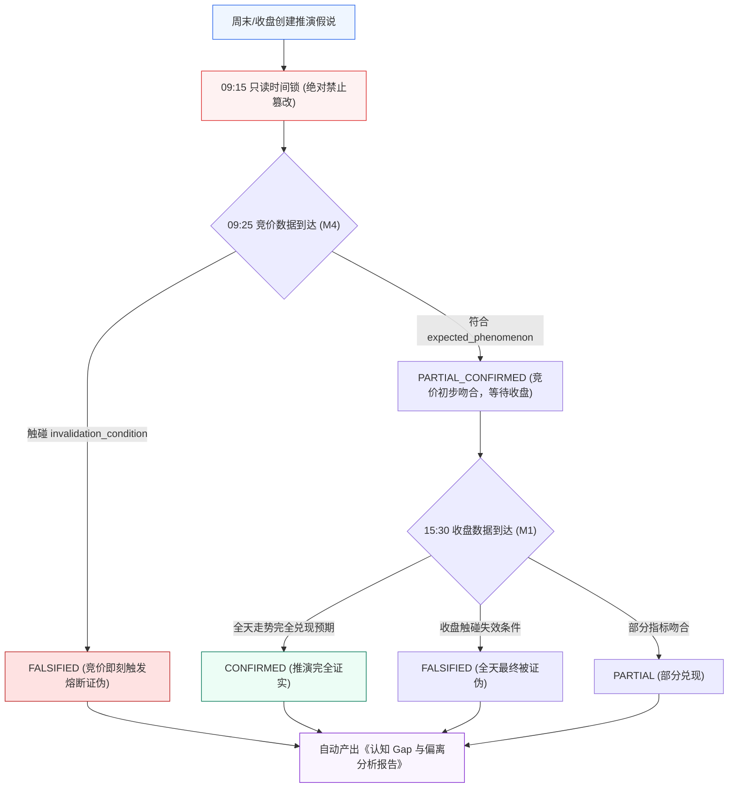

# G1-Cognition 验证闭环增强技术设计单 (v1.1 修订版)
## Cognitive Validation Loop MVP Technical Specification (v1.1)

> **设计单编号**：DESIGN-G1-COG-VALIDATION-01 (v1.1 董事会审定版)  
> **编制日期**：2026-09-26  
> **编制机构**：Antigravity 主开发团队  
> **当前流程阶段**：Step 1 技术设计单编制（已获董事会立项授权，**未授权实施编码，代码绝对冻结**）  
> **上位依据**：  
> 1. [《开发文档/01-项目决策基线（G0-正式版）.md》](file:///d:/项目库/AI认知复盘交易系统/开发文档/01-项目决策基线（G0-正式版）.md)  
> 2. [《开发文档/02-G1需求基线（正式冻结版）.md》](file:///d:/项目库/AI认知复盘交易系统/开发文档/02-G1需求基线（正式冻结版）.md)（S2 认知架构边界 / S3 人机回环 / M1~M5 事实基石）  
> 3. [《开发文档/04-G3架构与详细设计（正式版）.md》](file:///d:/项目库/AI认知复盘交易系统/开发文档/04-G3架构与详细设计（正式版）.md)（第 1.1/3.1/3.4 节 Cognition 与 Human Layer 独立分层）  
> 4. [《开发文档/10-项目多Agent四权分立工程治理规范.md》](file:///d:/项目库/AI认知复盘交易系统/开发文档/10-项目多Agent四权分立工程治理规范.md)  
> 5. **最高董事会立项、边界校准与哲学修正裁决**（`BOARD-DIRECTIVE-20260926-02` 及 2026-09-26 终局修正令）

---

## 修订记录 (Revision History)

| 版本 | 修订日期 | 修订主体 | 核心修订内容与哲学转变 |
| :--- | :--- | :--- | :--- |
| **v1.0** | 2026-09-26 | 主开发团队 | 初始编制：确立环境诊断卡片、跨日推演假说、事实验证状态机及个人戒律库。原计划周末 48 小时极速封口。 |
| **v1.1** | 2026-09-26 | 最高董事会审定 / 主开发修订 | **重大工程哲学校准与去武断修订**：<br/>1. **严禁脱离基线造新模块**：明确不造“G1-Cognition-Phase 2”大概念，定位为对既有 M1~M5 与 M3 的**验证闭环增强 MVP**；<br/>2. **严防 48 小时极速武断封口**：坚决废除“周日晚封口”的冒进承诺；坚决否定“规则直接写死判定”的武断逻辑，确立**“事实 $\to$ 诊断假设 $\to$ 人工确认 $\to$ 真实结果 $\to$ 再固化”**的核心铁律；<br/>3. **单笔诊断彻底解耦双层**：严格物理划分【事实层】与【认知解释层】，所有解释层均打上醒目标签 **`【AI 诊断 / 待人工确认】`**，严禁机器直接定罪；<br/>4. **周度复盘去玄学化**：废除主观绝对的“认知内vs运气盈亏”，重构为客观可度量的**“逻辑兑现度 / 环境匹配度 / 结果偏离度”**；<br/>5. **最高战略价值锚定**：全力做透 **Pre-market Hypothesis Tracker**，建立“判断 $\to$ 未来结果 $\to$ 证伪/验证 $\to$ 认知修正”的真实闭环；<br/>6. **终极验收标准迁移**：以**周一真实全天“周末假说 $\to$ 09:25 兑现 $\to$ 收盘结果 $\to$ Gap $\to$ 复盘”真实链路跑通**作为第一道业务验收闸门。 |

---

## 目录
- [一、需求基线映射与治理边界（为何做？边界在哪？）](#一需求基线映射与治理边界为何做边界在哪)
- [二、认知工程哲学与 10 大核心架构不变量（锁死设计）](#二认知工程哲学与-10-大核心架构不变量锁死设计)
- [三、架构拓扑与数据流设计（Cognitive Loop 最小垂直切片）](#三架构拓扑与数据流设计cognitive-loop-最小垂直切片)
- [四、三大核心功能重新定义与数据结构设计](#四大核心功能重新定义与数据结构设计)
- [五、核心状态机与客观核对算法（Engine Rules）](#五核心状态机与客观核对算法engine-rules)
- [六、API 接口契约设计（API Layer）](#六api-接口契约设计api-layer)
- [七、前端交互与产品化看板设计（Presentation Layer）](#七前端交互与产品化看板设计presentation-layer)
- [八、可执行验收方案（AC-1 ~ AC-6 测试矩阵）](#八可执行验收方案ac-1--ac-6-测试矩阵)
- [九、周一（2026-09-28）真实市场首战业务验收规程](#九周一2026-09-28真实市场首战业务验收规程)
- [十、四权分立流转与工序安排](#十四权分立流转与工序安排)

---

## 一、需求基线映射与治理边界（为何做？边界在哪？）

### 1.1 现状痛点与核心动因
当前系统已完成 M1 收盘复盘、M2 盘前简报、M4 竞价观察、M5 盘中异动以及 G1-M3 真实交易账本（5 大模块全部封口交付）。系统拥有极其扎实的**“客观事实观测底座”**与**“真实交易记账能力”**。
然而，系统此前始终缺乏一个将“客观事实”与“主观决策”进行对照、且能**被未来真实市场结果检验**的闭环机制。

依据最高董事会最新裁决，本次开发**不脱离既有 G1/G3 基线，不临时创造脱离基线的新架构层**，而是以 **M3 真实交易事实 + M1~M5 市场事实为输入**，实施 **G1-Cognition 验证闭环增强（Cognitive Validation Loop MVP）**。

### 1.2 优先级调整的法定依据
在系统总依赖拓扑中，原规划路线为：
$$\text{M1~M5 / M3 (已完成)} \longrightarrow \text{M6 策略与选股} \longrightarrow \text{M8 模拟交易} \longrightarrow \text{Cognition 闭环}$$
**董事会正式裁决调整实施顺序为**：
$$\text{M1~M5 / M3 (已完成)} \longrightarrow \text{Cognition 验证闭环增强 (MVP)} \longrightarrow \text{M6 策略与选股} \longrightarrow \text{M8 模拟交易}$$

**调整的底层逻辑**：
当前系统最急需的并不是扩充更多选股算法或虚拟账户，而是**验证现有认知模型是否具备被未来真实市场结果校验的能力**。利用 M1~M5 和 M3 已封口的事实数据，以最小垂直切片建立验证闭环，能以极高信噪比获得真实市场反馈，反哺 M6 的策略规则设计。

### 1.3 边界“三做与三不做”（负面清单绝对锁死）

- **✅ 本期必须做（MVP 范围）**：
  1. **切片 1：单笔交易认知诊断卡**（物理切分事实层与解释层，AI 诊断标记“待人工确认”）；
  2. **切片 2：周度认知复盘（Weekly Cognitive Audit）**（统计“逻辑兑现度、环境匹配度、结果偏离度”三维样本）；
  3. **切片 3：盘前/跨日推演假说追踪器（Pre-market Hypothesis Tracker）**（建立“判断 $\to$ 未来结果 $\to$ 证伪/验证 $\to$ 认知修正”的前向链路）；
  4. **周一（9月28日）真实开盘与收盘全链路业务验收**。
- **❌ 本期坚决不做（严防武断与过度设计）**：
  1. **严禁由 AI 直接下达绝对定性结论或直接定罪**（例如禁止直接写死“你犯了严重错误”或“这是纯运气盈利”）；
  2. **严禁周末极速 48 小时盲目封口**（算法必须留有校准弹性，以周一真实市场数据为准绳）；
  3. **不提前编写 M6 选股算法或生成自动买卖信号**；
  4. **不构建 M8 虚拟盘撮合交易与滑点仿真**。

---

## 二、认知工程哲学与 10 大核心架构不变量（锁死设计）

### 2.1 核心认知工程哲学：去武断化与人机回环

```text
       【错误路线 (已废除)】
       事实 ──→ AI 机械判定 ──→ 直接写死定罪 (容易沦为事后诸葛亮玄学)

       【正确路线 (本设计单确立)】
       事实 ──→ 诊断假设 (候选分析) ──→ 人工确认 (Human Review) ──→ 真实结果校验 ──→ 经验固化
```

### 2.2 10 大核心架构不变量

1. **事实层与解释层物理分离（Fact-Interpretation Segregation）**：
   - 数据展示与存储必须严格区分“客观物理事实”（价格、时间、D1~D6、买入后真实走势、持仓浮动盈亏）与“认知解释”（环境匹配度、逻辑归因、偏差分析）。
2. **AI 诊断待确认状态（Pending Human Confirmation）**：
   - 所有 AI 给出的单笔诊断与归因分析，初始状态一律标记为 **`【AI 诊断 / 待人工确认】`**，赋予用户审定、修正与补充反思的绝对主权。
3. **只读派生性（Read-only Derivation Invariant）**：
   - 诊断与事实验证均为只读派生分析，绝对禁止反向污染或篡改原始 `trade_record`（真实流水）和 `cognition_market_state`（市场状态）。
4. **度量去绝对化（Empirical Metrics Alignment）**：
   - 周度复盘杜绝主观玄学的“认知内vs运气”，统一收敛为客观可度量的三维指标：**逻辑兑现度、环境匹配度、结果偏离度**，重在样本积累而非道德评判。
5. **推演假说时间锁定（Hypothesis Time-lock）**：
   - 推演假说一旦创建并跨越目标交易日的开盘时间点（09:15），**即刻进入只读锁定状态，严禁就地修改内容**，杜绝事后修改假说。
6. **事实验证客观性（Objective Fact Verification）**：
   - 假说验证必须完全基于后续真实产生的市场客观数据（M4 09:25 竞价数据、M1 15:30 收盘数据）进行确定性断言，杜绝人工主观打分。
7. **证伪优先原则（Falsification Priority）**：
   - 假说中必须包含明确的“失效条件（Invalidation Condition）”。当市场实际走势触碰失效条件时，系统必须坚决判定为 `FALSIFIED`（证伪），并记录客观偏差事实。
8. **零伪造与无零填充（Zero Fake Data Invariant）**：
   - 待验证假说的吻合度显式保持为 `PENDING`，指标未就绪统一输出 `None`（前端渲染 `--`），绝无 `0.0` 假填充。
9. **TradeNote 关系守恒（TradeNote Association Invariant）**：
   - 诊断卡与 `trade_record` 保持 1:1 或 0..1 关系，与既有 `TradeNote` 的 `trade_id UNIQUE` 约束正交共存，不破坏既有数据拓扑。
10. **周一真实链路验收闸门（Monday Operational Gate）**：
    - 不承诺周末一次性封口；以 **2026-09-28（周一）能否完整跑通“周末假说 $\to$ 09:25 兑现 $\to$ 收盘结果 $\to$ Gap $\to$ 复盘”真实链路** 作为第一道也是终极的业务验收红线。

---

## 三、架构拓扑与数据流设计（Cognitive Loop 最小垂直切片）

### 3.1 架构分层拓扑

```text
┌─────────────────────────────────────────────────────────────────┐
│                     Presentation Layer                          │
│     /trading (集成单笔交易事实层 + AI认知解释抽屉[待确认])          │
│     /review  (集成周度认知复盘面板 + 跨日推演假说跟踪看板)          │
└──────────────────────────┬──────────────────────────────────────┘
                           │ HTTP RESTful API
┌──────────────────────────┴──────────────────────────────────────┐
│                        API Layer                                │
│       /api/v1/cognition/diagnosis/trade/{trade_id}              │
│       /api/v1/cognition/audit/weekly                            │
│       /api/v1/cognition/hypotheses (创建/列表/详情)              │
│       /api/v1/cognition/hypotheses/{id}/verify (事实验证)        │
│       /api/v1/cognition/rules (个人戒律记忆库)                   │
└──────────────────────────┬──────────────────────────────────────┘
                           │
┌──────────────────────────┴──────────────────────────────────────┐
│                      Service Layer                              │
│                 CognitionReviewService                          │
│     ├─ TradeDiagnosisEngine (单笔双层诊断与人机确认流)           │
│     ├─ WeeklyAuditEngine (三维量化度量计算)                     │
│     ├─ HypothesisTracker (跨日推演假说生命周期管理)             │
│     └─ FactVerificationEngine (基于真实行情的客观断言状态机)     │
└─────────┬──────────────────┬──────────────────┬─────────────────┘
          │                  │                  │
┌─────────┴────────┐ ┌───────┴────────┐ ┌───────┴─────────────────┐
│  M1~M5 客观事实  │ │  M3 交易事实   │ │  Persistence Layer      │
│  (Market State   │ │  (TradeRecord  │ │  SQLite 表结构扩展:     │
│   D1~D6 / M4/M5) │ │   + TradeNote) │ │  - cognitive_diagnosis  │
│                  │ │                │ │  - market_hypothesis    │
│                  │ │                │ │  - hypothesis_verify    │
│                  │ │                │ │  - cognitive_rule       │
└──────────────────┘ └────────────────┘ └─────────────────────────┘
```

---

## 四、三大核心功能重新定义与数据结构设计

### 4.1 功能一：单笔交易诊断卡（物理双层解耦）

彻底拆解为两层，并引入人工确认状态：

#### 1. 数据模型 (`CognitiveTradeDiagnosis`)
```python
class CognitiveTradeDiagnosis(Base):
    """单笔交易认知行为诊断 (与 trade_record 1:1 纯派生绑定)"""
    __tablename__ = "cognitive_trade_diagnosis"

    id = Column(Integer, primary_key=True, autoincrement=True)
    trade_id = Column(Integer, ForeignKey("trade_record.id"), nullable=False, unique=True, index=True)
    date = Column(String(10), nullable=False, index=True)          # 交易日期 YYYY-MM-DD
    
    # ---------------- 事实层 (Fact Layer - 客观不可推翻) ----------------
    trade_price = Column(Float, nullable=False)                    # 成交单价
    trade_quantity = Column(Integer, nullable=False)               # 成交股数
    trade_amount = Column(Float, nullable=False)                   # 成交金额
    trade_direction = Column(String(10), nullable=False)           # buy / sell
    market_d1_d6_snapshot = Column(Text, nullable=False)           # 当日 D1~D6 完整快照 (JSON)
    post_trade_mdd = Column(Float, nullable=True)                  # 买入后至清仓前最大回撤 %
    post_trade_max_profit = Column(Float, nullable=True)           # 买入后持有期最大浮盈 %
    
    # ------------ 认知解释层 (Interpretation Layer - 待人工确认) ----------
    env_match_type = Column(String(30), nullable=False)           # HIGH_MATCH(高度顺势), LOW_MATCH(逆势博弈), EMO_DRIVEN(情绪驱动), AMBIGUOUS(环境模糊)
    env_match_score = Column(Float, nullable=False)               # 0.0 ~ 100.0 环境匹配分
    logic_realization = Column(String(30), nullable=False)        # REALIZED(预案完全兑现), UNREALIZED(预案落空), ACCIDENTAL(偏离预案但意外)
    cognitive_gap_analysis = Column(Text, nullable=False)         # 认知 Gap 剖析 (AI 诊断草案)
    
    # 人工审定状态 (HITL)
    human_status = Column(String(20), default="UNCONFIRMED")      # UNCONFIRMED(待确认), CONFIRMED(已确认采纳), MODIFIED(人工修正)
    human_comment = Column(Text, nullable=True)                   # 用户修正意见或补充反思
    
    created_at = Column(DateTime, server_default=func.now())
    updated_at = Column(DateTime, server_default=func.now(), onupdate=func.now())
```

---

### 4.2 功能二：周度认知复盘（Weekly Cognitive Audit）

杜绝主观说教，聚合本周 M1~M5 与 M3 数据，输出三维客观度量：

#### 1. 三大核心量化维度
- **环境匹配度 (Environment Match Degree, EMD)**：本周全部交易中，顺应当时市场状态（如主升期做主线、冰点期控仓）的交易比例；
- **逻辑兑现度 (Logic Realization Degree, LRD)**：根据 TradeNote 中记录的买入逻辑，后续市场走势按照逻辑演绎的比例；
- **结果偏离度 (Outcome Deviation Degree, ODD)**：实际盈亏幅度与预期目标盈亏的平均偏离差值。

#### 2. 统计契约结构 (`WeeklyAuditResponse`)
```json
{
  "week_label": "2026-W39 (09-21 ~ 09-25)",
  "total_trades": 8,
  "metrics": {
    "env_match_degree": 75.0,
    "logic_realization_degree": 62.5,
    "outcome_deviation_degree": -3.8
  },
  "market_state_distribution": {
    "trend_days": 3,
    "divergent_days": 2
  },
  "trade_sample_summary": {
    "high_match_wins": 4,
    "high_match_losses": 1,
    "low_match_wins": 1,
    "low_match_losses": 2
  },
  "empirical_observations": [
    "在 D5 连板溢价走弱的 2 个交易日中，进行了 3 笔高位接力买入，贡献了本周 80% 的已实现亏损。",
    "在 D1 共振向上的 3 个交易日中，持仓稳定性较高，逻辑兑现度达 100%。"
  ]
}
```

---

### 4.3 功能三：盘前/跨日推演假说追踪器（Pre-market Hypothesis Tracker）

作为战略价值最高的核心，打通前向事实验证闭环：

#### 1. 数据模型 (`MarketHypothesis` 与 `HypothesisVerification`)
```python
class MarketHypothesis(Base):
    """跨交易日市场推演假说"""
    __tablename__ = "market_hypothesis"

    id = Column(Integer, primary_key=True, autoincrement=True)
    created_date = Column(String(10), nullable=False, index=True) # 假说生成日期 YYYY-MM-DD
    target_date = Column(String(10), nullable=False, index=True)  # 目标验证日期 YYYY-MM-DD (如周一)
    
    # 假说结构
    hypothesis_type = Column(String(30), nullable=False)          # INDEX_TREND(大盘), SECTOR_LEADER(板块核心), SENTIMENT_CYCLE(情绪周期)
    target_asset = Column(String(50), nullable=False)             # 标的名称/代码 (如"全市场/连板梯队/半导体/000001")
    expected_scenario = Column(String(30), nullable=False)        # ACCELERATION(加速), DIVERGENCE(分歧), REBOUND(修复), ROTATION(轮动)
    
    premise_logic = Column(Text, nullable=False)                  # 前置支撑事实 (基于 M1~M5 既有数据)
    expected_phenomenon = Column(Text, nullable=False)            # 预期可被观测的客观现象
    invalidation_condition = Column(Text, nullable=False)         # 证伪失效条件 (刚性熔断红线)
    
    status = Column(String(20), default="PENDING", nullable=False)# PENDING(只读锁定待验证), VERIFIED(已核对结案)
    created_at = Column(DateTime, server_default=func.now())

class HypothesisVerification(Base):
    """推演假说客观事实验证记录"""
    __tablename__ = "hypothesis_verification"

    id = Column(Integer, primary_key=True, autoincrement=True)
    hypothesis_id = Column(Integer, ForeignKey("market_hypothesis.id"), nullable=False, unique=True, index=True)
    verification_stage = Column(String(20), nullable=False)       # AUCTION_0925(竞价核对), CLOSE_1530(收盘核对)
    
    actual_data_snapshot = Column(Text, nullable=False)           # 实际抓取到的核对事实数据快照 (JSON)
    outcome = Column(String(20), nullable=False)                  # CONFIRMED(证实), FALSIFIED(证伪), PARTIAL(部分吻合), INVALID(异常)
    accuracy_score = Column(Float, nullable=False)                # 0.0 ~ 100.0 客观吻合度
    
    deviation_analysis = Column(Text, nullable=False)             # 偏差剖析 (为什么偏离预期？)
    gap_summary = Column(String(200), nullable=False)             # 一句话 Gap 总结
    verified_at = Column(DateTime, server_default=func.now())
```

---

## 五、核心状态机与客观核对算法（Engine Rules）

### 5.1 假说前向核对与证伪状态机（Falsification State Machine）



---

## 六、API 接口契约设计（API Layer）

所有接口挂载在 `/api/v1/cognition` 路由下：

### 6.1 单笔交易诊断
- `POST /api/v1/cognition/diagnosis/trade/{trade_id}`：触发生成单笔诊断（默认状态 `UNCONFIRMED`）；
- `GET /api/v1/cognition/diagnosis/trade/{trade_id}`：获取双层诊断（含事实层与待确认解释层）；
- `PUT /api/v1/cognition/diagnosis/trade/{trade_id}/confirm`：人工确认或修正诊断（提交 `human_status` 与 `human_comment`）。

### 6.2 周度认知复盘
- `GET /api/v1/cognition/audit/weekly?week_offset=0`：调取本周三维量化复盘（环境匹配度、逻辑兑现度、偏离度）。

### 6.3 跨日推演假说跟踪器
- `POST /api/v1/cognition/hypotheses`：创建推演假说（需包含明确的失效条件）；
- `GET /api/v1/cognition/hypotheses`：列表查询（按状态/日期筛选，呈现核对徽标）；
- `POST /api/v1/cognition/hypotheses/{id}/verify`：触发客观事实验证（传入 `stage: AUCTION_0925` 或 `CLOSE_1530`）。

---

## 七、前端交互与产品化看板设计（Presentation Layer）

### 7.1 `/trading` 交易看板：双层诊断抽屉
- **流水列表**：在操作列新增【认知诊断】按钮；
- **抽屉结构**：
  - **上半部（事实层，深色背景卡片）**：买卖成交价、持有期最大回撤/浮盈、成交当日 D1~D6 雷达图；
  - **下半部（解释层，明确标识 `[AI 诊断 / 待人工确认]`）**：环境匹配度建议、逻辑兑现归因、AI 提示的认知 Gap；
  - **底部交互区**：【确认采纳诊断】按钮与【补充/修正反思】输入框，保障人机回环。

### 7.2 `/review` 复盘看板：推演假说与验证追踪器
- **推演假说管理卡**：收盘复盘页底部新增【明日市场推演假说】输入/展示卡片，支持设定假说与失效条件；
- **跨日核对卡片**：展示历史假说兑现结果，红绿徽标直观标注 `[CONFIRMED 证实]`、`[FALSIFIED 证伪]`，并呈现事实偏离度与偏差剖析文本。

---

## 八、可执行验收方案（AC-1 ~ AC-6 测试矩阵）

| 验收项 | 验收目标与断言条件 | 测试方法与判定标准 |
|:---|:---|:---|
| **AC-1 事实与解释双层物理隔离** | 诊断输出明确区分 `fact_layer` 与 `interpretation_layer`，解释层默认标记 `UNCONFIRMED` | 单元测试核查 JSON 结构与字段定义，必须包含双层隔离与待确认标记 |
| **AC-2 人机审定修改流 (HITL)** | 用户调用 `/confirm` 接口可更新确认状态并附带 `human_comment` | 接口测试验证人工确认状态更新与历史反思保留 |
| **AC-3 周度复盘客观度量三维化** | 周复盘输出 `env_match_degree`、`logic_realization_degree` 与 `outcome_deviation_degree` | 构造一周测试流水，断言三维指标计算精确无除零崩溃 |
| **AC-4 假说不可篡改时间锁** | 假说创建后跨越目标交易日 09:15，尝试修改假说内容必须被 403 阻断 | 模拟修改锁定假说，断言系统刚性拦截 |
| **AC-5 触碰失效条件客观强断言** | 当实际行情触发预设的 `invalidation_condition` 时，状态机无条件裁决为 `FALSIFIED` | 模拟触碰失效条件的数据输入，断言状态必须为 `FALSIFIED` |
| **AC-6 零假数据与防抖锁** | 前端假说待核对时显示 `--`，提交按钮配备 `isSubmitting` 禁用态 | 静态扫描与界面交互防御断言 |

---

## 九、周一（2026-09-28）真实市场首战业务验收规程

依据最高董事会指示，**周末不盲目追求快速封口，周一真实市场全链路跑通是本模块的第一道核心业务验收闸门**。

```text
┌─────────────────────────────────────────────────────────────────────────┐
│              周一（2026-09-28）真实市场全链路业务验收流程                │
├────────────────────┬────────────────────────────────────────────────────┤
│ 节点 1：周日晚间   │ 基于 09-25（周五）收盘客观数据，生成首份真实假说： │
│ (20:00 前)         │ 《2026-09-28 周一核心板块与连板情绪推演假说》       │
├────────────────────┼────────────────────────────────────────────────────┤
│ 节点 2：周一早盘   │ 集合竞价结束，系统自动调用 M4 竞价数据进行比对：   │
│ (09:26)            │ 首轮【竞价兑现核对】，输出开盘偏离度与初判结果      │
├────────────────────┼────────────────────────────────────────────────────┤
│ 节点 3：周一收盘   │ 全天收盘，系统自动调用 M1 真实复盘数据进行核对：   │
│ (15:35)            │ 终局客观断言（证实/证伪），产出首份《认知Gap复盘》 │
├────────────────────┼────────────────────────────────────────────────────┤
│ 节点 4：董事会验收 │ 董事会与 Owner 检阅真实闭环报告，签署首战验收令！  │
└────────────────────┴────────────────────────────────────────────────────┘
```

---

## 十、四权分立流转与工序安排

```text
Step 1: 技术设计单编制 (v1.1 修订版已完成，已落实董事会哲学去武断要求)
   │
   ▼
Step 0: 移交独立红队特使 (red_team_tester) 执行白盒前审
   │   (审查重点: 事实/解释双层解耦、待确认状态、去玄学三维度量、失效条件断言)
   ▼
最高董事会审定并签署《Step 2 受控实施令》
   │
   ▼
Step 2: 受控代码实施与前后端开发联调
   │   (严密落实设计单，自测与构建全绿)
   ▼
Step 3: 独立红队破坏性攻击测试套件运行 (出具 PASS 裁决书)
   │
   ▼
Step 4: 独立质量发布闸门终审 (出具阶段性放行令)
   │
   ▼
Step 5: 周日晚生成真实假说 ──→ 周一迎接真实开盘与收盘终极业务检验！
```

---
*主开发团队郑重声明：本设计单已完全吸收最高董事会的治理与哲学指导。在获得红队前审 PASS 且董事会正式签署实施令之前，绝不擅自编写任何生产业务代码！*
