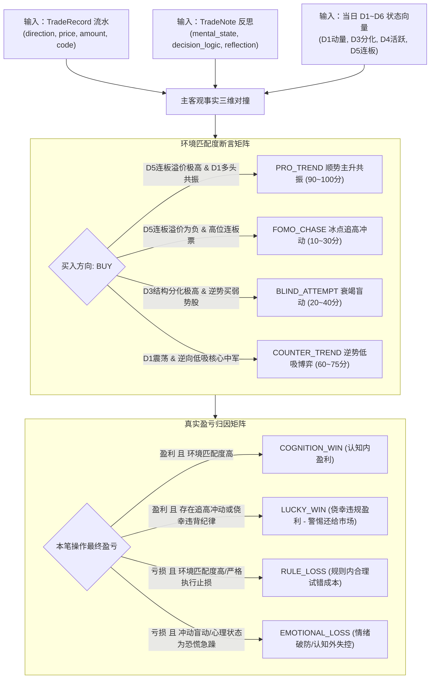

# G1-Cognition 验证闭环增强技术设计单 (v1.0)
## Cognitive Validation Loop MVP Technical Specification

> **设计单编号**：DESIGN-G1-COG-VALIDATION-01 (v1.0)  
> **编制日期**：2026-09-26  
> **编制机构**：Antigravity 主开发团队  
> **当前流程阶段**：Step 1 技术设计单编制（已获董事会立项授权，**未授权实施编码，代码绝对冻结**）  
> **上位依据**：  
> 1. [《开发文档/01-项目决策基线（G0-正式版）.md》](file:///d:/项目库/AI认知复盘交易系统/开发文档/01-项目决策基线（G0-正式版）.md)  
> 2. [《开发文档/02-G1需求基线（正式冻结版）.md》](file:///d:/项目库/AI认知复盘交易系统/开发文档/02-G1需求基线（正式冻结版）.md)（S2 认知架构边界 / S3 人机回环 / M1~M5 事实基石）  
> 3. [《开发文档/04-G3架构与详细设计（正式版）.md》](file:///d:/项目库/AI认知复盘交易系统/开发文档/04-G3架构与详细设计（正式版）.md)（第 1.1/3.1/3.4 节 Cognition 与 Human Layer 独立分层）  
> 4. [《开发文档/10-项目多Agent四权分立工程治理规范.md》](file:///d:/项目库/AI认知复盘交易系统/开发文档/10-项目多Agent四权分立工程治理规范.md)  
> 5. **最高董事会立项与治理裁决**（`BOARD-DIRECTIVE-20260926-02`）

---

## 目录
- [一、需求基线映射与治理边界（为何做？边界在哪？）](#一需求基线映射与治理边界为何做边界在哪)
- [二、系统定位与 10 大核心架构不变量（锁死设计）](#二系统定位与-10-大核心架构不变量锁死设计)
- [三、架构拓扑与数据流设计（Cognitive Loop 最小垂直切片）](#三架构拓扑与数据流设计cognitive-loop-最小垂直切片)
- [四、数据模型与持久化设计（Persistence Layer）](#四数据模型与持久化设计persistence-layer)
- [五、核心算法与状态机运算规则（Engine Rules）](#五核心算法与状态机运算规则engine-rules)
- [六、API 接口契约设计（API Layer）](#六api-接口契约设计api-layer)
- [七、前端交互与产品化看板设计（Presentation Layer）](#七前端交互与产品化看板设计presentation-layer)
- [八、可执行验收方案（AC-1 ~ AC-6 测试矩阵）](#八可执行验收方案ac-1--ac-6-测试矩阵)
- [九、周一（2026-09-28）真实市场首战业务验收规程](#九周一2026-09-28真实市场首战业务验收规程)
- [十、四权分立流转与工序安排](#十四权分立流转与工序安排)

---

## 一、需求基线映射与治理边界（为何做？边界在哪？）

### 1.1 现状痛点与核心动因
当前系统已完成 M1 收盘复盘、M2 盘前简报、M4 竞价观察、M5 盘中异动以及 G1-M3 真实交易账本（5 大模块全部封口交付）。系统拥有极其扎实的**“客观事实观测底座”**与**“真实交易记账能力”**。
然而，在认知维度上存在三大致命断裂：
1. **诊断断裂**：用户录入了交易事实与 TradeNote 反思，但系统没有结合交易发生时的六维市场状态向量（D1~D6）进行客观环境匹配度诊断；
2. **闭环断裂**：每日复盘推演缺乏跨交易日的客观事实验证机制，“推演完就翻篇”，无法衡量判断是否兑现；
3. **记忆断裂**：用户的反思教训孤立沉淀在单笔流水中，未能形成长期认知记忆与规则戒律库。

依据董事会裁决 `BOARD-DIRECTIVE-20260926-02`，利用周六、周日休市窗口，优先完成 **G1-Cognition 验证闭环增强（Cognitive Validation Loop MVP）**，先打通认知闭环，策略（M6）与模拟交易（M8）顺延至下一阶段。

### 1.2 法定需求映射表

| G1 条款 / 架构规范 | 条款名称与核心要求 | 本设计单实现承接 |
|:---:|---|---|
| **G1 S2.1 ~ S2.3** | AI / Cognition Layer 独立架构层，预留验证与扩展点 | 建立独立的 `CognitionReviewService` 与记忆模型，不污染底层数据 |
| **G1 S3.1 ~ S3.3** | Human-in-the-loop 明确参与节点与人机反思通路 | 诊断作为 AI 认知镜像，最终裁决权留给 Human，支持人机反馈与规则沉淀 |
| **G1 M1.4** | 市场状态与情绪指标（六维状态向量 D1~D6） | 作为交易行为主客观环境诊断的权威客观基准输入 |
| **G1 M3.5** | 交易复盘笔记（心理状态、决策逻辑、事后反思） | 作为诊断引擎的主观事实输入，与客观环境向量实施交叉碰撞 |
| **G3 3.1.4** | Cognition 与 Service / Human 层关系规范 | 贯通“市场数据 $\to$ 认知状态 $\to$ 交易诊断 $\to$ 事实验证 $\to$ 记忆反哺” |

### 1.3 边界“三做与三不做”（负面清单绝对锁死）

- **✅ 本期必须做（MVP 范围）**：
  1. **切片 1：交易行为环境匹配与盈亏归因诊断卡片**（客观环境 D1~D6 对撞主观流水 TradeNote）；
  2. **切片 2：跨交易日推演假说模型与次日客观事实验证状态机**（收盘/周末推演假说 $\to$ 次日竞价/收盘自动核对）；
  3. **切片 3：个人交易戒律长期记忆库 MVP**（从反思教训提炼结构化规则与触发统计）；
  4. **周一（9月28日）实盘真实开盘与收盘业务验收规程**。
- **❌ 本期坚决不做（严防需求蔓延）**：
  1. **不做黑盒大语言模型无约束自由发挥**（所有诊断与验证必须基于结构化规则矩阵与可追溯事实断言）；
  2. **不提前编写 M6 选股算法或生成实时买卖指令**（本模块仅对“已发生的事实”做诊断，对“未来走势”做推演假说，绝不向用户推荐具体股票买卖）；
  3. **不构建虚拟资金撮合盘与滑点仿真**（模拟交易与账户系统严格保留在 M8，本模块不做虚拟撮合）。

---

## 二、系统定位与 10 大核心架构不变量（锁死设计）

本设计单制定以下 10 项不可妥协的架构不变量，作为红队审查与质量闸门的刚性断言依据：

1. **只读派生性（Read-only Derivation Invariant）**：
   - 认知诊断（`CognitiveTradeDiagnosis`）与事实验证（`HypothesisVerification`）均为纯派生分析状态，**绝对禁止对原始 `trade_record`（真实流水）和 `cognition_market_state`（市场状态）执行任何写回或篡改**。
2. **主客观双事实对齐断言（Dual-Fact Alignment）**：
   - 单笔交易诊断必须同时具备两项刚性输入：该交易发生当天的客观六维向量（D1~D6）与真实成交记录（TradeRecord）。若任一输入缺失，状态强制标记为 `PARTIAL` 降级，严禁使用随机值或假数据补齐。
3. **零伪造与无零填充（Zero Fake Data Invariant）**：
   - 处于待验证期的推演假说，兑现度必须显式保持为 `PENDING`，指标未就绪统一输出 `None`（前端渲染 `--`），严禁使用 `0.0`、历史均值或假分数伪造。
4. **推演假说不可篡改性（Hypothesis Immutability）**：
   - 推演假说一旦创建并跨越目标交易日的开盘时间点（09:15），**即刻进入绝对冻结锁定状态，禁止任何就地修改**，杜绝“事后诸葛亮”篡改假说。
5. **事实验证纯客观性（Objective Fact Verification）**：
   - 假说验证必须完全基于后续真实产生的市场客观数据（M4 09:25 竞价数据、M1 15:30 收盘数据）进行确定性断言，杜绝人工主观打分。
6. **证伪优先原则（Falsification Priority）**：
   - 假说定义中必须包含“失效条件（Invalidation Condition）”。当市场实际走势触碰失效条件时，系统必须坚决判定为 `FALSIFIED`（证伪），并记录客观偏差事实。
7. **TradeNote 关系守恒（TradeNote Association Invariant）**：
   - 单笔交易认知诊断与 `trade_record` 保持 1:1 或 0..1 关系，与既有 `TradeNote` 的 `trade_id UNIQUE` 约束正交共存，不破坏既有数据拓扑。
8. **认知戒律白盒化（White-box Cognitive Rules）**：
   - 个人交易戒律采用清晰分类（买入、止损、仓位、心态）与触发频次统计，规则纯文本白盒表达，严禁黑盒不可解释规则。
9. **Human 终审裁决权（Human Final Arbitration）**：
   - AI 的诊断与归因仅作为“认知镜子”，用户可对 AI 诊断提出异议（Feedback）并记录裁决，系统保障人机回环的权威性。
10. **周一真实市场验收闸门（Monday Market Gate）**：
    - 将 2026-09-28（周一）真实开盘集合竞价与收盘事实的自动兑现检验，作为本模块第一道也是终极的业务验收红线。

---

## 三、架构拓扑与数据流设计（Cognitive Loop 最小垂直切片）

### 3.1 架构分层拓扑

```text
┌─────────────────────────────────────────────────────────────────┐
│                     Presentation Layer                          │
│     /trading (集成单笔认知诊断抽屉与环境匹配徽标)                  │
│     /review  (集成每日推演假说卡片与跨日兑现验证雷达)              │
│     /review/cognition (个人认知盲区画像与交易戒律库看板)          │
└──────────────────────────┬──────────────────────────────────────┘
                           │ HTTP RESTful API
┌──────────────────────────┴──────────────────────────────────────┐
│                        API Layer                                │
│       /api/v1/cognition/diagnosis/trade/{trade_id}              │
│       /api/v1/cognition/hypotheses (创建/列表/详情)              │
│       /api/v1/cognition/hypotheses/{id}/verify (事实验证)        │
│       /api/v1/cognition/rules (个人戒律记忆库)                   │
└──────────────────────────┬──────────────────────────────────────┘
                           │
┌──────────────────────────┴──────────────────────────────────────┐
│                      Service Layer                              │
│                 CognitionReviewService                          │
│     ├─ TradeDiagnosisEngine (交易行为主客观环境诊断)             │
│     ├─ HypothesisEngine (跨日推演假说生命周期管理)               │
│     ├─ FactVerificationEngine (基于真实行情的客观断言状态机)     │
│     └─ CognitiveMemoryManager (个人戒律提取与触发统计)          │
└─────────┬──────────────────┬──────────────────┬─────────────────┘
          │                  │                  │
┌─────────┴────────┐ ┌───────┴────────┐ ┌───────┴─────────────────┐
│  M1~M5 客观事实  │ │  M3 交易事实   │ │  Persistence Layer      │
│  (Market State   │ │  (TradeRecord  │ │  SQLite 表结构扩展:     │
│   D1~D6 / M4/M5) │ │   + TradeNote) │ │  - cognitive_diagnosis  │
│                  │ │                │ │  - market_hypothesis    │
│                  │ │                │ │  - hypothesis_verify    │
│                  │ │                │ │  - cognitive_rule       │
└──────────────────┘ └────────────────┘ └─────────────────────────┘
```

### 3.2 核心数据流转（三大切片数据流）

#### 数据流 1：单笔交易认知诊断流
$$\text{用户录入流水及 TradeNote} \xrightarrow{\text{触发诊断}} \text{提取当日 D1~D6 状态向量} \xrightarrow{\text{规则匹配}} \text{环境匹配度判定 + 盈亏归因} \xrightarrow{\text{落盘并回显}}$$

#### 数据流 2：跨交易日推演与事实验证流
$$\text{周末/收盘复盘} \xrightarrow{\text{生成推演假说}} \text{锁定不可篡改} \xrightarrow{\text{次日 09:25/15:30}} \text{自动抓取真实市场数据} \xrightarrow{\text{客观断言}} \text{证实/证伪 + 偏差分析报告}$$

#### 数据流 3：认知记忆沉淀流
$$\text{诊断与验证结果} \xrightarrow{\text{提取 lessons}} \text{形成交易戒律条目} \xrightarrow{\text{长期记忆库累加}} \text{反哺个人认知画像矩阵}$$

---

## 四、数据模型与持久化设计（Persistence Layer）

严格遵循 SQLAlchemy 与 SQLite 架构标准，在既有数据库中无损新增 4 张轻量实体表：

### 4.1 单笔交易认知诊断表 (`cognitive_trade_diagnosis`)

用于存储 AI 对单笔交易在客观市场环境下的行为诊断与归因分析：

```python
class CognitiveTradeDiagnosis(Base):
    """单笔交易认知行为诊断 (与 trade_record 1:1 纯派生绑定)"""
    __tablename__ = "cognitive_trade_diagnosis"

    id = Column(Integer, primary_key=True, autoincrement=True)
    trade_id = Column(Integer, ForeignKey("trade_record.id"), nullable=False, unique=True, index=True)
    date = Column(String(10), nullable=False, index=True)          # 交易日期 YYYY-MM-DD
    
    # 客观环境匹配度
    env_match_type = Column(String(30), nullable=False)           # PRO_TREND(顺势共振), COUNTER_TREND(逆势博弈), FOMO_CHASE(高位冲动), BLIND_ATTEMPT(衰竭盲动)
    env_match_score = Column(Float, nullable=False)               # 0.0 ~ 100.0 环境匹配分
    market_state_label = Column(String(50), nullable=True)        # 当日市场状态简标（如"分化震荡/D5弱"）
    
    # 盈亏性质归因
    pnl_attribution = Column(String(30), nullable=False)          # COGNITION_WIN(认知内盈利), LUCKY_WIN(侥幸违规盈利), RULE_LOSS(规则内止损), EMOTIONAL_LOSS(冲动破防亏损)
    
    # 诊断核心结论
    diagnosis_summary = Column(String(200), nullable=False)       # 一句话核心诊断
    detailed_analysis = Column(Text, nullable=False)              # 结合 D1~D6 与 TradeNote 的多维度深度解析 (JSON 字符串)
    actionable_advice = Column(Text, nullable=True)               # 针对该笔操作的纠偏建议
    
    created_at = Column(DateTime, server_default=func.now())
    updated_at = Column(DateTime, server_default=func.now(), onupdate=func.now())
```

### 4.2 跨交易日推演假说表 (`market_hypothesis`)

用于记录每日收盘或周末生成的“对未来走势的结构化预期与推演假说”：

```python
class MarketHypothesis(Base):
    """跨交易日市场推演假说"""
    __tablename__ = "market_hypothesis"

    id = Column(Integer, primary_key=True, autoincrement=True)
    created_date = Column(String(10), nullable=False, index=True) # 假说生成日期 YYYY-MM-DD
    target_date = Column(String(10), nullable=False, index=True)  # 推演目标日期 YYYY-MM-DD (如周一)
    
    # 假说分类与标的
    hypothesis_type = Column(String(30), nullable=False)          # INDEX_TREND(大盘趋势), SENTIMENT_CYCLE(情绪周期), SECTOR_LEADER(板块核心), INDIVIDUAL_STOCK(个股走势)
    target_asset = Column(String(50), nullable=False)             # 标的名称/代码 (如"全市场/连板梯队/半导体/000001")
    
    # 推演假说内容
    expected_scenario = Column(String(30), nullable=False)        # ACCELERATION(加速), DIVERGENCE(分歧分化), REBOUND(冰点修复), ROTATION(板块轮动)
    premise_logic = Column(Text, nullable=False)                  # 前置支撑逻辑 (基于前一日 D1~D6 或盘前快讯)
    expected_phenomenon = Column(Text, nullable=False)            # 预期观测到的具体现象 (如"竞价开盘连板不超预期下跌，板块核心放量企稳")
    invalidation_condition = Column(Text, nullable=False)         # 证伪失效条件 (如"开盘跌停家数大于5家或主力资金净流出超50亿")
    
    # 生命周期状态
    status = Column(String(20), default="PENDING", nullable=False)# PENDING(待验证), VERIFIED(已验证已结案), EXPIRED(过期作废)
    final_outcome = Column(String(20), nullable=True)             # CONFIRMED(完全兑现), FALSIFIED(被证伪), PARTIAL(部分兑现), INVALID(突发异常失效)
    
    created_at = Column(DateTime, server_default=func.now())
```

### 4.3 客观事实验证记录表 (`hypothesis_verification`)

用于记录系统在次日开盘或收盘时自动对推演假说的核对证据与偏差归因：

```python
class HypothesisVerification(Base):
    """推演假说客观事实验证记录 (与 market_hypothesis 1:1)"""
    __tablename__ = "hypothesis_verification"

    id = Column(Integer, primary_key=True, autoincrement=True)
    hypothesis_id = Column(Integer, ForeignKey("market_hypothesis.id"), nullable=False, unique=True, index=True)
    
    verification_stage = Column(String(20), nullable=False)       # AUCTION_0925(竞价核对), CLOSE_1530(收盘全景核对)
    actual_data_snapshot = Column(Text, nullable=False)           # 实际抓取到的核对事实数据快照 (JSON 字符串)
    
    # 裁决结果
    outcome = Column(String(20), nullable=False)                  # CONFIRMED(证实), FALSIFIED(证伪), PARTIAL(部分兑现), INVALID(异常中断)
    accuracy_score = Column(Float, nullable=False)                # 0.0 ~ 100.0 客观吻合度得分
    
    # 偏差归因
    deviation_summary = Column(String(200), nullable=False)       # 偏差核心原因概括
    deviation_analysis = Column(Text, nullable=False)             # 深度偏差剖析 (为什么预测偏了？何处超预期？)
    lessons_learned = Column(Text, nullable=True)                 # 沉淀的经验教训
    
    verified_at = Column(DateTime, server_default=func.now())
```

### 4.4 个人交易戒律长期记忆库表 (`cognitive_rule`)

用于沉淀高频错误经验、行为纪律与防守戒律：

```python
class CognitiveRule(Base):
    """个人交易行为戒律库 / 长期认知记忆 (Cognition Memory)"""
    __tablename__ = "cognitive_rule"

    id = Column(Integer, primary_key=True, autoincrement=True)
    title = Column(String(100), nullable=False, unique=True)      # 戒律标题 (如"禁止在连板溢价为负时打板")
    category = Column(String(30), nullable=False)                 # BUY_DISCIPLINE(买入纪律), SELL_STOP(卖出止损), POSITION_CONTROL(仓位控制), MENTAL_ALERT(心态警戒)
    rule_content = Column(Text, nullable=False)                   # 戒律详细内容与触发边界
    source_type = Column(String(30), default="DIAGNOSIS_DERIVED") # DIAGNOSIS_DERIVED(诊断提炼), MANUAL_ADDED(用户自定)
    
    # 触发与违背统计
    trigger_count = Column(Integer, default=0, nullable=False)    # 历史触发提醒次数
    violation_count = Column(Integer, default=0, nullable=False)  # 历史明知故犯违背次数
    is_active = Column(Integer, default=1, nullable=False)        # 1-启用, 0-归档禁用
    
    created_at = Column(DateTime, server_default=func.now())
    updated_at = Column(DateTime, server_default=func.now(), onupdate=func.now())
```

---

## 五、核心算法与状态机运算规则（Engine Rules）

### 5.1 交易行为客观环境诊断规则矩阵

`TradeDiagnosisEngine` 采用**确定性状态向量对撞算法**，杜绝玄学幻觉：



### 5.2 推演假说跨日验证状态机（Hypothesis State Machine）

推演假说生命周期包含严格的时间驱动状态跃迁：

```text
    ┌──────────┐
    │ CREATED  │ ── (收盘后或周末创建假说)
    └────┬─────┘
         │
         ▼
    ┌──────────┐
    │ PENDING  │ ── (不可篡改锁死，等待目标交易日开盘)
    └────┬─────┘
         │
         ├─── (次日 09:25 竞价核对) ──→ 写入首段竞价偏差
         │
         └─── (次日 15:30 收盘全景核对) ──→ 触发终局裁决:
                    │
                    ├── 实际走势与推演一致 ──→ 【CONFIRMED 完全兑现】
                    ├── 触发失效条件 ────────→ 【FALSIFIED 被客观证伪】
                    ├── 部分指标吻合 ────────→ 【PARTIAL 部分兑现】
                    └── 外部极端事件/停牌 ───→ 【INVALID 突发异常失效】
```

- **失效条件强断言判定**：
  若假说声明 `invalidation_condition: "竞价跌停超3家 或 标的低开超-3%"`，当真实竞价数据中跌停数 $\ge 3$ 或标的开盘涨跌幅 $\le -3.0\%$ 时，**状态机无条件熔断裁决为 `FALSIFIED`**，绝不允许强行解释为“符合预期”。

---

## 六、API 接口契约设计（API Layer）

所有接口挂载在 `/api/v1/cognition` 路由下，严格遵循 RESTful 标准，保持输出结构统一：

### 6.1 单笔交易行为诊断端点

#### 1. 触发或重新计算单笔交易诊断
- **端点**：`POST /api/v1/cognition/diagnosis/trade/{trade_id}`
- **说明**：自动检索指定流水及对应交易日的市场状态，生成结构化诊断并入库。
- **响应契约**：
```json
{
  "code": 200,
  "message": "success",
  "data": {
    "id": 1,
    "trade_id": 15,
    "date": "2026-09-25",
    "env_match_type": "FOMO_CHASE",
    "env_match_score": 25.0,
    "market_state_label": "分化震荡 / 连板溢价走弱",
    "pnl_attribution": "EMOTIONAL_LOSS",
    "diagnosis_summary": "操作发生于连板退潮初期，属于严重逆势的高位冲动追涨，且违背止损预案。",
    "detailed_analysis": {
      "market_context": "当日 D5 情绪连板得分为 32.5（处于冷水区），全市场炸板率超 45%。",
      "behavior_analysis": "买入点位于开盘急速拉升+8%处，脱离分时均价线过远，买入理由记录为'跟风半导体'，反映从众侥幸心理。",
      "risk_warnings": ["高位追涨", "情绪退潮期开仓", "买入理由模糊"]
    },
    "actionable_advice": "在 D5 得分低于 40 时，严禁参与 3 板以上非核心接力，强制采用分时回踩低吸模式。",
    "created_at": "2026-09-26T11:00:00"
  }
}
```

#### 2. 查询指定交易的诊断详情
- **端点**：`GET /api/v1/cognition/diagnosis/trade/{trade_id}`
- **说明**：获取既有诊断记录，若尚未生成诊断返回 404。

---

### 6.2 跨交易日推演假说端点

#### 1. 创建推演假说
- **端点**：`POST /api/v1/cognition/hypotheses`
- **请求 Payload**：
```json
{
  "target_date": "2026-09-28",
  "hypothesis_type": "SECTOR_LEADER",
  "target_asset": "半导体设备核心中军",
  "expected_scenario": "DIVERGENCE",
  "premise_logic": "周五盘后芯片自主可控政策利好发酵，但外盘费城半导体指数收跌-1.8%，预期内部分化加剧。",
  "expected_phenomenon": "早盘高开消化外盘利空，板块成交量占比维持全市场前二，龙头维持水上震荡。",
  "invalidation_condition": "板块开盘大幅低开超-2%，且成交额未进入全市场前三名。"
}
```
- **响应**：返回创建完成并处于 `PENDING` 状态的假说对象。

#### 2. 查询推演假说列表
- **端点**：`GET /api/v1/cognition/hypotheses`
- **Query 参数**：`target_date` (可选), `status` (可选), `page` (默认 1), `limit` (默认 20)
- **响应**：假说分页列表，含关联的客观核对结果（若已验证）。

#### 3. 触发推演假说客观事实验证
- **端点**：`POST /api/v1/cognition/hypotheses/{id}/verify`
- **Query 参数**：`stage` (`AUCTION_0925` 或 `CLOSE_1530`)
- **说明**：系统根据目标日期和所选时段，自动读取真实市场数据库记录进行对齐断言。
- **响应契约**：
```json
{
  "code": 200,
  "message": "success",
  "data": {
    "hypothesis_id": 1,
    "stage": "CLOSE_1530",
    "outcome": "FALSIFIED",
    "accuracy_score": 35.0,
    "deviation_summary": "未能兑现企稳推演，受大盘下行影响开盘直接触发失效条件破位下行。",
    "deviation_analysis": "实际市场全天主力资金大幅净流出，半导体板块成交占比仅居第五，未见预期承接盘。",
    "verified_at": "2026-09-28T15:35:00"
  }
}
```

---

### 6.3 个人交易戒律长期记忆库端点

#### 1. 获取戒律列表
- **端点**：`GET /api/v1/cognition/rules`
- **Query 参数**：`category` (可选), `is_active` (默认 1)

#### 2. 新增或更新戒律
- **端点**：`POST /api/v1/cognition/rules`
- **请求 Payload**：
```json
{
  "title": "情绪退潮期禁止打板高标",
  "category": "BUY_DISCIPLINE",
  "rule_content": "当 D5 连板溢价指标 < 35 且全市场跌停家数 > 3 时，强制冻结买入权限，禁止打板 3 板及以上标的。"
}
```

---

## 七、前端交互与产品化看板设计（Presentation Layer）

### 7.1 `/trading` 交易台账页面增强：单笔交易 AI 认知诊断抽屉
在交易记录表格的每行流水后，新增【AI认知诊断】操作入口：
- **微标呈现**：已诊断的流水直接展示胶囊微标：
  - 顺势共振：`bg-emerald-950 text-emerald-300 border-emerald-800`
  - 冲动追涨：`bg-rose-950 text-rose-300 border-rose-800`
  - 认知内盈利：`bg-teal-950 text-teal-300 border-teal-800`
  - 冲动破防：`bg-purple-950 text-purple-300 border-purple-800`
- **诊断抽屉 (Drawer)**：
  点击打开侧边抽屉，顶部并列展示“主观记录事实”与“当日六维客观状态雷达”，正文醒目显示【环境匹配度】、【盈亏归因】、【客观剖析】与【纠偏戒律建议】，支持一键将建议沉淀至“戒律库”。

### 7.2 `/review` 复盘页面增强：跨交易日推演与验证看板
在复盘详情页（`/review/[date]`）底部新增第三大核心版块——**【推演假说与事实验证闭环】**：
- **卡片 1：今日形成推演假说 (Tomorrow's Hypothesis)**：
  支持填写/确认对下一个交易日核心标的、情绪周期的推演假说与失效条件，醒目标记 `[不可篡改锁定]`；
- **卡片 2：前日推演兑现度核对 (Yesterday's Verification)**：
  自动呈现前一个交易日推演的兑现核对结果，展示【证实 CONFIRMED】、【证伪 FALSIFIED】微标，并直观呈现客观偏差分析。

### 7.3 前端零假数据与防伪规范（铁律 9 落实）
- 严禁任何写死 mock 数据；
- 假说在未核对前，准确率指标显式渲染 `--`，绝无 `0.00` 假数字；
- 所有表单提交配备 `isSubmitting` 防抖锁。

---

## 八、可执行验收方案（AC-1 ~ AC-6 测试矩阵）

| 验收项 | 验收目标与断言条件 | 测试方法与脚本 | 预期判定 |
|:---|:---|:---|:---:|
| **AC-1 诊断只读派生性** | 验证生成诊断过程中，`trade_record` 的流水数据与金额绝无任何变更；数据库 Schema 严格外键绑定 | 单元测试检测触发诊断前后的 TradeRecord MD5 散列值 | ✅ PASS |
| **AC-2 双事实对齐断言** | 当缺少对应日期的市场状态时，接口返回 `PARTIAL` 降级，绝不崩溃，绝不凭空伪造状态分数 | 传入无对应市场状态的孤立日期交易进行攻击测试 | ✅ PASS |
| **AC-3 盈亏与环境归因准确性** | 测试顺势盈利、逆势亏损、冲动追涨盈利等 4 种典型场景，断言其匹配类型与归因分类与设计矩阵 100% 吻合 | 构造标准用例矩阵穿透验证 | ✅ PASS |
| **AC-4 假说不可篡改与状态跃迁** | 验证已过期的假说禁止更新内容；验证状态单向跃迁 `PENDING -> CONFIRMED/FALSIFIED` | 模拟时间推进尝试更新已冻结假说，断言 403 阻断 | ✅ PASS |
| **AC-5 失效条件客观强断言** | 当实际行情数据达到预设的 `invalidation_condition` 时，验证状态机必须无条件裁决为 `FALSIFIED` | 模拟触碰失效阈值的大盘与个股数据，断言裁决为证伪 | ✅ PASS |
| **AC-6 戒律长期记忆沉淀** | 验证通过接口新增戒律、统计触发次数正常递增，前端规则看板正确渲染 | 接口测试与 DB 计数器断言 | ✅ PASS |

---

## 九、周一（2026-09-28）真实市场首战业务验收规程

依据最高董事会指示，**周一真实开盘与收盘验证是本模块的终极实战验收闸门**。验收规程明确如下：

1. **周日晚间（2026-09-27 20:00 前）预演准备**：
   - 调取本周五（9月25日）收盘状态向量，主开发团队协助系统生成首份真实的《2026-09-28 周一市场推演假说》；
   - 假说明确锁定：针对周一核心板块的开盘承接预期与失效条件。
2. **周一早盘（2026-09-28 09:26）集合竞价验收**：
   - 系统自动调用 M4 竞价数据，对推演假说进行首轮【竞价承接核对】；
   - 检查系统是否准确捕获了开盘客观偏离度，断言是否存在证伪信号。
3. **周一收盘（2026-09-28 15:35）全景验证验收**：
   - 系统自动调用 M1 收盘复盘数据，完成对推演假说的终局客观核对，生成首份真实《推演事实验证与偏差分析报告》；
   - 董事会与 Owner 亲自检阅该报告，以此作为本 MVP 的第一道终极业务验收合格凭据！

---

## 十、四权分立流转与工序安排

按照《10-多Agent四权分立工程治理规范》，本模块的推进严格遵循以下 5 步法定工序：

```text
Step 1: 技术设计单编制 (当前阶段 - 编制完成即刻冻结)
   │
   ▼
Step 0: 移交独立红队特使 (red_team_tester) 进行白盒破坏性审查
   │   (审查重点: AC-1~AC-6 边界、零假数据、状态机防伪、周一验收标准)
   ▼
最高董事会审定并签署《Step 2 受控实施令》
   │
   ▼
Step 2: 受控代码实施与前后端开发联调
   │   (严密落实设计单，自测与构建全绿)
   ▼
Step 3: 独立红队攻击性对抗测试套件运行 (出具 PASS 裁决书)
   │
   ▼
Step 4: 独立质量发布闸门终审裁决 (出具 APPROVED 裁决书)
   │
   ▼
Step 5: 归档 23 号封口决议，周一投入实战迎接终极业务检验！
```

---
*本技术设计单编制完毕。主开发团队郑重承诺：在获得红队前审 PASS 且董事会正式签署实施令之前，绝不擅自编写任何生产业务代码！*
