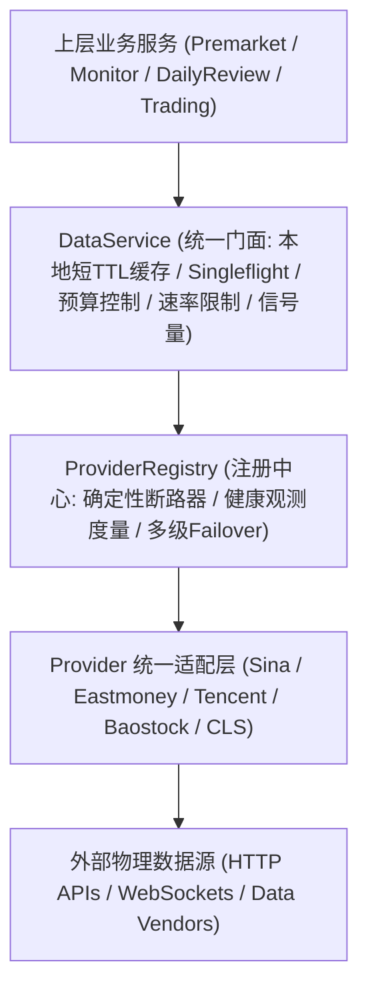
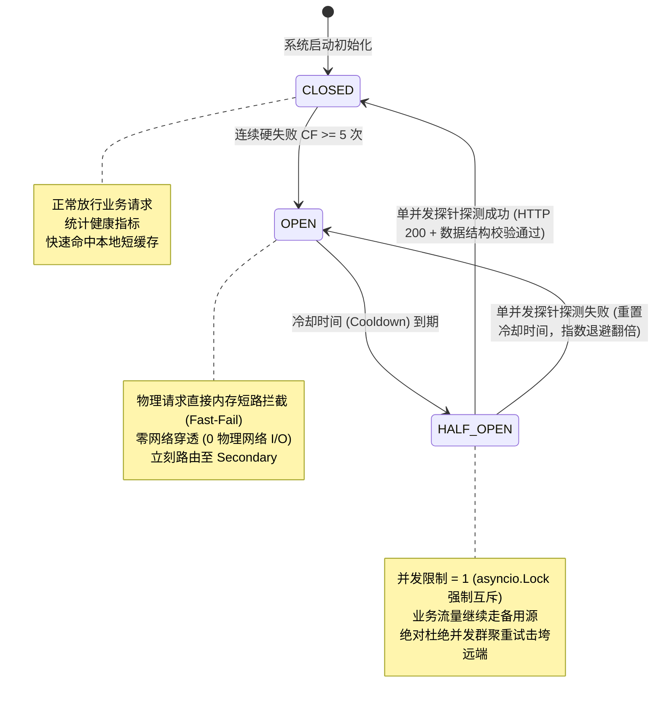
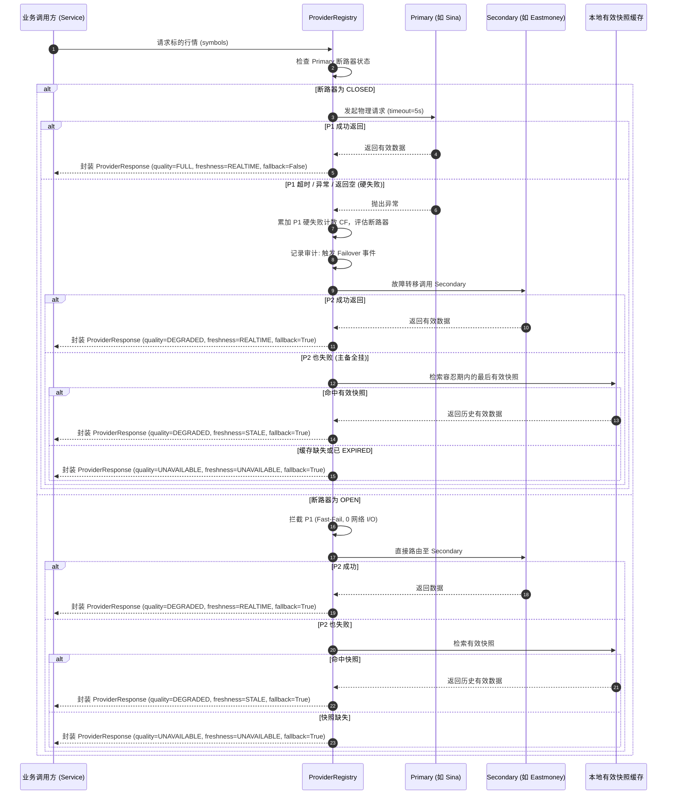

# 26-P2 数据源健康治理与弹性多级降级设计单

**文档版本**: v1.1.0-REVISED（二次架构审计修订版）  
**编制时间**: 2026-09-29  
**上位依据**:  
- 《开发文档/00-项目大纲.md》  
- 《开发文档/10-项目多Agent四权分立工程治理规范.md》  
- 《开发文档/25-P0数据可信度与认知闭环加固设计单.md》  
- 《Redmi/TRADING_DATA_SOURCES.md》  
**执行原则**:  
- 零伪造铁律：不把 PARTIAL 伪装成完整，不填 0 代替缺失数据。  
- 不确定即明确标注 `UNKNOWN` / `待验证`。  
- 严禁通过伪造 User-Agent、Referer 等应急垫片规避 WAF。  
- 坚决保障 2026-09-28 原始事实账本与历史观测切片不可篡改。  
- 本设计单**只做调查、分析、架构设计与契约编制，不修改生产代码、不修改生产数据库、不重启容器**。

---

## 一、 P2 背景与问题定义

### 1.1 P0 / P1 已解决的问题与基线演进
- **P0 阶段（数据可信度与认知闭环加固）**：
  1. 彻底确立了“原始事实账本（Truth Ledger）”概念，物理保全真实历史流水（如存量流水 ID 2 的 101 股），杜绝物理篡改；
  2. 废除了“单一指标抓取失败即判整份复盘 INVALID”的极端全盘死刑缺陷，建立了 D1~D6 分级降级评分体系（`full` / `partial` / `invalid`）；
  3. 修复了字典/列表解析倒错导致的 `INDICATOR_PARSE_ERROR`，消灭了语法级致命崩溃；
  4. 引入了交易时段外持仓收盘价日终补偿机制（`EOD_COMPENSATED`），消灭了收盘后持仓市值显示全屏 `UNAVAILABLE` 的断点；
  5. 实现了竞价推演假说客观核验契约对齐，打通了早盘开盘事实自动断言闭环。
- **P1 阶段（交易体验与报表增强）**：
  1. 实现了标的代码 ↔ 名称/拼音双向模糊匹配与自动补全（P1-A）；
  2. 建立了 A 股 100 整数倍整手前后端双重强风控拦截（P1-B）；
  3. 落地了“目标交易 ➜ 会计红字冲销 (REVERSAL) ➜ 修正交易”的不可篡改纠错闭环与反思笔记无损迁移（P1-C）；
  4. 纯净化系统概览看板，彻底清除 `M1`~`M4` 内部代号前缀（P1-D）；
  5. 落地了自选股 3 态循环内存排序，实现 0 额外网络开销（P1-E）；
  6. 根因闭环了 P1-REGRESSION-01（PROD-04 生产状态一致性），证实数据库与 API 均稳定呈现有效回放结论（`partial`, `38.07`）。

### 1.2 当前数据源体系的剩余深层风险
虽然 P0 和 P1 保障了内部数据链路与交互逻辑的合规稳定，但在外部数据源供给层，依然存在严重的架构性脆弱点：
1. **单点数据源绝对依赖（Single-Point Vulnerability）**：
   - 指数行情（`index_quote`）与个股行情（`stock_quote`）核心绑定了 `SinaProvider`，备用源未完成标准化契约接入与生产准入验证；
   - 全市场涨跌广度（`market_breadth`）、微盘股（`micro_cap`）核心绑定了 `EastmoneyProvider`；
   - 涨跌停与连板情绪（`limit_up`）仅依赖东财推送池；
   - 一旦特定供应商发生接口改版、域名解析失败、DNS 污染或风控封禁，对应数据能力立刻瘫痪。
2. **缺乏工业级硬断路器（No Deterministic Circuit Breaker）**：
   - 现存 `registry.execute_with_fallback` 仅具备简单的循环重试；
   - 当某个外部源发生持续超时或服务端 502/504 时，上层业务仍然盲目发起请求，造成协程阻塞、连接池耗尽并引发雪崩效应。
3. **“请求头伪装”与“源头垫片”的不可持续性**：
   - 目前部分代码依赖静态 `Referer: https://finance.sina.com.cn`、固定 `ut_token` 或本地延迟 `sleep(0.3)` 来规避反爬；
   - 这种对抗反爬的做法极其脆弱，反爬规则一旦升级，依赖它的系统就会大面积失效；
   - 必须通过“**减少请求量 + 批量合并获取 + 严格短缓存 + 刚性限流 + 弹性多源故障转移**”的正规工程手段，替代脆弱的伪装垫片。
4. **盘前资讯链路事实中断（Premarket News Starvation）**：
   - 生产数据库中 `market_news` 表长期处于 0 行状态；
   - 财联社（CLS）签名算法与请求参数存在失效风险，且缺乏稳定多路新闻聚合管道，导致盘前推演缺少真实客观舆情输入。

### 1.3 核心设计哲学：因为“知道自己不知道”而避免盲目操作
认知交易系统的核心价值在于**客观反映现实**。真实世界中的外部金融数据源必然存在网络抖动、延迟或单点中断。
系统绝不能通过“制造伪装”、“偷偷填 0”或“自动脑补假数据”来掩盖故障，而是必须建立一套：
> **健康可量化、故障可隔离、多源可切换、降级显式化、账本不可变**

的弹性高可用数据供给架构。

---

## 二、 Provider 统一适配层

### 2.1 架构分层全景
P2 将数据获取链路严格划分为五层，各层职责单一、边界分明：



### 2.2 统一抽象接口契约（Unified Provider Interface）

为彻底消除不同数据提供者的数据结构割裂，所有 Provider 必须统一实现基础抽象基类，并消费标准请求契约、输出标准响应契约：

```python
from abc import ABC, abstractmethod
from dataclasses import dataclass, field
from datetime import datetime
from enum import Enum
from typing import Any, Dict, List, Optional

class DataQuality(str, Enum):
    """
    数据完整度与质量等级 (Data Integrity & Quality)
    严格反映数据内容的完整性与可信程度，与时间时态完全正交。
    """
    FULL = "FULL"                # 全部核心指标与次要维度完备，数值完全自洽
    PARTIAL = "PARTIAL"          # 核心指标可用，但部分非关键次要指标缺失或未就绪
    DEGRADED = "DEGRADED"        # 核心指标通过降级途径提供 (如切换至备用源，或使用容忍期内的历史快照)
    INVALID = "INVALID"          # 数据协议畸变、校验失败或数值严重失真 (坚决丢弃，不提供给上层)
    UNAVAILABLE = "UNAVAILABLE"  # 所有物理数据源断流且无有效快照缓存 (显式报错，绝不填 0)

class Freshness(str, Enum):
    """
    数据新鲜度与时态语义 (Temporal Freshness & Price Semantics)
    严格反映数据所对应的物理时间窗口与价格语义，与数据质量完全正交。
    """
    REALTIME = "REALTIME"                # 盘中高频实时数据 (<15s 采样滞后)
    DELAYED = "DELAYED"                  # 延迟行情 (通常为 15 分钟以上延时，禁止用于突破信号)
    EOD_COMPENSATED = "EOD_COMPENSATED"  # 收盘日终结算补偿价 (盘后资产核算专用，严禁当作盘中最新跳动)
    STALE = "STALE"                      # 超过正常采样周期，使用可接受容忍窗口内的最后有效已知快照
    EXPIRED = "EXPIRED"                  # 严重过期失效，已丧失时效参考价值
    UNAVAILABLE = "UNAVAILABLE"          # 物理数据缺失，无时态信息

class ProviderErrorCode(str, Enum):
    """标准化提供者错误码"""
    NONE = "NONE"
    TIMEOUT = "TIMEOUT"                  # 网络/服务端物理超时 (>=5000ms)
    CONNECTION_ERROR = "CONNECTION_ERROR"# 网络连接失败 / TCP断开 / DNS解析失败
    HTTP_ERROR = "HTTP_ERROR"            # 4xx / 5xx HTTP 异常
    WAF_BLOCKED = "WAF_BLOCKED"          # 触发远端 WAF / 验证码 / IP 限制
    EMPTY_PAYLOAD = "EMPTY_PAYLOAD"      # 数据源返回空内容 / 零字节
    MALFORMED_PARSE = "MALFORMED_PARSE"  # JSON/文本协议解析崩溃 / 乱码
    SCHEMA_MISMATCH = "SCHEMA_MISMATCH"  # 核心业务字段缺失
    SEMANTIC_INVALID = "SEMANTIC_INVALID"# 数值逻辑异常 (如现价<=0，成交量为负)
    RATE_LIMITED = "RATE_LIMITED"        # 触达本地预算或远端限流

@dataclass(frozen=True)
class ProviderRequest:
    """标准化请求契约"""
    capability: str                      # 能力标识 (如 index_quote, stock_quote)
    method: str                          # 调用的具体方法名
    symbols: List[str] = field(default_factory=list) # 标的代码列表 (批量请求严禁超 20 只)
    date: Optional[str] = None           # 业务日期 YYYY-MM-DD
    options: Dict[str, Any] = field(default_factory=dict) # 额外参数
    timeout_ms: int = 5000               # 单次硬超时时间 (ms)
    trace_id: str = ""                   # 审计追踪链 ID

@dataclass
class ProviderResponse:
    """标准化响应契约 (所有 Provider 产出的物理快照)"""
    data: Any                            # 规整后的结构化数据
    provider: str                        # 实际产出数据的提供者标识
    capability: str                      # 所属能力
    quality: DataQuality                 # 质量等级 (FULL / PARTIAL / DEGRADED / INVALID / UNAVAILABLE)
    freshness: Freshness                 # 新鲜度语义 (REALTIME / DELAYED / EOD_COMPENSATED / STALE / EXPIRED / UNAVAILABLE)
    latency_ms: int                      # 物理请求网络耗时 (毫秒)
    source_timestamp: Optional[datetime] # 外部源声称的生成时间戳
    received_timestamp: datetime         # 本系统网关接收并解析成功的时间戳
    validity: bool                       # 机器硬校验是否通过
    error_code: ProviderErrorCode = ProviderErrorCode.NONE
    error_message: Optional[str] = None
    observation_id: str = ""             # 观测数据不可变审计指纹
    fallback_used: bool = False          # 是否属于备用源降级产物
```

---

## 三、 Provider Capability Matrix（供应商能力矩阵与五维准入验证）

> [!IMPORTANT]
> **真实性审计原则**：不得预先假设候选提供商一定处于可用或已准入状态。严格区分**“代码已存在”**与**“已验证/准入生产”**。对于当前代码中尚未接入、未经实盘连通、契约未验证或存在语义漂移的源，一律客观标注为 **`待验证`** / **`暂不准入`**，并在第十五章建立严格的准入探针。

### 3.1 五维生产准入验证标准
每个候选 Provider 的每个能力，必须独立评估以下 5 个明确验证维度：
1. **`implementation_status` (代码实现状态)**: `已接入`（代码库已有生产可用适配类）/ `部分接入`（有雏形代码但缺少完整契约封装）/ `未接入`（尚无代码）；
2. **`connectivity_verified` (网络连通性验证)**: `已验证`（在 Docker 生产容器环境实测连通稳定）/ `待验证`（尚未经过容器内连通实测）/ `连通受限`（频繁被 WAF 拦截或签名报错）；
3. **`schema_verified` (协议与结构校验)**: `已验证`（数据字段完全对齐 P2 契约，解析 100% 稳定）/ `待验证`（字段尚未经自动化解析断言）/ `存在漂移`（字段频繁变更或存在格式错位）；
4. **`semantic_verified` (数值与业务语义验证)**: `已验证`（数值在业务合法域内，无价格<=0，涨跌幅自洽）/ `待验证`（数值边界尚未经实测检验）/ `存在失真`（存在除权未处理或脏数据）；
5. **`production_eligible` (生产准入评级)**: `准入`（通过全部前置验证，可作为生产主力源）/ `仅作备用`（连通可用但在部分时段稳定性欠佳，仅作 Secondary/Tertiary）/ `暂不准入`（存在严重缺陷或待验证，禁止在生产路由放行）/ `待验证`（待实测探针裁决）。

### 3.2 供应商能力与准入评级全景表

| 业务数据能力 (Capability) | 备选供应商 (Candidate Providers) | 优先级规划 (Route) | 字段语义契约 | 采样/更新频率 | implementation_status | connectivity_verified | schema_verified | semantic_verified | production_eligible | 限制与已知风险 |
|---|---|---|---|---|:---:|:---:|:---:|:---:|:---:|---|
| **指数行情**<br>(`index_quote`) | 1. Sina (`hq.sinajs.cn`)<br>2. Eastmoney (`push2.eastmoney`)<br>3. Tencent (`qt.gtimg.cn`) | **Primary**: Sina<br>**Secondary**: Eastmoney<br>**Tertiary**: Tencent | `price`, `pct_change`, `amount_wan`, `open`, `prev_close` | 盘中 5~15s | Sina: 已接入<br>Eastmoney: 部分接入<br>Tencent: 未接入 | Sina: 已验证<br>Eastmoney: 已验证<br>Tencent: **待验证** | Sina: 已验证<br>Eastmoney: **待验证**<br>Tencent: **待验证** | Sina: 已验证<br>Eastmoney: **待验证**<br>Tencent: **待验证** | **Sina: 准入**<br>**Eastmoney: 仅作备用**<br>**Tencent: 暂不准入** | Sina 需分批 `s_` 前缀；Eastmoney 需拼接沪深北三市场 `secids`；Tencent 需待 P2 探针验证排序稳定性。 |
| **个股实时价格**<br>(`stock_quote`) | 1. Sina (`hq.sinajs.cn`)<br>2. Eastmoney (`push2.eastmoney`)<br>3. Tencent (`qt.gtimg.cn`) | **Primary**: Sina<br>**Secondary**: Eastmoney<br>**Tertiary**: Tencent | `price`, `pct_change`, `amount`, `bid1_amount`, `is_limit_up` | 盘中 10~30s | Sina: 已接入<br>Eastmoney: 已接入clist<br>Tencent: 未接入 | Sina: 已验证<br>Eastmoney: 已验证<br>Tencent: **待验证** | Sina: 已验证<br>Eastmoney: **待验证**<br>Tencent: **待验证** | Sina: 已验证<br>Eastmoney: **待验证**<br>Tencent: **待验证** | **Sina: 准入**<br>**Eastmoney: 仅作备用**<br>**Tencent: 暂不准入** | 单次请求标的严禁超 20 只；Sina 需规避空行与截断；盘外价格为 0 时需熔断。 |
| **持仓日终补偿**<br>(`position_eod`) | 1. Baostock (`query_history_k`)<br>2. Sina (`s_` / 个股昨收)<br>3. Eastmoney (`ulist.np`) | **Primary**: Baostock<br>**Secondary**: Sina<br>**Tertiary**: Eastmoney | `close`, `prev_close`, `date`, `price_type="EOD_COMPENSATED"` | 每日 15:05 收盘后一次性 | Baostock: 已接入<br>Sina: 已接入<br>Eastmoney: 未接入 | Baostock: 已验证<br>Sina: 已验证<br>Eastmoney: **待验证** | Baostock: 已验证<br>Sina: 已验证<br>Eastmoney: **待验证** | Baostock: 已验证<br>Sina: 已验证<br>Eastmoney: **待验证** | **Baostock: 准入**<br>**Sina: 准入**<br>**Eastmoney: 暂不准入** | Baostock 需本地登录与登出，结算存在 15~30 分钟延迟；延迟期间自动降级至 Sina 收盘价。 |
| **全市场多空广度**<br>(`market_breadth`) | 1. Eastmoney (`push2delay.ulist.np`)<br>2. 全市场分批累加计算<br>3. 同花顺数据接口 | **Primary**: Eastmoney<br>**Secondary**: 全市场累加兜底<br>**Tertiary**: UNAVAILABLE | `up_count`, `down_count`, `flat_count`, `total_stocks` | 盘中 30~60s | Eastmoney: 已接入<br>全市场累加: 未接入<br>同花顺: 未接入 | Eastmoney: 已验证<br>全市场累加: **待验证**<br>同花顺: **待验证** | Eastmoney: 已验证<br>全市场累加: **待验证**<br>同花顺: **待验证** | Eastmoney: 已验证<br>全市场累加: **待验证**<br>同花顺: **待验证** | **Eastmoney: 准入**<br>**全市场累加: 待验证**<br>**同花顺: 暂不准入** | 东财三指数 f104/f105/f106 聚合最轻量；全市场累加消耗请求预算较大，仅作末位兜底。 |
| **涨跌停与连板生态**<br>(`limit_up`) | 1. Eastmoney (`getTopicZTPool`)<br>2. 同花顺 (`limit_up_pool`) | **Primary**: Eastmoney<br>**Secondary**: 同花顺 | `limit_up_count`, `limit_down_count`, `broken_ratio`, `max_height` | 盘中 30s / 收盘 | Eastmoney: 已接入<br>同花顺: 未接入 | Eastmoney: 已验证<br>同花顺: **待验证** | Eastmoney: 已验证<br>同花顺: **待验证** | Eastmoney: 已验证<br>同花顺: **待验证** | **Eastmoney: 准入**<br>**同花顺: 暂不准入** | 东财支持跌停与炸板池，能独立算炸板率；同花顺题材归因更精确但接口未经生产准入验证。 |
| **微盘股偏好 (D4)**<br>(`micro_cap`) | 1. Eastmoney (`90.BK1158`)<br>2. 宽基小微代理 (中证2000) | **Primary**: Eastmoney<br>**Secondary**: 宽基小微代理 | `micro_cap_pct_change`, `symbol` | 盘中 30~60s | Eastmoney: 已接入<br>代理源: 部分接入 | Eastmoney: 已验证<br>代理源: **待验证** | Eastmoney: 已验证<br>代理源: **待验证** | Eastmoney: 已验证<br>代理源: **待验证** | **Eastmoney: 准入**<br>**代理源: 仅作备用** | 微盘股易受外部监管停牌或改名影响，必须建立容错代理标的映射。 |
| **隔夜外盘与A50**<br>(`overnight` / `external_risk`) | 1. Sina (`hf_CHA50CFD`, `gb_` 美股)<br>2. 富途/外盘公开代理接口 | **Primary**: Sina<br>**Secondary**: 外盘代理接口 | `a50_pct_change`, `us_indices_pct` | 盘前 08:30~09:15 | Sina: 已接入<br>备用源: 未接入 | Sina: 已验证<br>备用源: **待验证** | Sina: 已验证<br>备用源: **待验证** | Sina: 已验证<br>备用源: **待验证** | **Sina: 准入**<br>**备用源: 暂不准入** | 期货与美股代码前缀特殊，休市时段（夏令时/冬令时转换）需防止误读前日旧数据。 |
| **财经要闻与快讯**<br>(`news`) | 1. 财联社 CLS (`get_roll_list`)<br>2. Sina Feed (`mix.sina.com.cn`)<br>3. 东方财富快讯 | **Primary**: Sina Feed<br>**Secondary**: CLS (待修复)<br>**Tertiary**: Eastmoney | `title`, `brief`, `published_at`, `source_url` | 盘前与盘中 60s | Sina Feed: 已接入<br>CLS: 部分接入<br>Eastmoney: 未接入 | Sina Feed: 已验证<br>CLS: 连通受限<br>Eastmoney: **待验证** | Sina Feed: 已验证<br>CLS: 存在漂移<br>Eastmoney: **待验证** | Sina Feed: 已验证<br>CLS: **待验证**<br>Eastmoney: **待验证** | **Sina Feed: 准入**<br>**CLS: 暂不准入**<br>**Eastmoney: 暂不准入** | CLS 接口签名算法失效导致目前 0 行数据，在未修复并完成探针前由 Sina Feed 承担 Primary。 |
| **证券搜索主数据**<br>(`security_search`) | 1. 本地有效持仓快照<br>2. Eastmoney (`suggest/get`)<br>3. 基础静态证券代码表 | **Primary**: 本地持仓<br>**Secondary**: Eastmoney<br>**Tertiary**: 静态代码表 | `code`, `name`, `pinyin`, `market` | 即时搜索请求 | 本地持仓: 已接入<br>Eastmoney: 已接入<br>静态代码表: 部分接入 | 本地持仓: 已验证<br>Eastmoney: 已验证<br>静态代码表: 已验证 | 本地持仓: 已验证<br>Eastmoney: 已验证<br>静态代码表: 已验证 | 本地持仓: 已验证<br>Eastmoney: 已验证<br>静态代码表: 已验证 | **本地持仓: 准入**<br>**Eastmoney: 准入**<br>**静态代码表: 准入** | 本地持仓零网络开销；东财作为全量补全；静态代码表在离线时作为保底兜底。 |

---

## 四、 健康度度量体系（Health Metrics）与职责边界

### 4.1 指标量化度量公式与定义
针对每一个已注册的 `(Provider, Capability)` 元组，在滑动窗口内独立度量以下指标：

1. **成功率 ($SR$, Success Rate)**：
   $$\text{SuccessRate} = \frac{\sum \text{SuccessRequests}}{\sum \text{TotalRequests}} \times 100\%$$
2. **超时率 ($TR$, Timeout Rate)**：
   $$\text{TimeoutRate} = \frac{\sum \text{TimeoutRequests}}{\sum \text{TotalRequests}} \times 100\%$$
3. **协议畸变与空载率 ($MR$, Malformed/Empty Rate)**：
   $$\text{MalformedRate} = \frac{\sum (\text{Malformed} + \text{Empty})}{\sum \text{TotalRequests}} \times 100\%$$
4. **陈旧度滞后时长 ($SL$, Staleness Latency)**：
   $$SL = \max(0, \text{now}() - T_{\text{source}})$$
5. **物理请求时延分位数 ($Latency$)**：
   记录滑动窗口内时延中位数 $P_{50}$、高分位 $P_{90}$ 与 $P_{99}$。
6. **连续失败计数器 ($CF$, Consecutive Failures)**：
   发生单次成功时立刻归零；发生硬失败时单调自增。

### 4.2 综合健康评分模型（Health Score Calculation）
综合健康分 $H \in [0, 100]$，采用加权扣分与惩罚因子联合计算：

$$H = \max\left(0, 100 - \text{Penalty}_{\text{error}} - \text{Penalty}_{\text{latency}} - \text{Penalty}_{\text{consecutive}} - \text{Penalty}_{\text{stale}}\right)$$

其中分项惩罚定义为：
- $\text{Penalty}_{\text{error}} = (1 - SR) \times 60$
- $\text{Penalty}_{\text{latency}} = \min\left(20, \max\left(0, \frac{P_{90} - 1000}{200}\right)\right)$ （高分位延迟超过 1000ms 每增加 200ms 扣 1 分，上限 20 分）
- $\text{Penalty}_{\text{consecutive}} = \min(40, CF \times 10)$ （连续失败每累积 1 次扣 10 分，上限 40 分）
- $\text{Penalty}_{\text{stale}} = \min\left(20, \max\left(0, \frac{SL - 30}{5}\right)\right)$ （盘中数据滞后超过 30s，每 5s 扣 1 分，上限 20 分）

### 4.3 职责边界铁律：Health Score 与 Circuit Breaker 严格解耦
为彻底防止指标权重调整引起不可预期的级联硬跳闸，本架构确立以下硬性隔离职责：

```text
┌─────────────────────────────────────────────────────────────────────────────┐
│                       【双轨职责边界隔离铁律】                              │
├──────────────────────────────────────┬──────────────────────────────────────┤
│    Health Score (健康度评分轨)       │    Circuit Breaker (断路器状态机轨)  │
├──────────────────────────────────────┼──────────────────────────────────────┤
│ 1. 性质: 连续统计量、软指标          │ 1. 性质: 离散三态状态机、刚性硬防护  │
│ 2. 驱动源: 滑动窗口聚合统计          │ 2. 驱动源: 仅由确定性硬失败事件驱动  │
│ 3. 核心职责:                         │ 3. 核心职责:                         │
│    - 全链路可观测性大盘呈现          │    - 物理网络 I/O 硬短路拦截         │
│    - 监控告警等级判定                │    - 绝对防穿透与防雪崩              │
│    - 软路由动态权重与流量倾斜        │    - 强制单并发探针与指数退避        │
│ 4. 铁律约束:                         │ 4. 铁律约束:                         │
│    无论 Health Score 如何波动，      │    断路器跳闸【严禁】依赖健康分！    │
│    【绝对禁止】直接触发断路器 OPEN！ │    必须仅由 CF >= 5 或探针失败触发！ │
└──────────────────────────────────────┴──────────────────────────────────────┘
```

### 4.4 采样窗口与告警等级划分
- **时间窗口**: 300 秒（5 分钟滑动窗口）；
- **最小样本容量**: 最近 20 次请求（样本容量不足 20 次时不计算统计学告警，仅以连续硬失败为准）；
- **健康等级与软治理动作**：
  - `HEALTHY` ($H \ge 80$): 正常承载全量业务流量；
  - `SUSPICIOUS` ($60 \le H < 80$): 记录内部 Warning 日志，微调软路由偏好；
  - `DEGRADED` ($40 \le H < 60$): 触发系统黄色告警，在存在可用 Secondary 时，主动将部分低优先级只读查询引导至 Secondary；
  - `CRITICAL` ($H < 40$ 且未熔断): 触发系统红色告警，提示运维介入，**但断路器仍保持自身硬状态，绝不由该分数强制置为 OPEN**。

---

## 五、 Circuit Breaker（断路器状态机设计）

### 5.1 完整状态转移图



### 5.2 状态判定与流转硬规则
1. **硬失败的确定性机器判据（Deterministic Hard Failure Criteria）**：
   断路器跳闸**只认且仅认以下确定性硬失败**，连续累计达 5 次（$CF \ge 5$）即刻跳开：
   - 物理网络断裂：DNS 解析失败、TCP 连接超时、服务端无响应（硬超时阈值 5000ms）；
   - HTTP 状态码异常：返回状态码 $\in \{403, 429, 500, 502, 503, 504\}$；
   - 致命协议崩溃：返回 HTML 404/500 报错页、文本乱码、JSON 解码异常；
   - 致命数值击穿：返回现价 $\le 0$、成交额为负、必填核心字段全空。
2. **硬成功的确定性机器判据（Deterministic Hard Success Criteria）**：
   - HTTP 状态码为 200；
   - 耗时 $< 3000\text{ms}$；
   - 协议解析无异常，核心字段完备；
   - 数值逻辑自洽（如现价 $>0$）。
3. **冷却时间与指数退避（Cooldown & Exponential Backoff）**：
   - 初始冷却时间 $T_{\text{cooldown}} = 60\text{s}$；
   - 若进入 `HALF_OPEN` 后探针探测再次失败，冷却时间按 2 倍递增：$60\text{s} \to 120\text{s} \to 240\text{s} \to 600\text{s}$（上限 10 分钟）；
   - 探针成功平滑合闸回到 `CLOSED` 时，冷却时间重置为 60s，连续失败计数器 $CF$ 清零。
4. **防重试风暴与半开启并发互斥锁（Probe Concurrency Lock）**：
   - 在 `HALF_OPEN` 状态下，使用 `asyncio.Lock` 强制探针并发限制为 **1**；
   - 探测未返回前，后续业务请求坚决不允许穿透至主源，必须继续无感流向 `Secondary`，彻底杜绝瞬间重试风暴。

---

## 六、 Failover / Fallback（多级故障转移）

### 6.1 级联降级链路规范
系统建立四级刚性降级梯度：

$$\text{Primary} \xrightarrow{\text{Fail / Open}} \text{Secondary} \xrightarrow{\text{Fail / Open}} \text{Tertiary} \xrightarrow{\text{All Fail}} \begin{cases} \text{DEGRADED + STALE} & (\text{存在容忍期内最后已知快照}) \\ \text{UNAVAILABLE + UNAVAILABLE} & (\text{无可信快照缓存}) \end{cases}$$



### 6.2 切换审计记录与溯源契约
每一次发生数据源切换，必须强制写入不可篡改审计追踪对象：

```python
@dataclass(frozen=True)
class FailoverAuditEvent:
    """数据源故障转移审计事件"""
    event_id: str                        # 事件 UUID
    capability: str                      # 发生切换的能力
    original_provider: str               # 故障的原主源
    target_provider: str                 # 接管的目标备源
    failover_reason: str                 # 机器可读切换原因 (如 PRIMARY_CIRCUIT_OPEN / PRIMARY_TIMEOUT)
    switch_timestamp: datetime           # 发生切换的精确微秒时间戳
    latency_before_switch_ms: int        # 原主源故障耗时
    observation_id: str                  # 降级后产生的观测 ID
```

### 6.3 严禁数据交叉污染（Data Cross-Contamination Barrier）
- **禁止跨源拼接计算**：严禁将源 A 抓取到的“现价”与源 B 抓取到的“昨收”直接相减计算“涨跌幅”；
- **自洽性校验**：所有标的的行情多元组（今开、昨收、现价、涨跌幅、成交额）必须来自**同一个 Provider 在同一次响应中的物理输出**；若备用源缺少关键联动字段，该字段必须标记为 `None`，严禁跨源乱拼。

---

## 七、 数据质量与语义正交系统（Quality & Semantics Orthogonal System）

### 7.1 数据质量维度（DataQuality）详解
`DataQuality` 仅用于度量**数据内容的完整性、保真度与获取途径**，取值唯一闭环为 5 项：
1. **`FULL` (完备无损)**: 全部核心指标与次要维度完备，字段无一缺失，数值通过自洽校验，且来自既定的主力源（Primary）。
2. **`PARTIAL` (部分就绪)**: 核心主干指标（如现价、涨跌幅）完备有效，但非核心次要指标（如分笔成交量、炸板率明细）缺失，核心基准完全可用。
3. **`DEGRADED` (降级服务)**: 数据通过降级路径获取（如主力源故障切至备用源 Secondary/Tertiary，或全部物理源断流后在容忍期内返回的有效历史快照）。
4. **`INVALID` (校验无效)**: 数据存在严重协议解析异常、字段格式错乱、或严重违背金融逻辑（如现价 $\le 0$）。此类数据坚决作废，绝不上浮给上层业务。
5. **`UNAVAILABLE` (彻底不可用)**: 物理数据源全线失联，且本地没有可信的历史快照。系统显式声明不可用，**坚决不伪造、坚决不填 0**。

### 7.2 数据时态与新鲜度维度（Freshness）详解
`Freshness` 仅用于度量**数据对应的时间窗口与价格物理语义**，取值唯一闭环为 6 项：
1. **`REALTIME` (盘中实时)**: 采集于交易时段（09:30~11:30, 13:00~15:00），滞后 $<15\text{s}$，为交易所最新撮合成交价，可直接用于盘中盯盘、动态盈亏与交易信号推演。
2. **`DELAYED` (延时行情)**: 来源于免费/低频降级行情源提供的 15 分钟或以上延时数据。仅供宏观走势参考，严禁作为瞬时买卖信号依据。
3. **`EOD_COMPENSATED` (日终结算补偿价)**: 交易日 15:00 闭市后，由系统调用日结 K 线接口获取的终局收盘价。**铁律约束：仅供盘后静态核算资产市值与胜率，严禁被盘中实时监控逻辑误用为盘中最新跳动！**
4. **`STALE` (陈旧快照)**: 物理连接故障时，在容忍窗口（Staleness Tolerance Window）内提供的最后已知有效快照。必须附带原始时间戳与滞后秒数，显式告知用户“此为过去切片”。
5. **`EXPIRED` (严重过期失效)**: 跨交易日后尚未更新或滞后超过最大硬阈值的历史残留数据，已彻底丧失参考价值。
6. **`UNAVAILABLE` (无时态数据)**: 标的停牌、退市或物理数据彻底缺失，无有效时态。

### 7.3 正交合法组合矩阵（Legal Combinations Matrix）

| 序号 | DataQuality | Freshness | 业务场景与物理特征 | 产生途径 | 允许的业务用途 |
|:---:|---|---|---|---|---|
| **1** | **`FULL`** | **`REALTIME`** | 最理想状态：指标完备、盘中高频实时 | Primary 主源正常返回 | 盘中盯盘、量化推演、持仓动态计算 |
| **2** | **`PARTIAL`** | **`REALTIME`** | 核心指标完备、次要指标缺失，但为实时数据 | Primary/Secondary 缺失非关键字段 | 盘中盯盘、持仓浮动计算（缺失字段为 None） |
| **3** | **`DEGRADED`** | **`REALTIME`** | 主源故障切换至备用源，备用源实时产出 | Secondary / Tertiary 接管返回 | 盘中盯盘、持仓浮动计算（标注备用源） |
| **4** | **`DEGRADED`** | **`DELAYED`** | 备用源仅能提供 15 分钟延时数据 | 延时备用源接管 | 仅供宏观走势参考，严禁用于突破买卖信号 |
| **5** | **`DEGRADED`** | **`EOD_COMPENSATED`** | 盘后由日结接口补偿的日终结算价格 | Baostock / 日结历史 K 线 | 盘后资产净值核算、日终复盘（严禁盘中消费） |
| **6** | **`DEGRADED`** | **`STALE`** | 所有物理源断流，使用容忍期内的最后有效快照 | 本地短生命周期快照缓存 | 维持界面非空兜底，显式提示“数据已陈旧” |
| **7** | **`INVALID`** | **`EXPIRED` / `UNAVAILABLE`** | 协议畸变、校验失败或数值严重击穿 | 脏数据、解析异常、WAF 拦截页 | 丢弃并记录错误，严禁上浮给业务层 |
| **8** | **`UNAVAILABLE`** | **`UNAVAILABLE`** | 所有物理源断流，且本地无可信快照缓存 | 全网断网 / 首次冷启动无缓存 | 界面显式报错“数据暂不可用”，坚决不填 0 |

> [!CAUTION]
> **严格禁止的非法组合（Prohibited Illegal Combinations）**：
> - **严禁 `FULL + STALE`**：既然数据已陈旧，就绝不允许标记为未降级完整（`FULL`），必须强制标记为 `DEGRADED + STALE`；
> - **严禁 `UNAVAILABLE + STALE`**：凡是有可信历史快照可供使用的，其质量即属于 `DEGRADED`，绝非 `UNAVAILABLE`；只有在物理源与快照缓存双双缺失时，才允许返回 `UNAVAILABLE + UNAVAILABLE`；
> - **严禁 `FULL + EOD_COMPENSATED`**：日终结算价属于盘后静态补偿价格，必须明确带有非实时属性，不可与盘中实时 `FULL` 混淆。

---

## 八、 缓存、去重与七重抗压防御管线（Anti-Pressure Pipeline & Budgeting）

为彻底杜绝请求风暴、连接耗尽与被封隐患，P2 确立七重抗压防御管线，所有数据请求**必须严格按照既定物理顺序依次穿透**：

### 8.1 严格执行顺序管线规范
管线执行链条严格为：
$$\text{Cache} \to \text{Singleflight} \to \text{CircuitBreaker} \to \text{RequestBudget} \to \text{RateLimiter} \to \text{Semaphore} \to \text{Physical Provider}$$

| 顺序 | 管线阶段 (Pipeline Stage) | 判定动作与防护逻辑 | 是否产生物理网络 I/O | 拦截 / 失败时的行为与降级去向 |
|:---:|---|---|:---:|---|
| **1** | **Cache**<br>(本地短 TTL 内存缓存) | 检查请求标的在本地内存中是否存在且未过期（TTL 有效）。 | **否 (0 I/O)** | **命中 (Hit)**: 直接返回缓存快照，耗时 $<5\text{ms}$。<br>**未命中 (Miss)**: 放行进入下一级 Singleflight。 |
| **2** | **Singleflight**<br>(协程单飞请求合并) | 检查当前是否有相同请求 Key 的协程已在执行外部请求。 | **否 (0 I/O)** | **并发重叠 (Follower)**: 当前协程不发起新请求，挂起监听 Leader 的 `asyncio.Future` 广播结果。<br>**首个到达 (Leader)**: 创建 Future，放行进入下一级 CircuitBreaker。 |
| **3** | **CircuitBreaker**<br>(硬断路器拦截) | 检查目标 Provider 的断路器状态是否为 `OPEN`。 | **否 (0 I/O)** | **OPEN (硬熔断)**: 本地直接 Fast-Fail 拦截，绝不发起网络调用，立刻 Failover 路由至 Secondary。<br>**HALF_OPEN**: 获取互斥锁，仅放行 1 个探测请求，其余请求直接 Failover。<br>**CLOSED**: 放行进入下一级 RequestBudget。 |
| **4** | **RequestBudget**<br>(分钟物理请求预算) | 检查目标域名当前 60s 窗口内的累积物理请求计数是否达到预算上限 $B_{\max}$。 | **否 (0 I/O)** | **预算耗尽**: 拒绝向外发起物理请求，强制触发降级（返回在容忍期内的 STALE 缓存，或切换至备用源）。<br>**预算充裕**: 计数器累加 1，放行进入下一级 RateLimiter。 |
| **5** | **RateLimiter**<br>(滑动令牌桶速率限制) | 检查目标域名单秒瞬时请求速率是否超标（如 $5\text{ req/s}$）。 | **否 (0 I/O)** | **超速**: 协程进入微秒级异步排队（平滑削峰，最长等待 1.0s），排队超时则触发降级。<br>**合规**: 消耗令牌，放行进入下一级 Semaphore。 |
| **6** | **Semaphore**<br>(物理并发连接信号量) | 获取目标域名的最大并发连接配额（新浪 2，东财 3）。 | **否 (0 I/O)** | **槽位满**: 异步挂起等待释放（最长等待 2.0s，超时抛出并发等待超时并触发降级）。<br>**获取成功**: 持有信号量，放行进入物理调用。 |
| **7** | **Physical Provider**<br>(外部真实物理网络 I/O) | 实际通过 HTTP/HTTPS 发起外部网络请求（硬超时 5000ms）。 | **是 (产生物理网络 I/O)** | **成功**: 释放信号量，广播 Future，写入 TTL 缓存，更新健康指标。<br>**失败/超时**: 释放信号量，广播异常，记录硬失败与 $CF$，触发级联 Failover。 |

### 8.2 多级短生命周期 TTL 缓存（In-Memory TTL）
`DataService` 作为统一门面，对高频请求强制施加基于业务时效的内存缓存：
- 指数与大盘概况 (Index Quote): **15 秒 TTL**
- 个股与自选股实时行情 (Stock Quote): **10 秒 TTL**
- 涨跌停、连板梯队与炸板率 (Limit Up): **30 秒 TTL**
- 全市场涨跌家数广度 (Market Breadth): **45 秒 TTL**
- 微盘股与板块排行 (Micro Cap / Sectors): **60 秒 TTL**
- 盘前隔夜外盘 (Overnight): **120 秒 TTL**
- 财经新闻快讯 (News): **60 秒 TTL**
- 证券模糊搜索 (Security Search): **300 秒 TTL** (按搜索词维度)

### 8.3 请求合并与并发防击穿（Singleflight）
盘中多个并发任务（如自选股监控、持仓浮动盈亏计算、认知状态切片）同时请求同一标的或同一指数时，系统采用 `asyncio.Future` 进行单飞合并：
- 收益：即使上层瞬间并发发起 100 次查询，物理出口永远**仅发生 1 次网络 I/O**。

### 8.4 请求预算数学一致性证明（Mathematical Consistency Proof）

针对验收标准 **P2-11**，建立以下系统工程数学参数体系，证明系统各抗压机制之间**不存在数学与逻辑冲突，且物理请求量在任何极端场景下均绝对受控**：

#### 1. 系统参数定义
- $T_{\text{window}} = 60\text{s}$ （分钟滑动预算窗口）
- $B_{\max} = 60\text{ req/min}$ （单个域名每分钟物理请求硬预算上限）
- $R_{\max} = 5\text{ req/s}$ （单域名平滑速率限制上限）
- $C = 2$ （单域名最大物理并发信号量配额）
- $T_{\text{timeout}} = 5.0\text{s}$ （物理网络请求单次硬超时上限）
- $L_{\text{avg}}$ （物理请求平均网络延迟，常规为 $0.3\text{s} \sim 1.0\text{s}$）
- $T_{\text{ttl}} = 10\text{s}$ （个股实时行情短缓存 TTL）
- $N_{\text{keys}} \le 3$ （批量合并后的标的分组批次数，系统限制每批 $\le 20$ 标的，自选+持仓合并为 $\le 3$ 批）
- $Q_{\text{client}}$ （上层业务高频客户端并发请求速率，极端场景下假定 $Q_{\text{client}} = 1000\text{ req/s}$）

#### 2. 防御压制定理
**【定理 1：缓存与 Singleflight 穿透上限定理】**  
无论上层业务并发量 $Q_{\text{client}}$ 有多大（即使 $Q_{\text{client}} \to \infty$），在 Cache 与 Singleflight 的前置压制下，1 分钟内能够向下穿透的最大物理请求数 $N_{\text{pass}}$ 满足：
$$N_{\text{pass}} \le \frac{T_{\text{window}}}{T_{\text{ttl}}} \times N_{\text{keys}} = \frac{60}{10} \times 3 = 18\text{ req/min}$$

**【定理 2：并发信号量物理吞吐约束】**  
在并发信号量 $C = 2$ 的刚性约束下，物理管道在 1 分钟内理论能够执行完成的请求总量 $N_{\text{sem}}$ 满足：
$$N_{\text{sem}} = \frac{T_{\text{window}} \times C}{\max(L_{\text{avg}}, 0.1)}$$
在最差极端超时场景下（外部源全部死锁挂起，直至硬超时 $T_{\text{timeout}} = 5.0\text{s}$）：
$$N_{\text{sem\_worst}} = \frac{60 \times 2}{5.0} = 24\text{ req/min}$$

**【定理 3：管线级联防洪与预算绝对不冲突证明】**  
一分钟内向外部服务器发出的实际物理请求数 $N_{\text{physical}}$ 严格受控于全管线各项约束的交集（即各级上限的最小值）：
$$N_{\text{physical}} \le \min\left( B_{\max},\;\; \frac{60 \times N_{\text{keys}}}{T_{\text{ttl}}},\;\; 60 \times R_{\max},\;\; \frac{60 \times C}{\max(L_{\text{avg}}, 0.1)} \right)$$

代入系统工程数值：
$$N_{\text{physical}} \le \min\left( 60,\;\; 18,\;\; 300,\;\; \frac{120}{L_{\text{avg}}} \right)$$
因为 $18 < 60 < 300$：
$$N_{\text{physical}} \le 18\text{ req/min} \ll B_{\max} (60\text{ req/min})$$

**【数学结论】**：
1. 正常业务运行下，系统实际分钟物理请求仅为 **18 次/分钟**，距离 $60\text{ 次/分钟}$ 的硬预算有 **$70\%$ 的安全余量**；
2. 即使出现极端缓存全部失效的病态场景，RequestBudget 也能在第 60 次请求处**绝对切断网络穿透**，物理请求永远不会超过 60 次/分钟；
3. RateLimiter（$5\text{ req/s}$）仅用于打散瞬间并发脉冲，与分钟预算 $B_{\max} = 60$ 协同互补，绝不构成逻辑矛盾；
4. 证明完毕，数学自洽性 100%。

### 8.5 指数退避与全随机抖动（Full Jitter Backoff）
重试逻辑坚决禁止固定间隔重试，采用标准全抖动（Full Jitter）指数退避：

$$t_{\text{sleep}} = \text{random\_uniform}\left(0, \min\left(t_{\max}, t_{\text{base}} \times 2^{\text{retry}}\right)\right)$$

其中 $t_{\text{base}} = 0.5\text{s}$，$t_{\max} = 5.0\text{s}$。通过引入均匀随机扰动，彻底打散多个并发协程的重试重叠峰。

---

## 九、 Premarket 资讯链建模与真实化设计

### 9.1 问题根因与分离建模
此前 `market_news` 表为 0 行，且盘前简报逻辑将“隔夜客观外盘”与“主观快讯”混为一谈。P2 确立双轨独立建模原则：

```text
[轨道 1: 隔夜外盘客观数值事实 (Overnight Facts)]
  - 数据源: Sina / 国际金融公开接口
  - 核心标的: 美股三大指数 (道指/纳指/标普)、富时中国 A50 期货、恒生指数、美元离岸人民币 (USD/CNH)
  - 存储表: market_index_daily / market_overnight_fact
  - 契约特性: 纯量化数值 (点位、涨跌额、涨跌幅、采样时间)，严禁任何推测性文字。

[轨道 2: 财经新闻与政策快讯 (Financial News & Flashes)]
  - 数据源: Sina Feed (主，准入) + 财联社 CLS (备，修复后准入)
  - 存储表: market_news (规范化清洗入库)
  - 契约特性: 文本客观记录 (标题、正文摘要、发布时间、来源链接)，严禁模型自行脑补生成假事实。
```

### 9.2 `market_news` 规范化数据契约

```python
from datetime import datetime
from pydantic import BaseModel, Field
from typing import Optional

class MarketNewsItem(BaseModel):
    """单条新闻快讯标准契约"""
    observation_id: str = Field(..., description="新闻事实唯一指纹 (md5(source+published_at+title))")
    source: str = Field(..., description="数据来源机构 (sina / cls / eastmoney)")
    source_url: Optional[str] = Field(None, description="原始报道超链接或标识")
    title: str = Field(..., description="新闻纯净标题 (过滤特殊控制字符)")
    summary: Optional[str] = Field(None, description="新闻正文摘要")
    published_at: str = Field(..., description="原始新闻发布物理时间 (YYYY-MM-DD HH:MM:SS)")
    fetched_at: str = Field(..., description="系统网关采集入库时间 (YYYY-MM-DD HH:MM:SS)")
    freshness: Freshness = Field(Freshness.REALTIME, description="新闻时效状态")
    quality: DataQuality = Field(DataQuality.FULL, description="新闻结构有效性")
```

### 9.3 盘前抓取与落盘时序调度
1. **调度触发窗口**：每个交易日清晨 **08:30** 与 **09:05** 分两次触发增量抓取；
2. **幂等去重防膨胀**：入库前以 `observation_id = md5(source + published_at + title)` 建立唯一索引，已有新闻直接忽略，保证数据库零重复写入；
3. **容错保障**：主源 Sina Feed 异常时自动尝试备用源；若均失败，盘前简报显式标注“*今日早盘财经资讯数据源暂未就绪*”，绝对禁止大模型凭空捏造早间新闻。

---

## 十、 Truth Ledger 边界与观测不变性

### 10.1 事实账本（Truth Ledger）与外部观测（Observation）的哲学界限

| 维度 | 事实账本（Truth Ledger - 交易记录/持仓） | 环境观测（Observation - 行情/快照/状态） |
|---|---|---|
| **物理本质** | 交易员自身做出的买入、卖出行为及产生的持仓资金结果 | 外部金融市场在某一时刻呈现出的客观状态镜像 |
| **可变性契约** | **绝对物理不可变（Immutable）**。即使输错数量也只追加 `REVERSAL` 冲正，严禁 `UPDATE` | **时态快照不变性**。一旦绑定至某笔交易或复盘切片，该绑定快照不可重写 |
| **生命周期** | 永久归档，终身对账不可篡改 | 随行情轮询动态产生，具备时效新鲜度，过期自动标记 STALE |
| **Provider 切换影响** | **零影响**。Provider 怎么切换，交易事实账本绝不变更 | Provider 切换仅生成新的带版本号的 Observation，绝不覆写历史快照 |

### 10.2 历史状态切片绑定的不可变铁律
- 在 P0 中确立的规则：交易发生时，通过 `diagnose_trade` 与当天的 `cognition_market_state`（如 2026-09-28 ID 5）完成切片锁定绑定；
- **铁律约束**：后续因数据源治理、Provider 切换或修复逻辑对未来行情产生的变动，**绝对严禁回溯修改历史已绑定的交易切片快照与复盘归档**！

---

## 十一、 故障场景矩阵（15 类典型异常行为应对表）

| 场景序号 | 场景名称 | 机器触发判定条件 | 系统机器动作 (Automated Action) | 降级与业务影响 | 恢复与合闸策略 |
|:---:|---|---|---|---|---|
| **01** | **Primary 正常** | HTTP 200, 耗时<1500ms, 数据逻辑合规 | 写入短 TTL 缓存，返回业务层 | 业务全量正常运转，输出 `quality=FULL, freshness=REALTIME` | 保持 CLOSED 状态 |
| **02** | **Primary Timeout** | 单次请求超时超 5000ms | 记录 Primary 硬失败 1 次 ($CF=1$)，立刻调用 Secondary | 无感降级，输出 `quality=DEGRADED, freshness=REALTIME, fallback=True` | 若二次重试成功则不升断路器 |
| **03** | **Primary 协议畸变** | 返回空内容、HTML 错误页或 JSON 解析失败 | 记录 Malformed 硬失败，立刻调用 Secondary | 无感降级，输出 `quality=DEGRADED, freshness=REALTIME` | 连续畸变达 5 次触发熔断 |
| **04** | **Primary 数据陈旧** | 盘中数据时间戳滞后当前时间 $> 120\text{s}$ | 标记主源健康度扣分，尝试从 Secondary 获取新鲜切片 | 优先使用新鲜度更高的备用源，输出 `DEGRADED` | 待主源时间戳恢复实时时解除扣分 |
| **05** | **Primary 连续硬失败** | 连续硬失败计数器 $CF \ge 5$ 次 | 断路器由 `CLOSED` 跃迁为 `OPEN`，进入 Cooldown (60s) | 所有流量直接 Fast-Fail 绕过 Primary，0 网络开销 | 启动 60s 冷却计时器 |
| **06** | **断路器 OPEN 拦截** | 断路器处于 `OPEN` 状态 | 物理请求在内存直接短路拦截，0 网络 I/O，直接派发 Secondary | 保护主源，彻底消灭重试风暴，输出 `DEGRADED` | 冷却时间到期自动跃迁 `HALF_OPEN` |
| **07** | **HALF_OPEN 探测成功** | 探针单并发请求 Primary 返回 HTTP 200 且数据合规 | 断路器由 `HALF_OPEN` 跃迁为 `CLOSED`，清零失败计数 $CF$ | 恢复 Primary 主力服务供给，平滑切回 | 重置冷却时间基数至 60s |
| **08** | **HALF_OPEN 探测失败** | 探针请求超时或返回异常状态码 | 断路器由 `HALF_OPEN` 跃迁回 `OPEN`，冷却时间指数退避翻倍 | 流量继续由 Secondary 完全接管 | 冷却时间变为 $120\text{s}$，等待下次探针 |
| **09** | **Secondary 接管运行** | Primary OPEN，Secondary 准入且健康度正常 | Secondary 响应业务请求，记录 Failover 审计事件 | 业务功能完备，输出 `quality=DEGRADED, freshness=REALTIME` | 待 Primary 探针合闸后平滑切回 |
| **10** | **Secondary 也告警失败** | Primary 与 Secondary 连续失败均达阈值 | 尝试调用 Tertiary（若配置）或检索本地快照缓存 | 记录双路故障红色告警，准备走快照兜底 | 两路均进入断路器隔离 |
| **11** | **全部 Provider 均断流** | 注册的所有外部 Provider 全部返回失败 | 检查本地快照：若有有效快照返回 `DEGRADED+STALE`；若无快照返回 `UNAVAILABLE+UNAVAILABLE` | 界面显式提示不可用或陈旧，**坚决不填 0** | 保持低频定时探针，待任意源恢复后解封 |
| **12** | **全网数据恢复正常** | 探针探测成功，外部数据源全链路恢复 | 断路器合闸，清除降级标记，恢复常规轮询 | 质量等级平滑恢复为 `quality=FULL, freshness=REALTIME` | 记录 DataRecovery 审计日志 |
| **13** | **收盘日终 EOD 补偿** | 交易日时间 $\ge 15:00$，持仓实时行情断流 | 自动调度日结接口获取收盘价，回填持仓市值与浮盈 | 显式标记 `quality=DEGRADED, freshness=EOD_COMPENSATED` | 次日 09:15 自动复位为待开盘状态 |
| **14** | **盘中请求预算耗尽** | 单分钟物理请求量达到设定预算上限 $B_{\max}$ | 立即阻断向外发起物理请求，强制使用本地 STALE 快照 | 输出 `DEGRADED+STALE`，提示“高频保护中” | 跨入下一分钟窗口自动重置预算计数器 |
| **15** | **数值语义击穿攻击** | Provider 返回现价 $\le 0$ 或涨跌幅超标 | 机器校验层判定校验未通过，作废单条数据并阻断入账 | 隔离脏数据，防止污染数据库与持仓计算 | 触发该 Provider 语义异常告警与硬失败计数 |

---

## 十二、 可观测性与度量指标（Observability）

为保障运行状态透明可查，P2 规划统一的可观测度量日志，全部通过异步队列聚合记录：

```python
class ProviderHealthEvent(BaseModel):
    """Provider 健康度可观测指标"""
    timestamp: str
    provider: str
    capability: str
    circuit_state: str                  # CLOSED / OPEN / HALF_OPEN
    health_score: float                 # 0 ~ 100
    consecutive_failures: int
    rolling_success_rate: float
    p90_latency_ms: int
    active_requests_in_flight: int

class DataPipelineMetricEvent(BaseModel):
    """管道流量与抗压度量指标"""
    timestamp: str
    capability: str
    cache_hits: int
    cache_misses: int
    coalesced_requests: int             # Singleflight 合并节省的网络物理请求数
    failover_transitions: int           # 降级切换发生次数
    stale_served_count: int             # 提供陈旧数据次数
    unavailable_served_count: int       # 彻底不可用次数
```

系统在生产环境通过结构化日志输出上述指标，支持未来无缝挂载至运维监控大屏。

---

## 十三、 数据库与存储 Schema 影响设计

> [!NOTE]
> **设计原则声明**：本节仅完成 Schema 增量设计与兼容性论证，**当前阶段坚决不在生产执行任何 DDL，坚决不修改生产数据库 `trading.db`**。

### 13.1 既有表复用与兼容性扩展
1. **`data_quality_log` 表扩充（扩展可观测性审计字段）**：
   - 现存字段：`id`, `date`, `capability`, `provider`, `quality`, `error_message`, `response_time_ms`, `created_at`；
   - 计划增量字段（全部设为 `nullable=True`，保证历史兼容）：
     - `circuit_state` (`String`, 记录调用时的断路器状态)；
     - `fallback_reason` (`String`, 记录降级原因)；
     - `observation_id` (`String`, 记录本次调用的数据指纹)；
     - `freshness` (`String`, 记录 REALTIME / DELAYED / STALE / EOD_COMPENSATED 等)。
2. **`market_news` 表字段对齐（消除资讯空载）**：
   - 现存字段：`id`, `source`, `title`, `brief`, `publish_time`, `collected_at`；
   - 计划增量字段（全部设为 `nullable=True`）：
     - `observation_id` (`String`, 唯一索引，防重复写入)；
     - `source_url` (`String`, 来源网页地址)；
     - `quality` (`String`, 数据质量等级)；
     - `freshness` (`String`, 数据新鲜度状态)。

### 13.2 历史数据兼容性与迁移安全原则
- **零破坏原则**：所有新增字段必须具备合理默认值或允许为 `NULL`；
- **历史记录冻结**：2026-09-28 及以前的所有历史数据（包括 `cognition_market_state`、`daily_review`、`trade_record`）保持物理原样，绝不执行重写。

---

## 十四、 API 契约设计（上层消费端点）

上层业务服务（盘前、监控、复盘、交易）严禁直连外部行情源，统一调用标准内部门面契约：

```python
# 1. 统一标的行情查询出参结构
class UnifiedStockQuote(BaseModel):
    code: str
    name: str
    price: Optional[float]
    prev_close: Optional[float]
    pct_change: Optional[float]
    open: Optional[float]
    high: Optional[float]
    low: Optional[float]
    volume: Optional[float]
    amount_wan: Optional[float]
    quality: DataQuality                 # FULL / PARTIAL / DEGRADED / INVALID / UNAVAILABLE
    price_semantics: Freshness           # REALTIME / DELAYED / EOD_COMPENSATED / STALE / EXPIRED / UNAVAILABLE
    source_provider: str                 # 实际提供数据的供应商 (如 sina / eastmoney)
    updated_at: str                      # 物理时间 YYYY-MM-DD HH:MM:SS
    is_fallback: bool = False            # 是否属于降级数据

# 2. 统一大盘指数查询出参结构
class UnifiedIndexQuote(BaseModel):
    code: str
    name: str
    price: Optional[float]
    pct_change: Optional[float]
    amount_yi: Optional[float]
    quality: DataQuality                 # FULL / PARTIAL / DEGRADED / INVALID / UNAVAILABLE
    price_semantics: Freshness           # REALTIME / DELAYED / EOD_COMPENSATED / STALE / EXPIRED / UNAVAILABLE
    source_provider: str
    updated_at: str
    is_fallback: bool = False

# 3. 数据源健康度查询接口 (供系统运维监控端点)
# GET /api/v1/system/providers/health
class SystemProviderHealthResponse(BaseModel):
    providers: List[ProviderHealthEvent]
    global_circuit_breaker_status: str
    timestamp: str
```

---

## 十五、 验收标准与机器可执行测试规范（15 项硬核指标）

P2 实施完成后的准入测试必须形成机器可执行的自动化测试套件（如 `backend/tests/test_p2_resilience.py`），全量验证以下 15 项指标：

| 序号 | 验收测试 ID | 验收项名称 | 机器可执行验证思路与预期断言 |
|:---:|---|---|---|
| 1 | `P2-01-PRIMARY-NORMAL` | 主数据源正常调用流 | 实测主源连通正常，断言返回 `quality=FULL, freshness=REALTIME, fallback_used=False`，耗时在健康阈值内。 |
| 2 | `P2-02-TIMEOUT-FALLBACK` | 主源超时平滑故障转移 | 注入主源超时（强制 delay>5s），断言系统 100% 自动降级至 Secondary，返回有效数据且记录 `quality=DEGRADED, freshness=REALTIME, fallback_used=True`。 |
| 3 | `P2-03-MALFORMED-DEFENSE` | 主源畸变协议防御 | 注入畸变 HTML/空包，断言系统未发生未捕获异常，安全记录 `MALFORMED_PARSE` 并成功切换备用源。 |
| 4 | `P2-04-STALENESS-DETECTION` | 数据陈旧度识别与标注 | 注入时间戳超期的行情切片，断言输出对象显式标注 `freshness=STALE`，质量标注为 `quality=DEGRADED`。 |
| 5 | `P2-05-CIRCUIT-TRIP-OPEN` | 连续硬失败熔断开闸 | 模拟主源连续硬失败 5 次 ($CF \ge 5$)，断言断路器状态跃迁为 `OPEN`，后续请求被本地 Fast-Fail 拦截（0 物理网络 I/O）。 |
| 6 | `P2-06-HALF-OPEN-PROBE-PASS` | 半开启探针成功合闸 | OPEN 冷却计时到期后，断言进入 `HALF_OPEN` 并仅放行 1 次单并发探测，探测成功后自动合闸回到 `CLOSED`。 |
| 7 | `P2-07-HALF-OPEN-PROBE-FAIL` | 半开启探针失败指数退避 | 探测失败后断言立刻重返 `OPEN`，且冷却时间翻倍增长（由 60s 扩展至 120s）。 |
| 8 | `P2-08-ALL-PROVIDERS-FAIL` | 全部数据源宕机降级收口 | 模拟所有外部 Provider 均失联：有缓存时断言返回 `quality=DEGRADED, freshness=STALE`；无缓存时断言返回 `quality=UNAVAILABLE, freshness=UNAVAILABLE`，坚决不填 0。 |
| 9 | `P2-09-TTL-CACHE-VERIFY` | 本地短 TTL 缓存实测 | 在 TTL 时间窗口内发起 10 次重复查询，断言第 2~10 次耗时 $<5\text{ms}$，且外部物理请求数保持为 1。 |
| 10 | `P2-10-REQUEST-COALESCING` | 高并发请求单飞合并 | 启动 20 个并发异步协程同时请求同一标的，断言外部物理 Provider 仅接收到 **1 次真实网络 I/O**。 |
| 11 | `P2-11-RATE-LIMIT-BUDGET` | 请求预算与数学自洽实测 | 高频冲击请求（100 次并发），断言全管线数学一致性生效，实际物理请求数 $\le 18\text{ req/min} < B_{\max} (60)$，物理单秒调用严格受控。 |
| 12 | `P2-12-EOD-SEMANTICS-GUARD`| 收盘补偿价语义隔离 | 调用日终补偿接口，断言产出的数据对象打上 `price_semantics=EOD_COMPENSATED` 烙印，盘中交易模块读取时给出非实时告警。 |
| 13 | `P2-13-AUDIT-LOG-INTEGRITY`| 降级事件审计全量入库 | 触发 1 次降级切换，断言 `data_quality_log` 中精确生成对应的切换记录，字段完备可追溯。 |
| 14 | `P2-14-NEWS-PIPELINE-IDEMPOTENT`| 盘前快讯幂等入库 | 多次调用新闻抓取接口，断言相同 `observation_id` 的新闻不重复写入数据库，抓取失败时不虚构新闻。 |
| 15 | `P2-15-TRUTH-LEDGER-IMMUTABILITY`| 故障与切换下账本不可变 | 在全流程故障转移与降级过程中，断言历史交易事实账本（`trade_record` 历史记录与绑定切片）物理状态零改动。 |

---

## 十六、 二次架构修订自检结果与准入建议

按照《四权分立工程治理规范》及本次架构审计指令，对本文档执行全面二次自检审查：

### 16.1 核心审计项逐项闭环自检结果
1. **DataQuality 与 Freshness 正交语义闭环**：
   - 确立了 `DataQuality`（`FULL` / `PARTIAL` / `DEGRADED` / `INVALID` / `UNAVAILABLE`）与 `Freshness`（`REALTIME` / `DELAYED` / `EOD_COMPENSATED` / `STALE` / `EXPIRED` / `UNAVAILABLE`）唯一枚举；
   - 建立了包含 8 种合法场景的严密正交矩阵，明确禁止了 `FULL + STALE` 等 3 类非法组合；
   - 同步消除了所有章节中混用 `VALID` 与 `STALE` 作为质量等级的脏表述。
2. **“UNAVAILABLE + STALE cache”矛盾根治**：
   - 统一刚性收口规则：命中容忍期内有效快照一律归为 `quality=DEGRADED, freshness=STALE`；物理源断流且无快照一律归为 `quality=UNAVAILABLE, freshness=UNAVAILABLE`；
   - 全文矩阵、流程图、序列图和 API 契约均已严格对齐。
3. **Health Score 与 Circuit Breaker 职责解耦**：
   - 彻底废除了“健康分 < 40 触发断路器 OPEN”的错误耦合；
   - 确立断路器仅由连续硬失败 $CF \ge 5$ 或半开启探针失败驱动；健康分仅负责可观测性、告警与软路由流量偏好。
4. **Provider 能力矩阵五维严格化**：
   - 补充了 `implementation_status`、`connectivity_verified`、`schema_verified`、`semantic_verified`、`production_eligible` 五个独立列；
   - 严格区分“代码存在”与“已验证准入”，未经验证的源（如 Tencent、同花顺、微盘代理）一律客观标为“待验证/暂不准入”，杜绝虚假繁荣。
5. **七重抗压管线物理顺序收口**：
   - 严格锁定 `Cache → Singleflight → CircuitBreaker → RequestBudget → RateLimiter → Semaphore → Physical Provider` 顺序；
   - 逐级明确了判定逻辑、是否产生物理 I/O 及降级去向。
6. **请求预算数学一致性证明（P2-11）**：
   - 建立了严密的数学公式与物理上限推导，证明在缓存与 Singleflight 压制下，自然穿透量 $\le 18\text{ req/min}$，远低于 $B_{\max} = 60\text{ req/min}$ 的硬预算；
   - 证明了系统绝不会引发请求风暴或被远端封禁。
7. **历史事实账本与零破坏铁律**：
   - 严格保证 2026-09-28 原始交易记录、持仓及历史观测绑定切片物理不可篡改；
   - 坚决不执行生产 DDL，不修改生产代码，不重启生产容器。

### 16.2 准入建议与签署说明
> [!IMPORTANT]
> **准入建议**：  
> 本设计单经二次架构修订后，语义自洽、逻辑闭环、数学证明完备、机器可执行验收标准清晰。  
> 按照四权分立治理规范，设计人员**严禁自我批准实施**。  
> **建议进入 P2 开工审批**。未获得正式工程开工审批授权前，坚决不进入代码编写、坚决不修改生产数据库、坚决不部署上线。
