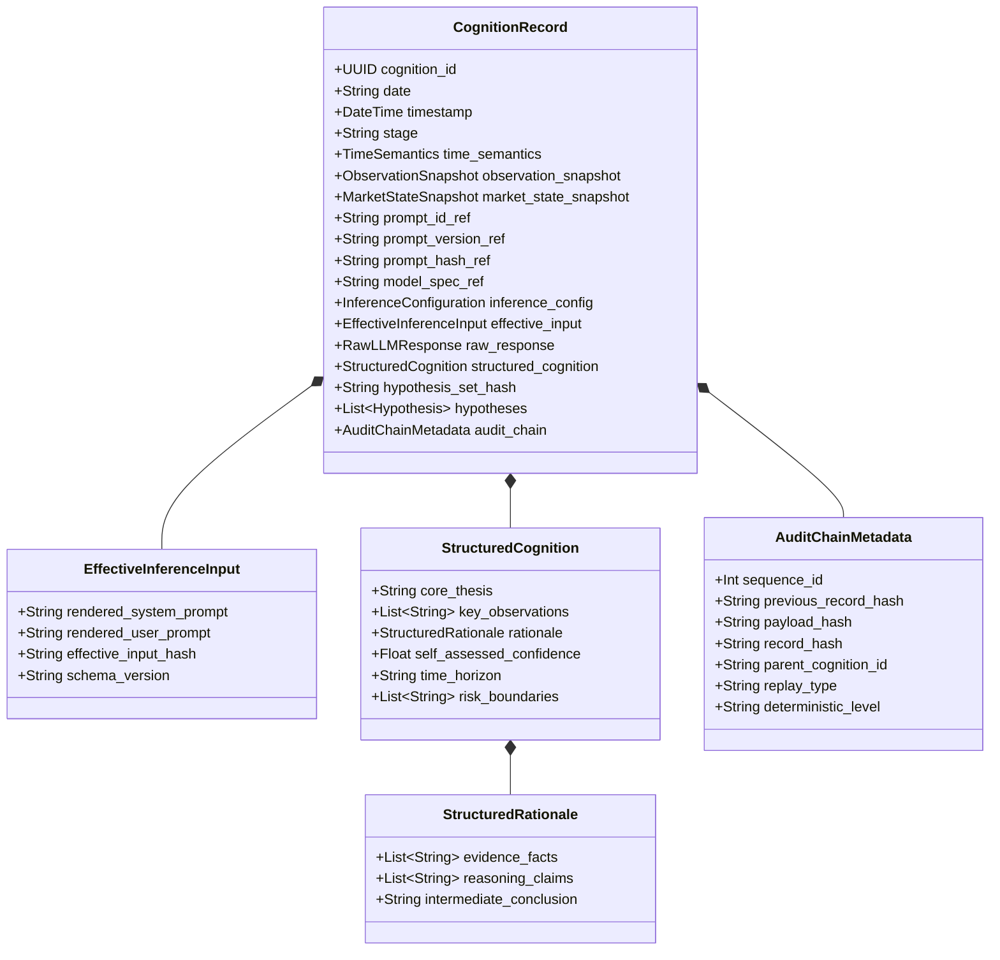
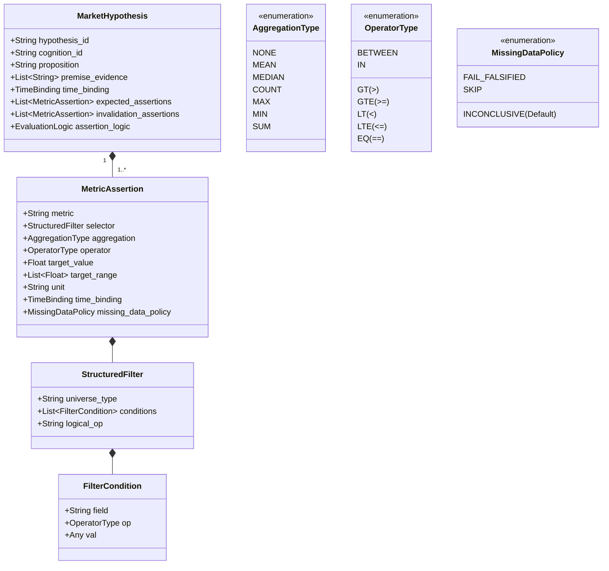
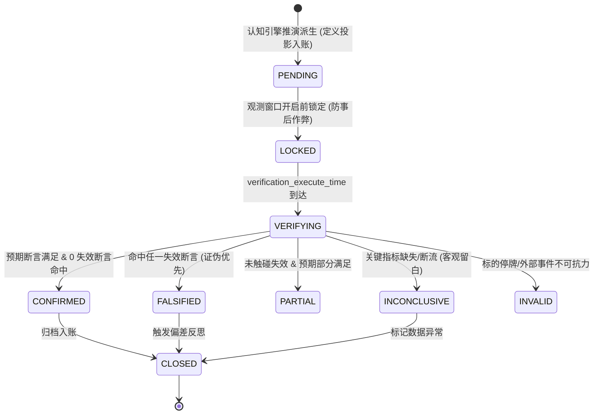
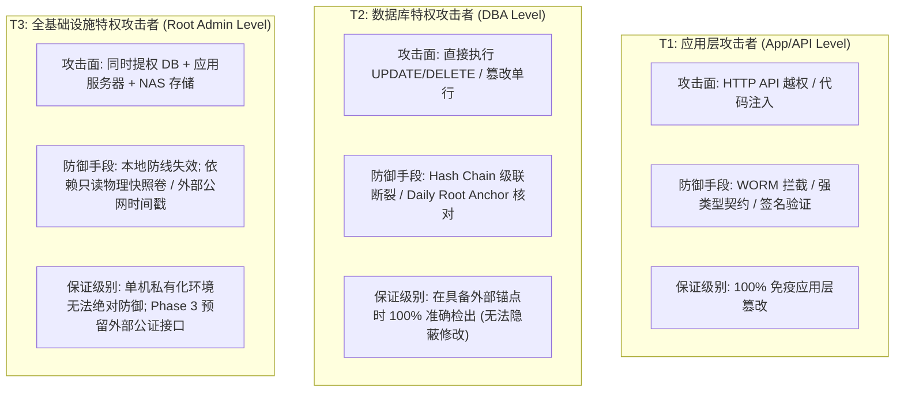
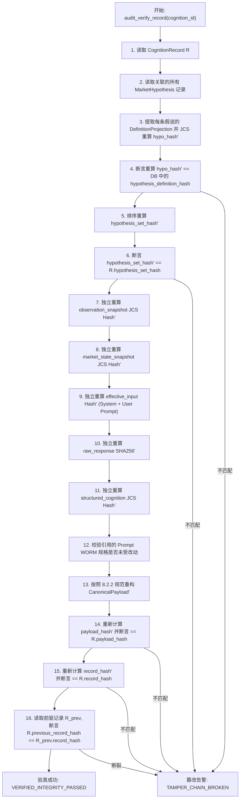

# 28-Cognition-Phase2-可审计结构化认知引擎技术设计单

> **文档版本**：v1.2.1-FINAL-CLOSURE（最终闭环冻结审查稿 / Final Closure Revision）  
> **修订日期**：2026-09-30  
> **编制依据**：  
> - 《开发文档/01-项目决策基线（G0-正式版）.md》  
> - 《开发文档/02-G1需求基线（正式冻结版）.md》  
> - 《开发文档/04-G3架构与详细设计（正式版）.md》  
> - 《开发文档/10-项目多Agent四权分立工程治理规范.md》  
> - 《开发文档/22-G1-Cognition验证闭环增强技术设计单.md》  
> - 《开发文档/23-v0.1.0-G1-Cognition-MVP-NAS运行环境验收报告.md》  
> - 《开发文档/25-P0数据可信度与认知闭环加固设计单.md》  
> - 《开发文档/26-P2数据源健康治理与弹性多级降级设计单.md》  
> - 《第三轮终审裁决与最终修订令（2026-09-30，裁决：C — HOLD）》  
> **架构定位**：定义 Cognition Phase 2 的核心架构骨架、数据契约、不可变审计账本与“四可”科学闭环引擎。  
> **工程约束**：本设计单属于纯架构与契约编制，**严禁修改既有基线文档，严禁修改生产代码与数据库，严禁接入真实外网大模型 API**。

---

## 架构审查最终闭环说明（v1.2.1 Final Closure Items）

根据 2026-09-30 最高董事会（用户）下达的《第三轮终审裁决与最终修订令》，本版本严密落实 4 项最终闭环任务（Closure Items），彻底封口冻结前的全部契约漏洞：

| 最终闭环编号 | 优先级 | 漏洞实质 | v1.2.1 解决方案与章节定位 |
| :---: | :---: | :--- | :--- |
| **C-01** | **P0** | **审计验真算法缺失**：仅有哈希生成定义，未定义校验器如何从底表重新计算与校验全链。 | **新增第 8.5 节**：制定 16 步严密的《全链路审计验真算法》（Audit Verification Algorithm），明确从原始假说到 Merkle Root Anchor 的只读重算校验规程。 |
| **C-02** | **P0/P1** | **假说定义与验证态未解耦**：若假说状态跃迁（`status`）参与哈希，后验验证会篡改原始认知账本。 | **重构第 4.3 节**：严格确立 `HypothesisDefinitionProjection`（不可变定义投影）；明确运行态（`status`, `verification_outcome`）绝对不得污染原始哈希。 |
| **C-03** | **P1** | **DSL 滑向任意查询语言**：`filter_expression` 出现类 SQL 子查询，导致执行器复杂度与注入风险激增。 | **重构第 4.2 节**：收敛收窄为有限白名单 AST（`StructuredFilterNode`），禁止嵌套子查询，引入预计算标的属性（如 `is_highest_board`）。 |
| **C-04** | **P1** | **Genesis 状态并发竞态**：空表时 `FOR UPDATE` 无锁，并发创世 Append 导致序号冲突。 | **重构第 8.4 节**：引入 `cognition_chain_state` 单行控制表与排他行锁协议，实现从 `sequence_id=1` 开始的绝对 Gapless Monotonic 串行化。 |

---

## 一、 顶层架构定位与演进宗旨

### 1.1 核心宗旨：从“状态测量器”升维至“可审计结构化认知引擎”

当前系统（Phase 1 尾声 / v0.2.0）通过 `M1~M5 → D1~D6 → 加权分 → MarketState` 建立了市场物理状态评估框架。然而，架构审计揭示了一个根本性矛盾：
> **当前所谓的 Cognition，本质上只是一个“物理量度传感器 / 状态测量器（Sensor / Metric Aggregator）”。**

它只能告诉系统“温度计显示 38 度，处于偏弱整理与极度分化状态”，却完全缺乏主体认知能力：它无法回答“为什么市场在这个位置缩量？”、“究竟是场内锁筹还是买盘枯竭？”、“如果这个解释成立，明早竞价应该出现什么现象？触碰什么红线即被彻底证伪？”

Cognition Phase 2 的使命，就是将系统从**被动的数据加权计算器**，升维为**具备可证伪性与因果审计链的现代认知引擎（Brain）**，完整建立以下认知生命周期闭环：

```text
┌─────────────────┐
│  M1 ~ M5 事实层  │ (S4 真实行情、外盘资讯、M3 交易账本、竞价数据)
└────────┬────────┘
         │ 1. 抽取只读观测投影 (Immutable Observation Projection)
         ▼
┌─────────────────┐
│   MarketState   │ (D1~D6 六维物理测量、极性、多子域正交状态)
└────────┬────────┘
         │ 2. 状态基座注入
         ▼
┌────────────────────────────────────────────────────────────────┐
│               Cognition Phase 2 认知推演引擎                   │
│                                                                │
│  [客观观察] ──→ [结构化论证] ──→ [派生假说] ──→ [刚性失效红线]  │
│  (Observation)   (Rationale)    (Hypothesis)  (DSL Assertions) │
└──────────────────────────┬─────────────────────────────────────┘
                           │ 3. 结构化派生与不可变绑定 (纳入 Hash Chain)
                           ▼
┌────────────────────────────────────────────────────────────────┐
│                  Hypothesis 假设账本                           │
│   • 明确命题  • 事实证据  • 检验时点  • 最小完整断言 DSL        │
└──────────────────────────┬─────────────────────────────────────┘
                           │ 4. 到期事实自动对撞 (时序解耦)
                           ▼
┌────────────────────────────────────────────────────────────────┐
│                 Verification 事实验证引擎                      │
│   • 真实物理事实快照对齐                                        │
│   • 状态自动跃迁: CONFIRMED / FALSIFIED / INCONCLUSIVE         │
└──────────────────────────┬─────────────────────────────────────┘
                           │ 5. 偏差度量与归因回馈
                           ▼
┌────────────────────────────────────────────────────────────────┐
│              Cognition Feedback (反思沉淀)                      │
│   • 认知 Gap 剖析  • 归因偏离度  • 后续认知修正建议             │
└────────────────────────────────────────────────────────────────┘
```

### 1.2 核心哲学原则：Self-contained Auditability（自包含可审计性）

为杜绝金融量化与 AI 推演系统“事后诸葛亮、根据结果改前因、伪造高胜率”的致命自欺，本设计单确立 **Cognition Entity 为系统一等公民**，并实施**不可变审计铁律（Immutable Cognition Ledger）**：

1. **认知因果不可篡改（Write-Once, Read-Many - WORM）**：
   任何一次认知行为，一旦落库，物理上禁止执行 `UPDATE` 或 `DELETE`。哪怕后来证明该判断错得离谱，其历史原始记录也是评估系统认知进化的珍贵资产。
2. **自包含可审计性（Self-contained Auditability）**：
   系统确立：
   > **只要保留 `CognitionRecord` 及其引用的不可变工件（Immutable Artifacts：Prompt 规范、Model 规格、推理配置），就必须能够在任意时空下完整恢复当时的全部推演环境与输入。**
   
   被引用的外部工件本身必须具备唯一的版本与哈希指纹，物理上具备 WORM 属性，严禁原地更新。
3. **假设必须机器可证伪（Machine Falsifiability by Design）**：
   禁止任何“只有自然语言观点、没有客观度量标准、模棱两可”的伪观点进入系统。每一条正式 `Hypothesis` 必须由**最小完整机器可执行断言表达式（MetricAssertion DSL）**构成失效红线。

---

## 二、 现状 Gap Analysis 与基线张力（Baseline Tension & Gap）

### 2.1 真实代码库现状梳理（已具备能力）

对照当前后端工程目录（`backend/app/`），系统已具备以下物理基础设施：

1. **事实数据与存储层**：
   * `backend/app/models/market.py`、`trading.py`、`report.py`：沉淀了日线、行情、交易账本（`TradeRecord`、`TradeNote`）、收盘复盘（`DailyReview`）与竞价报告（`AuctionReport`）。
   * `backend/app/models/cognition.py`：包含了 `CognitionMarketState`（六维指标状态快照）、`CognitiveTradeDiagnosis`（单笔交易行为诊断）、`MarketHypothesis`（跨日推演假说）以及 `HypothesisVerification`（两阶段事实验证）。
2. **状态测量与计算框架**：
   * `backend/app/cognition/market_state.py`：具备 D1~D6 指标清洗、加权计算、抗标量塌缩与分级降级（`full` / `partial` / `invalid`）能力。
   * `backend/app/cognition/interfaces.py`：定义了 `MarketState`、`SubDimensionState`、`CognitionInput`、`CognitionOutput`。
3. **初步验证闭环流**：
   * `backend/app/services/cognition_review.py`：实现了单笔交易诊断、周度三维审计（EMD/LRD/ODD 未确认隔离铁律）以及竞价（`AUCTION_0925`）与收盘（`CLOSE_1530`）的假说核验状态机原型。

### 2.2 核心缺失与伪认知缺陷（当前缺失）

通过白盒代码审查，当前系统存在以下架构断裂：

1. **缺失真正的不可变认知账本聚合根**：
   当前数据库中只有孤立的 `CognitionMarketState`，系统缺乏记录“一次完整认知活动”的主表。没有地方保全 Prompt 规格、Model 版本、生效推理输入、推理配置、假说集合与原始返回。
2. **AI 诊断实为硬编码规则垫片（Rule-based Pseudo-Cognition）**：
   审查 `cognition_review.py` 第 122~160 行发现：单笔交易的“AI 诊断草案”完全是由 `if d5_score >= 60.0 ... if "预案" in logic_text ...` 等写死 Python 逻辑生成的。这属于前序阶段的临时工程占位，**根本不是大模型认知推理**。
3. **版本化与真实输入审计彻底空白**：
   系统没有 Prompt 版本仓库，没有 Model 规格注册表，没有 Inference 参数记录，更未记录动态拼接后的最终输入（`EffectiveInferenceInput`）。
4. **假说验证依赖人工自然语言理解**：
   目前的 `MarketHypothesis` 虽然定义了 `invalidation_condition`，但其主体为自然语言字符串，核验代码中仅写死了极少数特定字段判定（如上证指数开盘点位），无法泛化，缺乏机器可执行断言。
5. **回放与影子对撞能力缺失**：
   完全不具备给定历史切片进行确定性重放（Replay）的能力，更无法执行同一切片下跨 Prompt/Model 的横向差异对比（Cognition Diff）。

### 2.3 基线冲突与张力剖析（Tension & Conflict Analysis）

| 冲突/张力编号 | 涉及基线条目 | 核心冲突描述 | v1.2.1-FINAL 最终裁决方案 |
| :--- | :--- | :--- | :--- |
| **Tension-01**<br/>(概念混淆) | G0 第 2 条 vs<br/>现有代码命名 | 代码中将 `CognitionMarketState` 直接视作认知层，导致团队在语意上将“状态测量器”等同于“认知体系”。 | **裁决**：严格正名。`MarketState` 降级为物理测量层产物，在 Phase 2 中作为认知记录的只读切片 `market_state_snapshot` 存在，不再代表认知本体。 |
| **Tension-02**<br/>(假说生成源头) | 文档 22 第 3 节 vs<br/>Phase 2 认知闭环 | 文档 22 将 `MarketHypothesis` 设计为通过 API 手工提交；而 Phase 2 要求假说由认知引擎根据事实推演派生。 | **裁决**：双轨兼容。`MarketHypothesis` 增加 `cognition_id` 强外键。支持认知引擎自动派生，同时保留交易员人工审定/创建通道（HITL）。 |
| **Tension-03**<br/>(确定性幻觉) | 科学可复现需求 vs<br/>现代 LLM 随机性 | 理论要求 Replay 100% 确定性复现；但商业 API 因 MoE 并发路由浮点抖动与模型静默更新，绝对二进制确定性并不存在。 | **裁决**：摒弃绝对确定性幻觉。设立分级确定性标记（`Deterministic Level`），显式记录复现信度，模型下线时触发降级协议。 |
| **Tension-04**<br/>(审计自包含性) | 单表物理自包含 vs<br/>关系型外键范式 | 追求完全物理自包含会导致数据库充斥臃肿冗余的大 JSON；过度拆表又会导致历史引用丢失。 | **裁决**：采用 **Self-contained Auditability** 原则，工件表严格实施 WORM（插入后不可更改），通过不可变版本与哈希形成强保障。 |

---

## 三、 Cognition Entity 领域模型与不可变契约设计

### 3.1 聚合根：CognitionRecord 逻辑模型

`CognitionRecord` 是认知域的最高聚合根。每一次认知推演生成一个唯一的不可变实体：



### 3.2 输入快照规范（Input Snapshots）

认知引擎严禁直接读取动态业务表，必须在推演发起瞬间将事实与状态固化为只读投影。

#### 3.2.1 ObservationSnapshot（客观物理事实投影）
* **`indices_quote`**：主要指数（上证、深成、创业板、科创50）实时/收盘数据，包含 OHLCV、涨跌幅、成交额；
* **`market_breadth_data`**：全市场涨跌家数比、中位数涨跌幅、涨跌停数、连板梯队高度；
* **`overnight_macro`**：美股三大指数、美元指数、富时 A50 期货、大宗商品收盘数据；
* **`news_headlines`**：财经快讯切片（标题、时间戳、重要性评级）；
* **`data_freshness_meta`**：各事实源采集延迟毫秒数与数据健康度（`HEALTHY` / `DEGRADED` / `CIRCUIT_BROKEN`）。

#### 3.2.2 MarketStateSnapshot（M1.4 状态量度切片）
* 映射 `backend/app/cognition/interfaces.py` 中的 `MarketState` 实例；
* 保全 D1~D6 各子维度计算得分、物理状态标签、多子域正交事实（如 D3 情绪与极端生态分离）；
* 完整保全 `data_quality`（`FULL` / `PARTIAL` / `INVALID`）与 `missing_metrics` 清单，绝不剔除异常。

### 3.3 环境与生效推理输入（Effective Inference Input）

#### 3.3.1 PromptSpecification（不可变工件）
* 存储于独立的 `cognition_prompt_spec` 表；
* 必须包含 `prompt_id`、`version`、`prompt_hash`（SHA-256）、`system_template`、`user_template`；
* **WORM 铁律**：Prompt 模板一旦落库，禁止任何原地修改。修改模板字符必须生成新版本与全新 Hash。

#### 3.3.2 ModelSpecification 与 InferenceConfiguration
* **`model_spec`**：供应商（`provider`）、模型代号（`model_name`）、修订版本（`model_version`）；
* **`inference_config`**：参数包（`temperature`, `top_p`, `seed`, `max_tokens`）。对于严肃认知推演，`temperature` 建议锁定为 `0.0` 或 `0.1`。

#### 3.3.3 EffectiveInferenceInput（真实生效推理输入）
仅仅留存静态模板和数据快照，不足以 100% 证明大模型当时接收到的确切文本。因此，系统显式保全：
* **`rendered_system_prompt`**：完成变量填充、动态规则拼装后的最终 System Prompt 字符串全文；
* **`rendered_user_prompt`**：注入了 `ObservationSnapshot` 与 `MarketStateSnapshot` 后的最终 User Prompt 字符串全文；
* **`effective_input_hash`**：`SHA-256(rendered_system_prompt + "\n---\n" + rendered_user_prompt)`；
* **`schema_version`**：输入协议版本（如 `v1.1`）。

### 3.4 模型输出与认知解析

#### 3.4.1 RawLLMResponse（原始输出全文）
* **`content`**：大模型输出的原始字符串全文（未经任何截断、清洗或修剪）；
* **`token_usage`**：`prompt_tokens`、`completion_tokens`、`total_tokens`；
* **`latency_ms`**：大模型推理往返耗时；
* **`finish_reason`**：生成结束标识（`stop` / `length` / `content_filter`）。

#### 3.4.2 StructuredCognition（结构化认知推导）
* **`core_thesis`**（核心论点）：定性当前市场核心认知本质（不超过 100 字）；
* **`key_observations`**（关键事实观察）：提炼出的 3~5 项决定性事实依据；
* **`rationale`（结构化因果论证链）**：
  - `evidence_facts`：引用的明确事实列表；
  - `reasoning_claims`：推导主张与因果断言链；
  - `intermediate_conclusion`：中间推演结论；
* **`self_assessed_confidence`（模型自我评估置信度）**：
  - 明确标注为模型输出的自我主观估计（0.0 ~ 1.0），**绝不冒充经验校准概率（Empirical Probability）**；
  - 严禁通过代码硬编码将 `PARTIAL` 降级强制设为 0.60。质量降级在 Prompt 中显式呈现，由模型根据缺损自评置信度；后序统计模块独立计算其实证校准度；
* **`time_horizon`**：适用周期（`INTRADAY` / `NEXT_OPEN` / `T_PLUS_1`）；
* **`risk_boundaries`**：自我边界说明（明确指出何种情形下本认知不适用）。

---

## 四、 Hypothesis 实体契约与机器可执行断言 DSL

### 4.1 假说（Hypothesis）的实体边界

假说是认知推演派生出的**“结构化、机器可对撞对赌凭证”**。假说由 `CognitionRecord` 派生并持有强外键引用，必须在市场事件发生前锁定。

### 4.2 【C-03 核心闭环】收窄 Phase 2A 断言 DSL 为有限白名单 AST

为规避引入类 SQL 子查询导致的解析复杂度与安全隐患，Phase 2A 严格收窄断言 DSL 为**有限、类型安全、白名单 AST**：



#### 4.2.1 Phase 2A 严格白名单规范（严禁任意 SQL 与嵌套子查询）
1. **`metric` 白名单**：
   * 行情类：`open_pct_change`、`pct_change`、`turnover_ratio`、`volume_ratio`；
   * 情绪类：`limit_up_count`、`limit_down_count`、`seal_amount_ratio`；
2. **`selector` 结构化过滤白名单（`StructuredFilter`）**：
   * `universe_type`：`ALL_A`（全A股）、`SECTOR`（行业板块）、`LADDER_HIGH_SPEC`（高标梯队）、`CUSTOM_LIST`（标的清单）；
   * **字段白名单（`FilterCondition.field`）**：
     `board_height`（连板高度）、`sector_code`（板块代码）、`is_highest_board`（**事实层预计算布尔标记，严禁动态写子查询 MAX**）、`is_st`、`market_cap`；
   * **操作符白名单（`FilterCondition.op`）**：
     `EQ`、`NE`、`GT`、`GTE`、`LT`、`LTE`、`IN`；
   * **组合逻辑**：单层平铺列表，仅支持 `logical_op: "AND" | "OR"`，不支持跨表关联与深层嵌套。
3. **`aggregation`**：多标的集合必须显式指定聚合函数（`NONE`, `MEAN`, `MEDIAN`, `COUNT`, `MAX`, `MIN`, `SUM`）；
4. **`missing_data_policy`**：缺数策略默认强制为 `INCONCLUSIVE`（坚守零伪造铁律）。

#### 4.2.2 结构化断言 JSON 样例
```json
{
  "hypothesis_id": "hypo_20260928_01_a9f2",
  "cognition_id": "cog_20260928_1530_d83e",
  "proposition": "2026-09-29 集合竞价阶段高位连板梯队（>=4板）整体低开杀跌",
  "premise_evidence": [
    "D3 极端生态跌停扩散至 56 家",
    "全天缩量 1800 亿无法承接高位换手"
  ],
  "assertion_logic": "AND",
  "expected_assertions": [
    {
      "metric": "open_pct_change",
      "selector": {
        "universe_type": "LADDER_HIGH_SPEC",
        "conditions": [
          {"field": "board_height", "op": "GTE", "val": 4}
        ],
        "logical_op": "AND"
      },
      "aggregation": "MEAN",
      "operator": "LTE",
      "target_value": -3.0,
      "unit": "PERCENT",
      "time_binding": "auction_0925",
      "missing_data_policy": "INCONCLUSIVE"
    }
  ],
  "invalidation_assertions": [
    {
      "metric": "open_pct_change",
      "selector": {
        "universe_type": "LADDER_HIGH_SPEC",
        "conditions": [
          {"field": "is_highest_board", "op": "EQ", "val": true}
        ],
        "logical_op": "AND"
      },
      "aggregation": "MAX",
      "operator": "GTE",
      "target_value": 0.0,
      "unit": "PERCENT",
      "time_binding": "auction_0925",
      "missing_data_policy": "INCONCLUSIVE"
    }
  ]
}
```

### 4.3 【C-02 核心闭环】Hypothesis Definition Projection（假说定义与后验状态严格物理隔离）

为防止后验事实验证结果（如 `status` 从 `PENDING` 跃迁为 `CONFIRMED`）修改假说而污染原始认知账本哈希，假说模型严格划分为两个生命周期域：

```text
┌────────────────────────────────────────────────────────┐
│ 1. 不可变假说定义投影 (HypothesisDefinitionProjection)   │
│   (认知生成时写入，永久锁定，参与密码学审计哈希计算)       │
│                                                        │
│   • hypothesis_id                                      │
│   • cognition_id                                       │
│   • proposition                                        │
│   • premise_evidence                                   │
│   • assertion_logic                                    │
│   • expected_assertions (DSL)                          │
│   • invalidation_assertions (DSL)                      │
└──────────────────────────┬─────────────────────────────┘
                           │ JCS 规范化计算
                           ▼
                    hypothesis_hash
                           │ 字典序聚合入账
                           ▼
                  hypothesis_set_hash ──→ CognitionRecord.payload_hash
                           │
                           │ 验证事实到达后，追加/更新运行态 (单向隔离)
                           ▼
┌────────────────────────────────────────────────────────┐
│ 2. 验证运行态域 (Verification Runtime Domain)           │
│   (事实验证时发生跃迁，绝对严禁污染原始 hypothesis_hash)  │
│                                                        │
│   • status (PENDING / LOCKED / VERIFYING / CLOSED)     │
│   • actual_data_snapshot (对撞物理事实切片)             │
│   • verification_outcome (CONFIRMED / FALSIFIED / ...) │
│   • verification_execute_time                          │
│   • deviation_analysis & gap_summary                   │
└────────────────────────────────────────────────────────┘
```

* **铁律**：`status`、`actual_data_snapshot`、`verification_outcome` 等后验运行态字段，**严禁进入 `HypothesisDefinitionProjection`，严禁参与 `hypothesis_hash` 与 `hypothesis_set_hash` 计算**。原始认知生成时刻的假说定义指纹自始至终恒定不可变。

---

## 五、 Verification 客观事实验证机制

### 5.1 四维时间语义契约解耦

彻底消除“用 15:30 代表收盘事实”的时间混淆，解耦为四维明确时序：

```text
┌───────────────────────────────────────────────────────────┐
│ 1. market_event_time         │ 市场真实物理事件时点 (如 15:00:00 收盘停盘)
├──────────────────────────────┼───────────────────────────┤
│ 2. observation_window        │ 假说生效观测窗口 (如 09:15:00 ~ 09:25:00)
├──────────────────────────────┼───────────────────────────┤
│ 3. data_snapshot_time        │ 外部数据源清洗固化落库时点 (如 15:05:20)
├──────────────────────────────┼───────────────────────────┤
│ 4. verification_execute_time │ 自动验证状态机触发执行时点 (如 15:30:00 复盘触发)
└───────────────────────────────────────────────────────────┘
```

### 5.2 验证状态机与生命周期流转



* **时钟锁死防作弊铁律**：
  早盘推演假说必须在 `09:15:00` 前进入 `LOCKED`；全天走势假说必须在 `09:30:00` 前进入 `LOCKED`。超出时间窗口提交者系统物理拒收。

---

## 六、 科学实验闭环：Replay 与 Cognition Diff 引擎

### 6.1 Replay Engine 设计原则与确定性标记

#### 6.1.1 历史认知重放流程
历史切片重放允许研究员验证：“面对历史同一客观事实，换用新 Prompt 或新模型，认知是否会发生正向改善？”

```text
[历史父记录 Parent CognitionRecord]
       │
       ├─ 提取: Historical ObservationSnapshot
       ├─ 提取: Historical MarketStateSnapshot
       ├─ 载入: Target PromptSpec (可相同或升级)
       ├─ 载入: Target ModelSpec (可相同或升级)
       ├─ 载入: Target InferenceConfig (Seed, Temp)
       ▼
┌──────────────────────────────┐
│  Replay Runner (重放执行器)   │
└──────────────┬───────────────┘
               ▼
产生 [衍生记录 Derived CognitionRecord]
       │
       ├─ parent_cognition_id = Parent.cognition_id
       ├─ replay_type = "EXACT_REPLAY" | "DIFF_SHADOW"
       └─ deterministic_level = 明确标注确定性等级
```

#### 6.1.2 确定性等级标记（Deterministic Level）
坚决摒弃“temperature=0 即等于绝对确定”的技术盲从，系统严格区分四级确定性：
* **`BIT_EXACT`**：新生成的 `raw_response` 与历史文本 `SHA-256` 二进制级 100% 吻合；
* **`SEMANTIC_EQUAL`**：文本存在标点或同义词微小浮动，但提取出的 `structured_cognition` 与假说断言 100% 等价；
* **`STOCHASTIC_DRIFT`**：相同配置下模型因 MoE 路由浮点抖动产生结论漂移，系统记录漂移日志；
* **`OFFLINE_FALLBACK`**：历史模型已被供应商下线，采用指定替代模型进行近似推演，显式标注元数据。

### 6.2 Cognition Diff 差异对撞引擎（无排行榜）

彻底删除 `winner_cognition_id` 字段。认知对撞的本质是**科学实验中的控制变量对照**，绝非粗暴评选胜负。

#### 6.2.1 五维差异对比报告（Cognition Diff Report）
对撞引擎对比两个 `CognitionRecord`（Record A vs Record B），输出结构化报告：
1. **`Observation Diff`**：两组推演在事实摄入上的关注点差异；
2. **`Reasoning Diff`**：逻辑归因链条与因果断言差异；
3. **`Hypothesis Diff`**：
   - 假说命题差异；
   - 断言严格度差异（失效红线设定的宽严对比）；
4. **`Confidence Diff`**：模型主观置信度差异（识别模型过度自信）；
5. **`Outcome Comparison Matrix（结果对照矩阵）`**：
   
   | 对照维度 | Record A (对照组) | Record B (实验组) | 差异显著性 |
   | :--- | :--- | :--- | :--- |
   | **假说总数** | 2 条 | 3 条 | 实验组颗粒度更细 |
   | **证实 (CONFIRMED)** | 1 条 | 2 条 | 实验组新增 1 条兑现 |
   | **证伪 (FALSIFIED)** | 1 条 (高标溢价落空) | 0 条 (设置了严格失效线) | 实验组防守性显著提升 |
   | **无法判定 (INCONCLUSIVE)** | 0 条 | 1 条 (观察标的停牌) | 客观记录事实缺损 |

---

## 七、 M1~M5 事实层输入契约与弹性降级映射

### 7.1 分层投影架构（消除重复定义）

严格规范事实数据流向，杜绝在 Cognition 层再造一套重复的事实数据库：

```text
┌────────────────────────────────────────────────────────┐
│  M1 ~ M5 Canonical Fact Tables (系统底层唯一物理事实账本) │
│  (market_daily, trade_record, daily_review, ...)       │
└──────────────────────────┬─────────────────────────────┘
                           │ 单向抽取与只读映射
                           ▼
┌────────────────────────────────────────────────────────┐
│      Immutable Observation Projection (观测投影切片)    │
│  • 标准化清洗  • 质量元数据标注  • 只读快照序列化       │
└──────────────────────────┬─────────────────────────────┘
                           │ 注入认知账本
                           ▼
┌────────────────────────────────────────────────────────┐
│           CognitionRecord.observation_snapshot         │
└────────────────────────────────────────────────────────┘
```

### 7.2 质量元数据传递与“零填充防伪铁律”

1. **零填充铁律**：如果 M5 盘中某接口瘫痪导致跌停家数缺失，快照中该字段保持 `None`，绝对不得填 0；
2. **Prompt 级降级安全警示**：当输入质量为 `PARTIAL` 时，系统自动在 `rendered_system_prompt` 中拼装警告段落：
   > *“【数据质量警示】当前输入切片存在降级指标：`['market_breadth']`。在进行因果归因时，严禁对缺失指标作过度外推猜测，推演假说必须显式阐明数据缺损风险。”*
3. **`INVALID` 状态熔断保护**：当有效维度权重 $< 60\%$ 时，系统强制熔断，仅生成“数据不可信警示单”，物理拒绝生成推演假说。

---

## 八、 存储、审计保障与三层威胁模型

### 8.1 逻辑数据模型（物理表 Schema）

```sql
-- 1. 核心不可变认知账本表
CREATE TABLE cognition_record (
    id VARCHAR(64) PRIMARY KEY,                    -- cog_YYYYMMDD_HHMMSS_xxxx
    date VARCHAR(10) NOT NULL,                     -- YYYY-MM-DD
    stage VARCHAR(20) NOT NULL,                    -- PRE_MARKET / INTRADAY / POST_CLOSE
    timestamp DATETIME NOT NULL,
    
    -- 四维时间解耦物理列
    market_event_time VARCHAR(20) NOT NULL,        -- 物理事件时点 (如 15:00:00)
    observation_window VARCHAR(50) NOT NULL,       -- 观测窗口 (如 09:15:00-09:25:00)
    data_snapshot_time DATETIME NOT NULL,          -- 事实快照落库时点 (如 15:05:22)
    verification_execute_time DATETIME,            -- 验证执行触发时点 (如 15:30:00，未执行前为 NULL)
    
    -- 只读快照投影
    observation_snapshot TEXT NOT NULL,            -- JSON (JCS Canonical)
    market_state_snapshot TEXT NOT NULL,           -- JSON (JCS Canonical)
    
    -- 不可变工件引用 (Self-contained Auditability)
    prompt_id VARCHAR(50) NOT NULL,
    prompt_version VARCHAR(20) NOT NULL,
    prompt_hash VARCHAR(64) NOT NULL,              -- SHA-256
    model_provider VARCHAR(30) NOT NULL,
    model_name VARCHAR(50) NOT NULL,
    model_version VARCHAR(50) NOT NULL,
    inference_config TEXT NOT NULL,                -- JSON
    
    -- 生效推理输入保全
    effective_input_hash VARCHAR(64) NOT NULL,     -- SHA-256
    rendered_system_prompt TEXT NOT NULL,
    rendered_user_prompt TEXT NOT NULL,
    
    -- 输出与结构化认知
    raw_response TEXT NOT NULL,
    response_tokens INT,
    latency_ms INT,
    structured_cognition TEXT NOT NULL,            -- JSON: {thesis, rationale, self_assessed_conf, ...}
    
    -- 假说集合哈希
    hypothesis_set_hash VARCHAR(64) NOT NULL,      -- SHA-256 (全量派生假说定义投影集合哈希)
    
    -- 真正的链式审计与血缘
    sequence_id BIGINT NOT NULL UNIQUE,            -- 严格自增单调连续序号 (防删除)
    previous_record_hash VARCHAR(64) NOT NULL,     -- 前驱哈希 (创世记录为全0)
    payload_hash VARCHAR(64) NOT NULL,             -- 本记录全要素 Canonical Payload 哈希
    record_hash VARCHAR(64) NOT NULL UNIQUE,       -- SHA256(JCS({"payload_hash": ..., "previous_record_hash": ...}))
    
    parent_cognition_id VARCHAR(64),               -- 重放来源
    replay_type VARCHAR(20) DEFAULT 'ORIGINAL',    -- ORIGINAL / EXACT_REPLAY / DIFF_SHADOW
    deterministic_level VARCHAR(30),               -- BIT_EXACT / SEMANTIC_EQUAL / STOCHASTIC_DRIFT
    
    created_at DATETIME DEFAULT CURRENT_TIMESTAMP
);

CREATE INDEX idx_cog_date_stage ON cognition_record(date, stage);
CREATE INDEX idx_cog_seq ON cognition_record(sequence_id);

-- 2. 账本链全局控制表 (C-04 核心新增: 杜绝 Genesis Race)
CREATE TABLE cognition_chain_state (
    chain_id VARCHAR(32) PRIMARY KEY,              -- 默认 'MAIN_LEDGER'
    tail_sequence_id BIGINT NOT NULL,              -- 当前链尾序号 (创世初始化为 0)
    tail_record_hash VARCHAR(64) NOT NULL,         -- 当前链尾哈希 (创世初始化为 64个0)
    updated_at DATETIME DEFAULT CURRENT_TIMESTAMP
);

-- 3. 不可变 Prompt 规格表 (WORM 范式)
CREATE TABLE cognition_prompt_spec (
    id VARCHAR(64) PRIMARY KEY,                    -- prompt_id + "@" + version
    prompt_id VARCHAR(50) NOT NULL,
    version VARCHAR(20) NOT NULL,
    prompt_hash VARCHAR(64) NOT NULL UNIQUE,       -- SHA-256
    system_template TEXT NOT NULL,
    user_template TEXT NOT NULL,
    input_schema TEXT,
    created_at DATETIME DEFAULT CURRENT_TIMESTAMP
);

-- 4. 对撞报告持久化表
CREATE TABLE cognition_diff_report (
    id VARCHAR(64) PRIMARY KEY,
    base_cognition_id VARCHAR(64) NOT NULL,
    target_cognition_id VARCHAR(64) NOT NULL,
    diff_matrix TEXT NOT NULL,                     -- JSON: 五维差异对比与结果对照矩阵
    summary_analysis TEXT NOT NULL,
    created_at DATETIME DEFAULT CURRENT_TIMESTAMP
);

-- 5. 假说表扩展 (绑定认知账本、定义投影哈希与 AST 断言)
ALTER TABLE market_hypothesis ADD COLUMN cognition_id VARCHAR(64) REFERENCES cognition_record(id);
ALTER TABLE market_hypothesis ADD COLUMN hypothesis_definition_hash VARCHAR(64); -- 仅覆盖定义投影的哈希
ALTER TABLE market_hypothesis ADD COLUMN assertion_dsl TEXT;                     -- JSON: 收窄 AST 断言清单
```

### 8.2 规范化执行标准与全要素 Canonical Payload

#### 8.2.1 规范化执行标准（RFC 8785 Compliance）
> **规范引用铁律**：所有参与审计计算的 JSON 规范化**必须严格遵从 RFC 8785 (JSON Canonicalization Scheme - JCS)**；底层实现必须通过 RFC 8785 兼容的官方测试向量验证。**除 RFC 8785 本身明确规定的内容外，本系统不得自行定义第二套 Canonicalization 规则。**

#### 8.2.2 全要素 Canonical Payload 覆盖清单（包含假说集合哈希）
```json
{
  "date": "2026-09-28",
  "effective_input_hash": "sha256_of_rendered_prompts",
  "hypothesis_set_hash": "sha256_of_canonical_hypotheses_array",
  "inference_config": {
    "max_tokens": 4096,
    "seed": 42,
    "temperature": 0.0,
    "top_p": 1.0
  },
  "market_event_time": "15:00:00",
  "market_state_snapshot_hash": "sha256_of_canonical_market_state_snapshot",
  "model_spec": {
    "model_name": "claude-3-5-sonnet-20241022",
    "model_version": "v1",
    "provider": "anthropic"
  },
  "observation_snapshot_hash": "sha256_of_canonical_observation_snapshot",
  "parent_cognition_id": null,
  "prompt_hash": "sha256_of_prompt_spec",
  "raw_response_hash": "sha256_of_raw_llm_response",
  "replay_type": "ORIGINAL",
  "sequence_id": 1024,
  "stage": "POST_CLOSE",
  "structured_cognition_hash": "sha256_of_canonical_structured_cognition"
}
```

#### 8.2.3 无歧义链式哈希计算公式
$$\text{payload\_hash}_N = \text{SHA256}(\text{JCS}(\text{CanonicalPayload}_N))$$
$$\text{record\_hash}_N = \text{SHA256}\left(\text{JCS}\left(\left\{\text{"payload\_hash"}: \text{payload\_hash}_N, \text{"previous\_record_hash"}: \text{record\_hash}_{N-1}\right\}\right)\right)$$

### 8.3 三层威胁模型（Three-tier Threat Model）

本系统坚决摒弃脱离威胁环境的“绝对 100% 防篡改”口号，科学界定三个层级的防御能力边界：



1. **T1：应用层攻击者（Application-Level Adversary）**
   * *防御能力*：**100% 绝对阻断**。数据访问层根本未提供 `UPDATE` / `DELETE` 接口，数据库触发器与应用网关实施绝对拦截。
2. **T2：数据库特权攻击者 / DBA 直接篡改（DBA-Level Adversary）**
   * *防御能力*：**在具备外部锚点时 100% 准确检出**。单行改动破坏 Payload Hash；多行伪造破坏链式前驱；与每日固化在本地只读审计日志及 NAS 灾备卷的 `Daily Root Anchor` 冲突。
3. **T3：全基础设施特权攻击者（Full Infrastructure Compromise）**
   * *防御能力*：**局域网私有化单机部署下显式承认无法绝对防御**；
   * *演进预留*：预留 **RFC 3161 远程时间戳公证（Timestamp Token）** 与 **外部只读对象存储锁定（Object Lock）** 标准接口，可在 Phase 3 中零代码成本接入外部独立公证服务。

### 8.4 【C-04 核心闭环】Genesis Append 并发串行化契约（Chain-State Lock Protocol）

为保证 `sequence_id` 绝对严格连续（Gapless Monotonic Sequence，无遗漏空洞）并彻底消除 Genesis 创世状态下的并发竞态漏洞，系统制定基于 `cognition_chain_state` 的排他串行化协议：

```python
# 伪代码：覆盖 Genesis 状态的排他串行化入账协议
async def append_cognition_record_serialized(session: AsyncSession, payload_data: dict, hypotheses_list: list) -> CognitionRecord:
    async with session.begin():
        # 1. 悲观行锁锁定全局单行控制表 (即使链为空，该控制行也必然存在)
        stmt_lock = (
            select(CognitionChainState)
            .where(CognitionChainState.chain_id == "MAIN_LEDGER")
            .with_for_update()
        )
        chain_state = (await session.execute(stmt_lock)).scalar_one()
        
        # 2. 严格确定序号与前驱哈希 (Gapless 绝对保证)
        new_seq = chain_state.tail_sequence_id + 1
        prev_hash = chain_state.tail_record_hash  # 创世状态时固定为 "0"*64
        
        # 3. 处理假说定义投影并聚合计算 hypothesis_set_hash (C-02 闭环)
        hypo_hashes = []
        for hypo_def in hypotheses_list:
            # 严格仅抽取定义投影字段，过滤掉任何验证运行态
            def_proj = extract_hypothesis_definition_projection(hypo_def)
            h_hash = sha256_jcs(def_proj)
            hypo_hashes.append({"id": hypo_def["hypothesis_id"], "hash": h_hash})
            # 插入/保存 market_hypothesis
            save_market_hypothesis(session, hypo_def, h_hash)
            
        hypo_hashes_sorted = [x["hash"] for x in sorted(hypo_hashes, key=lambda x: x["id"])]
        hypothesis_set_hash = sha256_jcs(hypo_hashes_sorted)
        
        # 4. 组装全要素 Canonical Payload 并计算哈希
        canonical_payload = build_canonical_payload(new_seq, payload_data, hypothesis_set_hash)
        payload_hash = sha256_jcs(canonical_payload)
        
        # 5. 规范化计算当前 record_hash
        record_hash = sha256_jcs({
            "payload_hash": payload_hash,
            "previous_record_hash": prev_hash
        })
        
        # 6. 落库不可变认知记录
        record = CognitionRecord(
            sequence_id=new_seq,
            previous_record_hash=prev_hash,
            payload_hash=payload_hash,
            record_hash=record_hash,
            hypothesis_set_hash=hypothesis_set_hash,
            **payload_data
        )
        session.add(record)
        
        # 7. 更新全局控制表链尾状态
        chain_state.tail_sequence_id = new_seq
        chain_state.tail_record_hash = record_hash
        chain_state.updated_at = func.now()
        
        # 8. 提交事务，释放排他锁
        await session.commit()
        return record
```

### 8.5 【C-01 核心闭环】全链路审计验真算法（Audit Verification Algorithm）

为确保 AC-10 验收项在工程落地时不留歧义，系统确立一套严格的 16 步只读验真规程。任何第三方审计器必须依此算法独立验证数据完整性：



#### 算法执行代码规程（Python 标准伪代码）
```python
def verify_cognition_integrity(db_session: Session, cognition_id: str) -> AuditResult:
    # Step 1: 读取记录主表
    r = db_session.query(CognitionRecord).filter_by(id=cognition_id).one()
    
    # Step 2 & 3: 读取关联假说并重算定义哈希
    hypos = db_session.query(MarketHypothesis).filter_by(cognition_id=cognition_id).all()
    calculated_hypo_hashes = []
    for h in hypos:
        def_proj = extract_hypothesis_definition_projection_from_model(h)
        recalculated_h_hash = sha256_jcs(def_proj)
        if recalculated_h_hash != h.hypothesis_definition_hash:
            return AuditResult(is_valid=False, error_code="TAMPER_HYPOTHESIS_DEF", detail=f"假说 {h.id} 定义被篡改")
        calculated_hypo_hashes.append({"id": h.id, "hash": recalculated_h_hash})
        
    # Step 4 & 5: 排序并计算假说集哈希
    sorted_hashes = [x["hash"] for x in sorted(calculated_hypo_hashes, key=lambda x: x["id"])]
    recalculated_set_hash = sha256_jcs(sorted_hashes)
    if recalculated_set_hash != r.hypothesis_set_hash:
        return AuditResult(is_valid=False, error_code="TAMPER_HYPOTHESIS_SET", detail="假说集合指纹失配")
        
    # Step 6~11: 独立重算快照、输入、输出、推导哈希
    recalculated_obs_hash = sha256_jcs(json.loads(r.observation_snapshot))
    recalculated_state_hash = sha256_jcs(json.loads(r.market_state_snapshot))
    recalculated_eff_input_hash = hashlib.sha256((r.rendered_system_prompt + "\n---\n" + r.rendered_user_prompt).encode("utf-8")).hexdigest()
    recalculated_raw_hash = hashlib.sha256(r.raw_response.encode("utf-8")).hexdigest()
    recalculated_struct_cog_hash = sha256_jcs(json.loads(r.structured_cognition))
    
    # Step 12: 构造 Canonical Payload
    canonical_payload = {
        "date": r.date,
        "effective_input_hash": recalculated_eff_input_hash,
        "hypothesis_set_hash": recalculated_set_hash,
        "inference_config": json.loads(r.inference_config),
        "market_event_time": r.market_event_time,
        "market_state_snapshot_hash": recalculated_state_hash,
        "model_spec": json.loads(r.model_spec_ref),
        "observation_snapshot_hash": recalculated_obs_hash,
        "parent_cognition_id": r.parent_cognition_id,
        "prompt_hash": r.prompt_hash,
        "raw_response_hash": recalculated_raw_hash,
        "replay_type": r.replay_type,
        "sequence_id": r.sequence_id,
        "stage": r.stage,
        "structured_cognition_hash": recalculated_struct_cog_hash
    }
    
    # Step 13 & 14: 验真 payload_hash
    recalculated_payload_hash = sha256_jcs(canonical_payload)
    if recalculated_payload_hash != r.payload_hash:
        return AuditResult(is_valid=False, error_code="TAMPER_PAYLOAD_CORRUPT", detail="Canonical Payload 校验失败")
        
    # Step 15: 验真 record_hash
    recalculated_record_hash = sha256_jcs({
        "payload_hash": recalculated_payload_hash,
        "previous_record_hash": r.previous_record_hash
    })
    if recalculated_record_hash != r.record_hash:
        return AuditResult(is_valid=False, error_code="TAMPER_RECORD_HASH", detail="Record Hash 计算失配")
        
    # Step 16: 链式完整性校验
    if r.sequence_id == 1:
        if r.previous_record_hash != "0" * 64:
            return AuditResult(is_valid=False, error_code="TAMPER_GENESIS_PREV", detail="创世记录前驱必须为0")
    else:
        prev_r = db_session.query(CognitionRecord).filter_by(sequence_id=r.sequence_id - 1).first()
        if not prev_r or prev_r.record_hash != r.previous_record_hash:
            return AuditResult(is_valid=False, error_code="TAMPER_CHAIN_BROKEN", detail=f"序号 {r.sequence_id} 与前驱断裂")
            
    return AuditResult(is_valid=True, error_code="VERIFIED_INTEGRITY_PASSED")
```

---

## 九、 Phase 2 实施范围管理：2A 与 2B 分步解耦

为规避一次性全面铺开造成的巨大工程风险，采纳红队审查意见，将 Phase 2 严格划分为前后相继的两大子阶段：

```text
┌────────────────────────────────────────────────────────┐
│   Phase 2A：不可变认知账本与机器可验证底座 (当前实施目标) │
│                                                        │
│  ✅ 核心不可变表结构 (cognition_record, prompt_spec)     │
│  ✅ cognition_chain_state 控制表与排他单写入协议       │
│  ✅ RFC 8785 Canonical 规范与全链路 16 步验真算法       │
│  ✅ EffectiveInferenceInput 渲染文本与 Hash 保全       │
│  ✅ HypothesisDefinitionProjection 与收窄 AST DSL      │
│  ✅ 验证状态机四维时间对齐与自动对撞 (证伪优先/INCONCLUSIVE)│
│  ✅ M1~M5 事实投影抽取与 PARTIAL 降级透传              │
└──────────────────────────┬─────────────────────────────┘
                           │ 2A 100% 验收封口后，才准予启动
                           ▼
┌────────────────────────────────────────────────────────┐
│     Phase 2B：科学实验与差异对撞引擎 (后续进阶目标)       │
│                                                        │
│  ⏳ Replay Engine 参数化重放执行器                      │
│  ⏳ 分级确定性标记 (BIT_EXACT / SEMANTIC_EQUAL / ...)    │
│  ⏳ Cognition Diff 五维差异对撞矩阵与对照报告生成器      │
└────────────────────────────────────────────────────────┘
```

---

## 十、 可执行验收标准（13 大端到端硬指标）

本终审稿全面同步了所有修订内容，构成严密不可推翻的验收矩阵：

| 序号 | 验收项目 | 验收标准与预期物理证据 | 裁决门槛 |
| :---: | :--- | :--- | :---: |
| **AC-01** | **认知不可变性** | 调用修改或删除 `cognition_record` 接口，系统直接抛出 405/403 异常；代码层严禁暴露 Update/Delete 接口。 | **一票否决** |
| **AC-02** | **自包含可审计性** | 单条 CognitionRecord 配合其引用的不可变工件（Prompt/Model Spec），能够无损还原当时全景推演上下文，无悬空失效引用。 | **一票否决** |
| **AC-03** | **Prompt 规格 WORM** | 修改已发布 Prompt 模板任一字符，系统自动计算全新 `prompt_hash` 并生成新记录，旧 Hash 记录严格保持只读。 | **一票否决** |
| **AC-04** | **生效推理输入保全** | `rendered_system_prompt` 与 `rendered_user_prompt` 全文留存，计算其 `effective_input_hash` 与数据库记录 100% 一致。 | **一票否决** |
| **AC-05** | **机器断言 DSL 约束** | 假说必须包含白名单 AST（`StructuredFilter` 结构）；`invalidation_assertions` 必须由强类型操作符和数值构成；模糊口号者校验器强制拦截。 | **一票否决** |
| **AC-06** | **验证状态机自愈** | 在历史数据回放中，竞价触碰红线准确跃迁为 `FALSIFIED`；数据缺失时客观断言 `INCONCLUSIVE`，**绝无偷填 0**。 | **一票否决** |
| **AC-07** | **确定性重放标记** | Replay 生成的新记录 `parent_cognition_id` 准确指向原记录，并打上明确的 `deterministic_level` 标签。 | **Phase 2B 项** |
| **AC-08** | **差异结果对照矩阵** | Diff 报告输出 Observation、Reasoning、Hypothesis、Confidence 与事实验证对照矩阵，严禁存在 winner 评选。 | **Phase 2B 项** |
| **AC-09** | **降级输入显式透传** | 当 M1~M5 为 `PARTIAL` 时，`ObservationSnapshot` 显式记录 `degraded_fields`，且渲染输入中带有安全约束。 | **一票否决** |
| **AC-10** | **全链路验真算法达标**<br/>(终审对齐) | **运行 16 步验真算法，修改快照、输入、输出、推导或假说定义投影中任意字段，或调换/删除记录，校验器在 T1/T2 威胁模型下 100% 报错识别篡改。** | **一票否决** |
| **AC-11** | **时钟锁死防作弊** | 假说锁定时间必须在目标时间窗口开启之前；迟于 `09:15:00` 提交的早盘假说被物理拒绝。 | **一票否决** |
| **AC-12** | **生产代码零侵入** | 本期仅完成架构设计单交付；生产业务代码与数据库修改量严格保持为 0。 | **一票否决** |
| **AC-13** | **时间语义四维对齐** | 记录中物理列明确区分 `market_event_time`、`observation_window`、`data_snapshot_time` 与 `verification_execute_time`。 | **必须满足** |

---

## 十一、 架构终审与实施基线冻结令签发

### 11.1 总结陈词
《28-Cognition-Phase2 技术设计单 v1.2.1-FINAL-CLOSURE》已严密落地最高董事会第三轮裁决要求的全部 4 项最终闭环任务：
1. **C-01 算法闭环**：确立了 16 步《全链路审计验真算法》，物理定义了重算与核验路径；
2. **C-02 投影闭环**：确立了 `HypothesisDefinitionProjection`，彻底将后验运行态与不可变认知指纹隔离；
3. **C-03 DSL 闭环**：将断言筛选收敛为有限白名单 AST，消灭了类 SQL 查询语言带来的实施与安全风险；
4. **C-04 创世闭环**：引入 `cognition_chain_state` 排他单写入协议，实现从 `sequence_id=1` 开始的 Gapless 连续性。

至此，本设计单在哲学原则、领域模型、算法实现、时序契约与物理表结构上已达到**完全无歧义、前后一致、可直接作为工程实施基线**的标准。

### 11.2 下一步行动指南
1. **保持代码静默**：不修改任何生产代码、不修改生产数据库、不接入外部大模型 API；
2. **提请终审签章（A — FREEZE）**：提请最高董事会（用户）签署《Phase 2A 实施基线冻结令》；
3. **正式实施启动**：基线冻结后，按四权分立工程规范受控启动 Phase 2A 代码开发。
