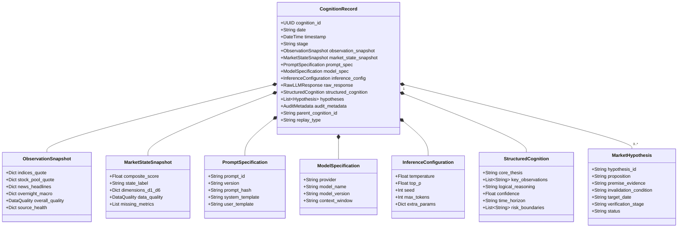
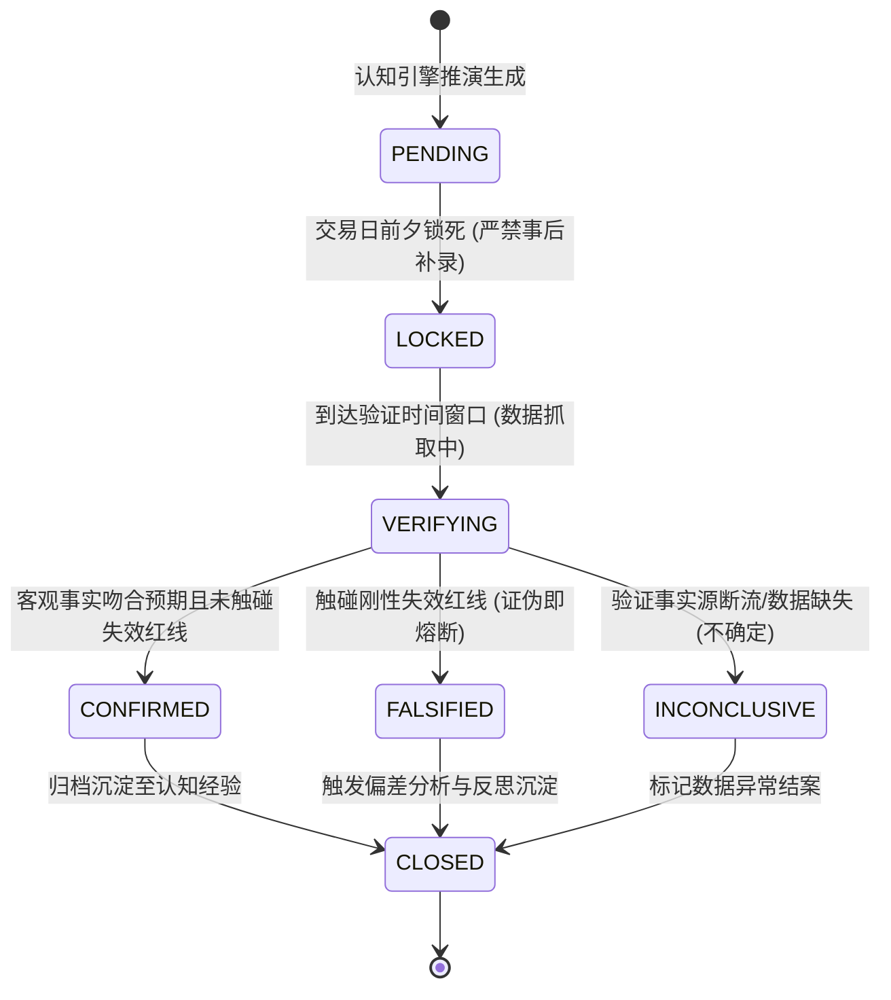
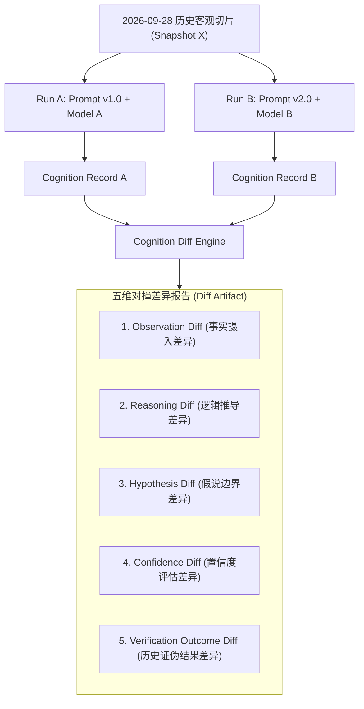

# 28-Cognition-Phase2-可审计结构化认知引擎技术设计单

> **文档版本**：v1.0.0-PROPOSED（架构设计审查稿）  
> **编制依据**：  
> - 《开发文档/01-项目决策基线（G0-正式版）.md》  
> - 《开发文档/02-G1需求基线（正式冻结版）.md》  
> - 《开发文档/04-G3架构与详细设计（正式版）.md》  
> - 《开发文档/10-项目多Agent四权分立工程治理规范.md》  
> - 《开发文档/22-G1-Cognition验证闭环增强技术设计单.md》  
> - 《开发文档/23-v0.1.0-G1-Cognition-MVP-NAS运行环境验收报告.md》  
> - 《开发文档/25-P0数据可信度与认知闭环加固设计单.md》  
> - 《开发文档/26-P2数据源健康治理与弹性多级降级设计单.md》  
> **架构定位**：定义 Cognition Phase 2 的核心架构骨架、数据契约、不可变审计账本与“四可”科学闭环引擎。  
> **工程约束**：本设计单属于纯架构与契约编制，**严禁修改既有基线文档，严禁修改生产代码与数据库，严禁接入真实外网大模型 API**。

---

## 一、 顶层架构定位与演进宗旨

### 1.1 核心宗旨：从“状态测量器”升维至“可审计结构化认知引擎”

当前系统（Phase 1 尾声 / v0.2.0）通过 `M1~M5 → D1~D6 → 加权分 → MarketState` 建立了市场物理状态评估框架。然而，架构审计揭示了一个根本性矛盾：
> **当前所谓的 Cognition，本质上只是一个“物理量度传感器 / 状态测量器（Sensor / Metric Aggregator）”。**

它只能告诉系统“温度计显示 38 度，处于偏弱整理与极度分化状态”，却完全缺乏主体认知能力：它无法回答“为什么市场在这个位置缩量？”、“究竟是场内锁筹还是买盘枯竭？”、“如果这个解释成立，明早竞价应该出现什么现象？触碰什么红线即被彻底证伪？”

Cognition Phase 2 的使命，就是将系统从**被动的数据加权计算器**，升维为**具备可证伪性与因果审计链的现代认知引擎（Brain）**，完整建立以下认知生命周期闭环：

```text
┌─────────────────┐
│  M1 ~ M5 事实层  │ (S4 真实行情、外盘资讯、M3 交易账本、竞价数据)
└────────┬────────┘
         │ 1. 结构化输入切片 (含数据质量与新鲜度元数据)
         ▼
┌─────────────────┐
│   MarketState   │ (D1~D6 六维物理测量、极性、多子域正交状态)
└────────┬────────┘
         │ 2. 状态基座注入
         ▼
┌────────────────────────────────────────────────────────┐
│               Cognition Phase 2 认知引擎               │
│                                                        │
│  [客观观察] ──→ [逻辑归因] ──→ [形成假说] ──→ [失效红线]  │
│  (Observation)  (Reasoning)   (Hypothesis) (Invalidation)│
└──────────────────────────┬─────────────────────────────┘
                           │ 3. 结构化派生
                           ▼
┌────────────────────────────────────────────────────────┐
│                  Hypothesis 假设账本                   │
│   • 明确命题  • 事实证据  • 检验时点  • 刚性失效红线      │
└──────────────────────────┬─────────────────────────────┘
                           │ 4. 到期事实对撞 (竞价 09:25 / 收盘 15:30)
                           ▼
┌────────────────────────────────────────────────────────┐
│                 Verification 事实验证                   │
│   • 真实市场快照对齐                                     │
│   • 状态跃迁: CONFIRMED / FALSIFIED / INCONCLUSIVE      │
└──────────────────────────┬─────────────────────────────┘
                           │ 5. 偏差度量与归因回馈
                           ▼
┌────────────────────────────────────────────────────────┐
│              Cognition Feedback (反思沉淀)              │
│   • 认知 Gap 剖析  • 归因偏离度  • 后续认知修正建议       │
└────────────────────────────────────────────────────────┘
```

### 1.2 核心哲学原则：认知实体的“不可变审计铁律”

为杜绝金融量化与 AI 推演系统“事后诸葛亮、根据结果改前因、伪造高胜率”的致命自欺，本设计单确立 **Cognition Entity 为系统一等公民**，并实施**不可变审计铁律（Immutable Cognition Ledger）**：

1. **认知因果不可篡改（Write-Once, Read-Many - WORM）**：
   任何一次认知行为，一旦落库，物理上禁止执行 `UPDATE` 或 `DELETE`。哪怕后来证明该判断错得离谱，其历史原始记录也是评估系统认知进化的珍贵资产。
2. **全要素保全原则（Total Context Preservation）**：
   一条合法的历史认知记录，必须能够完全自包含地回答：
   * *“在什么时刻？”*（Timestamp & Stage）
   * *“看到了什么物理事实与状态？”*（`observation_snapshot` + `market_state_snapshot`）
   * *“使用了什么 Prompt 体系？”*（`prompt_id` + `prompt_version` + `prompt_hash`）
   * *“由什么模型在什么配置下生成？”*（`model_name` + `model_version` + `inference_config`）
   * *“模型的原始未篡改输出是什么？”*（`raw_llm_response`）
   * *“解析出的结构化推导与假说是什么？”*（`structured_cognition` + `hypotheses`）
   * *“后来的市场客观事实是什么，假说被证实还是证伪？”*（`verification_linkage`）
3. **假设必须可证伪（Falsifiability by Design）**：
   禁止任何“只有自然语言观点、没有客观度量标准、模棱两可”的伪观点进入系统。每一条正式 `Hypothesis` 必须具备明确的**失效红线（Invalidation Condition）**与**检验时间窗口**。

---

## 二、 现状 Gap Analysis 与基线张力（Baseline Tension & Gap）

### 2.1 真实代码库现状梳理（已具备能力）

对照当前后端工程目录（`backend/app/`），系统已具备以下物理基础设施：

1. **事实数据与存储层**：
   * `backend/app/models/market.py`、`trading.py`、`report.py`：沉淀了日线、行情、交易账本（`TradeRecord`、`TradeNote`）、收盘复盘（`DailyReview`）与竞价报告（`AuctionReport`）。
   * `backend/app/models/cognition.py`：包含了 `CognitionMarketState`（六维指标状态快照）、`CognitiveTradeDiagnosis`（单笔交易行为诊断）、`MarketHypothesis`（跨日推演假说）以及 `HypothesisVerification`（两阶段事实验证）。
2. **状态测量与计算框架**：
   * `backend/app/cognition/market_state.py`：具备 D1~D6 指标清洗、加权计算、抗标量塌缩与分级降级（`full` / `partial` / `invalid`）能力。
   * `backend/app/cognition/interfaces.py`：定义了 `MarketState`、`SubDimensionState`、`CognitionInput`、`CognitionOutput`。
3. **初步验证闭环流**：
   * `backend/app/services/cognition_review.py`：实现了单笔交易诊断、周度三维审计（EMD/LRD/ODD 未确认隔离铁律）以及竞价（`AUCTION_0925`）与收盘（`CLOSE_1530`）的假说核验状态机原型。

### 2.2 核心缺失与伪认知缺陷（当前缺失）

通过深入白盒代码审查，发现当前系统存在以下架构断裂：

1. **缺失真正的 `CognitionRecord` 聚合实体**：
   当前数据库中只有孤立的 `CognitionMarketState`，系统缺乏记录“一次完整认知活动”的主表。没有地方保全 Prompt 规格、Model 版本、推理配置与原始返回。
2. **AI 诊断实为硬编码规则垫片（Rule-based Pseudo-Cognition）**：
   审查 `cognition_review.py` 第 122~160 行发现：单笔交易的“AI 诊断草案”完全是由 `if d5_score >= 60.0 ... if "预案" in logic_text ...` 等写死 Python 逻辑生成的。这属于前序阶段的临时工程占位，**根本不是大模型认知推理**。
3. **版本化与指纹追踪彻底空白**：
   系统没有 Prompt 版本仓库，没有 Model 规格注册表，没有 Inference 参数（`temperature`, `top_p`, `seed`）记录。当推演产生偏差时，完全无法溯源“是因为模型换了，还是 Prompt 变了”。
4. **假说与认知活动脱节**：
   目前的 `MarketHypothesis` 是通过 REST API 由前端或测试脚本直接手工插入（`create_hypothesis`），其与当日的市场状态快照、模型推演没有外键关联与审计血缘。
5. **回放与影子对撞能力为零**：
   完全不具备给定历史切片进行确定性重放（Replay）的能力，更无法执行同一切片下不同 Prompt / Model 的横向差异对比（Cognition Diff）。

### 2.3 预留能力与扩展点状态

* `backend/app/cognition/interfaces.py`：
  - `CognitionInput` 中预留了 `historical_context` 与扩展点注释（`cognition_memory`, `human_feedback`），但未定义类型契约；
  - `CognitionOutput.reasoning` 目前仅为简单文本，且在计算 `MarketState` 时被置空；
  - `CognitionLayerInterface` 仅有一个 `compute_market_state` 抽象方法，尚未定义 `infer_cognition` 或 `replay_cognition`。
* `backend/app/models/cognition.py`：
  - `CognitiveTradeDiagnosis.env_match_score` 与 `HypothesisVerification.accuracy_score` 当前显式留白（`default=None`），严格执行了“拒绝主观伪精确打分”的铁律。

### 2.4 基线冲突与张力剖析（Tension & Conflict Analysis）

在梳理 G0/G1/G3/文档 22/文档 23 的过程中，识别出以下三项核心架构张力，本设计单据此提出解决裁决：

| 冲突/张力编号 | 涉及基线条目 | 核心冲突描述 | 架构审计建议与裁决方案 |
| :--- | :--- | :--- | :--- |
| **Tension-01**<br/>(概念混淆) | G0 第 2 条 vs<br/>G3 第 3.1 节 vs<br/>现有代码 | G0 规定“Phase 1 只定边界不设计完整模型”，但代码中将 `CognitionMarketState` 直接挂在 `cognition/` 下，导致团队在语意上将“状态测量器”等同于“Cognition 体系”。 | **裁决**：严格正名。`MarketState` 降级为物理测量层产物，在 Phase 2 中作为 `CognitionRecord` 的子结构 `market_state_snapshot` 存在，不再代表认知本体。 |
| **Tension-02**<br/>(假说生成源头) | 文档 22 第 3 节 vs<br/>Phase 2 认知闭环 | 文档 22 将 `MarketHypothesis` 设计为通过 API 手动提交；而 Phase 2 要求假说是由认知引擎在完成观察归因后结构化派生。 | **裁决**：双轨兼容。`MarketHypothesis` 增加 `cognition_record_id` 可选外键。支持 AI 认知引擎全自动派生，同时保留交易员人工录入/修正的 HITL 接口。 |
| **Tension-03**<br/>(确定性幻觉) | 科学可复现需求 vs<br/>现代 LLM 随机性 | 理论要求 Replay “同输入同模型必须 100% 确定性复现”；但外部商业 API 即使设 `temperature=0`，因 MoE 稀疏路由与底层并发调度，仍存在浮点微小扰动，且模型版本会静默下线。 | **裁决**：坚决摒弃“绝对确定性”幻觉。设计分级确定性标记（Deterministic Level），显式记录复现可信度，模型下线时触发降级协议。 |

### 2.5 Phase 2 交付与 Phase 3 边界划分

为防止架构范围无节制膨胀，严正划定阶段边界：

```text
┌─────────────────────────────────────────────────────────────┐
│                      Phase 2 核心边界                        │
│  ✅ CognitionRecord 不可变实体与数据契约                     │
│  ✅ Prompt / Model / Inference Config 版本与指纹规范        │
│  ✅ Raw Output 与 Structured Cognition 解析契约             │
│  ✅ 强约束可证伪 Hypothesis 实体与两阶段事实验证状态机        │
│  ✅ Replay Engine (重放执行原则与非确定性标记)               │
│  ✅ Cognition Diff (五维认知差异对撞矩阵)                   │
│  ✅ M1~M5 FULL/PARTIAL 降级输入契约与质量透传               │
└─────────────────────────────────────────────────────────────┘
                               │
                               ▼ 明确推迟至 Phase 3
┌─────────────────────────────────────────────────────────────┐
│                   Phase 3 长期演进 (本次不做)                │
│  ❌ 跨周/跨月长期经验记忆库 (Long-term Memory Store / Vector)│
│  ❌ 自主反思自学习与 Prompt 权重自动微调 (Self-Reflexion)   │
│  ❌ M6 AI 选股与 M8 交易执行的自主决策联动 (保持人机隔离)    │
│  ❌ 多 Agent 自动红蓝博弈演练网络                           │
└─────────────────────────────────────────────────────────────┘
```

---

## 三、 Cognition Entity 领域模型与不可变契约设计

### 3.1 聚合根：CognitionRecord 不可变认知账本

`CognitionRecord` 是认知域的最高聚合根（Aggregate Root）。每一次认知活动生成一个唯一的全局不可变实例。



### 3.2 输入快照规范（Input Snapshots）

认知引擎严禁直接读取可能发生变化的数据表，必须在推演发起瞬间，将所有上下文固化为只读快照。

#### 3.2.1 ObservationSnapshot（客观物理事实快照）
* **`indices_quote`**：主要指数（上证、深成、创业板、科创50）实时/收盘数据，包含 OHLCV、涨跌幅、成交额。
* **`market_breadth_data`**：全市场涨跌家数比、中位数涨跌幅、涨停/跌停数、连板梯队高度。
* **`overnight_macro`**：美股三大指数、美元指数、富时A50期货、大宗商品收盘数据。
* **`news_headlines`**：财联社/新浪精选 Top 10 快讯标题与时间戳切片。
* **`data_freshness_meta`**：记录各输入源的采集延迟毫秒数与数据健康度（`HEALTHY` / `DEGRADED` / `CIRCUIT_BROKEN`）。

#### 3.2.2 MarketStateSnapshot（M1.4 状态量度快照）
* 完全映射 `backend/app/cognition/interfaces.py` 中的 `MarketState` 实例。
* 保全 D1~D6 各子维度计算得分、物理状态标签、多子域正交事实（如 D3 情绪与极端生态分离）。
* 保全 `data_quality`（`FULL` / `PARTIAL` / `INVALID`）与 `missing_metrics` 清单，绝不剔除异常。

### 3.3 环境与运行规格（Environment & Execution Specs）

#### 3.3.1 PromptSpecification（版本与指纹）
* **`prompt_id`**：Prompt 语义标识（如 `PROMPT-DAILY-CLOSE-REVIEW`、`PROMPT-PREMARKET-HYPO`）。
* **`version`**：语义化版本（如 `v1.2.0`）。
* **`prompt_hash`**：对完整 Prompt 模板字符串计算的 `SHA-256` 摘要值（防篡改物理凭证）。
* **`system_prompt` & `user_prompt_template`**：模板全文留存，占位符格式必须统一为 `{variable}`。

#### 3.3.2 ModelSpecification（模型版本）
* **`provider`**：大模型服务供应商（如 `anthropic`、`openai`、`deepseek`、`local_vllm`）。
* **`model_name`**：模型代号（如 `claude-3-5-sonnet-20241022`、`deepseek-chat-v3`）。
* **`model_version`**：供应商公开的版本修订号或系统内部指定的镜像快照 Tag。

#### 3.3.3 InferenceConfiguration（推理参数包）
* **`temperature`**：采样温度。对于严肃认知推演，建议默认锁定为 `0.0` 或 `0.1`。
* **`top_p`**：核采样阈值。
* **`seed`**：随机种子（整数，如 `42`），用于支持模型层尽最大努力的确定性生成。
* **`max_tokens`**：最大生成 Token 限制。

### 3.4 模型输出与认知解析（Output & Interpretation）

#### 3.4.1 RawLLMResponse（原始输出不可篡改保全）
* **`content`**：大模型输出的原始字符串全文（未经任何 JSON 截断、清洗或格式化）。
* **`token_usage`**：包含 `prompt_tokens`、`completion_tokens`、`total_tokens`。
* **`latency_ms`**：大模型推理网络往返耗时（毫秒）。
* **`finish_reason`**：生成结束原因（`stop` / `length` / `content_filter`）。

#### 3.4.2 StructuredCognition（结构化认知推导）
从 `RawLLMResponse` 中提取并通过强类型校验解析出的核心认知实体：
* **`core_thesis`**（核心论点）：一句话定性当前市场核心认知本质（不超过 100 字）。
* **`key_observations`**（关键事实观察）：从输入快照中提炼出的 3~5 项决定性事实依据。
* **`logical_reasoning`**（因果归因推演）：连接事实与结论的严密逻辑推导过程。
* **`confidence`**（主观置信度）：0.0 ~ 1.0，反映模型自身推导的确定性评估。
* **`time_horizon`**（时效窗口）：认知的有效适用周期（`INTRADAY` / `NEXT_OPEN` / `T_PLUS_1` / `WEEKLY`）。
* **`risk_boundaries`**（认知盲区与自我边界）：显式阐述本认知在什么宏观或微观情形下不适用。

### 3.5 审计元数据与指纹（Audit Metadata & Fingerprints）

* **`record_hash`**：对该条 `CognitionRecord` 的核心字段序列化后计算的 `SHA-256` 签名。
* **`parent_cognition_id`**：如果是由 Replay 引擎重放派生生成的，必须指向历史原始父记录 ID；若是原创推演，则为 `null`。
* **`replay_type`**：`ORIGINAL`（原创）/ `EXACT_REPLAY`（同参重放）/ `DIFF_SHADOW`（影子对撞）。

---

## 四、 Hypothesis 实体契约与证伪生命周期

### 4.1 假说（Hypothesis）的实体边界与一等公民地位

假说不是浮于表面的自然语言文本，而是**认知引擎向未来市场开出的“结构化对赌凭证”**。
每一条 `Hypothesis` 必须隶属于某一个具体的 `CognitionRecord`（通过 `cognition_id` 强关联），并且支持单独跟踪与事实验证。

### 4.2 假说强约束结构（拒绝自然语言模糊观点）

每一条进入系统的 `Hypothesis` 必须满足强类型契约，禁止包含“大概率震荡”、“短期看好”等无法度量的套话：

```json
{
  "hypothesis_id": "hypo_20260928_01_a9f2",
  "cognition_id": "cog_20260928_1530_d83e",
  "proposition": "2026-09-29 竞价阶段高标连板梯队将出现极端分歧杀跌",
  "premise_evidence": [
    "2026-09-28 D3 极端生态指标显示尾部跌停扩散至 56 家",
    "全天缩量 1800 亿，增量资金衰竭无法承接 5 板高位换手"
  ],
  "expected_phenomenon": "早盘 09:25 连板高标开盘竞价跌幅超过 -3%，跌停家数大于 10 家",
  "invalidation_condition": "09:25 最高板个股平开或高开高走，且市场跌停开盘数 <= 2 家",
  "assertion_metrics": {
    "target_asset": "SENTIMENT_HIGH_SPEC",
    "open_pct_max": -3.0,
    "limit_down_open_min": 10
  },
  "target_date": "2026-09-29",
  "verification_stage": "AUCTION_0925",
  "status": "PENDING"
}
```

#### 关键字段契约约束：
1. **`proposition`（命题）**：明确的主谓宾判断，指出特定时间、特定资产预期的演绎方向。
2. **`premise_evidence`（前置事实依据）**：必须严格引用 `ObservationSnapshot` 或 `MarketStateSnapshot` 中存在的物理测量，严禁捏造。
3. **`invalidation_condition`（刚性失效红线）**：
   * **这是假说最核心的灵魂**。它明确界定了“发生什么客观现象，即证明我完全错了”。
   * 必须是可被物理数据测量的条件（如价格、涨跌幅、家数、成交额阈值）。
4. **`assertion_metrics`（量化断言指标包）**：结构化的键值对，供验证引擎自动对撞断言执行，减少人工主观争议。

### 4.3 假说状态机与生命周期流转

假说生命周期实行严格的时序单向流转，禁止逆向修改：



* **`LOCKED` 节点刚性约束**：
  * 早盘推演假说必须在 `09:15`（竞价前）锁定；
  * 全天走势假说必须在 `09:30`（开盘前）锁定；
  * 超出时间窗口提交的假说，系统强制标记 `REJECTED_OVERDUE`，坚决杜绝“看盘后补预案”。

---

## 五、 Verification 客观事实验证机制

### 5.1 验证阶段划分（Verification Stage）

验证引擎按照 A 股时间律动，设立两个强制独立的事实对撞阶段（联合唯一键防重）：
1. **`AUCTION_0925`（早盘竞价核对）**：
   * 触发时间：交易日 `09:25:30 ~ 09:29:00`；
   * 核心对撞：大盘指数竞价开盘点位、隔夜一字板/跌停家数、高标溢价兑现度。
2. **`CLOSE_1530`（收盘全景终核）**：
   * 触发时间：交易日 `15:30:00 ~ 16:00:00`；
   * 核心对撞：全天大盘量能、全市场涨跌中位数、主线题材承接力、全天极端风险释放情况。

### 5.2 客观对撞数据源与契约对齐

验证数据必须严格来自真实物理事实管道（由 S4 / DataService 供给），并以不可篡改的 `actual_data_snapshot` 固化落库。
* **竞价事实**：来自 `AuctionReport.index_open_data`（规范化 `indices` 字典数组）。
* **收盘事实**：来自 `DailyReview.market_overview` 与东财/新浪结算数据。

### 5.3 裁决结果枚举（Verification Outcome）

| 裁决状态 | 物理语义 | 触发逻辑判定标准 |
| :--- | :--- | :--- |
| **`CONFIRMED`** | **客观证实** | 事实数据完全满足 `expected_phenomenon`，且指标在 `assertion_metrics` 范围内，未触碰失效红线。 |
| **`FALSIFIED`** | **客观证伪** | 事实数据**只要触碰** `invalidation_condition` 中定义的任何一条红线，立即无条件裁定证伪。**（证伪优先原则）** |
| **`PARTIAL`** | **部分吻合** | 假说包含多项复合预期（如“指数红盘且半导体领涨”），仅部分兑现但未直接触碰死线。 |
| **`INCONCLUSIVE`** | **无法判定** | 目标时间段数据源断流、外部网络超时、或对应指标物理缺失（`MISSING`）。**严禁用 0 脑补，坚守防伪铁律。** |
| **`INVALID`** | **假说无效** | 标的停牌、退市、交易异常熔断，导致命题前提不成立。 |

### 5.4 自动状态跃迁与对撞算法

```python
# 伪代码：对撞断言核心逻辑 (严守证伪优先原则)
def evaluate_verification(hypothesis: MarketHypothesis, actual_snapshot: dict) -> VerificationResult:
    # 1. 检查数据源完整性 (若核心数据缺失，直接断言 INCONCLUSIVE)
    if not is_data_sufficient(actual_snapshot, hypothesis.required_keys):
        return VerificationResult(outcome="INCONCLUSIVE", reason="核心验证指标在事实快照中缺失，客观无法断言")
    
    # 2. 刚性失效红线检查 (Falsification First)
    if check_invalidation_triggered(actual_snapshot, hypothesis.invalidation_condition, hypothesis.assertion_metrics):
        return VerificationResult(
            outcome="FALSIFIED",
            deviation_analysis=f"实际走势触碰失效红线: 实际测量值超出安全边界",
            gap_summary="假说被客观事实直接证伪"
        )
    
    # 3. 预期兑现度检查
    if check_phenomenon_matched(actual_snapshot, hypothesis.expected_phenomenon, hypothesis.assertion_metrics):
        return VerificationResult(
            outcome="CONFIRMED",
            deviation_analysis="实际走势完全符合推演预期",
            gap_summary="推演假说兑现"
        )
        
    return VerificationResult(outcome="PARTIAL", gap_summary="推演仅部分吻合预期")
```

---

## 六、 科学实验闭环：Replay 与 Cognition Diff 引擎

### 6.1 Replay Engine 设计原则与确定性边界

#### 6.1.1 历史认知重放流程

```text
[历史 CognitionRecord (Parent)]
       │
       ├─ 抽取: Historical ObservationSnapshot
       ├─ 抽取: Historical MarketStateSnapshot
       ├─ 注入: Target PromptSpec (历史版本 或 新版)
       ├─ 注入: Target ModelSpec (历史模型 或 新模型)
       ├─ 注入: Target InferenceConfig (Seed, Temp)
       ▼
┌───────────────────────────────┐
│     Replay Runner (回放执行器) │
└──────────────┬────────────────┘
               ▼
产生 [New CognitionRecord (Derived)]
       │
       ├─ parent_cognition_id = Parent.cognition_id
       ├─ replay_type = "EXACT_REPLAY" | "DIFF_SHADOW"
       └─ deterministic_level = "BIT_EXACT" | "SEMANTIC_EQUAL" | "STOCHASTIC_DRIFT"
```

#### 6.1.2 现实中的非绝对确定性问题（破除确定性幻觉）

许多工程系统盲目宣称“设置 `temperature=0` 和 `seed` 就能实现 100% 确定性回放”。在真实工业场景下，这是一种**严重的认知幻觉**，根因包括：
1. **MoE 稀疏路由的浮点不确定性**：主流大模型（如 DeepSeek-V3/R1、Mixtral、GPT-4）采用 MoE 架构，多 GPU 并行推理中的归约操作（Reduction Order）受动态网络抖动影响，浮点微扰会导致偶尔选出不同的 Token。
2. **商业 API 服务端的静默变更**：云端大模型厂商会定期更新底层 CUDA 算子或执行量化剪枝，同一模型名称（如 `claude-3-5-sonnet`）在相隔两周后的输出可能发生语义漂移。
3. **模型下线与不可获得（Model Deprecation）**：历史某个具体 Checkpoint 可能在 6 个月后被供应商下线，导致不可调用。

#### 6.1.3 重放确定性等级标记（Deterministic Level）

系统在生成 Replay 记录时，必须显式打上**确定性置信度标签**：

| 确定性等级 | 判定依据 | 审计定性 |
| :--- | :--- | :--- |
| **`BIT_EXACT`** | 重放生成的 `raw_response` 与历史记录 `SHA-256` 100% 一致。 | 完美二进制级重现。 |
| **`SEMANTIC_EQUAL`** | 文本存在个别标点或同义词差异，但结构化提取的 `hypotheses` 与论点 100% 对齐。 | 语义等价复现。 |
| **`STOCHASTIC_DRIFT`** | 相同配置下，模型输出了截然不同的逻辑归因或假说。 | 随机性漂移，系统告警并记录模型抖动日志。 |
| **`OFFLINE_FALLBACK`** | 原模型已下线，采用指定替代模型执行近似重放。 | 降级重放，显式标注替代模型元数据。 |

### 6.2 Cognition Diff 差异对撞引擎

Cognition Diff 是 Phase 2 最具科研与实战价值的模块。它通过**控制变量法（Controlled Experiment）**，回答以下高阶问题：
* *“如果我们把 Prompt 优化到了 v2.0，面对 2026-09-28 的极端暴跌，系统还会犯错吗？”*
* *“Claude 3.5 与 DeepSeek-R1 在面对同一天冰点行情时，谁提出的失效红线更严密？”*

#### 6.2.1 五维差异比较矩阵（Five-Dimensional Diff Matrix）



1. **`Observation Diff`（事实摄入差异）**：
   比较两套配置分别关注了哪些输入特征（例如：Run A 只关注了指数跌幅，而 Run B 准确识别了跌停 56 家的微观恶化）。
2. **`Reasoning Diff`（逻辑归因差异）**：
   对比核心逻辑推导文本的语义向量距离与因果链断言。
3. **`Hypothesis Diff`（假说与红线差异）**：
   * 命题数量对比；
   * 失效红线（`invalidation_condition`）的严格度对比（谁设的红线更具防守性）。
4. **`Confidence Diff`（置信度差异）**：
   对比两者的置信度打分差异（如 0.85 vs 0.40），识别模型是否存在过度自信（Overconfidence）。
5. **`Verification Outcome Diff`（验证终局差异）**：
   * 将两套假说与**当时真实发生的事实快照**进行对撞；
   * 对比谁被 `FALSIFIED`，谁成功 `CONFIRMED`。由此得出 Prompt 或模型优化的**硬客观证据**。

---

## 七、 M1~M5 事实层输入契约与弹性降级映射

### 7.1 M1~M5 向 Cognition 输送数据的统一契约

Cognition 引擎绝不盲目假设 M1~M5 永远处于 `FULL` 完美状态。
依照《26-P2数据源健康治理设计单》，M1~M5 向 Cognition 交付的数据统一封装为强契约载荷：

```python
class CognitionDataPayload(BaseModel):
    date: str
    timestamp: str
    overall_quality: DataQuality  # FULL, PARTIAL, INVALID
    
    # 事实数据块
    market_overview: Dict[str, Any]
    sentiment_indicators: Dict[str, Any]
    sector_rankings: Dict[str, Any]
    trade_facts: List[Dict[str, Any]]
    
    # 质量与降级元数据 (严禁掩盖缺陷)
    freshness_seconds: float
    source_health_summary: Dict[str, str] # e.g. {"sina": "HEALTHY", "eastmoney": "CIRCUIT_BROKEN"}
    degraded_fields: List[str]            # e.g. ["market_breadth", "limit_down_count"]
    missing_metrics: List[str]
```

### 7.2 降级输入在认知引擎中的语义传递与防腐

1. **零填充防伪铁律不变**：
   如果 M5 盘中某接口瘫痪导致涨停数缺失，输入契约中该字段必须保持 `None`，并显式登入 `degraded_fields`。
2. **质量元数据显式作为 Prompt 约束注入**：
   当输入质量为 `PARTIAL` 时，系统必须自动向大模型注入“数据质量警示系统指令”：
   > *“警告：当前市场数据中，以下指标因数据源故障处于降级缺失状态：`['market_breadth']`。在进行因果归因与形成假说时，严禁对缺失指标做过度自信的外推猜测，必须将推演置信度上限约束在 0.60 以下，并显式阐明数据缺损对推演的影响。”*
3. **`INVALID` 状态熔断保护**：
   若输入质量为 `INVALID`（有效维度权重 $< 60\%$），认知引擎**强制拒绝生成交易型推演假说**，仅生成“市场数据不可信警示录”，杜绝基于垃圾数据进行脑补创作。

---

## 八、 存储与接口契约设计（Schema & API Contracts）

### 8.1 逻辑数据模型（ORM 表结构与索引规划）

为支持高并发安全写入、不可变审计与高效回溯，设计 3 张核心新表，并扩展 1 张旧表：

#### 1. `cognition_record`（核心不可变认知账本表）
```sql
CREATE TABLE cognition_record (
    id VARCHAR(64) PRIMARY KEY,                    -- UUID / cog_YYYYMMDD_HHMMSS_xxxx
    date VARCHAR(10) NOT NULL,                     -- YYYY-MM-DD
    stage VARCHAR(20) NOT NULL,                    -- PRE_MARKET / INTRADAY / POST_CLOSE / NIGHT_REVIEW
    timestamp DATETIME NOT NULL,
    
    -- 输入快照 (JSON 存储)
    observation_snapshot TEXT NOT NULL,            -- 原始客观事实切片
    market_state_snapshot TEXT NOT NULL,           -- M1.4 六维状态快照
    
    -- 环境与推理规格
    prompt_id VARCHAR(50) NOT NULL,
    prompt_version VARCHAR(20) NOT NULL,
    prompt_hash VARCHAR(64) NOT NULL,              -- SHA-256
    model_provider VARCHAR(30) NOT NULL,           -- anthropic / openai / deepseek
    model_name VARCHAR(50) NOT NULL,
    model_version VARCHAR(50) NOT NULL,
    inference_config TEXT NOT NULL,                -- JSON: {temp, seed, top_p, ...}
    
    -- 模型输出
    raw_response TEXT NOT NULL,                    -- 未修改原始输出全文
    response_tokens INT,
    latency_ms INT,
    
    -- 结构化认知实体 (JSON 存储)
    structured_cognition TEXT NOT NULL,            -- JSON: {core_thesis, reasoning, confidence, ...}
    
    -- 审计血缘与重放追溯
    parent_cognition_id VARCHAR(64),               -- 重放来源，NULL表示原创
    replay_type VARCHAR(20) DEFAULT 'ORIGINAL',    -- ORIGINAL / EXACT_REPLAY / DIFF_SHADOW
    deterministic_level VARCHAR(30),               -- BIT_EXACT / SEMANTIC_EQUAL / STOCHASTIC_DRIFT
    record_hash VARCHAR(64) NOT NULL,              -- 全记录防伪哈希
    
    created_at DATETIME DEFAULT CURRENT_TIMESTAMP
);

CREATE INDEX idx_cog_date_stage ON cognition_record(date, stage);
CREATE INDEX idx_cog_parent ON cognition_record(parent_cognition_id);
```

#### 2. `cognition_prompt_spec`（Prompt 规格版本管理表）
```sql
CREATE TABLE cognition_prompt_spec (
    id VARCHAR(64) PRIMARY KEY,                    -- prompt_id + version
    prompt_id VARCHAR(50) NOT NULL,                -- 逻辑ID
    version VARCHAR(20) NOT NULL,                  -- v1.0.0
    prompt_hash VARCHAR(64) NOT NULL UNIQUE,       -- SHA-256 唯一指纹
    system_template TEXT NOT NULL,
    user_template TEXT NOT NULL,
    input_schema TEXT,                             -- 输入字段约束
    description VARCHAR(255),
    is_active BOOLEAN DEFAULT TRUE,
    created_at DATETIME DEFAULT CURRENT_TIMESTAMP
);
```

#### 3. `cognition_diff_report`（对撞报告持久化表）
```sql
CREATE TABLE cognition_diff_report (
    id VARCHAR(64) PRIMARY KEY,                    -- diff_xxxx
    base_cognition_id VARCHAR(64) NOT NULL,        -- 对照组 A
    target_cognition_id VARCHAR(64) NOT NULL,      -- 实验组 B
    diff_dimensions TEXT NOT NULL,                 -- JSON: 五维差异对比数据
    winner_cognition_id VARCHAR(64),               -- 经事实验证裁决胜出者 (可选)
    summary_analysis TEXT NOT NULL,
    created_at DATETIME DEFAULT CURRENT_TIMESTAMP
);
```

#### 4. `market_hypothesis` 表架构扩展（关联外键）
在原有 `market_hypothesis` 表上，新增如下字段以形成血缘闭环：
* `cognition_id VARCHAR(64) REFERENCES cognition_record(id)`（关联认知账本）；
* `invalidation_metrics TEXT`（结构化失效红线 JSON，增强原有自然语言 `invalidation_condition`）。

### 8.2 数据不可变性保障机制（Append-Only & Hash Chain）

1. **应用层拦截**：`CognitionRepository` 严禁暴露 `update` 与 `delete` 方法，仅提供 `insert_immutable` 与 `query` 接口。
2. **防篡改哈希链（Hash Integrity）**：
   在写入前，计算 `record_hash = SHA256(date + stage + prompt_hash + model_name + raw_response)`。查询时动态校验，若哈希不匹配直接报错“数据已被非法篡改”。

### 8.3 RESTful API 契约设计

```text
POST   /api/v1/cognition/infer             # 触发一次结构化认知推演 (生成 CognitionRecord)
GET    /api/v1/cognition/records           # 分页查询历史认知账本 (支持按日期、阶段、模型过滤)
GET    /api/v1/cognition/records/{id}      # 获取单条不可变认知完整因果图谱

POST   /api/v1/cognition/replay            # 触发历史切片重放 (支持覆写 Prompt 或 Model)
POST   /api/v1/cognition/diff              # 提交两个 CognitionRecord ID，计算五维差异报告

GET    /api/v1/cognition/prompts           # 查询已注册 Prompt 规格清单
POST   /api/v1/cognition/prompts           # 注册新版 Prompt 规格 (自动计算 Hash 并冻结)
```

---

## 九、 Phase 2 MVP 边界与范围管理

为了杜绝工程自嗨与无休止的需求蔓延，依照四权分立治理规范严密划定执行边界：

### 9.1 Phase 2 必须实现（Must-Have）
1. `CognitionRecord` 不可变实体、存储表结构及防篡改哈希计算；
2. Prompt 规格注册与版本哈希指纹校验；
3. 基于现有数据源的 `ObservationSnapshot` 与 `MarketStateSnapshot` 抓取并固化落库；
4. 结构化假说（`MarketHypothesis`）与失效红线契约定义，并与认知记录建立外键绑定；
5. 早盘（`AUCTION_0925`）与收盘（`CLOSE_1530`）双时点自动事实核验状态机闭环（`CONFIRMED`/`FALSIFIED`/`INCONCLUSIVE`）；
6. Replay Engine 基础运行机制（支持给定历史快照进行参数化重放，并标记确定性等级）；
7. Cognition Diff 五维差异比较矩阵与报告导出。

### 9.2 Phase 2 可以暂缓（Nice-to-Have / Phase 2.5）
1. 复杂的 Prompt 自动化演化搜索（Auto-Prompt Optimizer）；
2. 跨多天的复合嵌套假说链路（仅支持 $T \to T+1$ 与 $T \to T+0$ 日内闭环）；
3. 高精尖语义向量距离打分（Diff 中的语义比较先以字段对齐与关键词规则为主）。

### 9.3 Phase 2 明确禁止（Strictly Forbidden）
1. **禁止直接调用外部未经治理的 LLM API 污染生产数据库**；
2. **禁止为了迎合演示而使用硬编码常量（Mock）冒充大模型输出**；
3. **禁止允许前端或 API 接口修改已封口的历史认知记录（违背不可变原则）**；
4. **禁止将大模型推演作为策略自动下单（M8）的直接驱动源（保持严密的人机隔离）**。

---

## 十、 可执行验收标准（12 大端到端硬指标）

本设计单在后续转入实施时，必须能够通过独立红队与质量闸门对照以下 12 项硬指标进行 100% 验收：

| 序号 | 验收项目 | 验收标准与预期物理证据 | 裁决门槛 |
| :---: | :--- | :--- | :---: |
| **AC-01** | **认知不可变性** | 调用修改或删除 `cognition_record` 接口，系统直接抛出 405/403 异常；数据库触发器或代码层严禁存在 Update 路径。 | **一票否决** |
| **AC-02** | **全要素自包含** | 单条 `CognitionRecord` 查询返回的 JSON，完整包含输入快照、Prompt指纹、模型规格、原始输出、结构化结论，无跨表依赖悬空。 | **一票否决** |
| **AC-03** | **Prompt 指纹防篡改** | 修改 Prompt 模板任一字符，系统自动生成全新 `prompt_hash`，若指定旧 hash 查询则拒绝匹配。 | **一票否决** |
| **AC-04** | **原始响应未篡改保全** | `raw_response` 完整保全大模型原始字符串（包含格式瑕疵），与结构化解析出的 `structured_cognition` 互为印证。 | **一票否决** |
| **AC-05** | **假说可证伪红线** | 派生的每条假说必须包含可测量的 `invalidation_condition`；若仅有模糊主观口号，校验器强制驳回创建。 | **一票否决** |
| **AC-06** | **验证状态机自愈** | 在 2026-09-28 历史数据回放测试中，竞价触碰红线准确跃迁为 `FALSIFIED`；无数据时客观断言 `INCONCLUSIVE`，**绝无偷填 0**。 | **一票否决** |
| **AC-07** | **确定性重放标记** | 对同一历史切片执行 Replay，生成新记录且 `parent_cognition_id` 准确指向原记录，并打上确切的 `deterministic_level` 标签。 | **必须满足** |
| **AC-08** | **五维 Diff 完整对撞** | 输入两个同切片认知记录，Diff 引擎准确输出 Observation、Reasoning、Hypothesis、Confidence、Outcome 五维结构化差异对比。 | **必须满足** |
| **AC-09** | **降级输入显式透传** | 当 M1~M5 为 `PARTIAL` 时，`ObservationSnapshot` 显式记录 `degraded_fields`，且生成的认知记录中带有降级安全警示。 | **一票否决** |
| **AC-10** | **数据防伪哈希链** | 手动修改数据库底层某条记录的文本，调用验真端点时，系统基于 `record_hash` 校验报错，识别数据篡改。 | **必须满足** |
| **AC-11** | **时钟锁死防作弊** | 假说创建时间必须在目标验证时点之前；任何迟于 `09:15`（早盘）或 `09:30`（开盘）提交的假说被物理拒绝。 | **一票否决** |
| **AC-12** | **治理基线不回退** | 全量单元测试与回归测试 100% 通过；生产环境代码修改量保持为 0（本期仅交付设计单与契约）。 | **一票否决** |

---

## 十一、 架构审核与下一步演进建议

### 11.1 总结陈词
本设计单彻底完成了从“被动状态打分”到“主动可审计认知”的范式转移。通过确立 `CognitionRecord` 不可变账本、强约束可证伪假说、确定性重放与五维对撞机制，为系统构筑了具备科学实证主义的认知大脑骨架。

### 11.2 下一步执行建议（等待最高董事会裁决）
1. **停止一切代码修改**，将本设计单呈报最高董事会（用户）与独立红队执行前置审查；
2. 审查通过后，依据四权分立治理规范，分步推进数据表迁移与 Pydantic 契约定义；
3. 继续同步推进另一条 P0 轨道：按照《26-P2设计单》加固 M1~M5 的数据源健康度与短缓存，为本设计单定义的输入快照提供高保真的真实事实底座。
