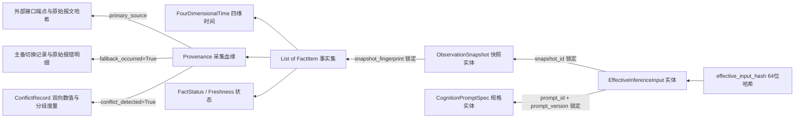

# Phase 2A Step 3.4 综合组装、全链路冷启动与静态验收实施计划
# （Full Pipeline Assembly, Cold-Start Scenarios & Static Architecture Scan）

> **计划编号**：`PLAN-PHASE2A-STEP3.4-20261001`  
> **版本**：v1.0.0-PROPOSED  
> **日期**：2026-10-01  
> **上位依据**：最高董事会工程令（`BOARD-APPROVAL-20260930-STEP3` / `Sub-Step 3.3 ACCEPTED / CLOSED`）  
> **实施状态**：**PLAN ONLY（仅限实施计划编制与提请审查，未经董事会批准严禁开展代码实施）**  
> **核心硬边界**：  
> $$\text{Physical Facts} \longrightarrow \text{ObservationSnapshot} \longrightarrow \text{Eligibility / Conflict / Quality} \longrightarrow \text{EffectiveInferenceInput} \longrightarrow \text{Deterministic Prompt} \longrightarrow \text{effective\_input\_hash} \longrightarrow \mathbf{STOP}$$  
> **绝对红线**：STOP 之后严禁触发任何真实/模拟 LLM 推理、假说生成、断言判定、交易信号、订单持久化、Replay/Diff 对撞引擎或 M6 生产化。

---

## 一、 Step 3.3 封口 Integrity 与 Hash Boundary 固化契约

按照董事会最终指令，在启动 Step 3.4 计划前，首先对 Step 3.3 的核心产物——`effective_input_hash` 的密码学边界做全息固化，杜绝“只算 Prompt 文本哈希而丢失底层事实审计性”的架构缺陷。

### 1.1 Hash Boundary 逐字段语义与审计必要性说明
`effective_input_hash` 严格基于 RFC 8785 JSON Canonicalization Scheme (JCS) 与 SHA-256 计算，其 Canonical Payload 包含且仅包含以下 12 个顶层字段（按 UTF-16 字节字典序排列）：

```json
{
  "admitted_facts": {},
  "data_quality_warnings": [],
  "inference_metadata": {},
  "input_id": "inp_...",
  "prompt_hash": "...",
  "prompt_id": "...",
  "prompt_version": "...",
  "rendered_system_prompt": "...",
  "rendered_user_prompt": "...",
  "snapshot_id": "obs_...",
  "stale_facts": {},
  "suppressed_facts": []
}
```

| 字段名称 | 类型 | 参与 Hash 审计的核心必要性说明 | 篡改攻击防御效果 |
| :--- | :---: | :--- | :--- |
| `admitted_facts` | `Dict` | **结构化合格事实集**。保全经过六维准入网严格筛选的客观事实键值对，包含各业务维度的规范化数据。 | 防范在 Prompt 文本外部偷换底层事实模型，确保大模型视觉输入与系统底层事实 100% 对应。 |
| `data_quality_warnings` | `List[str]` | **数据质量强制警示清单**。包含降级指标、超时字段、不可用维度等警示。 | 防止外部静默剥离数据缺陷告警，确保审计人员可核验系统是否对模型下达了数据缺陷警示。 |
| `inference_metadata` | `Dict` | **推理运行时元数据**。固化执行上下文（如 `{"sandbox_mode": true, "engine_version": "2.0.0", "zero_llm_execution": true}`）。 | 锁定计算环境与引擎版本，防止沙箱配置被偷换为实盘配置。 |
| `input_id` | `str` | **不可变输入唯一标识**。由确定性时钟与业务切片确立的唯一单调 ID。 | 防止跨切片或跨时段的输入载荷混淆与重放。 |
| `prompt_hash` | `str` | **静态 Prompt 模板 SHA-256 签名**。锁定模板发布时的签名。 | 防止底座模板被原地篡改（双重 WORM 锁定）。 |
| `prompt_id` | `str` | **Prompt 模板规范标识符**（如 `prompt_m1_review_v1`）。 | 锁定推理所绑定的具体模板身份。 |
| `prompt_version` | `str` | **Prompt 模板语义版本号**（如 `1.0.0`）。 | 防止模板版本漂移或未受控升级。 |
| `rendered_system_prompt`| `str` | **最终渲染的 System Prompt 文本全文**。 | 完整留存大模型底座系统指令的逐字真实输入。 |
| `rendered_user_prompt`  | `str` | **最终渲染的 User Prompt 文本全文**。包含四大区段与安全数据隔离容器。 | 锁定大模型最终“肉眼所见”的文字流，任何标点、换行变化必引发哈希雪崩。 |
| `snapshot_id` | `str` | **上游 ObservationSnapshot 的唯一指纹级标识**。 | **全息血缘纽带**：反向直接锁定该快照的 `snapshot_fingerprint`，进而溯源至全部原始 FactItem。 |
| `stale_facts` | `Dict` | **陈旧事实独立专区**。仅收纳经 FactContract 明确许可作为基准参考的历史缓存。 | 防止陈旧数据混入合格事实集，实现密码级物理隔离。 |
| `suppressed_facts` | `List[Dict]`| **排除事实清单与排除理由**。记录被排除的事实键、原始状态、排除规则与裁决结果。 | **“知其所不知”**：系统明确留存“排除了什么以及为什么排除”，作为推演缺失防御依据。 |

### 1.2 为什么必须“双重密码锁”？（Fact-Level vs Text-Level）
若仅仅对 `rendered_user_prompt` 文本计算哈希，将导致以下**致命审计漏洞**：
1. **事实结构塌缩**：审计员无法在数据库层面快速对结构化事实（如指数涨跌幅、成交额）进行 SQL 查询、交叉比对和自动对撞；
2. **血缘断裂**：无法从哈希反向证明该文本是否来自于特定的数据源采集事件或受污染的缓存；
3. **假零与偷换混淆**：若文本中序列化了 `0`，仅凭文本无法断定该 `0` 是真实客观的“涨停数为0”，还是因超时被非法填充的假 `0`。

> **结论**：`effective_input_hash` 实现了**事实级结构化对象（Fact-Level）**与**大模型视界文本流（Text-Level）**的原子级密码学绑定，缺一不可！

### 1.3 G10 PASS 的准确语义边界对齐
> [!IMPORTANT]
> **董事会重要澄清**：
> `3.3-G10 PASS` 的法律与工程含义是：**外部不可信文本（M2/S4）在输入层已被严格降级为纯数据（DATA ONLY），并在 Prompt 序列化时强制实施了 XML `<untrusted_market_data>` 容器结构隔离、闭合标签转义（`<` 与 `>` 转义为实体）以及安全约束指令注入。**  
> **严禁将 G10 PASS 表述为“已经完成真实 LLM Prompt Injection 的端到端攻击防御验证”。**  
> 真实 LLM 的语义理解、越狱抵抗与提示词注入防护属于未来的 Cognition Runtime 范畴，当前阶段因恪守“零 LLM 运行时”红线，仅在纯沙箱数据结构层面完成了输入安全隔离。

---

## 二、 全链路综合组装架构设计（Sub-Step 3.4.1）

Step 3.4 将把此前离散开发的 Step 3.1、3.2、3.3 各模块端到端打通，形成无缝衔接、纯沙箱、只读确定性的完整流水线：

```text
┌────────────────────────────────────────────────────────────────────────┐
│ 1. DATA ADAPTER STAGE                                                  │
│   • M1ReviewFactAdapter       (收盘行情、广度、涨停梯队)                  │
│   • M2PremarketFactAdapter    (隔夜外盘、宏观资讯、盘前观察)              │
│   • M4AuctionFactAdapter      (09:25:00 竞价开盘、量能比、一字板)         │
│   • M5SettlementFactAdapter   (结算价、超时标记、本地历史缓存)            │
│   • S4NewsFactAdapter         (快讯流、CLS/Sina 双源、重复与乱序保全)     │
└───────────────────────────────────┬────────────────────────────────────┘
                                    │ List[FactItem] (deep detached)
                                    ▼
┌────────────────────────────────────────────────────────────────────────┐
│ 2. SNAPSHOT BUILDER & QUALITY STAGE                                    │
│   • ObservationSnapshotBuilder: 组合多源事实切片                        │
│   • Quality Aggregator: 评估 Overall Quality (FULL/PARTIAL/DEGRADED/INVALID) │
│   • RFC 8785 JCS Fingerprint: 固化 snapshot_fingerprint                │
└───────────────────────────────────┬────────────────────────────────────┘
                                    │ ObservationSnapshot
                                    ▼
┌────────────────────────────────────────────────────────────────────────┐
│ 3. CONFLICT ENGINE STAGE                                               │
│   • ConflictEngine: 针对同切片多源同名事实检测分歧与矛盾                │
│   • 识别分类: NUMERIC_DIVERGENCE / STATE_CONTRADICTION / TEMPORAL_INVERSION│
│   • 裁决策略: ACCEPT_A / ACCEPT_B / INCONCLUSIVE (无权威依据时强行未决) │
│   • 证据留存: 实例化 ConflictRecord，保全双方 source、数值、时戳与度量   │
└───────────────────────────────────┬────────────────────────────────────┘
                                    │ Multi-source Resolved Snapshot
                                    ▼
┌────────────────────────────────────────────────────────────────────────┐
│ 4. FACT ELIGIBILITY GATE STAGE                                         │
│   • FactEligibilityGate: 依据六维准入矩阵与 FactContract 执行求值       │
│   • 四分区输出: admitted_facts / stale_facts / suppressed_facts / warnings │
│   • 铁律执行: Missing ≠ False, Timeout ≠ 0, Stale 物理隔离, Empty 语义分流 │
└───────────────────────────────────┬────────────────────────────────────┘
                                    │ Admitted / Stale / Suppressed / Warnings
                                    ▼
┌────────────────────────────────────────────────────────────────────────┐
│ 5. DETERMINISTIC PROMPT SERIALIZER STAGE                               │
│   • DeterministicPromptSerializer: 四区段只读确定性序列化               │
│   • SECTION 1: 数据质量与陈旧/缺失警示声明                              │
│   • SECTION 2: 合格事实 (UTF-16 字典序)，外部文本包裹安全容器            │
│   • SECTION 3: 陈旧事实隔离专区 [HISTORICAL/STALE REFERENCE ONLY]       │
│   • SECTION 4: 排除事实与缺失维度声明 [DEFICIENCIES SUMMARY]            │
└───────────────────────────────────┬────────────────────────────────────┘
                                    │ Canonical Payload
                                    ▼
┌────────────────────────────────────────────────────────────────────────┐
│ 6. EFFECTIVE INPUT HASH & STOP BOUNDARY                                │
│   • RFC 8785 JCS SHA-256 计算 effective_input_hash                      │
│   • 校验 verify_effective_input_hash 密闭闭环                          │
│   • 实例化不可变 EffectiveInferenceInput 值对象                         │
│   • ★★★ 立即触发 STOP 阻断，严禁任何后续 LLM 与交易调用 ★★★              │
└────────────────────────────────────────────────────────────────────────┘
```

---

## 三、 七大冷启动场景矩阵与全覆盖验证计划（Sub-Step 3.4.2）

在系统刚启动、未有任何历史推演上下文时（Cold Start），系统必须在各种极端网络与数据源供给状态下表现出确定性行为。Step 3.4 设立以下 7 大核心冷启动场景，必须 100% 具备测试用例覆盖：

| 场景编号 | 场景名称 | 模拟输入条件 | 预期 ObservationSnapshot 状态 | 预期 Eligibility 分流 | 预期 Prompt 与 Hash 表现 |
| :---: | :--- | :--- | :--- | :--- | :--- |
| **CS-01** | **全量健康可用 (Full Available)** | M1/M2/M4/M5/S4 数据源全部正常响应，时戳一致，无分歧，指标齐全。 | `overall_quality = FULL`，`degraded_fields = []`。 | 全部事实进入 `admitted_facts`；`stale_facts` 为空；`suppressed_facts` 为空；`warnings` 为空。 | SECTION 1 显示 FULL 无告警；SECTION 2 完整展开；SECTION 3/4 显示 None。哈希有效。 |
| **CS-02** | **部分次要缺失 (Partial Missing)** | M1 正常，M4 高标溢价缺失（None），S4 快讯为空。 | `overall_quality = PARTIAL`，`degraded_fields` 记录高标缺失。 | 关键指数/广度/连板池进入 `admitted_facts`；高标溢价进入 `suppressed_facts`（`INCONCLUSIVE_MISSING`，**payload=None，严禁填0**）；快讯按合法空集合进入 `admitted`。 | SECTION 1 显示 PARTIAL 告警；SECTION 4 明确列出高标缺失，注入 `[无法推断]` 警示。 |
| **CS-03** | **物理超时故障 (Physical Timeout)** | Baostock 超时异常（`asyncio.TimeoutError`），且本地无任何历史缓存。 | `overall_quality = DEGRADED`，结算价状态为 `TIMEOUT`，`payload=None`。 | 结算价进入 `suppressed_facts`（`SUPPRESSED_DEFECTIVE`，**payload=None，严禁填0.0**）；记录 `[DATA TIMEOUT]` 警示。 | SECTION 1 提示超时；SECTION 4 列明结算价超时已被强行剥离。 |
| **CS-04** | **陈旧历史参考 (Stale Reference)** | Baostock 超时，但读取到本地昨日历史收盘价缓存（`status=STALE`）。 | `overall_quality = DEGRADED`，`degraded_fields` 包含个股代码。 | 结算价进入 `stale_facts`（`STALE_RESTRICTED`），**绝对不在 `admitted_facts` 中出现**。 | SECTION 1 警示陈旧；SECTION 2 无该结算价；SECTION 3 显式标注 `[HISTORICAL/STALE REFERENCE ONLY]`。 |
| **CS-05** | **客观空事实 (Legitimate Empty)** | 市场处于冰点极值行情，当日 0 只个股涨停（`limit_up_count=0`）。 | `overall_quality = FULL`，涨停池状态为 `EMPTY`，`payload={"limit_up_count": 0, "pool": []}`。 | 符合 `COUNT_ZERO` 语义，合法进入 `admitted_facts`。 | SECTION 2 正确包含 `limit_up_count=0`，不被错误判定为故障缺失。 |
| **CS-06** | **多源分歧对撞 (Multi-source Conflict)** | Eastmoney 报上证指数 +1.25%，Sina 报 -0.45%（分歧 1.70% > 0.3%）。 | 生成 `ConflictRecord` 保全双方证据；指数快照状态标记为 `INCONCLUSIVE`。 | 指数事实进入 `suppressed_facts`（`SUPPRESSED_CONFLICT`，`payload=None`）；注入多源冲突告警。 | SECTION 1 标注入冲突；SECTION 4 严厉声明指数分歧未决，凡依赖指数的推演必须为无法判定。 |
| **CS-07** | **全不可用极端 (Total Failure)** | 全市场休市/所有外部接口网络物理阻断，无任何有效数据。 | `overall_quality = INVALID`，所有事实均为 `MISSING` 或 `ERROR`。 | `admitted_facts` 为空字典；所有事实均进入 `suppressed_facts`。 | SECTION 1 标明 INVALID；SECTION 2 显示“无可用事实”；SECTION 4 列出全量缺陷清单。哈希确定性生成，阻断推演。 |

---

## 四、 全链路四维确定性验证规范（Sub-Step 3.4.3）

为了彻底证明整个系统不存在任何内存地址泄露、随机种子漂移、字典无序遍历或进程上下文依赖，设计以下四维确定性测试：

### 4.1 100-Run 内存级确定性（In-Memory Determinism）
- 在同一进程内，对给定的全量快照连续运行完整链路（Adapter → Snapshot → Conflict → Eligibility → Serializer → Hash）100 次；
- **断言**：第 1 次至第 100 次生成的 `effective_input_hash` 逐字符相同，`rendered_user_prompt` 文本逐字节恒等。

### 4.2 独立跨进程确定性（Fresh-Process Subprocess Determinism）
- 启动一个全新的 Python 独立子进程（`subprocess.run([sys.executable, ...])`），传递相同输入；
- 验证在全新的 Python 解释器实例（不同的内存堆栈、不同的内部字符串哈希种子 `PYTHONHASHSEED`）下，生成的 `effective_input_hash` 与主进程完全一致；
- **断言**：排除任何依赖解释器内存地址或默认字典哈希特性的隐蔽缺陷。

### 4.3 输入任意乱序排布确定性（Arbitrary Permutation Invariance）
- 将输入的原始事实列表随机打乱（`random.shuffle`），分别送入快照构建器与流水线；
- **断言**：无论原始事实项以何种顺序到达，经 UTF-16 严格字典序规范化后，最终生成的 `snapshot_fingerprint`、`rendered_user_prompt` 与 `effective_input_hash` 100% 恒等。

### 4.4 重复报文与乱序到达原貌保全（Duplicate & Arrival Order Invariance）
- 模拟同一新闻快讯被抓取两次（Duplicate），或时间戳较早的新闻因网络延迟后到达（Out-of-Order）；
- **断言**：流水线通过 `Provenance` 的 `duplicate_detected`、`duplicate_count` 与 `original_arrival_order` 忠实记录，并在整个快照和最终 Prompt 中保持可重现的确定性输出。

---

## 五、 全息血缘闭环与反向追溯体系（Sub-Step 3.4.4 Provenance Closure）

本计划要求建立完备的**反向审计追溯算法**，实现“见 Hash 见全局”：



### 5.1 追溯断言要求
编写自动化测试，输入任意合法的 `effective_input_hash`：
1. **第一步（输入层验真）**：计算该输入的规范化载荷，哈希严格匹配；
2. **第二步（模板层回溯）**：反查绑定的 Prompt 模板，计算模板哈希，与 `prompt_hash` 严格匹配；
3. **第三步（快照层回溯）**：通过 `snapshot_id` 读取关联快照，计算其全要素指纹，与 `snapshot_fingerprint` 严格匹配；
4. **第四步（事实层回溯）**：快照中每一个事实项重新计算 JCS 指纹，与 `fact_fingerprint` 严格匹配；
5. **第五步（底层血缘穿透）**：提取每个事实项的 `Provenance`，可无损查阅其采集时间（`observed_time`）、物理事件时间（`event_time`）、源端点（`endpoint`）、原始报文指纹（`raw_payload_hash`）、主备切换原因（`fallback_reason`）及冲突证据（`ConflictRecord`）。

---

## 六、 静态架构扫描与安全合规防线（Sub-Step 3.4.5）

为了在纯物理和代码层面彻底封死违规调用的可能，在 Step 3.4 必须实现一个基于 Python AST（抽象语法树）的静态代码扫描工具 `backend/tests/static_architecture_scanner.py`，作为测试闸门的一环执行：

### 6.1 扫描规则负面清单（Zero-Tolerance Blacklist）
1. **外部大模型 SDK 扫描**：
   - 扫描 `backend/app/cognition/` 目录；
   - 严禁出现以下模块的 `import` 或 `from ... import`：
     `openai`, `anthropic`, `google.generativeai`, `google.genai`, `langchain`, `litellm`, `cohere`, `huggingface_hub`, `transformers`, `torch` 等。
2. **网络套接字与不可控时钟扫描**：
   - 在认知输入管道中，严禁直接调用 `socket`, `requests`, `aiohttp`, `httpx`（必须通过受控的 Provider 适配器）；
   - 严禁直接调用 `time.time()`, `datetime.now()`（不带时区），必须通过 `DeterministicClock`。
3. **交易系统隔离扫描**：
   - 扫描 `backend/app/cognition/input/` 与 `backend/app/cognition/observation/`；
   - 严禁导入 `backend/app/trading/` 内部的任何执行模块；
   - 严禁调用 `TradeRecord`, `Position`, `TradeNote` 的实例化或写入方法。
4. **数据库 Migration 扫描**：
   - 检查 `backend/migrations/versions/`；
   - 确认 Step 3 未新增任何未经批准的数据库表迁移脚本。
5. **生产 API 路由隔离扫描**：
   - 检查 `backend/app/api/v1/`；
   - 确认没有将 Cognition 未受控地直接接入实盘下单路由 `/api/v1/trading/records`。

---

## 七、 交付物规划与实施时间表

### 7.1 代码与测试交付清单
1. **`backend/app/cognition/input/pipeline.py`**：`CognitionObservationPipeline` 纯沙箱组装器，将 Step 3.1/3.2/3.3 串联为确定性流水线；
2. **`backend/tests/test_cognition_step3_assembly.py`**：
   - 7 大冷启动场景全覆盖测试；
   - 100 次内存运行确定性测试；
   - 跨子进程（Subprocess）运行确定性测试；
   - 乱序输入排布确定性测试；
   - 全息血缘反向追溯（Provenance Closure）穿透测试；
3. **`backend/tests/test_cognition_static_architecture_scan.py`**：
   - 基于 AST 的静态代码扫描与红线违规检测套件；
4. **`开发文档/40-Phase-2A-Step3.4-实施完成报告与全链路验收证据链.md`**：Step 3 总体大闭环验收报告。

### 7.2 实施边界与工序承诺
```text
3.4.1 方案审查与工程令批准 (本实施计划等待董事会决议)
        ↓ (董事会签发工程授权令)
3.4.2 流水线沙箱组装 (pipeline.py，只拼装、不扩权)
        ↓
3.4.3 七大冷启动场景测试 (CS-01 ~ CS-07)
        ↓
3.4.4 四维确定性与反向血缘穿透测试 (100-run, subprocess, reverse audit)
        ↓
3.4.5 静态架构扫描验证 (AST 扫雷)
        ↓
3.4.6 全系统 81+ 综合回归与完成报告提交
```

---

## 八、 提请决议事项

本《Phase 2A Step 3.4 综合组装、全链路冷启动与静态验收实施计划》已完全对齐董事会关于全链路组装、7 大冷启动场景、四维确定性、全息血缘闭环、AST 静态架构扫描以及 `effective_input_hash` 完整 Hash Boundary 的各项强制要求。

**提请最高董事会审议决议：**
> **批准本实施计划《PLAN-PHASE2A-STEP3.4-20261001》。签发正式工程授权令后，方可受控启动 Sub-Step 3.4 纯沙箱代码实施。**
