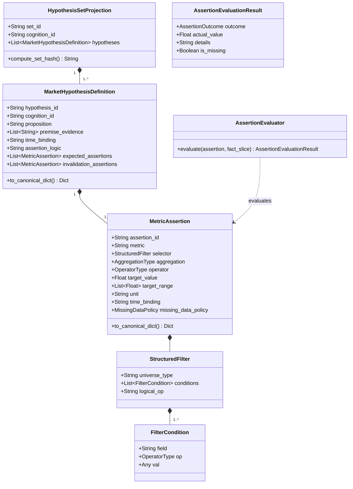

# Phase 2A Step 4 假说定义投影与收窄 AST 断言执行器实施规划
# （Hypothesis Definition Projection & Narrowed AST Assertion Executor Plan）

> **计划编号**：`PLAN-PHASE2A-STEP4-20261001`  
> **版本**：v1.0.0-PROPOSED  
> **日期**：2026-10-01  
> **上位依据**：  
> 1. 《开发文档/28-Cognition-Phase2-可审计结构化认知引擎技术设计单.md》v1.2.1-FINAL  
> 2. 《开发文档/29-Cognition-Phase2A架构与数据契约冻结决议与实施约束单.md》  
> 3. 《最高董事会终审裁决执行令 DECISION-PHASE2A-STEP3-FINAL-CLOSURE-20261001》  
> **实施状态**：**PLAN ONLY（纯实施规划，未经董事会评审与签发工程授权令前，严禁开启业务代码实施）**  
> **核心使命**：  
> 在 Step 3 完成“事实输入基础设施”（模型看到了什么、来源何处、Hash为何）的基础上，**Step 4 开启“假说结构化对撞底座”建设**。  
> 解决：**“如何用类型安全、白名单收窄的机器断言定义假说，如何使假说定义与后验验证运行态严格物理隔离，如何以‘证伪优先’原则对物理事实切片进行确定性机器求值。”**

---

## 一、 Step 4 核心工程问题与设计原则

根据《28-设计单》与董事会关于 Step 1~3 的全部工程裁决，Step 4 必须在设计阶段就彻底封死以下四个核心工程陷阱：

### 1. 【C-02 核心闭环】假说定义与后验状态严格物理隔离（Definition Projection Invariant）
- **工程陷阱**：若假说实体中的后验字段（如 `status` 从 `PENDING` 跃迁为 `CONFIRMED`、`actual_data_snapshot`、`verification_outcome`）与假说定义混在一个对象中，后验结果写入时就会篡改假说对象，导致原始认知账本的 `payload_hash` 与 `record_hash` 发生崩溃性篡改。
- **设计解法**：严格确立不可变值对象 [`HypothesisDefinitionProjection`](#)。认知生成时刻只对该“定义投影”执行 RFC 8785 JCS 规范化并计算 `hypothesis_hash` 与 `hypothesis_set_hash`；后验运行态字段物理隔离在独立的运行态域中，单向引用定义，**绝不反向污染原始哈希**。

### 2. 【C-03 核心闭环】收窄 Phase 2A 断言 DSL 为有限白名单 AST（Narrowed Whitelist AST）
- **工程陷阱**：若允许大模型生成任意类 SQL 字符串（如 `SELECT MAX(close) FROM stocks WHERE ...`），将导致不可控的 SQL 注入风险、复杂嵌套子查询爆炸、跨表性能雪崩，且根本无法在沙箱中确定性审计。
- **设计解法**：Phase 2A 严格禁止任意 SQL 与嵌套子查询。收窄为**有限白名单 AST**：
  - 单层平铺的 `StructuredFilter`（仅支持 `AND` / `OR`，禁止深层递归嵌套）；
  - 严格限制在白名单内的 `metric`（行情类、情绪类、梯队类）；
  - 严格限制在白名单内的 `field`（如 `board_height`, `sector_code`, `is_highest_board` 等，其中 `is_highest_board` 必须由事实层预计算为布尔值，**严禁运行时执行动态 MAX 子查询**）；
  - 显式声明的聚合函数（`AggregationType`）与比较操作符（`OperatorType`）。

### 3. 证伪优先与 Missing-Data 语义（Falsification-First & Zero-Fill Defense）
- **工程陷阱**：若把“数据缺失”当作“验证失败”或盲目填 0，会导致假说被错误证伪或错误确证。
- **设计解法**：
  - **证伪优先（Falsification-First）**：每个假说包含 `expected_assertions`（预期发生）与 `invalidation_assertions`（证伪条件）。只要证伪条件成立，假说立即判定为 `FALSIFIED`；
  - **Missing != False 铁律**：求值过程中若事实切片中对应指标缺失、超时或未决，默认强制判定为 `INCONCLUSIVE`（除非策略显式声明 `FAIL_FALSIFIED`），严禁假零填充。

### 4. 纯沙箱与硬停机边界（Pure Sandbox & Boundary Isolation）
- **设计解法**：Step 4 全部断言求值器与投影计算器运行在纯沙箱内存中。测试阶段通过 Mock 数据与标准事实切片驱动，**零外部大模型 API 调用，零交易系统写入，零数据库 Migration**。

---

## 二、 Step 4 架构蓝图与实体关系



---

## 三、 Step 4 子步骤实施路线图（Sub-Step 4.1 ~ 4.4）

按照严谨的工程工序，Step 4 分解为 4 个紧密递进、可独立测试验证的子步骤：

### Sub-Step 4.1：假说实体契约与定义投影隔离（Contracts & Projection Engine）
- **实施目标**：构建类型安全不可变的假说模型，实现 JCS 哈希计算与 C-02 物理隔离。
- **交付模块**：`backend/app/cognition/hypothesis/contracts.py` 与 `backend/app/cognition/hypothesis/fingerprint.py`。
- **核心内容**：
  1. 定义 `MetricType`、`UniverseType`、`OperatorType`、`AggregationType`、`MissingDataPolicy`、`AssertionOutcome` 等枚举；
  2. 实现不可变 Pydantic 模型：`FilterCondition`、`StructuredFilter`、`MetricAssertion`、`MarketHypothesisDefinition`、`HypothesisSetProjection`；
  3. 实现 `compute_hypothesis_hash(hypo)` 与 `compute_hypothesis_set_hash(hypo_set)`：
     - 单假说哈希：对 `to_canonical_dict()` 执行 RFC 8785 JCS SHA-256；
     - 假说集合哈希：按 `hypothesis_id` 的 UTF-16 字节字典序排列各假说哈希，进行全要素 JCS 聚合计算；
  4. 严格确立 `C-02 Invariant`：定义模型中绝对不包含任何运行态字段（`status`, `actual_data`, `outcome`）。
- **配套测试**：`backend/tests/test_cognition_step4_contracts.py`（模型不可变性、JCS确定性、哈希防篡改与雪崩测试）。

---

### Sub-Step 4.2：收窄 AST 断言执行求值引擎（Narrowed AST Assertion Executor）
- **实施目标**：实现对白名单 AST 的纯内存确定性求值，严防 SQL 注入与假零填充。
- **交付模块**：`backend/app/cognition/hypothesis/evaluator.py`。
- **核心内容**：
  1. **数据切片过滤（`StructuredFilter` 解释器）**：
     - 在传入的事实集合中，根据 `universe_type`（全A股/行业/高标）与 `conditions` 进行单层过滤；
     - 支持操作符：`EQ`, `NE`, `GT`, `GTE`, `LT`, `LTE`, `IN`；
     - 字段类型安全转换与白名单强校验（非法字段直接抛出语法拒绝异常）；
  2. **指标聚合计算（`Aggregation` 处理器）**：
     - 支持对过滤后的集合计算 `MEAN`, `MEDIAN`, `COUNT`, `MAX`, `MIN`, `SUM`；
     - 集合为空时的严格语义：`COUNT` 输出 0；数值聚合（如 `MEAN`）按 Fact-type 契约判定，严禁假0；
  3. **目标对撞求值（`OperatorType` 比较器）**：
     - 比较聚合值与 `target_value` 或 `target_range`；
     - 产出 `AssertionOutcome.PASSED` 或 `AssertionOutcome.FAILED`；
  4. **Missing-Data 语义求值**：
     - 若所需指标在事实快照中为 `MISSING`、`TIMEOUT` 或 `ERROR`，严格遵循 `missing_data_policy`（默认：`AssertionOutcome.INCONCLUSIVE`）；
     - 验证 `Missing ≠ False` 铁律在断言层的延续。
- **配套测试**：`backend/tests/test_cognition_step4_evaluator.py`（白名单校验、各聚合函数精确度、空集合与缺数分支测试）。

---

### Sub-Step 4.3：假说双时点对撞逻辑与证伪优先引擎（Falsification Engine）
- **实施目标**：将原子断言结果合成假说的最终裁决状态，严格遵循证伪优先与多断言逻辑组合。
- **交付模块**：`backend/app/cognition/hypothesis/falsification.py`。
- **核心内容**：
  1. **证伪优先判决流（Falsification Invariant）**：
     - 优先求值 `invalidation_assertions`（证伪断言列表）；
     - 若证伪断言列表中任一条件满足（或满足 `assertion_logic`），假说立即终审裁决为 **`FALSIFIED`**；
     - 只有当证伪断言全部未触发时，才进一步求值 `expected_assertions`；
  2. **预期验证判决流**：
     - 若 `expected_assertions` 满足其 `assertion_logic`（`AND` 或 `OR`），假说裁决为 **`CONFIRMED`**；
     - 若未触发证伪但预期未达成，假说裁决为 **`UNCONFIRMED`**；
  3. **未决状态熔断（Inconclusive Short-Circuit）**：
     - 若关键断言因缺数产生 `INCONCLUSIVE` 且无法达成逻辑闭式，假说整体强制判定为 **`INCONCLUSIVE`**，绝对不擅自得出肯定或否定结论。
- **配套测试**：`backend/tests/test_cognition_step4_falsification.py`（证伪优先熔断、多条件 AND/OR 组合、缺数未决测试）。

---

### Sub-Step 4.4：综合组装、冷启动对撞场景与静态架构防线（Assembly & Static Gates）
- **实施目标**：建立端到端假说流水线，验证极端行情下的断言表现，执行静态 AST 架构扫雷。
- **交付模块**：`backend/app/cognition/hypothesis/pipeline.py` 与专项测试套件。
- **核心内容**：
  1. **假说流水线编排器（`HypothesisPipeline`）**：
     - 输入：`MarketHypothesisDefinition` 集合 + 验证时点事实切片（`ObservationSnapshot`）；
     - 输出：验证结果不可变载荷（含各断言明细、聚合数值、最终裁决状态）；
     - 坚守 STOP 边界：输出结果即刻停机，不连接交易下单；
  2. **七大假说冷启动与极端对撞测试矩阵**：
     - 场景 1：全命中确证（高位连板按预期低开杀跌 $\rightarrow$ `CONFIRMED`）；
     - 场景 2：直接证伪（最高板超预期高开抢筹 $\rightarrow$ 触发证伪断言 $\rightarrow$ `FALSIFIED`）；
     - 场景 3：关键行情指标缺失（开盘价缺失 $\rightarrow$ `INCONCLUSIVE`，严禁判定为下跌）；
     - 场景 4：冰点空集合对撞（昨日0只连板股 $\rightarrow$ `LADDER_HIGH_SPEC` 集合为空 $\rightarrow$ 合法空集合求值）；
     - 场景 5：数值边界压线（设定 `-3.0%`，实际 `-3.0001%` 与 `-2.9999%` 精度测试）；
     - 场景 6：非法字段/任意 SQL 注入拦截（恶意注入 `SELECT *` $\rightarrow$ AST 解析器直接抛错拒绝）；
     - 场景 7：后验状态写入不污染哈希验证（修改后验状态，重新计算假说定义哈希 100% 恒等）；
  3. **AST 静态架构扫描拓展**：
     - 扫描 `backend/app/cognition/hypothesis/` 目录，确保零大模型 SDK 引入、零交易模块引入。
- **配套测试**：`backend/tests/test_cognition_step4_assembly.py` 与静态扫描扩展。

---

## 四、 Step 4 交付工件与代码架构规划

```text
backend/app/cognition/hypothesis/
├── __init__.py           # 包级导出与统一接口
├── contracts.py          # 假说实体、断言 AST 节点、过滤条件不可变模型
├── fingerprint.py        # hypothesis_hash 与 hypothesis_set_hash (JCS SHA-256)
├── evaluator.py          # 收窄 AST 结构化求值器 (白名单集合过滤、指标聚合计算)
├── falsification.py      # 证伪优先裁决引擎 (FalsificationEngine)
└── pipeline.py           # 假说流水线沙箱组装器 (HypothesisPipeline)

backend/tests/
├── test_cognition_step4_contracts.py      # 模型契约、不可变性与哈希一致性测试
├── test_cognition_step4_evaluator.py      # AST 过滤、指标聚合与 Missing-Data 语义测试
├── test_cognition_step4_falsification.py  # 证伪优先逻辑与状态流转测试
└── test_cognition_step4_assembly.py       # 端到端冷启动对撞、注入拦截与 AST 架构扫描
```

---

## 五、 实施纪律与硬性负面清单（Step 4 Red Lines）

在进入 Step 4 编码实施后，必须严格执行以下红线，任何触犯立即一票否决：

- [ ] **严禁引入类 SQL 解析引擎**：所有过滤与求值必须基于 Python 原生类型安全的单层对象模型，严禁解析字符串 SQL；
- [ ] **严禁后验状态参与定义哈希**：`status`、`actual_data_snapshot`、`verification_outcome` 绝不进入 `HypothesisDefinitionProjection`；
- [ ] **严禁假零填充与负面推论**：断言求值时缺数必须输出 `INCONCLUSIVE`，严禁用 0 代替缺失数据；
- [ ] **严禁调用真实 LLM API**：Step 4 所有测试输入均为预设或 Mock 的事实切片，绝对禁止发起外部大模型网络请求；
- [ ] **严禁连接交易系统**：假说判定结果绝不自动转化为买卖指令，绝不写入订单与持仓表；
- [ ] **严禁私自修改 Step 1~3 已冻结契约**：严格继承 `EffectiveInferenceInput` 与 `ObservationSnapshot`。

---

## 六、 提请决议事项

本《Phase 2A Step 4 假说定义投影与收窄 AST 断言执行器实施规划》已全面遵照《28-设计单》及董事会历次工程裁决，完成了对假说实体契约、收窄白名单 AST、证伪优先求值引擎与冷启动测试矩阵的系统化规划。

**提请最高董事会审议决议：**
> **批准本实施规划《PLAN-PHASE2A-STEP4-20261001》。签发正式工程授权令后，方可受控开启 Sub-Step 4.1 ~ 4.4 纯沙箱代码实施。**
