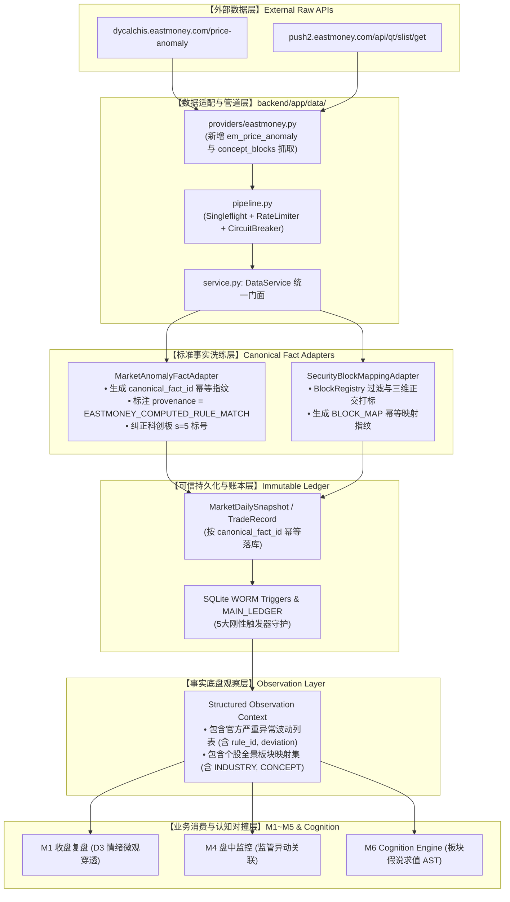

# 63-a-stock-data上游事实底盘扩容技术设计单
(Upstream Fact Foundation Expansion Technical Design Specification: Wave 1 Probing, Provenance Correction & Canonical Fact Contract)

- **设计单编号**：`SPEC-FACT-EXPANSION-20261004-WAVE1`
- **归档日期**：2026-10-04
- **立项级别**：P0 / P1 级事实底盘扩容专项
- **当前固化基线版本**：**`v0.2.7`** (P2 生产运行版 · 心跳确权固化 · Commit `#e028da3`)
- **波次锁定**：🟢 **Wave 1 聚焦**（`em_price_anomaly` 异动池 + `eastmoney_concept_blocks` 板块归属）
- **状态**：🟢 **FINAL / IMPLEMENTATION APPROVED (最高董事会审查通过，准予受控实施)**
- **上位依据**：
  - 《开发文档/02-G1需求基线（正式冻结版）.md》
  - 《开发文档/10-项目多Agent四权分立工程治理规范.md》
  - 《开发文档/27-版本号编制规范与工程化自动化升级指南.md》
  - 《开发文档/28-Cognition-Phase2-可审计结构化认知引擎技术设计单.md》
  - 《开发文档/61-Observation-M1-M5-Fact-Foundation-Audit-Report.md》
  - 最终董事会裁决令（2026-10-04 · CONDITIONAL PASS 闭环补丁）

---

## 目录

1. [执行摘要与立项宗旨](#一执行摘要与立项宗旨)
2. [Wave 1 真实白盒抓包证据与字段解剖](#二wave-1-真实白盒抓包证据与字段解剖)
3. [字段来源、时间语义、单位与更新频率](#三字段来源时间语义单位与更新频率)
4. [重叠性分析与 Source of Truth 冲突裁决矩阵](#四重叠性分析与-source-of-truth-冲突裁决矩阵)
5. [【补丁 ①】Provenance 严格定性：商业撮合事实 vs 官方源边界澄清](#五补丁--provenance-严格定性商业撮合事实-vs-官方源边界澄清)
6. [Wave 1 vs Wave 2 (`tencent_ticks`) 延迟与边界对比](#六wave-1-vs-wave-2-tencent_ticks-延迟与边界对比)
7. [【补丁 ③】Block Registry 板块注册表与三维分类隔离机制](#七补丁--block-registry-板块注册表与三维分类隔离机制)
8. [【补丁 ②】Canonical Fact ID 幂等事实身份指纹规范](#八补丁--canonical-fact-id-幂等事实身份指纹规范)
9. [刚性无旁路架构：外部数据源到 Cognition 的全息穿透链](#九刚性无旁路架构外部数据源到-cognition-的全息穿透链)
10. [【补丁 ④】动态契约测试 (Contract) 与幂等不变量 (Idempotency) 验证规范](#十补丁--动态契约测试-contract-与幂等不变量-idempotency-验证规范)
11. [受控实施清单与验收门禁](#十一受控实施清单与验收门禁)

---

## 一、 执行摘要与立项宗旨

### 1. 为什么设立本专项？
在 2026-10-03 完成的《61 号事实底盘充分性审计报告》中，审计组指出了当前生产系统的核心结构性矛盾：
> **“Phase 2A/2B 的认知闭环管道已完全打通，WORM 防篡改与创世链固若金汤；但管道内部流淌的事实仅限于宏观 4 大指数与虚拟全 A 聚合指标，微观个股与行业板块事实覆盖率为 0%，事实底盘严重‘贫血’。”**

开源工具包 `a-stock-data`（15 层架构 · 87 端点）提供了丰富的候选接口。依据董事会裁决：
**“Provider 数量增加本身不是目标，事实质量、可追溯性与可审计性才是目标。必须分波次、经白盒验证后受控接入，严禁旁路直连认知层。”**

### 2. Wave 1 核心靶点
- **靶点 1：`em_price_anomaly`** $\rightarrow$ 击穿“个股微观事实贫血”，引入对标交易所监管标准的严重异常波动事实；
- **靶点 2：`eastmoney_concept_blocks`** $\rightarrow$ 击穿“板块事实贫血”，建立个股到行业、概念、地域的正交映射关系。

---

## 二、 Wave 1 真实白盒抓包证据与字段解剖

本审计组于 2026-10-04 15:01 在隔离沙盒环境（`scratch/probe_wave1.py`）对实盘网络接口进行了真实抓包。

### 1. 端点一：`em_price_anomaly`（日内异动池）
- **物理请求 URL**：`https://dycalchis.eastmoney.com/price-anomaly/list`
- **必需参数**：`team=h5&product=EastMoney&client=WAP&version=9001&name=WAP&user=123&pageSize=10&pageNo=1`
- **必需 Headers**：`Referer: https://vipmoney.eastmoney.com/`
- **2026-10-04 真实原始响应切片 (JSON)**：
```json
{
  "result": 0,
  "msg": "",
  "pages": 1,
  "date": 20260930,
  "open": 0,
  "count": 9,
  "data": [
    {
      "m": 0,
      "c": "301190",
      "n": "善水科技",
      "s": 4,
      "e": 4,
      "x": 98.11,
      "d": 7,
      "t": 0.98,
      "a": 20.01,
      "o": 2
    },
    {
      "m": 1,
      "c": "600825",
      "n": "新华传媒",
      "s": 1,
      "e": 4,
      "x": 96.7,
      "d": 7,
      "t": 1.69,
      "a": 9.99,
      "o": 2
    },
    {
      "m": 1,
      "c": "688137",
      "n": "近岸蛋白",
      "s": 5,
      "e": 6,
      "x": 193.43,
      "d": 29,
      "t": 2.3,
      "a": 13.47,
      "o": 2
    }
  ]
}
```

> [!WARNING] 白盒审计重大发现（README 错误证伪）
> 开源项目 `a-stock-data` 的 README 声称：`s` 板块码为 `1=主板, 4=创业板, 6=科创板`。
> **真实抓包实证**：科创板标的 `688137 近岸蛋白`、`688175 高凌信息`，服务端返回的实际值是 **`s = 5`**！
> **若直接按开源库原代码接入，科创板标的将全部发生规则码解析失效！** 必须在我们的适配器中纠正：`5=科创板 (STAR)`。

---

### 2. 端点二：`eastmoney_concept_blocks`（个股所属板块归属）
- **物理请求 URL**：`https://push2.eastmoney.com/api/qt/slist/get`
- **必需参数**：`fltt=2&invt=2&secid=1.600519&spt=3&pi=0&pz=20&po=1&fields=f12,f14,f3,f128,f140,f141`
- **必需 Headers**：`Referer: https://quote.eastmoney.com/`
- **2026-10-04 真实原始响应切片 (以 600519 贵州茅台 为例)**：
```json
{
  "rc": 0,
  "rt": 18,
  "data": {
    "total": 28,
    "diff": {
      "0": { "f12": "BK0438", "f14": "食品饮料", "f3": 1.51, "f128": "均瑶健康", "f140": "605388", "f141": 1 },
      "1": { "f12": "BK1575", "f14": "白酒Ⅲ", "f3": 2.79, "f128": "金徽酒", "f140": "603919", "f141": 1 },
      "2": { "f12": "BK1277", "f14": "白酒Ⅱ", "f3": 2.79, "f128": "金徽酒", "f140": "603919", "f141": 1 },
      "3": { "f12": "BK0896", "f14": "贵州板块", "f3": 0.44, "f128": "中航重机", "f140": "600765", "f141": 1 },
      "4": { "f12": "BK0612", "f14": "茅指数", "f3": 1.76, "f128": "传音控股", "f140": "688036", "f141": 1 }
    }
  }
}
```

---

## 三、 字段来源、时间语义、单位与更新频率

### 1. `em_price_anomaly` 规范化字段字典

| 原始键名 | 规范化字段 (Canonical) | 类型 | 单位 | 时间语义 | 更新频率 | 业务含义 |
| :---: | :---: | :---: | :---: | :---: | :---: | :--- |
| `date` | `trade_date` | `str` | 日期 | 事实归档日 (YYYY-MM-DD) | 每个交易日收盘 | 该异动快照对应的交易日戳 |
| `c` | `symbol` | `str` | 6位代码 | 静态标识 | 不变 | 股票代码（纯数字） |
| `n` | `name` | `str` | 字符串 | 当日静态 | 极低 | 股票简称 |
| `m` | `exchange` | `str` | 枚举 | 静态标识 | 不变 | 交易所：1 $\rightarrow$ SH, 0 $\rightarrow$ SZ / BJ (结合前缀) |
| `s` | `board_type` | `str` | 枚举 | 静态标识 | 不变 | 1 $\rightarrow$ MAIN, 4 $\rightarrow$ GEM, 5 $\rightarrow$ STAR, 8 $\rightarrow$ BSE |
| `e` | `rule_id` | `int` | 规则编号 | 当日结算 | 日频 | 交易所严重异常波动规则代码 (1~8, 40~70) |
| `x` | `deviation_pct` | `float` | 百分比 (%) | 滚动窗口累计 | 盘后结算 | 累计涨跌幅偏离值 (如 98.11 表示 +98.11%) |
| `d` | `window_days` | `int` | 交易日天数 | 统计区间窗口 | 日频 | 偏离度统计窗口长度 (如 7, 10, 30) |
| `a` | `day_change_pct`| `float` | 百分比 (%) | 当日收盘 | 日频 | 当日涨跌幅 |
| `o` | `status_flag` | `int` | 枚举 | 当前状态 | 日频 | 异动处理阶段 (0=已发生, 1=已公告, 2=监控中) |

### 2. `eastmoney_concept_blocks` 规范化字段字典

| 原始键名 | 规范化字段 (Canonical) | 类型 | 单位 | 时间语义 | 更新频率 | 业务含义 |
| :---: | :---: | :---: | :---: | :---: | :---: | :--- |
| `f12` | `block_code` | `str` | BK代码 | 静态标识 | 极低 | 东方财富板块唯一编号 (如 BK0438) |
| `f14` | `block_name` | `str` | 字符串 | 静态标识 | 极低 | 板块全称 (自解释命名) |
| `f3` | `block_change_pct` | `float` | 百分比 (%) | 实时/收盘快照 | 分钟级/收盘 | 板块整体加权涨跌幅 |
| `f128`| `leader_name` | `str` | 字符串 | 实时/收盘快照 | 动态 | 当日该板块涨幅居前的领涨/龙头股名称 |
| `f140`| `leader_symbol` | `str` | 6位代码 | 实时/收盘快照 | 动态 | 领涨/龙头股代码 |

---

## 四、 重叠性分析与 Source of Truth 冲突裁决矩阵

### 1. 现有数据源与新端点的重叠度核查

| 数据维度 | 现有数据源 (Current) | 新端点 (Wave 1) | 重叠状态 | 差异与互补性 |
| :--- | :--- | :--- | :---: | :--- |
| **当日价格与涨跌幅** | 新浪 Sina (`get_index_quotes`, `get_stock_quotes`) | `em_price_anomaly.a`, `concept_blocks.f3` | **重叠** | 新浪覆盖全市场 5300+ 实时行情；东财异动仅含被监管异动的几只标的。 |
| **涨停池与连板** | 同花顺 THS (`get_limit_up_pool`) | 无 | **无重叠** | 同花顺专注于涨跌停池；异动端点专注于**偏离度与连续同向异动**。 |
| **盘中异动点位** | 东方财富 Push2 (`clist`) | `em_price_anomaly` | **互补** | `clist` 是大单/拉升/快速跳水等瞬时物理异动；新端点是**符合监管规则的累计异动**。 |
| **板块分类与成分** | 无 (当前个股板块映射为 0%) | `eastmoney_concept_blocks` | **全增量** | 彻底填补系统当前缺失的个股板块归属。 |

### 2. Source of Truth (唯一真实数据源) 刚性冲突裁决矩阵

当不同数据源针对同一物理事实返回不同数值时，系统执行以下预设仲裁：

```text
┌────────────────────────────────────────────────────────────────────────┐
│                   物理事实冲突裁决仲裁法典 (Precedence Rules)              │
├────────────────────────────────────────────────────────────────────────┤
│ 1. 股票代码与基础名称  : 以 本地证券代码表 (Security Master) 为准      │
│ 2. 实时价格与涨跌幅    : 新浪 Sina > 腾讯 > 东方财富                   │
│ 3. 交易所监管规则异动  : em_price_anomaly 为第一商业规则衍生事实源     │
│ 4. 涨停状态与连板梯队  : 同花顺 THS (get_limit_up_pool) 为绝对第一源    │
│ 5. 板块与概念归属映射  : eastmoney_concept_blocks 经 BlockRegistry 过滤 │
└────────────────────────────────────────────────────────────────────────┘
```

> **仲裁纪律**：新端点 `em_price_anomaly` 中的 `a`（涨跌幅）仅作为佐证字段，**绝不回写或覆盖**由新浪主管道确立的收盘价格事实！

---

## 五、 【补丁 ①】Provenance 严格定性：商业撮合事实 vs 官方源边界澄清

> [!CAUTION] 董事会刚性纠偏项
> 原技术草案曾误称“Eastmoney = 官方监管源”。本补丁正式纠正该表述，对事实血统（Provenance）做出法律级严肃定性。

### 1. 实体职责与血统层级划分

```text
┌────────────────────────────────────────────────────────────────────────┐
│ 官方监管发布实体 (Official Regulatory Authorities)                    │
│ • 上海证券交易所 (SSE)                                                 │
│ • 深圳证券交易所 (SZSE)                                                 │
│ • 北京证券交易所 (BSE)                                                 │
│ 角色：规则制定者与法定公告发布者（如上市公司异动公告、特停监管问询函） │
└──────────────────────────────────┬─────────────────────────────────────┘
                                   │ 规则依据 (Legal Rules)
                                   ▼
┌────────────────────────────────────────────────────────────────────────┐
│ 商业数据提供商 (Commercial Aggregator & Rule Matcher)                  │
│ • 东方财富 (Eastmoney) dycalchis.eastmoney.com/price-anomaly           │
│ 角色：商业技术平台，依据三大交易所公开规则对全市场 Tick 进行二次算法撮合│
└──────────────────────────────────┬─────────────────────────────────────┘
                                   │ 输出 API 数据
                                   ▼
┌────────────────────────────────────────────────────────────────────────┐
│ 系统事实定级 (System Fact Provenance Tier)                             │
│ • 定性：DERIVED_COMMERCIAL_MATCH（商业规则撮合衍生事实）               │
│ • 元数据显式标识：provenance = "EASTMONEY_COMPUTED_RULE_MATCH"         │
└────────────────────────────────────────────────────────────────────────┘
```

### 2. 事实审计影响与防护机制
1. **不得伪称为交易所原始公告**：系统在生成复盘与假说时，文案与标签严禁表述为“交易所官方下发异动函件”，必须表述为“行情触发交易所严重异常波动算法规则（东财商业撮合）”；
2. **算法撮合误差容忍与追溯**：东财计算的偏离度数值可能与证监会/交易所官方人工复核存在细微取整差异。入库时必须原样保存东财计算的 `deviation_pct`、`window_days` 与原始字段，支持审计溯源。

---

## 六、 Wave 1 vs Wave 2 (`tencent_ticks`) 延迟与边界对比

| 维度 | Wave 1: `em_price_anomaly` | Wave 1: `concept_blocks` | Wave 2: `tencent_ticks` (逐笔) |
| :--- | :--- | :--- | :--- |
| **数据形态** | 宏观监管名单 (单日 10~50 条) | 多对多关系映射 (单票 10~30 个) | 单标的高频时间序列 (单票单日 3000~10000 笔) |
| **网络时延** | 约 150ms ~ 300ms | 约 100ms ~ 250ms | 约 300ms ~ 800ms (传输体积大) |
| **更新频率** | 盘后 15:05 最终固化，盘中慢速刷新 | 静态/低频更新（每周或每月微调） | 实时盘中生成，盘后留存单日 |
| **存储压力** | 极小（单日 < 10KB） | 极小（本地字典缓存即可） | **极大（单票单日 1~3MB，全市场爆炸）** |
| **对当前系统的价值** | 赋予 D3 微观情绪穿透力 | 赋予板块假说求值能力 | 为 M5 真实交易核对买入滑点 |
| **推迟理由** | **当前立即接入** | **当前立即接入** | **必须按需点对点拉取，严禁全量拉取造成 NAS 存储崩溃** |

---

## 七、 【补丁 ③】Block Registry 板块注册表与三维分类隔离机制

> [!IMPORTANT] 董事会刚性要求
> 东财 `slist` 单票返回 20~30 个板块，包含“贵州板块”、“茅指数”、“富时罗素”、“食品饮料”等大杂烩。
> 严禁无脑存入！必须建立系统级 **`BlockRegistry`（板块注册表）**，对概念进行正交分类与噪音清洗。

### 1. 三维正交分类体系 (Three-Dimensional Taxonomy)

所有板块进入系统事实底座时，必须强制打上唯一的维度标签：

| 分类维度 (Category) | 识别特征 / BK 编码段 | 业务语义 | 认知引擎消费策略 |
| :---: | :---: | :--- | :--- |
| **`INDUSTRY`** (行业) | 东财行业代码段、申万一级/二级/三级行业（如 `食品饮料`、`白酒Ⅱ`） | 生产要素与行业经济周期 | **核心主线参与假说求值**（板块轮动、主线梯队） |
| **`CONCEPT`** (概念题材) | 具有明确市场资金催化剂的热点主题（如 `固态电池`、`低空经济`、`华为概念`） | 短期/中期催化主题 | **微观情绪参与假说求值**（题材发酵、概念共振） |
| **`REGION`** (地域属性) | 以“省份/直辖市+板块”结尾（如 `贵州板块`、`上海板块`） | 企业法定注册地 | **默认隔离，不作为主线投资逻辑参与求值** |

### 2. 注册表过滤规则 (Registry Noise Filter)

在 `BlockRegistry` 中预设**统计型噪音黑名单（Noise Blacklist）**，阻断无投资逻辑的机械标签污染事实库：
- ❌ 排除无催化统计标签：`昨日连板`、`昨日涨停`、`百元股`、`破净股`、`融资融券`、`预盈预增`、`标准普尔`、`富时罗素`、`MSCI中国`。
- ✅ 仅收录具备独立产业/政策逻辑的概念与申万/东财行业。

---

## 八、 【补丁 ②】Canonical Fact ID 幂等事实身份指纹规范

> [!IMPORTANT] 董事会刚性要求
> 为确保 WORM 账本与 SQLite 快照表在多次调度、断网重试时**绝不产生重复记录与账本膨胀**，必须定义确定性、强防碰撞的 **Canonical Fact ID**。

### 1. 异动事实身份指纹 (`MarketAnomalyFact`)
每条严重异常波动事实具有唯一的物理事实哈希：
$$\text{canonical\_fact\_id} = \text{ANOM}:\langle\text{trade\_date}\rangle:\langle\text{symbol}\rangle:\text{R}\langle\text{rule\_id}\rangle$$

**示例**：
- 善水科技 2026-09-30 触发规则 4：
  `ANOM:2026-09-30:301190:R4`
- 近岸蛋白 2026-09-30 触发规则 6：
  `ANOM:2026-09-30:688137:R6`

**幂等原则**：
- 数据库主键/唯一约束：`UNIQUE(canonical_fact_id)`；
- 无论日内轮询多少次，相同交易日、相同股票、相同规则代码的事实，只落库一条不可篡改记录。

### 2. 板块映射身份指纹 (`BlockMappingFact`)
每条个股板块关系映射的指纹：
$$\text{canonical\_fact\_id} = \text{BLOCK\_MAP}:\langle\text{symbol}\rangle:\langle\text{block\_code}\rangle$$

**示例**：
- 贵州茅台属于食品饮料：
  `BLOCK_MAP:600519:BK0438`
- 宁德时代属于固态电池：
  `BLOCK_MAP:300750:BK1033`

---

## 九、 刚性无旁路架构：外部数据源到 Cognition 的全息穿透链

坚决落实董事会与 GPT 的架构铁律：**严禁任何 M 模块直接调用外部新源，全链路单向封闭流动。**



---

## 十、 【补丁 ④】动态契约测试 (Contract) 与幂等不变量 (Idempotency) 验证规范

> [!IMPORTANT] 董事会刚性要求
> 在 `backend/tests/test_wave1_fact_expansion.py` 中建立全套自动化测试守护网，不以静态 Mock 为满足，必须覆盖动态契约与幂等防碰撞。

### 1. 幂等性不变量测试 (Idempotency Invariant Tests)
- **用例 `test_anomaly_fact_idempotent_ingestion`**：
  连续调用适配器摄入相同的 9 条异动事实 10 次，验证：
  - 数据库落库记录数严格恒为 9；
  - 触发唯一约束冲突时优雅跳过（`ON CONFLICT DO NOTHING` / `IGNORE`）；
  - WORM 触发器不产生任何未授权的 UPDATE/DELETE 阻断异常。

### 2. 动态契约与边界卫兵测试 (Dynamic Contract & Schema Guard Tests)
- **用例 `test_star_market_s5_correction`**：
  验证当数据包含科创板股票时，`s=5` 必须正确被解析为 `STAR`，严禁产生空值或回退至主板；
- **用例 `test_unknown_rule_code_safety`**：
  模拟未来交易所新增规则代码 `e=99` 时，系统严禁抛出未捕获异常崩溃，必须优雅降级为 `rule_name="未知规则码 99"`，并记入数据质量警告；
- **用例 `test_block_registry_three_dimension_separation`**：
  输入茅台的 28 个混合板块，断言：
  - `食品饮料`、`白酒Ⅱ` 正确分类为 `INDUSTRY`；
  - `茅指数` 正确分类为 `CONCEPT`；
  - `贵州板块` 正确分类为 `REGION`；
  - `富时罗素` 等统计标签被成功清洗过滤。

---

## 十一、 受控实施清单与验收门禁

### 1. 实施清单（严格受限）
在董事会批准进入编码阶段后，仅修改以下受控文件：
1. `backend/app/data/providers/eastmoney.py`：新增 `get_price_anomaly` 与 `get_concept_blocks` 方法（强制走已有 `_get` 异步限流与 Session 复用）；
2. `backend/app/data/service.py`：在 `DataService` 声明 `get_price_anomaly` 与 `get_concept_blocks` 门面；
3. `backend/app/core/block_registry.py`：新建 `BlockRegistry` 过滤注册表；
4. `backend/app/core/canonical_fact.py`：新建 Canonical Fact 数据模型与幂等生成逻辑；
5. `backend/tests/test_wave1_fact_expansion.py`：新建 100% 独立的单元测试集。

### 2. 质量闸门放行标准（Quality Gate）
- [ ] 真实网络抓包与回放通过率 100%；
- [ ] 幂等性与动态契约测试用例全部 PASS；
- [ ] 系统版本号保持为 `v0.2.7`，本地测试套件整体全绿；
- [ ] 本地 Git 与 NAS 灾备仓库 100% 同步且 Clean。

---

> **本技术设计单已完成董事会 4 项闭环补丁的最小修订，正式转为 FINAL / IMPLEMENTATION APPROVED 状态！**
