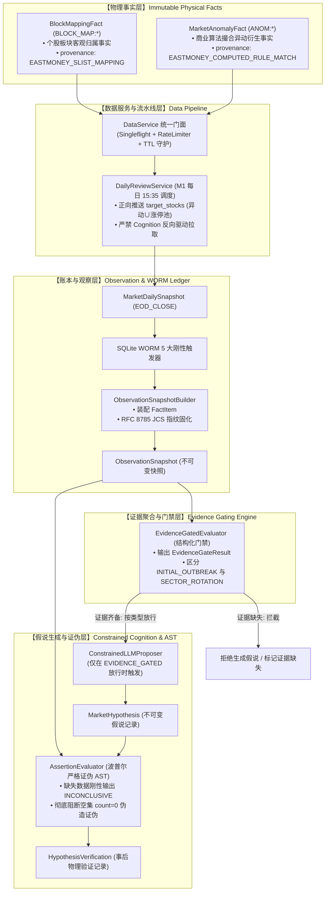

# 64-Phase-2C-Wave1事实消费与板块假说条件解封技术设计单 (v1.1 闭环修订版)
(Technical Design Specification: Wave 1 Fact Consumption & Evidence-Gated Sector Cognition - Patch Set 1)

- **设计单编号**：`SPEC-COGNITION-PHASE2C-20261005-V1.1`
- **归档日期**：2026-10-05
- **修订版本**：v1.1（吸收独立红队首审 🔴 BLOCK 攻击与最高董事会 4 个 P0 补丁）
- **当前固化基线版本**：**`v0.2.8`** (Wave 1 事实底盘扩容版 · Commit `#3f90cfd`)
- **前置硬门禁凭据**：`baseline_evidence/replay_baseline_20260930_v028.json` (Phase 2C.1 🟢 PASS)
- **当前阶段**：🟡 **PHASE 2C.3 设计修订审查期 (提交 board_red_team 二审，严禁提前编码)**
- **上位依据**：
  - 《开发文档/02-G1需求基线（正式冻结版）.md》
  - 《开发文档/10-项目多Agent四权分立工程治理规范.md》
  - 《开发文档/28-Cognition-Phase2-可审计结构化认知引擎技术设计单.md》
  - 《开发文档/61-Observation-M1-M5-Fact-Foundation-Audit-Report.md》
  - 《开发文档/63-a-stock-data上游事实底盘扩容技术设计单.md》
  - 独立红队首审裁决书（`RED-TEAM-REVIEW-20261005-01` · 🔴 BLOCK）
  - 最高董事会最终裁决令（2026-10-05 · 4 P0 + 4 P1 修订令）

---

## 目录

1. [执行摘要与最高审查靶点](#一执行摘要与最高审查靶点)
2. [总体架构：Wave 1 事实到认知假说的刚性闭环链](#二总体架构wave-1-事实到认知假说的刚性闭环链)
3. [【P0-3 补丁】数据血统与 Provenance 法律级定性：商业撮合事实澄清](#三p0-3-补丁数据血统与-provenance-法律级定性商业撮合事实澄清)
4. [【P0-1 补丁】核心防腐：解耦 Membership 与 Strength，严密区分假说类型](#四p0-1-补丁核心防腐解耦-membership-与-strength严密区分假说类型)
5. [【P0-2 补丁】事实来源边界：严禁临时扩源，缺失显式保持 MISSING](#五p0-2-补丁事实来源边界严禁临时扩源缺失显式保持-missing)
6. [【P1-6 补丁】结构化 EvidenceGateResult 与证据门禁状态机](#六p1-6-补丁结构化-evidencegateresult-与证据门禁状态机)
7. [正交分类两维度准入与两维度刚性隔离](#七正交分类两维度准入与两维度刚性隔离)
8. [【P1-5 & P0-4 补丁】M1 / M4 / M6 流水线消费与 RFC 8785 JCS 规范描述](#八p1-5--p0-4-补丁m1--m4--m6-流水线消费与-rfc-8785-jcs-规范描述)
9. [【P1-8 补丁】结构化 AST 解释器空集防 0 漏洞与 INCONCLUSIVE 保证](#九p1-8-补丁结构化-ast-解释器空集防-0-漏洞与-inconclusive-保证)
10. [【P1-7 补丁】四维时间不可变 Schema 与防未来函数防火墙](#十p1-7-补丁四维时间不可变-schema-与防未来函数防火墙)
11. [受控实施清单与 10-08 实弹验证门禁](#十一受控实施清单与-10-08-实弹验证门禁)

---

## 一、 执行摘要与最高审查靶点

### 1. 为什么设立 Phase 2C？
在 Phase 2B 中，系统验证了基于宏观宽基指数和全 A 聚合指标的假说证伪闭环。然而在《61号审计报告》中，由于板块事实覆盖率为 0%，中观板块假说被刚性红牌阻断（`FACT-STARVATION HARD BLOCK`）。
随着 **v0.2.8（Wave 1 事实底盘扩容版）** 成功接入东财日内严重异常波动（`em_price_anomaly`）与个股三维板块归属（`eastmoney_concept_blocks`），系统已具备中观与微观事实的物理底座。

Phase 2C 的工程使命是：**将已就绪的 Wave 1 物理事实有序注入每日收盘流水线，并在极为严苛的证据约束下，将板块认知从“饥饿硬阻断”升级为“条件证据门禁（EVIDENCE_GATED）”。**

### 2. 董事会指定的核心审查靶点（最高考题）
本设计单全程围绕最高董事会指定的唯一裁判命题展开论证：
> **“Phase 2C 是否在没有引入认知旁路、没有把 Membership 当 Strength、没有让 LLM 补全缺失证据的前提下，实现了从 Wave 1 Facts $\rightarrow$ Evidence $\rightarrow$ Hypothesis $\rightarrow$ Falsification 的可审计闭环？”**

---

## 二、 总体架构：Wave 1 事实到认知假说的刚性闭环链

坚决贯彻零旁路架构，所有流动均为单向有向无环图（DAG），严禁任何下游模块直连外部原始数据源。



---

## 三、 【P0-3 补丁】数据血统与 Provenance 法律级定性：商业撮合事实澄清

> [!CAUTION] 董事会与红队刚性定性要求
> 严禁将东财异动数据伪称为“交易所官方公告”，必须彻底纠偏为商业规则撮合衍生事实。

1. **实体职责与血统定级**：
   - **交易所（SSE / SZSE / BSE）**：规则制定者与法定处罚公告发布者；
   - **东方财富（Eastmoney）**：商业技术平台，依据交易所公开规则对全市场 Tick 进行二次算法撮合；
   - **系统事实定性**：
     - `provenance` = `"EASTMONEY_COMPUTED_RULE_MATCH"`
     - `provenance_tier` = `"DERIVED_COMMERCIAL_MATCH"`（商业规则撮合衍生事实）
2. **审计与文案规范**：
   系统研报与假说推演文本严禁表述为“交易所下发官方异动函”，必须严肃表述为“行情触发交易所严重异常波动算法规则（东财商业撮合）”。

---

## 四、 【P0-1 补丁】核心防腐：解耦 Membership 与 Strength，严密区分假说类型

> [!IMPORTANT] 核心防腐铁律（红队 🔴 BLOCK 攻击一号痛点）
> `BLOCK_MAP` 只能证明集合归属：
> $$\text{Symbol } s \in \text{Sector } S$$
> 它只能证明“贵州茅台属于食品饮料行业”，**绝对不能单独作为“食品饮料行业走强”的任何证据！**
> 必须彻底废除“首板允许作为持续性（Persistence）”的自相矛盾逻辑！

### 1. 板块四维充分性证据矩阵 (The Four-Pillar Evidence Matrix)
系统建立 4 根独立事实支柱：

$$\text{SectorEvidence}(S) = \langle \text{Membership}, \text{Breadth}, \text{Leadership}, \text{Persistence} \rangle$$

1. **Pillar 1: 集合归属 (Membership)**：来自 `BlockMappingFact` (`BLOCK_MAP:*`)，必须为 `INDUSTRY` 或 `CONCEPT`；
2. **Pillar 2: 板块广度 (Breadth)**：来自已有收盘涨停池 `limit_up.items` 中属于该板块的标的数量及全市场占比；
3. **Pillar 3: 领军效应 (Leadership)**：来自 `MarketAnomalyFact` (`ANOM:*`) 或 涨停池首板/龙一标的；
4. **Pillar 4: 持续惯性 (Persistence)**：来自连板高度池 `limit_up.items`，要求**连板高度 $\ge 2$（至少二连板）**。**首板严禁计入持续性！**

### 2. 假说类型严密分流（彻底消除逻辑矛盾）
依据证据齐备度，系统严格分流为两类受控命题，严禁跨级推演：

| 证据齐备状态 | 准入假说类型 (HypothesisType) | 业务语义与推演边界 | 证伪断言核心指标 |
| :--- | :--- | :--- | :--- |
| **Pillar 1 + 2 + 3 齐备**<br/>*(无连板，仅有首板与异动)* | **`INITIAL_OUTBREAK`**<br/>(题材首发/脉冲爆发) | 仅推演该题材/行业在当日出现**瞬时异动爆发**，次日考验早盘溢价承接，**绝不推演中长期轮动**！ | 次日竞价龙头溢价 (`leader_open_pct` $< 0$) 即告证伪 |
| **Pillar 1 + 2 + 3 + 4 全齐备**<br/>*(存在 $\ge 2$ 连板梯队)* | **`SECTOR_ROTATION`**<br/>(板块主线轮动) | 具备连板高度支撑，允许推演为**主线板块轮动持续**与梯队扩散。 | 次日板块连板断板率 $> 50\%$ 或 龙头深幅回撤即告证伪 |
| **Pillar 1 仅有归属**<br/>*(无广度/无龙头/无异动)* | 🚫 **INSUFFICIENT_EVIDENCE** | **刚性阻断！** 严禁生成任何假说，直接标记证据不充分。 | 不进入 AST，零开销 |

---

## 五、 【P0-2 补丁】事实来源边界：严禁临时扩源，缺失显式保持 MISSING

> [!CAUTION] 董事会刚性指令
> 明确 Breadth / Persistence 的真实 Canonical Fact 来源；不存在就保持 MISSING，绝对不得在 Phase 2C 临时扩源！

1. **绝对禁止临时私拉数据源**：
   - 严禁为了凑齐“板块加权指数”而临时引入未经白盒验证的东财行业指数端点；
   - 当前系统的物理真实边界已在 Wave 1 冻结：
     - 个股异动事实：`em_price_anomaly` $\rightarrow$ `MarketAnomalyFact`
     - 个股板块映射：`eastmoney_concept_blocks` $\rightarrow$ `BlockMappingFact`
     - 涨停与连板事实：`limit_up_snapshot` (同花顺主管道已有的 `items`)
2. **缺失语义守卫（Missingness Discipline）**：
   - 缺乏全行业加权涨跌幅时，`pillar_breadth` **坦然标记为 `FactStatus.MISSING`**；
   - 证据门禁（Evidence Gate）依据“缺失即阻断”原则，**绝不调用 LLM 脑补**，直接阻断高级轮动假说，仅在涨停池明细证据充足时放行 `INITIAL_OUTBREAK`。

---

## 六、 【P1-6 补丁】结构化 EvidenceGateResult 与证据门禁状态机

废除简陋的 `bool` 返回值，正式建立结构化、可入账、可审计的不可变门禁对象：

```python
class EvidenceGateResult(BaseModel):
    """板块证据门禁判定报告（不可变值对象）"""
    model_config = ConfigDict(frozen=True, extra="forbid")

    sector_code: str
    sector_name: str
    category: str                       # "INDUSTRY" | "CONCEPT"
    gate_status: str                    # "ADMITTED" | "REJECTED"
    admitted_hypothesis_type: str       # "INITIAL_OUTBREAK" | "SECTOR_ROTATION" | "NONE"
    
    # 四维事实支柱状态
    pillar_membership: FactStatus       # AVAILABLE / MISSING
    pillar_breadth: FactStatus          # AVAILABLE / MISSING / EMPTY
    pillar_leadership: FactStatus       # AVAILABLE / MISSING / EMPTY
    pillar_persistence: FactStatus      # AVAILABLE / MISSING / EMPTY
    
    rejection_reasons: List[str]
    evaluated_at: str
    evidence_fingerprint: str           # JCS SHA-256 证据指纹
```

* **入账与追溯**：每个交易日收盘生成的 `EvidenceGateResult` 序列化持久化至 `MarketDailySnapshot.market_state_snapshot`，任何假说的产生必须绑定其对应的 `evidence_fingerprint`。

---

## 七、 正交分类两维度准入与两维度刚性隔离

严格遵循 `BlockRegistry` 的三维正交体系，对不同维度的板块实施物理分流策略：

```text
┌────────────────────────────────────────────────────────────────────────┐
│                        正交板块分类处置策略表                          │
├────────────────────────────────────────────────────────────────────────┤
│ 🟢 INDUSTRY (行业维度)   : 允许解封进入主线板块假说 (如: 食品饮料)     │
│ 🟢 CONCEPT  (概念题材)   : 允许解封进入题材发酵假说 (如: 固态电池)     │
│ 🔴 REGION   (地域属性)   : 刚性隔离！绝不进入主线投资假说 (如: 贵州板块) │
│ 🔴 NOISE    (机械统计)   : 刚性阻断！物理清洗，绝不入库 (如: 昨日涨停)   │
└────────────────────────────────────────────────────────────────────────┘
```

* **地域属性（REGION）硬隔离**：标的属于“贵州板块”，仅作为企业静态法定地址备案，严禁进入 `INITIAL_OUTBREAK` 或 `SECTOR_ROTATION` 假说；
* **机械噪音（NOISE）硬清洗**：入库前直接丢弃“昨日连板”、“MSCI中国”等无产业逻辑标签。

---

## 八、 【P1-5 & P0-4 补丁】M1 / M4 / M6 流水线消费与 RFC 8785 JCS 规范描述

### 1. 【P1-5 补丁】明确 `target_stocks` 物理来源（单向正向推送）
* **铁律**：严禁 Cognition 引擎反向驱动爬虫或调用数据服务！
* **来源约束**：M1 每日 15:35 调度 `DailyReviewService.generate_review()` 时，`target_stocks` 的物理集合**严格限定为正向确定的并集**：
  $$\text{target\_stocks} = \{s \mid s \in \text{DailyAnomalyList}\} \cup \{s \mid s \in \text{LimitUpPool.items}\}$$
* 绝不遍历全市场 5300 只股票，仅对今日发生极端异动与涨停的核心标的单向抽取三维板块映射。

### 2. 【P0-4 补丁】RFC 8785 JCS 规范化精准定义
* **术语纠偏**：彻底删除“UTF-16 字节字典序”的不严谨表述；
* **官方规范对齐**：
  > 依据 **RFC 8785 (JSON Canonicalization Scheme)** 第 3.2.3 节标准，字典键排序必须遵循：
  > **“Lexicographical ordering of UTF-16 code units”**（等价于标准 Python 中的 `s.encode('utf-16-be')` 字节比对序列，以及 ASCII 子集的 UTF-8 字典序）。
* **代码对齐**：快照装配器与指纹计算器严格复用 [`backend/app/cognition/jcs.py`](file:///d:/项目库/AI认知复盘交易系统/backend/app/cognition/jcs.py) 中的 `canonicalize()` 和 `hash_jcs()`，确保 100% Bit-Exact 确定性。

---

## 九、 【P1-8 补丁】结构化 AST 解释器空集防 0 漏洞与 INCONCLUSIVE 保证

> [!CAUTION] 红队 🔴 BLOCK 攻击二号痛点（致命伪造证伪漏洞）
> 原实现当板块成分股因数据缺失为空集时，AST 聚合 `COUNT` 会返回 `0.0`，进而错误裁决为 `FAILED`（假说被证伪）。
> 这是将“物理缺数”扭曲为“假说被反事实击碎”，彻底摧毁了科学证伪原则！

### 1. AST 解释器空集与缺失断言守护（`AssertionEvaluator`）
在重构 `evaluator.py` 时，增加前置硬断言：

```python
# 伪代码规范: backend/app/cognition/hypothesis/evaluator.py
def evaluate_sector_metric(assertion, snapshot_data):
    sector_stocks = snapshot_data.get("sector_stocks")
    
    # 刚性防御：如果板块数据在客观快照中为 None 或缺失
    if sector_stocks is None:
        return EvaluationResult(
            outcome=Outcome.INCONCLUSIVE,
            actual_value=None,
            reason="SECTOR_DATA_MISSING_FROM_OBSERVATION"
        )
    
    # 刚性防御：如果板块数据集合为空集
    if len(sector_stocks) == 0:
        # 若断言本身是在验证“标的数是否为0”，走合法 EMPTY 语义；
        # 若断言是在验证价格/涨跌/龙头表现，严禁返回 0.0，必须挂起为 INCONCLUSIVE！
        if assertion.metric in ("leader_open_pct", "sector_change_pct", "board_height"):
            return EvaluationResult(
                outcome=Outcome.INCONCLUSIVE,
                actual_value=None,
                reason="EMPTY_UNIVERSE_CANNOT_EVALUATE_PERFORMANCE"
            )
```

**铁律**：严禁以任何默认 `0.0` 掩盖空集合！因缺少成分股导致的求值异常，**必须 100% 输出 `INCONCLUSIVE`**，坚决捍卫波普尔证伪原则。

---

## 十、 【P1-7 补丁】四维时间不可变 Schema 与防未来函数防火墙

系统将三维关键时钟正式列入不可变字段：

| 时钟字段 | 含义与物理约束 | 防未来函数铁律 |
| :--- | :--- | :--- |
| `observation_time` | 客观物理事实快照被观察固化的时间戳 | 锁定在当日 `15:35:00` |
| `hypothesis_generated_time` | 受约束假说被 Proposer 生成的时间戳 | 必须满足 $\ge \text{observation\_time}$，严格在盘后收盘后生成 |
| `evaluation_time` | AST 执行器对假说进行事后反事实求值的时间戳 | **刚性锁定在次日 `15:05:00`**，严禁在当日复盘提前偷窥次日开盘价 |

---

## 十一、 受控实施清单与 10-08 实弹验证门禁

```text
┌────────────────────────────────────────────────────────┐
│  Phase 2C.3: 本技术设计单 v1.1 修订完成 (当前节点)     │
└──────────────────────────┬─────────────────────────────┘
                           ▼
┌────────────────────────────────────────────────────────┐
│  Phase 2C.4: board_red_team 独立只读二审 (🔴 必须通过) │
└──────────────────────────┬─────────────────────────────┘
                           ▼
┌────────────────────────────────────────────────────────┐
│  最高董事会审查与编码授权令 (🔴 暂缓编码，等待签批)    │
└──────────────────────────┬─────────────────────────────┘
                           ▼
┌────────────────────────────────────────────────────────┐
│  Phase 2C.5: 受控实施 (仅修改 M1 与 AST 扩展，禁止越界) │
└──────────────────────────┬─────────────────────────────┘
                           ▼
┌────────────────────────────────────────────────────────┐
│  Phase 2C.6: 10-08 节后首个真实交易日实弹对比验证门禁 │
└──────────────────────────┘
```

> **主开发郑重承诺**：
> 本设计单已完成对红队 🔴 BLOCK 裁决与董事会 4 个 P0 补丁的全量闭环吸收。
> 在 `board_red_team` 二审通过且最高董事会正式批准之前，主开发坚决不写一行生产代码！
