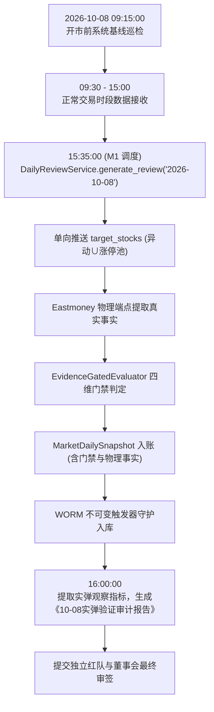

# 66-Phase-2C.6-10-08首个真实交易日实弹验证方案与观察协议

- **方案编号**：`SPEC-VERIFICATION-PHASE2C6-20261005`
- **生效日期**：2026-10-05 (休市期代码冻结生效)
- **实弹执行日期**：**2026-10-08 (节后首个真实交易日)**
- **当前工程基线**：`v0.2.8-phase2c-rc` (Commit `#3f90cfd` + Phase 2C.5 补丁集)
- **上位决策依据**：最高董事会裁决令（`CONDITIONAL PASS — Closure Review PASS，暂不 Production Release`）
- **红队审查依据**：`RED-TEAM-REVIEW-20261005-03` (二审 🟢 PASS)

---

## 一、 董事会裁决固化与基线冻结铁律

依据最高董事会 2026-10-05 裁决令，系统正式确立当前阶段状态：

```text
┌────────────────────────────────────────────────────────────────────────┐
│  Phase 2C.5 — CLOSED / PASS                                            │
│  Phase 2C.6 — LOCKED / PENDING FIRST LIVE TRADING-DAY VALIDATION       │
│  Production Release — NOT AUTHORIZED (严禁提前发布)                    │
│  Next Gate — 2026-10-08 First Live Trading-Day Validation (实弹后置门禁)│
└────────────────────────────────────────────────────────────────────────┘
```

### 休市期（10-05 至 10-07）代码冻结三大铁律
1. **严禁扩源**：严禁私自引入任何额外数据源（如未白盒审计的东财行业端点、同花顺未验接口）；
2. **严禁扩型**：严禁私自扩充新的假说类型，假说边界严格锁定在 `INITIAL_OUTBREAK` 与 `SECTOR_ROTATION`；
3. **严禁“为了指标好看”调参**：严禁通过降低门槛或人为调参来迎合 10-08 的通过率。**INCONCLUSIVE 偏高不是坏事，真实反应缺数是科学认知的基石。**

---

## 二、 10-08 董事会指定四大观察维度与审计协议

10-08 真正要检验的不是“代码能不能跑通”，而是：**“Wave 1 事实注入以后，系统的认知质量是否真的发生了可审计的增量？”**

### 维度 A：证据质量审计 (Evidence Quality)
- **A1. 广度现实对齐 (Breadth Reality Check)**：
  - *董事会警示*：当前 Breadth 的物理本质是“涨停池板块扩散度（Limit-Up Breadth）”，而非“全板块横截面广度（Sector Cross-Section Breadth）”。
  - *观察指标*：统计 10-08 盘后放行的板块中，其成分股在涨停池外的整体走势是否出现严重割裂（如：仅 1 只微盘股涨停，其余大票全跌）。
- **A2. 领军效应去虚假检验 (Leadership vs. Anomaly Check)**：
  - *董事会警示*：$\text{ANOM} \neq \text{Leadership}$。异动事实（ANOM:*）不能天然等价于市场龙头。
  - *观察指标*：记录所有通过 `pillar_leadership == AVAILABLE` 的标的，核验其是否属于资金认同度高、辨识度强的核心主线龙头，还是仅仅触碰了冷门机械异动规则。若出现大面积伪龙头泛滥，下一阶段必须将 `Anomaly Evidence` 与 `Leadership Evidence` 彻底解耦。
- **A3. 持续性首板防腐验证 (Persistence Discipline Check)**：
  - 核验是否存在任何首板标的被错误赋予持续性（Persistence）。

### 维度 B：假说生成质量审计 (Hypothesis Quality)
- **B1. 假说分布结构**：
  - 统计 `INITIAL_OUTBREAK` 与 `SECTOR_ROTATION` 的实际生成数量与比例；
  - 观察 `INITIAL_OUTBREAK` 是否大量井喷但无法在次日得到溢价承接；
  - 观察 `SECTOR_ROTATION` 是否过度稀疏（若连板梯队整体匮乏，稀疏是客观正确的物理反映）。
- **B2. 假主线防御与漏报核验**：
  - 是否生成了缺乏逻辑支撑的假主线；
  - 市场上公认的强主线板块，是否因证据缺失被合理挂起（`MISSING`）。

### 维度 C：波普尔证伪质量审计 (Falsification Quality)
- **C1. 证伪三态分布**：
  - 统计单日 AST 解释求值产出的 `PASSED` / `FAILED` / `INCONCLUSIVE` 比例；
- **C2. 空集与缺失防御有效性**：
  - 验证是否存在板块因缺少成分股报价而触发伪造证伪；
  - **守卫原则**：`INCONCLUSIVE` 必须显著高于因数据缺失导致的伪 `FAILED`。

### 维度 D：增量认知价值审计 (Incremental Cognition Value)
- **D1. 无 Wave 1 vs 有 Wave 1 增量对照**：
  - 对比 09-30 盲视状态（Wave 1 接入前，板块事实覆盖率为 0%，全面硬阻断）；
  - 评估 10-08 引入 Wave 1 事实后，系统究竟**多知道了哪些中观与微观结构**，产出的认知报告是否具有可操作的深度。

---

## 三、 10-08 实弹执行标准化操作程序 (SOP)



### 1. 15:35:00 自动流水线启动
执行标准命令：
```powershell
# 盘后自动调度（或受控测试验证）
python -c "import asyncio; from backend.app.core.database import async_session; from backend.app.services.daily_review import DailyReviewService; asyncio.run((lambda: DailyReviewService(async_session()).generate_review('2026-10-08', force=False))())"
```

### 2. 16:00:00 提取实弹度量凭据
从数据库与快照中提取：
- `MarketDailySnapshot.market_state_snapshot` 中的 `sector_evidence_gates`；
- 各板块的 `pillar_membership`, `pillar_breadth`, `pillar_leadership`, `pillar_persistence` 状态；
- `CognitionRecord` 的 `evidence_fingerprint` 与链式哈希状态。

---

## 四、 责任声明与基线冻结

主开发郑重承诺：
1. 恪守最高董事会裁决令，休市期间坚决保持生产代码冻结，严禁为了“漂亮数据”私改代码；
2. 10-08 实盘测试将以纯客观、严谨、防御式态度忠实记录所有真实市场数据与门禁表现；
3. 实盘数据未出、红队三审未过、董事会未签批前，绝不发布 `v0.2.9` 生产版本。
