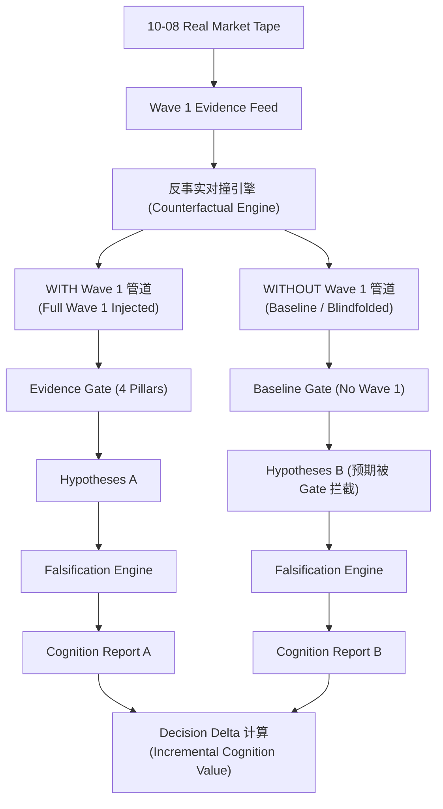
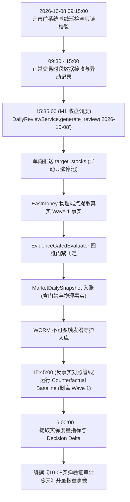

# 66-Phase-2C.6-10-08首个真实交易日实弹验证方案与观察协议

- **方案编号**：`SPEC-VERIFICATION-PHASE2C6-20261005`
- **裁决结论**：**`PASS / LOCKED FOR EXECUTION` (正式冻结基线，休市期严禁功能性修改)**
- **生效日期**：2026-10-05 (休市期代码冻结生效)
- **实弹执行日期**：**2026-10-08 (节后首个真实交易日)**
- **当前工程基线**：`v0.2.8-phase2c-rc` (Commit `#3f90cfd` + Phase 2C.5 补丁集)
- **上位决策依据**：最高董事会终审裁决令（`2026-10-05 终审意见：PASS / LOCK`）
- **红队审查依据**：`RED-TEAM-REVIEW-20261005-03` (二审 🟢 PASS)

---

## 一、 董事会终审裁决与认知架构基准

依据最高董事会 2026-10-05 终审裁决，系统正式确立核心工程与认知状态：

```text
┌────────────────────────────────────────────────────────────────────────┐
│  Phase 2C.5 — CLOSED / PASS                                            │
│  Phase 2C.6 — LOCKED / PENDING FIRST LIVE TRADING-DAY VALIDATION       │
│  Production Release — NOT AUTHORIZED (严禁提前发布，继续保持硬阻断)    │
│  Next Gate — 2026-10-08 First Live Trading-Day Validation (实弹后置门禁)│
└────────────────────────────────────────────────────────────────────────┘
```

### 1. 终审第一性原则
1. **把“能运行”与“认知有效”彻底分离**：
   - 代码此前已经完成静态类型、回放回测、WORM 不可变触发器、哈希防篡改、只读幂等性等全量工程验证。
   - 10-08 真正需要回答的科学问题是：  
     $$\text{Wave 1} \xrightarrow{} \text{Evidence} \xrightarrow{} \text{Gate} \xrightarrow{} \text{Hypothesis} \xrightarrow{} \text{Falsification} \xrightarrow{} \text{Cognition}$$
     是否形成**真实、有效、未被污染的信息增量**。
2. **严禁设立“虚假通过率”，坚守波普尔科学纪律**：
   - 严禁设置任何形如 `PASSED > 60%`、`INCONCLUSIVE < 30%` 的人造门槛。这些指标在实盘首日毫无统计学意义，反而会诱导工程团队反向降低证据门槛或调参凑数。
   - `INCONCLUSIVE` 被明确视为**合法、客观且必须予以尊重的科学结论**，绝非系统缺陷或失败。
3. **休市期（10-05 至 10-07）六维绝对冻结铁律 (Six-Frozen Discipline)**：
   ```text
   CODE        FROZEN  (严禁改动任何后端执行逻辑与路由代码)
   SCHEMA      FROZEN  (严禁变更数据表契约与字段定义)
   SOURCE      FROZEN  (严禁私自扩充未经白盒审计的数据源端点)
   HYPOTHESIS  FROZEN  (假说类型严格限制在 INITIAL_OUTBREAK 与 SECTOR_ROTATION)
   THRESHOLD   FROZEN  (严禁调整任何门禁参数与打分阈值)
   GATE        FROZEN  (四维证据门禁规则保持物理硬约束)
   ```
   10-08 唯一允许且必须观察的流动向量为：
   $$\text{REAL MARKET DATA} \implies \text{OBSERVATION} \implies \text{EVIDENCE} \implies \text{AUDIT}$$
   **绝对杜绝“观察到数据不好看 $\rightarrow$ 临时修改规则 $\rightarrow$ 重新跑流水线 $\rightarrow$ 直到结果好看”的科研自欺行为。**

---

## 二、 10-08 五维观察框架与审计协议 (A ~ E)

### 维度 A：事实与证据质量审计 (Evidence Quality)
- **A1. 广度现实对齐 (Breadth Reality Check)**：
  - *第一性警示*：当前 Breadth 的物理本质是“涨停池板块扩散度（Limit-Up Breadth）”，而非“全板块横截面广度（Sector Cross-Section Breadth）”。
  - *观察指标*：统计 10-08 盘后放行的板块中，其成分股在涨停池外的整体走势是否出现严重割裂（例如：仅 1 只微盘股异动涨停，其余大票全线下跌）。
- **A2. 领军效应去虚假检验 (Leadership vs. Anomaly Check)**：
  - *第一性警示*：$\text{ANOM} \neq \text{Leadership}$。异动事实（`ANOM:*`）不能天然等价于市场龙头。
  - *观察指标*：记录所有通过 `pillar_leadership == AVAILABLE` 的标的，核验其是否属于具有资金辨识度的核心主线龙头，还是仅仅触碰了冷门机械异动规则。
- **A3. 持续性首板防腐验证 (Persistence Discipline Check)**：
  - 核验是否存在任何首板标的被错误赋予持续性（Persistence）。

### 维度 B：假说生成质量审计 (Hypothesis Quality)
- **B1. 假说分布结构**：
  - 统计 `INITIAL_OUTBREAK` 与 `SECTOR_ROTATION` 的实际生成数量与比例；
  - 观察 `INITIAL_OUTBREAK` 是否大量井喷但缺乏次日承接；
  - 观察 `SECTOR_ROTATION` 是否过度稀疏（若连板梯队整体匮乏，稀疏是客观正确的物理反映，严禁强求）。
- **B2. 假主线防御与漏报核验**：
  - 是否生成了缺乏微观事实支撑的假主线；
  - 市场上公认的强主线板块，是否因证据缺失被合理挂起（`MISSING`）。

### 维度 C：波普尔证伪质量审计 (Falsification Quality)
- **C1. 证伪三态分布**：
  - 统计单日收窄 AST 解释求值产出的 `PASSED` / `FAILED` / `INCONCLUSIVE` 比例；
- **C2. 空集与缺失防御有效性**：
  - 验证是否存在板块因缺少成分股报价而触发伪造证伪；
  - **守卫原则**：`INCONCLUSIVE` 必须显著高于因数据缺失导致的伪 `FAILED`。

### 维度 D：增量认知价值审计 (Incremental Cognition Value)
- **D1. 无 Wave 1 vs 有 Wave 1 增量对照**：
  - 对比 09-30 盲视状态（Wave 1 接入前，板块事实覆盖率为 0%，全面硬阻断）；
  - 评估 10-08 引入 Wave 1 事实后，系统究竟**多知道了哪些中观与微观结构**，产出的认知报告是否具有可操作的深度。

### 维度 E：因果归因与污染审计 (Causal Attribution & Pollution Audit) —— 【董事会终审核心增补】
10-08 最容易出现的认知系统欺诈，是**把市场本身的自然变化错误归因于 Wave 1**。必须设立 E1~E5 专项审计指标：

- **E1. New-Evidence Attribution (新增证据归因)**：
  - 本条 `CognitionRecord` 是否真正依赖 10-08 当日新注入的 Wave 1 Evidence？
- **E2. Pre-existing Evidence Isolation (存量证据隔离)**：
  - 是否存在 Wave 1 接入前已经存在、但被错误计入本次增量的陈旧事实？
- **E3. Hypothesis Attribution (假说因果链追溯)**：
  - 每个新生成的 Hypothesis 必须具备严格闭环因果追溯链：
    $$\text{Hypothesis} \xrightarrow{} \text{Evidence IDs} \xrightarrow{} \text{Physical Facts} \xrightarrow{} \text{Source Endpoint / Raw Timestamp}$$
- **E4. Decision Delta (决策差分与反事实对照 —— 最重要)**：
  - **反事实实验 (Counterfactual Experiment)**：如果移除 10-08 Wave 1 Evidence，假说是​​否消失？证伪结论是否改变？认知报告是否发生结构性坍塌？
- **E5. No-Evidence No-Claim (无证据不妄言)**：
  - 当某些板块或标的没有任何新增证据时，系统是否坚定保持原结论或维持 `MISSING/INCONCLUSIVE`，而不是为了“强行产生认知”而凭空捏造假说。

---

## 三、 反事实实验框架 (Counterfactual Experiment Protocol)

为彻底回答董事会核心问题：**“如果把 10-08 新增 Wave 1 Evidence 从认知链中拿掉，系统的结论会不会发生变化？”**，系统确立如下反事实对照管道：



### 认知增量价值的科学度量公式：
$$\text{Incremental Cognition Value} = \Delta(\text{Facts}) + \Delta(\text{Relations}) + \Delta(\text{Hypotheses}) + \Delta(\text{Falsifications}) + \Delta(\text{Resolutions})$$

具体度量：
1. **事实差分 ($\Delta\text{Facts}$)**：Wave 1 使系统新增获知的东财板块映射与成分股归属数量；
2. **关系差分 ($\Delta\text{Relations}$)**：涨停标的与所属主线板块的中观链接关系；
3. **假说差分 ($\Delta\text{Hypotheses}$)**：合法生成的 `INITIAL_OUTBREAK` 与 `SECTOR_ROTATION` 数量；
4. **证伪差分 ($\Delta\text{Falsifications}$)**：获得确定性证伪判定的假说数量；
5. **决断差分 ($\Delta\text{Resolutions}$)**：此前因缺乏板块微观事实而只能处于 `INCONCLUSIVE`、如今获得科学裁决的状态迁移数。

---

## 四、 科学观察矩阵：替代“通过率”的动态响应准则

不设人为死板指标，建立 **Observation $\rightarrow$ Interpretation $\rightarrow$ Decision** 科学响应矩阵：

| 实弹观察现象 (Observation) | 科学机理释义 (Interpretation) | 决策响应动作 (Decision) |
|---|---|---|
| **`INCONCLUSIVE` 比例偏高** | 市场客观证据覆盖不足，真实反映数据边界 | **绝不调参凑数**，维持证据纪律，继续实盘观察 |
| **`FAILED` 比例偏高** | 假说生成标准可能偏宽，或者市场分歧剧烈 | 深入检查 Hypothesis Gate，排查生成逻辑是否过激 |
| **`INITIAL_OUTBREAK` 数量较多** | 盘面首板活跃，初板物理事实丰富 | 重点观察次日溢价与承接状态，不立即修改规则 |
| **`SECTOR_ROTATION` 数量极少** | 市场连板梯队羸弱，缺乏多梯队共振 | 真实反映市场弱势物理特征，**严禁视为系统缺陷** |
| **Leadership `AVAILABLE` 偏多** | 存在高频异动侵蚀龙头语义的风险 ($\text{ANOM}\rightarrow\text{Lead}$) | 启动专项审计，准备进入下一阶段 Leadership 解耦 |
| **Breadth 与涨停池外走势严重背离** | 当前“涨停池扩散度”无法代表全行业截面 | 记录偏差样本，启动下一阶段全横截面定义升级评估 |

---

## 五、 10-08 交付总表模板：《10-08实弹验证审计总表》

10-08 验证完成后，主开发与审计团队必须共同签署并出具下表：

| 层级 (Layer) | 关键审查问题 (Core Question) | 审计结果 (Audit Result) | 证据索引 (Evidence Ref) |
|---|---|---|---|
| **1. Physical Fact** | Wave 1 是否真实抓到了 10-08 物理事实？ | *(待 10-08 填报)* | Raw Snapshot ID |
| **2. Evidence** | Evidence 提取是否满足契约与 Gate？ | *(待 10-08 填报)* | Gate Pass Count |
| **3. Membership** | 板块成分股归属是否准确可信？ | *(待 10-08 填报)* | Stock-Sector Map |
| **4. Breadth** | Breadth 指标是否存在严重语义偏差？ | *(待 10-08 填报)* | Breadth vs Tape |
| **5. Leadership** | 是否存在普通异动标的冒充领军龙头？ | *(待 10-08 填报)* | Leader Anomaly Audit |
| **6. Persistence** | 是否存在首板被错误赋予持续性？ | *(待 10-08 填报)* | Persistence Check |
| **7. Hypothesis** | 假说类型是否严格锁定且证据完备？ | *(待 10-08 填报)* | Hypothesis Manifest |
| **8. Falsification** | PASSED / FAILED / INCONCLUSIVE 真实分布 | *(待 10-08 填报)* | Popper Result Set |
| **9. Cognition** | 系统是否产生新增可解释认知？ | *(待 10-08 填报)* | CognitionReport ID |
| **10. Attribution** | 新增认知是否确由 Wave 1 导致 (E4 $\Delta$)？ | *(待 10-08 填报)* | Counterfactual Diff |
| **11. Integrity** | WORM 防篡改 / 指纹 / 链式哈希是否完整？ | *(待 10-08 填报)* | Hash Chain Verify |
| **12. Release** | 是否满足下一阶段生产发布门禁？ | **NOT YET (硬阻断)** | Board Authorization |

---

## 六、 10-08 实弹执行标准化操作程序 (SOP)



### 1. 15:35:00 真实收盘复盘流水线执行
```powershell
# 盘后自动调度（带 Wave 1 事实消费）
python -c "import asyncio; from backend.app.core.database import async_session; from backend.app.services.daily_review import DailyReviewService; asyncio.run((lambda: DailyReviewService(async_session()).generate_review('2026-10-08', force=False))())"
```

### 2. 15:45:00 反事实基准对照流水线执行 (Decision Delta 提取)
```powershell
# 反事实盲视对照执行（测试沙箱运行无 Wave 1 管道）
# 验证移除 Wave 1 事实后，假说生成数量是否归零或回落至孤立个股状态
python -c "import asyncio; from backend.app.core.database import async_session; from backend.app.services.counterfactual_audit import run_counterfactual_comparison; asyncio.run(run_counterfactual_comparison('2026-10-08'))"
```

### 3. 16:00:00 提取实弹度量凭据与哈希校验
核验凭证：
- `MarketDailySnapshot.market_state_snapshot["sector_evidence_gates"]`
- `MarketDailySnapshot.market_state_snapshot["sector_membership_map"]`
- `CognitionRecord.evidence_fingerprint` 与 `previous_record_hash` 链式防篡改校验。

---

## 七、 终审签字与工程誓约

**本方案已获最高董事会终审正式锁定：`SPEC-VERIFICATION-PHASE2C6-20261005 = PASS / LOCKED FOR EXECUTION`。**

10-08 真正的检验门禁为：
> **系统是否在不降低证据标准、不扩大假说边界、不制造缺失数据的前提下，仅凭真实 Wave 1 Evidence，产生了可追溯、可证伪、可反事实验证的新增认知。**

主开发团队庄严承诺：休市期至 10-08 实盘结束前，代码库保持绝对物理冻结；真实记录市场，不伪饰指标，不盲从调参，全力确保首个真实交易日实弹认知验证的严谨性与科学性。
