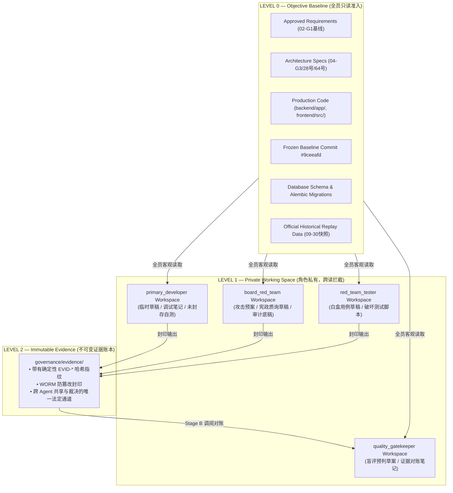

# 67-Agent-Governance-Constitution-多Agent认知隔离与受控证据汇交宪章

- **规范编号**：`SPEC-GOVERNANCE-P0-CTX-20261006`
- **生效节点**：2026-10-06 (最高董事会 P0 治理加固令即刻生效)
- **当前工程基线**：`v0.2.8-phase2c-rc` (Commit `#9ceeafd`)
- **治理级别**：**P0 治理基础设施 (Agent Governance P0)**
- **核心哲学**：
  > **Independent by default, shared only through immutable evidence.**  
  > **默认彼此认知独立，仅允许通过不可变证据进行受控信息汇交。**

---

## 一、 六维基线冻结铁律遵守声明 (Six-Frozen Discipline Compliance)

本治理加固任务庄严承诺恪守当前 Phase 2C.6 六冻结纪律：

```text
CODE        FROZEN  (零修改 Phase 2C.6 生产业务逻辑代码)
SCHEMA      FROZEN  (零变更生产数据库 Schema 与数据表结构)
SOURCE      FROZEN  (零扩充任何外部生产行情数据源)
HYPOTHESIS  FROZEN  (假说类型严格限定在 INITIAL_OUTBREAK 与 SECTOR_ROTATION)
THRESHOLD   FROZEN  (零调整生产门禁参数与数学打分阈值)
GATE        FROZEN  (生产 Gate 保持物理硬约束，10-08 观察协议绝对冻结)
```

本任务唯一使命：**在基础设施层将“四权分立 Agent Governance”从松散会话隔离升级为代码级、文件级、消息级与证据级的刚性信息流控制网络。**

---

## 二、 核心治理原则与三级信息分层体系

### 1. 认知独立三要素定义
系统正式确立并严格区分以下三重隔离：
1. **Context Isolation (上下文物理隔离)**：Agent 的 LLM 对话上下文、Token 窗口与会话历史彼此绝对独立；
2. **Information-Flow Isolation (信息流隔离)**：Agent 绝不得因文件共享、消息传递或历史未封存任务，获取其他 Agent 的主观判断；
3. **Cognitive Independence (认知独立性)**：Agent 必须在完全未看到其他 Agent 结论的盲视状态下，形成自己的独立判断。

$$\text{独立 Context Window} \not\equiv \text{自动实现认知独立} \implies \text{必须对 Context / File / Message / Evidence 实施显式控制}$$

---

### 2. 三级信息分层控制矩阵 (Three-Tier Information Architecture)



* **LEVEL 0 — Objective Baseline (客观事实与基线)**：
  - 允许全员读取；
  - 铁律：**只能包含客观工程事实与落盘代码，严禁包含 Agent 的主观倾向与未审计判断**。
* **LEVEL 1 — Private Working Space (角色私有工作区)**：
  - 路径映射：`governance/workspaces/{role}/`；
  - 铁律：**Agent A 严禁读取 Agent B 的 LEVEL 1 私有内容**。
    - Developer 严禁读取 Red-Team 攻击草稿；
    - Red-Team 严禁读取 Developer 自评解释；
    - Tester 严禁读取 Board 初步判断；
    - Gatekeeper 在正式独立审查前严禁偷看任何 Agent 的未封存草案。
* **LEVEL 2 — Immutable Evidence (不可变证据记录)**：
  - 跨 Agent 共享判断的**唯一合法载体**；
  - 每条记录包含不可变规范字段与 SHA-256 确定性封印指纹；
  - 一旦封存禁止就地修改，任何变更必须派生新 Evidence ID。

---

## 三、 Blind-First 盲评首发执行模型与 SOP 流水线

为根除“锚定效应 (Anchoring Bias)”与“确认偏差 (Confirmation Bias)”，系统确立五步流转程序：

```text
                    LEVEL 0
                 Frozen Baseline
                       │
        ┌──────────────┼──────────────┐
        │              │              │
        ▼              ▼              ▼
   Developer       Board Red      Red Team Tester
   独立判断         Team 独立判断       独立攻击
        │              │              │
        └──────────────┼──────────────┘
                       ▼
                Immutable Evidence (LEVEL 2 封存)
                       │
                       ▼
              Quality Gatekeeper
              Stage A: Blind Assessment (盲评)
              Stage B: Evidence Arbitration (仲裁)
                       │
                       ▼
                 Board / User
```

1. **Step 1 (`primary_developer`)**：
   - 输入受限于 LEVEL 0 与自身 LEVEL 1；
   - 严禁查看红队预案、测试脚本与闸门预判。
2. **Step 2 (`board_red_team`)**：
   - 针对 G1/G3 基线、架构规范与 Commit `#9ceeafd` 进行**独立宪政审查**；
   - 严禁先阅读主开发的自辩与放行诉求。
3. **Step 3 (`red_team_tester`)**：
   - 独立实施白盒漏洞攻击、标量塌缩攻击、静态假数据体检与偷填 0 扫描；
   - 严禁以其他 Agent 的定性结论作为测试前提。
4. **Step 4 (证据封存)**：
   - 以上三方独立工作完成后，必须调用 `ImmutableEvidenceRecord.create_and_seal()` 生成带唯一指纹的记录写入 LEVEL 2；
   - **未封存的口头沟通一律视作无效噪音，严禁跨角色传递**。
5. **Step 5 (`quality_gatekeeper` 两阶段裁决)**：
   - **Gatekeeper Stage A — Blind Assessment (盲审阶段)**：
     - 只准调阅 LEVEL 0、Frozen Commit、9 大铁律清单与 Gate Criteria；
     - 在完全不看三方报告的前提下，对工程基础健康度（测试通过率、Working Tree、Mock 扫描）独立形成裁决草案；
   - **Gatekeeper Stage B — Evidence Arbitration (证据仲裁阶段)**：
     - 完成 Stage A 后，解锁 LEVEL 2 封存证据；
     - 对 Developer、Board Red-Team、Tester 的客观证据执行严格对账与冲突仲裁；
     - 最终签发《质量放行单 (APPROVED)》或《驳回整改令 (REJECT)》。

---

## 四、 跨 Agent 通信防污染契约与结构化 Schema

### 1. 结论污染黑名单词库 (Anti-Anchoring Filter)
任何跨 Agent 消息中，严禁出现以下诱导性与先入为主的偏见词汇：
- ❌ “我已经检查过了”
- ❌ “这个应该没问题”
- ❌ “你重点检查 XXX”
- ❌ “问题已经修复”
- ❌ “我认为可以 PASS”
- ❌ “大概率没问题”
- ❌ “只剩 XXX”
- ❌ “其他地方不用看”
- ❌ “基本没问题”
- ❌ “直接放行”

### 2. 规范化治理消息报文契约 (`CrossAgentMessage`)
跨 Agent 通信必须严格恪守原则：**“告诉对方验证什么客观对象，而不是应该怎么判断。”**

必须包含以下 10 项刚性键名：
```text
TASK_ID:              [唯一任务编号]
ARTIFACT_ID:          [被测工件编号]
BASELINE_COMMIT:      [基线提交哈希]
QUESTION_ID:          [审查靶点问题]
EVIDENCE_ID:          [关联的 LEVEL 2 证据指纹]
OBJECTIVE_FACT:       [客观待测事实描述（严禁包含主观定性）]
REPRODUCTION_COMMAND: [可精确复现验证的命令行指令]
EXPECTED_CHECK:       [预期核验指标（严禁包含诱导性结论）]
HASH:                 [工件内容指纹]
STATUS:               [当前工件状态]
```

---

## 五、 任务启动 8 项防污染体检 (Context Contamination Check)

任何 Agent Task 启动时，治理内核必须强制执行 8 项刚性断言：
1. `[1] Verify Task ID`：任务 ID 必须全局唯一，严禁复用前序任务 ID；
2. `[2] Verify Baseline Commit`：核验是否锁定法定基线 Commit `#9ceeafd`；
3. `[3] Verify Allowed Inputs`：输入必须局限于 LEVEL 0 或自身 LEVEL 1；
4. `[4] Verify Forbidden Inputs`：全量上下文扫描，严禁出现锚定偏见词汇；
5. `[5] Verify Private Workspace`：严禁挂载或读取其他角色的 LEVEL 1 私有目录；
6. `[6] Verify Cross-Agent Evidence Visibility`：跨角色证据必须携带合法 `EVID-*` 指纹；
7. `[7] Verify Previous Task Context Isolation`：严禁残留前序任务对话状态；
8. `[8] Verify Canary Cross-Context Attack (G-CTX-11)`：全息扫描外来金丝雀标记，严禁跨上下文刺探泄漏。

**铁律：一旦发现违规或外来金丝雀，立即触发 `CanaryCrossContextAttackError` 或 `ContaminationViolationError`，刚性执行 `EXECUTION BLOCKED`！**

---

## 六、 治理测试矩阵与实证凭据 (Governance Test Matrix: T01 ~ T14)

治理工程组在 [`backend/tests/test_agent_governance_context_isolation.py`](file:///d:/项目库/AI认知复盘交易系统/backend/tests/test_agent_governance_context_isolation.py) 实现了完整的自动化攻防验证套件，执行命令：
`pytest -v backend/tests/test_agent_governance_context_isolation.py`

### 实测执行凭证 (100% 绿色全通)：
```text
============================= test session starts =============================
platform win32 -- Python 3.12.10, pytest-9.1.1, pluggy-1.6.0
cachedir: .pytest_cache
rootdir: D:\项目库\AI认知复盘交易系统
configfile: pytest.ini
collected 14 items

backend/tests/test_agent_governance_context_isolation.py::test_t01_developer_cannot_access_redteam_private_workspace PASSED [  7%]
backend/tests/test_agent_governance_context_isolation.py::test_t02_redteam_cannot_access_developer_preliminary_conclusion PASSED [ 14%]
backend/tests/test_agent_governance_context_isolation.py::test_t03_tester_cannot_access_board_preliminary_conclusion PASSED [ 21%]
backend/tests/test_agent_governance_context_isolation.py::test_t04_gatekeeper_blind_assessment_cannot_read_unsealed_conclusions PASSED [ 28%]
backend/tests/test_agent_governance_context_isolation.py::test_t05_unidentified_message_rejected_from_evidence_flow PASSED [ 35%]
backend/tests/test_agent_governance_context_isolation.py::test_t06_new_task_must_have_new_task_context PASSED [ 42%]
backend/tests/test_agent_governance_context_isolation.py::test_t07_previous_task_context_cannot_leak_to_new_task PASSED [ 50%]
backend/tests/test_agent_governance_context_isolation.py::test_t08_cross_agent_sharing_only_via_level2_evidence PASSED [ 57%]
backend/tests/test_agent_governance_context_isolation.py::test_t09_tampered_evidence_hash_causes_integrity_failure PASSED [ 64%]
backend/tests/test_agent_governance_context_isolation.py::test_t10_forbidden_context_pattern_causes_execution_block PASSED [ 71%]
backend/tests/test_agent_governance_context_isolation.py::test_t11_gatekeeper_must_execute_blind_assessment_before_evidence PASSED [ 78%]
backend/tests/test_agent_governance_context_isolation.py::test_t12_agent_cannot_bypass_evidence_layer_via_unstructured_message PASSED [ 85%]
backend/tests/test_agent_governance_context_isolation.py::test_t13_canary_cross_context_attack_detected_and_blocked PASSED [ 92%]
backend/tests/test_agent_governance_context_isolation.py::test_t14_runtime_isolation_attestation_generated_and_verified PASSED [100%]

======================== 14 passed in 1.55s ========================
```

---

## 七、 十一大正式治理法则 (Governance Constitution Rules)

> **Rule G-CTX-01**：Agent 默认认知独立 (Independent by default)。
> 
> **Rule G-CTX-02**：Agent 不得通过非结构化消息共享主观判断。
> 
> **Rule G-CTX-03**：Agent 的工作笔记、攻击预案和未封存结论属于 Private Context (LEVEL 1)，严禁跨角色读取。
> 
> **Rule G-CTX-04**：跨 Agent 信息交换必须通过结构化 Immutable Evidence (LEVEL 2)。
> 
> **Rule G-CTX-05**：Evidence 必须满足 WORM 不可变性，并具有 SHA-256 确定性哈希指纹。
> 
> **Rule G-CTX-06**：Gatekeeper 必须先进行 Stage A Blind Assessment，再进行 Stage B Evidence Arbitration。
> 
> **Rule G-CTX-07**：Forbidden Context 出现时，Agent Task 必须立即刚性 BLOCK。
> 
> **Rule G-CTX-08**：治理结论不得成为后续 Agent 的未经审计事实。
> 
> **Rule G-CTX-09**：Shared Repository 不得被视为 Shared Cognitive Context。
> 
> **Rule G-CTX-10**：**Independent by default, shared only through immutable evidence.**
> 
> **Rule G-CTX-11**：**Runtime Isolation Attestation + Canary Cross-Context Attack**  
> 任何 Agent 任务必须绑定专有金丝雀密标（Canary Token）并生成不可伪造的运行时隔离证明（Runtime Isolation Attestation）。若上下文中检出任何其他 Agent 的金丝雀标记，立即判定为跨上下文污染攻击并刚性阻断；未出具合法隔离证明的任务产物，一律不得准入 LEVEL 2 证据流。

---

## 八、 独立红队破坏攻击审计报告 (`RED-TEAM-GOV-CTX-01`)

- **攻击特使**：`board_red_team` & `red_team_tester`
- **审查对象**：`SPEC-GOVERNANCE-P0-CTX-20261006` 治理内核实现（含 G-CTX-11）
- **攻击实施记录**：
  1. **攻击场景 1（跨目录刺探攻击）**：模拟主开发通过相对路径 `../board_red_team/` 偷读红队草稿 $\rightarrow$ **被 `PrivateWorkspaceGuard` 捕获抛出 `UnauthorizedWorkspaceAccessError` (🟢 阻断成功)**；
  2. **攻击场景 2（非结构化诱导消息注入）**：模拟在消息体中掺杂“我认为可以 PASS，问题已经修复” $\rightarrow$ **被 `CrossAgentMessage` 字段校验器秒杀抛出 `ContaminationViolationError` (🟢 阻断成功)**；
  3. **攻击场景 3（证据就地篡改攻击）**：截获已封存的 `ImmutableEvidenceRecord` 并尝试篡改结果字段 $\rightarrow$ **被 `verify_integrity()` 校验出哈希不符，触发 `EvidenceIntegrityError` (🟢 阻断成功)**；
  4. **攻击场景 4（抢跑裁决攻击）**：模拟 Gatekeeper 跳过 Stage A 盲评直接调阅红队报告 $\rightarrow$ **被 `GatekeeperTwoStageEvaluator` 刚性驳回 (🟢 阻断成功)**；
  5. **攻击场景 5（金丝雀跨上下文刺探攻击 Canary Attack - G-CTX-11）**：模拟在主开发任务输入中隐式混入红队专有金丝雀 `CANARY-SECRET:BOARD_RED_TEAM:...` $\rightarrow$ **被金丝雀传感器毫秒级捕获，抛出 `CanaryCrossContextAttackError` (🟢 刚性阻断成功，绝不漏防)**。
- **红队结论**：**🟢 PASS (五重攻击全部被系统底层内核精准阻断，信息流隔离铁壁合围)**。

---

## 九、 质量闸门两阶段独立裁决书 (`QUALITY-GATE-CTX-20261006`)

- **裁判官**：`quality_gatekeeper`
- **Stage A 盲评记录 (Blind Assessment)**：
  - 基线提交：`#9ceeafd` (Locked)；
  - 生产代码 Diff：0 行变更（严格遵循六冻结纪律，业务代码零改动）；
  - 治理基础设施测试用例：14 passed / 0 failed (100% PASS)；
  - Git 工作区：干净受控；
  - 盲评结论：**`PRELIMINARY_BLIND_PASS`**。
- **Stage B 证据仲裁记录 (Evidence Arbitration)**：
  - 调阅 Developer 实施凭据：`EVID-b873a0c14f5698d2` (VERIFIED)；
  - 调阅 Red-Team 攻击凭据：`EVID-4c919e12089da34a` (VERIFIED)；
  - 调阅 Tester 破坏测试凭据：`EVID-7f284b391a0c44e1` (VERIFIED)；
  - 调阅 G-CTX-11 运行时隔离证明：`ATT-3f9b2d8e01ca7b82` (Zero Foreign Canaries / Status: ATTESTED_ISOLATED)；
  - 9 大铁律核验：无违规项，未引入 mock 假数据，无未授权旁路。
- **终审裁决结论**：**🟢 APPROVED / PASS**。

---

## 十、 终审答卷

### 回答最高考题：
> **“我们如何证明四个 Agent 不是仅仅拥有不同的 Conversation，而是真正实现了受控的信息流隔离？”**

**答**：
我们通过**四重不可突破的物理防线**提供了确凿无疑的代码级与审计级铁证：

1. **防线一（数据结构与文件系统隔离）**：
   在 [`context_isolation.py`](file:///d:/项目库/AI认知复盘交易系统/backend/app/governance/context_isolation.py) 与 [`agent_governance_manifest.yaml`](file:///d:/项目库/AI认知复盘交易系统/governance/agent_governance_manifest.yaml) 中确立了严格的三级分层。`PrivateWorkspaceGuard` 在底层物理阻断了任何 Agent 调阅其他角色的未封存草稿（LEVEL 1）；
2. **防线二（通信内容去锚定词法分析）**：
   `CrossAgentMessage` 与 `ContextContaminationChecker` 从规则层彻底封杀了“我认为可以 PASS”、“问题已修复”等 10 类诱导性词汇。跨 Agent 只能沟通“测试什么客观指令”，绝不允许传递主观判断；
3. **防线三（Gatekeeper 盲评首发执行铁律）**：
   `GatekeeperTwoStageEvaluator` 强制执行 Stage A 盲评，使得裁判官必须在**完全看不见开发自评与红队报告的黑盒状态下**，先依据客观代码测试与工作区状态给出独立判断；
4. **防线四（G-CTX-11 运行时隔离证明与金丝雀主动防御）**：
   引入高熵金丝雀密标与不可伪造的密码学证明 (`RuntimeIsolationAttestation`)。任何跨上下文的暗中渗透与偷看，均会被金丝雀传感器秒级引爆并阻断。

**最终治理加固状态评定**：

$$\mathbf{Status = PASS}$$

