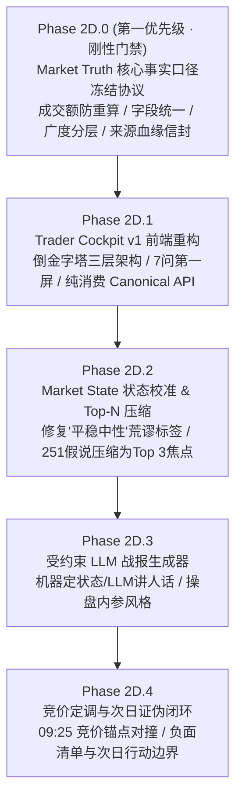

# 69-Phase-2D-市场真相口径冻结与交易员驾驶舱技术设计单

- **设计单编号**：`SPEC-DESIGN-PHASE2D-20261008-V1.0`
- **状态**：**`PROPOSED / LOCKED FOR USER REVIEW` (设计基线冻结，待用户最终授权执行)**
- **生效基线**：`v0.2.8-phase2c-rc` (Commit `#3f90cfd`)
- **对应阶段**：**Phase 2D 认知交付重构与市场真相口径冻结**
- **上位依据**：用户 2026-10-08 战略裁决令（`Phase 2D.0 口径冻结前置，代码完全冻结`）
- **协同输入**：
  - GPT 架构审计：7问第一屏法则、251 $\rightarrow$ Top 3 认知压缩、反方证伪、机器定状态+LLM讲人话
  - Gemini 战报审计：三层倒金字塔作战驾驶舱、双视图彻底隔离、业务级优雅降级
  - Antigravity 底盘审计：已抓取资产无缝打通、成交额重复计算陷阱识别、零破坏性重构路径

---

## 一、 核心立项背景与第一性原则

### 1. 深刻反思：工程合规自嗨 vs 交易实战致盲
在 Phase 2C 的研发过程中，系统在底层建立起了极其严密的学术防伪体系（WORM 不可变触发器、RFC 8785 JCS 哈希、波普尔 AST 执行器、反事实 Decision Delta 对撞），并在 10-08 首个交易日实弹验证中完成了 12 层级审计。

然而，**前线交易员的真实体验切中了致命要害**：
> “报告说了那么多，但通过前端我能够得到的有用信息很少。如果只看程序给我的复盘报告、竞价等板块，我无法准确了解今天市场关键信息和全貌。”

**根因定性**：
1. **系统“后端比前端聪明”**：底层其实已经抓到了 43 只涨停梯队、10 只连板、32 只炸板、13 只跌停、11 只交易所监管异动，但前端只堆砌了抽象的标量分（D1~D6），把关键的股票名字、主线板块和亏钱梯队全部吞掉了；
2. **“机器自我证明”喧宾夺主**：前端充斥着 CI/CD 质检报告般的工程元数据，反而遮蔽了前线作战简报；
3. **口径未冻结的高危风险**：今天暴露出的**成交额重复计算（把创业板与深市重复累加导致天量虚高）**、指数点位空值、广度单源依赖缺陷证明：**如果直接把“数据库现有资产”硬搬到前端，只是把底层口径缺陷包装成了漂亮的欺骗性终端！**

### 2. Phase 2D 铁律：“四不原则”
依据最高裁决，Phase 2D 实施过程中坚守以下底线：
```text
1. 不新增核心交易算法 (No new core trading algorithms)
2. 不改动 Cognition Admission Guard (Preserve zero-pollution gate)
3. 不改动 WORM / Immutable Ledger (Preserve cryptographic chain)
4. 不删除审计追溯能力 (Preserve forensic observability)
```
**Phase 2D 的唯一使命是：改变认知交付方式，把认知以交易员看得懂、用得上、信得过的方式交付到前线！**

### 3. 认知交付第一优先级
Trader Cockpit 的第一优先级不是“展示更多数据”，而是让交易员在 1~3 分钟内依次得到：
$$\text{市场状态 (State)} \longrightarrow \text{主线战场 (Mainlines)} \longrightarrow \text{强者阵型 (Leaders)} \longrightarrow \text{亏钱效应 (Risk/Bleeding)} \longrightarrow \text{次日证伪条件 (Actionable)}$$

---

## 二、 实施序列与里程碑规划

依据用户最终裁决，实施顺序刚性调整为：



- **Phase 2D.0**：**Market Truth 口径冻结（P0 刚性门禁，不可跳过）**。核验并固化全市场真实成交额、指数、广度、梯队、监管异动的标准语义契约，提供单元测试与规范化数据适配器；
- **Phase 2D.1**：**Trader Cockpit v1 前端重构**。基于 2D.0 冻结的 Canonical API 重塑前端 Review 页面，实现双视图隔离（作战视图 vs 审计抽屉）与倒金字塔三层呈现；
- **Phase 2D.2**：**Market State 语义校准与 Top-N 主线压缩**。优化状态评分权重，将 251 个分散假说按显著性打分压缩为 Top 3~5 核心主线候选并引入反方证据；
- **Phase 2D.3**：**受约束 LLM 实战战报生成器**。由确定性状态约束 Prompt，生成操盘手内参风格战报；
- **Phase 2D.4**：**竞价定调与次日证伪闭环**。打通盘前简报、早盘竞价与全天复盘。

---

## 三、 Phase 2D.0: Market Truth 六大市场事实口径冻结协议

在任何前端呈现之前，必须通过单元测试锁定以下 6 项核心事实口径：

### 1. 口径一：全市场真实总成交额计算口径（阻断重复计算陷阱）
- **痛点与陷阱**：
  国内深交所公布的“深证成指/深市总成交”（如 10-08 约 8709.26 亿元）**在交易所统计范畴内已经完全包含了创业板成交额（约 4227.55 亿元）**！
  若简单执行 `上证(8111.83亿) + 深证(8709.26亿) + 创业板(4227.55亿)`，创业板成交额被重复计算了 2 次，导致得出虚假的“2.18 万亿”！
- **刚性冻结规范**：
  $$\text{沪深两市真实总成交额} = V_{\text{SH}} + V_{\text{SZ}}$$
  $$\text{全市场总成交额 (含北交所)} = V_{\text{SH}} + V_{\text{SZ}} + V_{\text{BJ}}$$
  $$\text{创业板成交占比} = \frac{V_{\text{CY}}}{V_{\text{SZ}}} \quad (\text{仅作为深市内部结构风格切片呈现，绝对严禁加入两市总额！})$$
  - `amount_total_yi`：两市总成交额（亿元）；
  - `amount_sh_yi`：沪市总成交（亿元）；
  - `amount_sz_yi`：深市总成交（亿元，已含创业板）；
  - `amount_cy_yi`：创业板成交（亿元，结构切片）；
  - `amount_bj_yi`：北证成交（亿元）。

### 2. 口径二：核心指数点位与行情字段命名归一规范
- **痛点**：上游不同 Provider 返回 `price`、`close`、`pre_close`、`change_pct`、`pct_change` 混杂，导致前端多处出现 `--` 或空值。
- **刚性冻结规范**：
  统一对外输出 `CanonicalIndexQuote` 模型：
  ```python
  class CanonicalIndexQuote(BaseModel):
      symbol: str          # 如 "sh000001"
      name: str            # 如 "上证指数"
      current_price: float # 当前收盘/最新点位 (严格非空且 > 0)
      pre_close: float     # 昨收盘点位
      change_val: float    # 绝对涨跌点数 (current_price - pre_close)
      pct_change: float    # 涨跌幅百分比 (精确到两位小数, 如 -0.79)
      amount_yi: float     # 成交额 (严格折算为亿元单位)
      trade_date: str      # 撮合日期 (YYYY-MM-DD)
  ```

### 3. 口径三：全市场横截面广度 vs 涨停池扩散度分层治理
- **痛点**：全市场广度单源接口 502 时，系统直接拉闸导致前端黑屏；同时历史上存在将“涨停池板块覆盖度”误当成“全市场板块广度”的语义混淆。
- **刚性冻结规范**：
  - **全市场横截面广度 (`market_breadth_cross_section`)**：全市场 5000+ 标的涨/跌/平中位数。若上游 502，状态标记为 `DEGRADED/UNAVAILABLE`，数值输出为 `None`，前端显式提示“上游接口通信故障，横截面不可用”；
  - **涨停池扩散广度 (`limit_up_breadth`)**：基于 43 只涨停股的中观板块扩散数量，明确命名为“涨停池扩散度”，绝不允许冒充全市场广度；
  - **业务级降级推断 (`sentiment_heuristic`)**：当全市场广度缺失时，系统依据涨跌停比（43:13）、炸板率（42.6%）和双创跌幅给出明确业务提示：“横截面缺失，但微观博弈样本显示极高分歧”。

### 4. 口径四：连板梯队天梯定义与炸板率标准定义
- **连板高度 (`board_height` / `lbc`)**：定义为连续自然交易日收盘涨停次数（连板数 $\ge 1$）；
- **炸板定义 (`broken_limit_stocks`)**：日内最高价触及涨停板、但收盘未以涨停价封死的标的集合；
- **炸板率计算公式**：
  $$\text{炸板率} = \frac{\text{炸板家数}}{\text{封死涨停家数} + \text{炸板家数}} \times 100\%$$
- **梯队阵型聚合契约 (`LadderGroup`)**：
  必须按连板高度从高到低倒序分组：`[8B, 4B, 3B, 2B, 1B]`。每个标的必须包含：代码、名称、所属主线题材、连板天数、首次封板时间、封单金额、换手率。

### 5. 口径五：交易所严重异常波动监管事实定性
- **事实性质**：明确标识为 `EASTMONEY_COMPUTED_RULE_MATCH`（由东财依据沪深北交易所异常波动监控指引撮合匹配的规则事实）；
- **展示要素**：股票代码、名称、触碰规则名称（如“主板连续10个交易日内4次出现同向异常波动”）、偏离值幅度（如 +100%、+200%）、监控阶段（预警/达标）；
- **业务意义**：作为短线情绪“政策顶与监管强压制”核心风控雷达。

### 6. 口径六：全字段元数据血缘信封（Provenance Envelope）
前端消费的任何关键指标，必须包裹统一的血缘元数据：
```json
{
  "value": 3811.9,
  "source": "SINA_HQ_STREAM",
  "observed_time": "2026-10-08T15:05:00.000+08:00",
  "quality": "FULL",
  "is_degraded": false
}
```
**前端严禁擅自推算口径或伪造字段，必须纯消费具备信封的 Canonical 数据。**

---

## 四、 Phase 2D.1: Trader Cockpit v1 架构与页面重构蓝图

### 1. 视图双轨硬隔离 (View Separation)
- **主界面：交易员作战驾驶舱 (Trader Cockpit)**
  - 严禁出现 `obs-xxx`、`JCS 指纹`、`SHA256`、`AST 解释器`、`WORM 触发器` 等程序员自嗨词汇；
  - 界面风格为专业级暗色交易终端，高信息密度、低认知摩擦；
  - 严格回答 GPT 提出的“第一屏 7 问”；
- **底部抽屉：科学审计与防伪存证 (Audit Drawer，默认折叠收起)**
  - 包含：12 层级审计总表、WORM 链式哈希核验器、不可变快照原始 JSON 查阅、反事实 Decision Delta 报告。

### 2. 倒金字塔三层信息流

```text
┌────────────────────────────────────────────────────────────────────────┐
│ 第一层：30 秒市场全貌罗盘 (Macro & Sentiment Compass)                 │
│ • 一句话多空定调：【天量巨幅分歧 · 高位抱团与防御避险】                │
│ • 大盘量能：沪深总额 1.68 万亿 (放量+25%) | 创业板占比 25.1%          │
│ • 指数分化：上证 3811 (-0.79%) vs 创业板 2786 (-3.15%) / 科创 (-4.82%)│
│ • 情绪体温：涨停 43 | 连板 10 | 跌停 13 | 炸板 32 (炸板率 42.6% ⚠️)    │
├────────────────────────────────────────────────────────────────────────┤
│ 第二层：战场主线与微观博弈阵型 (Mainlines & Gaming Tape)              │
│ • 核心主线候选 Top 3 (240+ 杂音折叠)：                                │
│   [焦点 1] 固态电池/锂电 (强度 ★★★★☆): 8家涨停 / 梯队4-3-2-1深度齐备   │
│   [焦点 2] 医药避险高低切 (强度 ★★☆☆☆): 华北制药/联环药业 (防守属性)   │
│ • 连板天梯图 (Ladder Tree)：8B 新华传媒 ──> 4B (2家) ──> 3B (4家) ──> 2B│
│ • 亏钱效应与大面榜：32 家炸板股明细 (按跌幅排序) + 13 家跌停核按钮    │
│ • 监管异动雷达：11 只交易所重点监控个股 (近岸蛋白+200%, 新华传媒)    │
├────────────────────────────────────────────────────────────────────────┤
│ 第三层：次日行动预案与负面清单 (Actionable Setups & Checklist)         │
│ • 次日竞价观察锚点：09:25 观察 8B 新华传媒、4B 时代万恒的溢价与承接    │
│ • 绝对禁止操作负面清单：严禁开盘追入无梯队支撑的孤立首板；回避监管高标 │
└────────────────────────────────────────────────────────────────────────┘
```

---

## 五、 Phase 2D.2: 显著性聚类算法与状态校准 (Top-N Salience Ranking)

### 1. 251 个板块假说 $\rightarrow$ Top 3~5 焦点压缩公式
针对 10-08 准入的 251 个板块假说，系统执行多维加权显著性打分（Salience Score）：
$$\text{Score}(S) = w_b \cdot \text{BreadthScore}(S) + w_p \cdot \text{PersistenceScore}(S) + w_l \cdot \text{LeadershipScore}(S)$$
其中：
- $\text{BreadthScore}(S) = \min(1.0, \frac{\text{板块涨停家数}}{5})$；
- $\text{PersistenceScore}(S) = \frac{\text{板块最高连板高度}}{\text{全市场最高连板高度}}$；
- $\text{LeadershipScore}(S) = 1.0$ (若板块成分股命中严重异动 $\text{ANOM}:*$)，否则为 $0.5$；
- 权重分配：$w_b = 0.35, w_p = 0.45, w_l = 0.20$。

**输出分层**：
- **Top 1~3（核心主线卡片）**：例如电池（得分为各板块最高，具备 4-3-2-1 梯队，独立全宽展示）；
- **Top 4~5（局部活跃题材）**：例如医药、航运港口；
- **其余 240+ 板块（一句话折叠）**：“其余 246 个板块仅有孤立首板，缺乏梯队共振，归入【日内脉冲杂音】（可展开列表）”。

### 2. 状态机评分修复：消除“平稳中性”荒谬感
优化 M1.4 状态机评分逻辑：
- 当“全市场总成交额突破历史 90 分位数（天量）”且“炸板率 $\ge 35\%$”且“高弹性双创跌幅 $\ge 3\%$”时；
- 刚性分流为 **【天量巨幅分歧 (Extreme High-Volume Divergence)】**，彻底消除在天量跳水日输出“平稳中性”的算法失真。

---

## 六、 Phase 2D.3: 受约束 LLM 实战战报生成契约

### 1. 机器定状态，LLM 讲人话
- **严禁**：让 LLM 直接阅读非结构化行情并天马行空总结；
- **规范**：由底层规则引擎先产出不可变的结构化 JSON 上下文（含 State、Top 3 主线、连板空间、炸板率、监管异动），再交由 LLM 执行受约束 Prompt 渲染。

### 2. 输出风格范式
采用严谨专业的游资操盘手/首席策略内参风格（200~300 字）：
> *“【10-08 盘面内参】今日市场呈现典型的‘天量震荡、高位派发、低位防守’特征。两市总成交额急剧放大至 1.68 万亿创下历史天量，但双创指数重挫近 -5%，高位科技获利盘汹涌兑现。短线情绪严重撕裂：高标新华传媒顶至 8 板维系空间，电池板块走出 4-3-2-1 完整梯队（8家涨停）成为日内最强避险主线；但全天炸板率高达 42.6%，且多只 20cm 标的触碰交易所严重异动监管红线。明日核心关注 8 板标的竞价溢价，严禁盲目接力无梯队支撑的高位孤立板。”*

---

## 七、 实施步骤与准入检查单

```text
[ ] Phase 2D.0: Market Truth 口径冻结
    [ ] 编写 test_market_truth_contracts.py (成交额防重复算断言)
    [ ] 编写 Canonical Market Snapshot 适配层
    [ ] 规范化 indices/breadth/ladder/anomaly 字段输出
[ ] Phase 2D.1: Trader Cockpit v1 前端重构
    [ ] 重构 frontend/src/app/review/[date]/page.tsx
    [ ] 上线 连板天梯图 (Ladder Tree) 组件
    [ ] 上线 主线题材 Top-3 卡片
    [ ] 上线 炸板/跌停大面榜 与 监管异动雷达
    [ ] 上线 底部科学审计折叠抽屉
[ ] Phase 2D.2: 显著性聚类与状态机校准
    [ ] 实现 251 假说 Top-N 显著性排序服务
    [ ] 修复天量分歧日状态标签误判为“平稳中性”问题
[ ] Phase 2D.3: 受约束 LLM 战报生成
    [ ] 制定操盘手内参 Prompt 规范
    [ ] 接入结构化复盘生成管线
[ ] Phase 2D.4: 竞价与次日闭环
    [ ] 联动 09:25 竞价核验与次日负面清单
```

---

## 八、 终审签字与冻结承诺

本设计单完整吸纳了最高裁决与多方审计意见。在获得用户正式确认签字之前，工程团队坚决履行**零代码修改铁律**。

- **起草人**：Antigravity Agentic Team
- **基线版本**：`SPEC-DESIGN-PHASE2D-20261008-V1.0`
- **当前执行状态**：**WAITING FOR USER APPROVAL TO BEGIN 2D.0**
