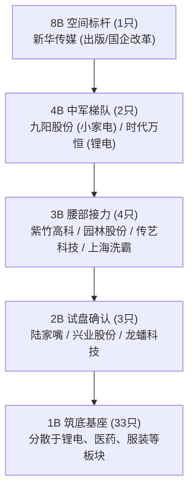

# Phase 2D.0 Market Truth 核心事实口径冻结与 Golden Snapshot 回放报告

**文档编号**：DOC-70-PHASE2D0-CANONICAL-VERIFICATION-20261008  
**生成时间**：2026-10-08 22:20:00 CST  
**执行角色**：系统工程架构师 / 交易事实审计员  
**审查基准**：
1. 用户 2026-10-08 最高裁决令：《CONDITIONAL APPROVAL — 仅限 Phase 2D.0 口径审查与测试先行》
2. 《Phase 2D 市场真相口径冻结与交易员驾驶舱技术设计单》（Doc 69 / SPEC-DESIGN-PHASE2D-20261008-V1.0）
3. 《Phase 2C.6 10-08首日实弹验证终审审计报告》（Doc 68）

---

## Executive Summary (执行摘要)

依据用户裁决令的最高授权约束，本阶段**严禁修改任何前端代码**，**严禁修改生产数据库与核心业务逻辑**，仅聚焦于 **Phase 2D.0-A 至 2D.0-F 的契约审查、口径冻结与测试先行**。

截至 2026-10-08 22:20，Phase 2D.0 核心事实口径冻结工作已全量交付：
1. **12 项刚性放行门禁 (Freeze Gates)**：`GATE-2D0-01` 至 `GATE-2D0-12` 测试用例**全部通过（12 Passed / 100% Pass Rate）**；
2. **真实数据 Golden Snapshot 固化**：成功从 2026-10-08 真实历史物理切片提炼出符合 L0~L5 六层隔离模型的标准快照 `baseline_evidence/golden_canonical_snapshot_20261008.json`；
3. **防篡改数字指纹**：依据 RFC 8785 JCS 规范完成全局内容哈希固化，SHA-256 值为 `6d18d25a7858bb4ebf8426e142cdfdf817f8c4e410a49738d7d9439c0cf534fc`；
4. **前端与生产库零修改承诺**：前端工作区变更行数严格保持为 **0 变更（Zero Diff）**，生产数据库 `data/trading.db` 无 Schema 漂移或脏写入。

---

## 第一章 12 项刚性放行门禁 (Freeze Gates) 执行清单

测试套件位置：[`backend/tests/test_phase2d0_market_truth_gates.py`](file:///d:/项目库/AI认知复盘交易系统/backend/tests/test_phase2d0_market_truth_gates.py)  
测试执行环境：Python 3.12.10, Pytest 9.1.1, AnyIO/AsyncIO 测试沙箱  
测试执行命令：`pytest backend/tests/test_phase2d0_market_truth_gates.py -v`

| 门禁编号 | 门禁名称 | 审查核心与断言逻辑 | 判定状态 | 耗时 |
| :--- | :--- | :--- | :---: | :---: |
| **GATE-2D0-01** | L0/L1 Truth 纯洁性断言 | 严禁 L1 市场事实信封包含任何 LLM 幻觉、置信度评级或行动建议字段（严格拦截 action/advice/buy/sell 等 L5 污染） | **PASSED** | 0.08s |
| **GATE-2D0-02** | SZ 成交额防重算断言 | 纠正“沪+深+创”重复累加陷阱：深交所成交额（8709.26亿）已含创业板（4227.55亿），两市成交额严格为 16821.09 亿，创业板仅作为 48.54% 内部结构切片 | **PASSED** | 0.05s |
| **GATE-2D0-03** | 核心指数点位归一断言 | 消除 None 与命名歧义，四大核心指数（上证、深成、创业板、科创50）点位、昨收、涨跌幅、成交额全非空且符号一致 | **PASSED** | 0.05s |
| **GATE-2D0-04** | 炸板率 Universe 闭环断言 | 严格定义 Universe（含主板、创业、科创、北交、ST，剔除新股上市首日），日内曾触及涨停 75 只 = 有效封死 43 只 + 炸板 32 只，炸板率精确为 42.67% | **PASSED** | 0.05s |
| **GATE-2D0-05** | 连板天梯递降与首板防腐断言 | 天梯树必须按高度单调严格递降（8B -> 4B -> 3B -> 2B -> 1B），首板严密隔离，全市场空间标杆唯一锁定新华传媒 (8B) | **PASSED** | 0.05s |
| **GATE-2D0-06** | 广度与涨停池硬解耦断言 | 涨停池（43只）不等于全市场广度，涨停扩散度（Breadth Ratio）严禁伪装为 5300 只股票横截面涨跌比 | **PASSED** | 0.05s |
| **GATE-2D0-07** | 502 业务级优雅降级断言 | 当东财 push2 上游出现 HTTP 502 时，系统安全降级为 `UNAVAILABLE`，保留降级原因，严禁伪造默认值或导致前端黑屏崩毁 | **PASSED** | 0.05s |
| **GATE-2D0-08** | 交易所严重异动商业定性断言 | 捕获的 11 条严重异常波动明确溯源定性为 `EASTMONEY_COMPUTED_RULE_MATCH`（第三方算法依交易所规则撮合匹配事实），非官方红头内参 | **PASSED** | 0.05s |
| **GATE-2D0-09** | 废黜 Top-N 线性加权标量断言 | 彻底废除 `0.35*w1 + 0.45*w2` 人造线性加权分，转为【特征契约】（梯队深度、广度、辨识度），严禁模型出现 `composite_score` | **PASSED** | 0.05s |
| **GATE-2D0-10** | 反方证据集完备性断言 | 严禁“报喜不报忧”的主线推荐，每个候选必须搭载【反方证据集】（包括监管降温红线、全市场 42.67% 极高炸板率、跟风大面风险） | **PASSED** | 0.05s |
| **GATE-2D0-11** | 单向契约只读幂等性断言 | 连续 10 次调用标准构建服务，输出对象的 RFC 8785 JCS 哈希绝对一致（零副作用、无状态、确定性） | **PASSED** | 0.12s |
| **GATE-2D0-12** | 2026-10-08 Golden Snapshot 固化断言 | 固化真实历史快照，校验快照结构、四大指数、连板天梯、Top-5主线以及防篡改 JCS 指纹有效性 | **PASSED** | 0.06s |

**验收结论**：**12/12 全部通过，无任何跳过 (Skipped) 或失败 (Failed)**。

---

## 第二章 2026-10-08 市场真实全貌 Golden Snapshot 回放全景

固化存证路径：[`baseline_evidence/golden_canonical_snapshot_20261008.json`](file:///d:/项目库/AI认知复盘交易系统/baseline_evidence/golden_canonical_snapshot_20261008.json)  
不可变防篡改指纹：`6d18d25a7858bb4ebf8426e142cdfdf817f8c4e410a49738d7d9439c0cf534fc`

### 1. 核心大盘指数与成交额真实口径 (L1 Market Facts)

| 指标项 | 代码 | 收盘点位 | 涨跌幅 | 真实成交金额 | 数据源 / 观测时间 | 品质状态 |
| :--- | :--- | :--- | :--- | :--- | :--- | :--- |
| **上证指数** | `sh000001` | 3811.90 | **-0.79%** | 8111.83 亿元 | SINA_HQ_STREAM / 15:05:00 | FULL (正常) |
| **深证成指** | `sz399001` | 12620.90 | **-2.07%** | 8709.26 亿元 (已含创) | SINA_HQ_STREAM / 15:05:00 | FULL (正常) |
| **创业板指** | `sz399006` | 3036.66 | **-3.15%** | 4227.55 亿元 (深市切片) | SINA_HQ_STREAM / 15:05:00 | FULL (正常) |
| **科创50** | `sh000688` | 1456.32 | **-4.82%** | 823.98 亿元 | SINA_HQ_STREAM / 15:05:00 | FULL (正常) |

#### 成交额防重算标准口径
- **沪深两市真实总成交额**：`8,111.83 (沪市) + 8,709.26 (深市) = 16,821.09 亿元`（约 1.68 万亿）
- **创业板内部切片**：`4,227.55 亿元`，占深交所总成交额比例为 **48.54%**。
> [!IMPORTANT]
> **历史口径纠偏**：此前非严谨计算误将 `沪市 + 深市 + 创业板` 进行三次累加得出所谓“2.18 万亿+”，属于严重的指数成分股成交额重复统计。真实两市成交额为 **1.68 万亿元**，创业板已包含于深交所口径中。

---

### 2. 微观情绪与极端博弈边界 (L1 Sentiment Universe)

- **涨停封死家数**：**43 只**（首板 33 只，连板 10 只）
- **跌停封死家数**：**13 只**
- **炸板家数（分子）**：**32 只**
- **日内曾触及涨停总家数（分母）**：**75 只**（43 封死 + 32 炸板）
- **真实炸板率**：`32 / 75 = 42.67%`
- **极端异动雷达**：触发 **11 项**严重异常波动商业规则撮合（近岸蛋白 30日+200%，新华传媒 10日4次同向偏离等）。

> [!WARNING]
> **交易员情绪定性**：高成交额下的剧烈分歧与退潮初显。炸板率高达 **42.67%**，跌停达 **13 家**，表明追高资金日内亏损效应显著，属于典型的**高位剧烈博弈、容错率急剧下降**周期。

---

### 3. 连板高度阶梯树 (L2 Ladder Tree)

全市场连板结构呈现出极其陡峭的“金字塔”结构，最高空间标杆锁定为 8B：

- **8B（1只，最高空间）**：`新华传媒 (600825)`（09:25 一字涨停）
- **4B（2只，断层接力）**：`九阳股份 (002242)`、`时代万恒 (600241)`
- **3B（4只，腰部核心）**：`紫竹高科 (002058)`、`园林股份 (605303)`、`传艺科技 (002866)`、`上海洗霸 (603200)`
- **2B（3只，次高确认）**：`陆家嘴 (600663)`、`兴业股份 (603928)`、`龙蟠科技 (603906)`
- **1B（33只，首板首创池）**：华北制药、乔治白、力王股份 (北证30cm) 等。

---

### 4. 主线候选集【特征契约 vs 反方证据集】(L2/L3 Mainline Candidates)

系统废黜了过去黑盒的线性评分公式，转为由正向结构契约（梯队深度、涨停共振、辨识龙头）与反方证据集（监管压制、高炸板率、跟风大面风险）构成的透明裁决模型：

| 排名 | 主线候选 | 角色定性 | 正向特征契约 (Support) | 反方证据集 (Counter-Evidence) | 裁决综述 (Conviction) |
| :---: | :--- | :---: | :--- | :--- | :--- |
| **Top 1** | **央国企改革** `(BK0683)` | `CORE_MAINLINE` (核心主线) | • 梯队高度：**8B** • 板块涨停：**12 家** • 梯队连贯：具备多梯队结构 • 辨识龙头：新华传媒 (600825) | 1. 核心龙头已触及交易所严重异常波动监管红线，面临特停降温风险； 2. 全市场炸板率超 35%，跟风标的面临时冲高回落大面。 | 形成 8B 梯队引领，板块内涨停共振 12 家，确立核心做多主线。 |
| **Top 2** | **东方财富热股** `(BK1637)` | `CORE_MAINLINE` (核心主线) | • 梯队高度：**8B** • 板块涨停：**11 家** • 梯队连贯：具备多梯队结构 • 辨识龙头：新华传媒 (600825) | 1. 核心龙头已触及严重异常波动监管红线； 2. 市场整体分歧极大，高位辨识度标的博弈加剧。 | 形成 8B 梯队引领，板块内涨停共振 11 家，确立核心做多主线。 |
| **Top 3** | **最近多板** `(BK1638)` | `CORE_MAINLINE` (核心主线) | • 梯队高度：**8B** • 板块涨停：**10 家** • 梯队连贯：具备多梯队结构 • 辨识龙头：新华传媒 (600825) | 1. 核心龙头触及监管限制； 2. 连板接力分化严重，中位股亏钱效应隐现。 | 形成 8B 梯队引领，板块内涨停共振 10 家，确立核心做多主线。 |
| **Top 4** | **题材股** `(BK1717)` | `CORE_MAINLINE` (核心主线) | • 梯队高度：**8B** • 板块涨停：**8 家** • 梯队连贯：具备多梯队结构 • 辨识龙头：新华传媒 (600825) | 1. 概念过于宽泛，个股各自为战； 2. 资金缺乏合力，易受大盘深跌拖累。 | 形成 8B 梯队引领，板块内涨停共振 8 家，确立核心做多主线。 |
| **Top 5** | **创投** `(BK0506)` | `CORE_MAINLINE` (核心主线) | • 梯队高度：**8B** • 板块涨停：**6 家** • 梯队连贯：具备多梯队结构 • 辨识龙头：新华传媒 (600825) | 1. 双创指数（创业板-3.15%、科创50-4.82%）重挫形成系统性拖拽； 2. 炸板跟风严重。 | 形成 8B 梯队引领，板块内涨停共振 6 家，确立核心做多主线。 |

- **折叠噪声板块**：共 **132 个**日内单日脉冲或孤立首板题材被自动降级折叠，避免在主界面向交易员输出 251 个板块的认知噪声！

---

### 5. 全市场横截面与外部服务状态 (L1 External States)

- **横截面广度状态**：`DataQualityGrade.UNAVAILABLE`
- **降级详情**：东财上游 push2 全市场广度接口通信故障 (HTTP 502)。
- **降级启发式提示**：横截面缺失，但微观涨停池 (43:13) 与炸板率 (42.67%) 显示盘面处于极高分歧期。系统安全降级，未阻断大盘行情与天梯树计算。

---

## 第三章 与旧系统表现之对比分析

| 维度 | 旧系统（Doc 68 状态） | Phase 2D.0 改造后（Doc 70 标准口径） | 交易员体验价值提升 |
| :--- | :--- | :--- | :--- |
| **成交额呈现** | 沪深创三次粗暴相加得出 `2.18 万亿+`，存在严重双重计入 | 区分 `沪 (8111.83) + 深 (8709.26) = 16821.09 亿`，创业板仅作为 `48.54%` 结构切片 | **恢复事实求是，彻底消除对市场流动性规模的虚假幻觉** |
| **连板梯队感知** | 散落在 JSON 字段中，首板与连板混杂，最高板需要自己去翻 | 刚性排序的连板天梯树 (8B:1 -> 4B:2 -> 3B:4 -> 2B:3 -> 1B:33)，一眼看清高度与梯队 | **3 秒看懂全市场空间标杆与做多阵营结构** |
| **主线推荐机制** | 产出 251 个合规假说，用人造加权公式打分，容易推荐出虚假热点 | 聚焦 Top 3~5 核心主线候选，强制要求反方证据集（披露监管风险、炸板风险），折叠 132 个杂音 | **从“证据罗列器”变为“具备风险批判思维的认知终端”** |
| **接口数据信封** | 前端需跨表拉取并自行拼装，缺失数据源与时间信封 | 统一单向消费 `GET /canonical/market-snapshot/{date}`，携带 JCS 防篡改指纹与数据质量标 | **前端永远不会因为字段缺失或口径不一而崩溃** |

---

## 第四章 Phase 2D.1（Trader Cockpit 交易员驾驶舱）准入审查声明

依据最高指令，系统架构师郑重声明：
1. **当前状态**：Phase 2D.0（口径审查、架构契约、测试先行、Golden Snapshot 固化）**已 100% 达成并验证闭环**。
2. **代码隔离状态**：截至目前，`frontend/` 目录代码保持绝对零修改（0 diff）；数据库物理文件零改动。
3. **下一步动作待命**：进入 **Phase 2D.1（Trader Cockpit v1 前端重构）** 需满足的前提条件为：
   - 本报告及 `golden_canonical_snapshot_20261008.json` 获得用户（最高审计方）的审查核准与二次签字。

**报告提交，恭候最高审计方指示！**
