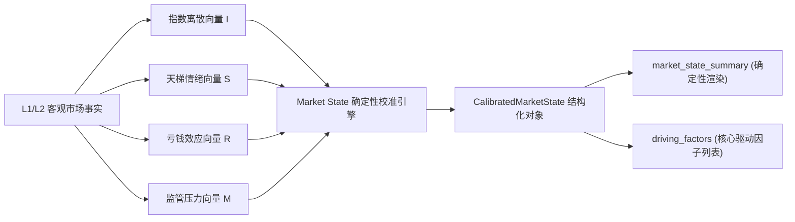

# DOC-78 · Phase 2D.2 Market State 状态机自适应校准与多周期回放体系技术设计单

> **文档编号**：DOC-78-PHASE2D2-MARKET-STATE-REPLAY-DESIGN-20261009  
> **文档性质**：Phase 2D.2 核心技术架构与实施方案设计单 (Technical Architecture & Engineering Specification)  
> **设计日期**：2026-10-09  
> **上位依据**：  
> 1. 《【最高董事会终审裁决令：PHASE 2D.1 FULL PASS & OFFICIAL ACCEPTANCE】》  
> 2. 《DOC-77 · Phase 2D.1 Trader Acceptance Closure Report》  
> 3. 《DOC-69 · Phase 2D 市场真相口径冻结与交易员驾驶舱技术设计单》  
> 
> **当前状态**：**PROPOSED / AWAITING BOARD REVIEW (设计待审定 / 生产代码零修改)**

---

## 一、架构背景与设计动机 (Motivation)

在 Phase 2D.0 (Market Truth 冻结) 与 Phase 2D.1 (Trader Cockpit 第一屏) 闭环后，系统已经具备了坚不可摧的底层客观物理事实与直观的 1080P 倒金字塔人机交互能力。

然而，对当前顶层认知（L3 Cognition）进行科学哲学与交易逻辑深度复核，发现存在一个核心演进缺口：

> **当前系统的市场状态一句话（`market_state_summary`）在本质上仍是一个由启发式规则拼接的半静态文本，缺乏数学严密的状态机模型（State Machine）支持，且目前仅在单一交易日（2026-10-08）进行了极限压测，尚未建立可跨越不同历史盘面风格（普涨、冰点、主升、退潮）的自适应校准与多周期回放体系（Multi-Period Replay System）。**

如果市场状态定性缺乏严格的数学不变量，随着交易日的推移，系统可能会在不同行情特征下出现“定性摇摆”或“文本自相矛盾”。

因此，Phase 2D.2 的核心使命是：
1. **建立多维量化 Market State 有限状态机**：将宏观事实（指数、成交额、广度）与微观情绪（天梯高度、炸板率、跌停数、监管异动）映射为数学无歧义的确定性市场状态；
2. **构建多周期历史回放引擎**：实现跨交易日（$T-1 \to T \to T+1$）的自动化时空回放与次日波普尔证伪对账，杜绝单日过拟合；
3. **向后完全兼容 2D.0/2D.1 契约**：保证已有 25 项 Freeze Gates 100% 绿灯，第一屏 30 秒 7 问信息密度零坍塌。

---

## 二、架构刚性红线 (Hard Architecture Invariants)

在 Phase 2D.2 实施全流程中，必须绝对恪守以下六项工程铁律：

1. **铁律一：设计先行，生产代码零修改**  
   在董事会对本设计单出具正式核准裁决前，严禁修改任何生产后端与前端代码。
2. **铁律二：L0~L2 Truth 纯洁性不可动摇**  
   严禁为迎合状态机判定而修改成交额防重算口径、炸板率样本空间、天梯树递降结构与 Security Master 实体身份。
3. **铁律三：零自由文本编造 (No Unconstrained LLM Hallucination)**  
   状态机定性与驱动因子解释必须由结构化状态对象和确定性模板引擎派生，严禁将未受控的 LLM 生成物作为状态判定核心。
4. **铁律四：零交易指令泄漏 (No Trader Action Leakage)**  
   状态机输出必须严格停留在客观状态标定与风险观测层，严禁输出任何买卖建议、仓位建议或追高提示。
5. **铁律五：向后兼容性 100% 保障**  
   `CognitionSnapshot` 保留原有的 `market_state_summary: str` 字段作为对外只读渲染视图，现有前端与 API 契约无缝运行。
6. **铁律六：历史版本幂等性与 WORM 不可篡改**  
   多周期回放生成的每一份快照必须继续满足 RFC 8785 JCS 确定性规范化与 SHA-256 哈希存证，历史 Golden Fixtures 不得被静默覆写。

---

## 三、Market State 状态空间与多维输入向量规范

### 1. 六大标准市场状态定义 (Market State Space)

状态机确立六大相互互斥、完全穷尽 (MECE) 的基准市场状态：

```text
┌────────────────────────────────────────────────────────────────────────┐
│                    Market State 有限状态机状态空间                      │
├──────────────────────────┬─────────────────────────────────────────────┤
│ 状态枚举 (Enum)          │ 交易语义与盘面微观特征定性                  │
├──────────────────────────┼─────────────────────────────────────────────┤
│ EXPANSION_ACCELERATION   │ 【主升共振期】：指数放量突破，连板梯队深厚，│
│ (主升共振 / 情绪主升)    │ 炸板率 < 20%，市场呈现良性做多合力。        │
├──────────────────────────┼─────────────────────────────────────────────┤
│ HIGH_DIVERGENCE_TOPPING  │ 【高位剧烈分化期】：天量震荡/指数背离，空间 │
│ (高位分化 / 滞涨见顶)    │ 板畸形博弈，炸板率 > 35%，跌停扩散，大面频现│
├──────────────────────────┼─────────────────────────────────────────────┤
│ RECESSION_PANIC          │ 【退潮恐慌期】：指数连续破位，中高位大面积  │
│ (退潮冰点 / 踩踏恐慌)    │ 跌停/断板，全市场亏钱效应扩散，空间板腰斩。 │
├──────────────────────────┼─────────────────────────────────────────────┤
│ FREEZING_REVERSAL        │ 【极值冰点反转期】：恐慌盘衰竭，跌停收窄，  │
│ (冰点反转 / 破局萌芽)    │ 地量见底，出现具备辨识度的新题材首板逆势破局│
├──────────────────────────┼─────────────────────────────────────────────┤
│ CHAOTIC_ROTATION         │ 【混沌震荡期】：指数窄幅拉锯，板块快速轮动，│
│ (混沌轮动 / 弱势整理)    │ 缺乏领军主线，中军断层，连板高度压制 <= 3B。│
├──────────────────────────┼─────────────────────────────────────────────┤
│ LOW_REBOUND              │ 【低位超跌反弹期】：超跌权重或大金融脉冲护盘│
│ (超跌修复 / 弱势反弹)    │ 题材跟风意愿弱，连板梯队缺乏持续性扩散。    │
└──────────────────────────┴─────────────────────────────────────────────┘
```

### 2. 四维输入特征向量 (Multi-Dimensional Feature Vector)

状态机判定完全基于 L1/L2 客观事实计算出的四维量化向量 $\vec{X} = (\vec{I}, \vec{S}, \vec{R}, \vec{M})$：



#### (1) 指数与流动性向量 $\vec{I}$ (Index & Liquidity)
- $Vol_{total}$：沪深两市真实总成交额（亿元）
- $\Delta Vol_{ratio}$：成交额较前一日环比变化率：$(Vol_t - Vol_{t-1}) / Vol_{t-1}$
- $Dispersion$：各大指数极差离散度：$\max(\text{pct\_change}) - \min(\text{pct\_change})$
- $STAR\_Divergence$：科创50与主板指数背离差值

#### (2) 天梯与做多广度向量 $\vec{S}$ (Ladder & Breadth)
- $H_{max}$：全市场连板天梯最高高度（Board Count）
- $Count_{lu}$：真实涨停股票数量
- $Count_{ld}$：真实跌停股票数量
- $Ratio_{leader}$：高位连板标的占总涨停比率：$\sum_{h \ge 3} Count_h / Count_{lu}$

#### (3) 亏钱效应与负反馈向量 $\vec{R}$ (Risk & Negative Feedback)
- $R_{broken}$：全市场真实炸板率：$Count_{broken} / Count_{touched}$
- $Count_{broken}$：日内炸板标的数量
- $Pain_{ratio}$：极值大面率（跌停数 + 炸板数占总活跃池比例）

#### (4) 监管压力向量 $\vec{M}$ (Regulatory Anomalies)
- $Count_{anomaly}$：触发交易所严重异常波动规则的标的总数
- $Has\_Leader\_Alert$：空间板（最高板）是否触碰特停/重点监控降温红线

---

## 四、确定性决策树与状态转移规则

### 1. 刚性不变量约束 (State Invariants)

校准引擎必须在代码层强制断言三大不变量：

- **Invariant S1 (高危风险拦截)**：  
  若 $R_{broken} \ge 35\%$ 且 $Count_{ld} \ge 10$，**严禁判定为 `EXPANSION_ACCELERATION`**！必须标定为 `HIGH_DIVERGENCE_TOPPING` 或 `RECESSION_PANIC`。
- **Invariant S2 (高度与广度支撑拦截)**：  
  若 $H_{max} \le 2$ 且 $Count_{lu} < 25$，**严禁判定为 `EXPANSION_ACCELERATION` 或 `HIGH_DIVERGENCE_TOPPING`**！必须标定为 `CHAOTIC_ROTATION` 或 `LOW_REBOUND`。
- **Invariant S3 (冰点反转极限条件)**：  
  若标定为 `FREEZING_REVERSAL`，前一日必须处于 `RECESSION_PANIC`，且当日跌停家数环比下降 $\ge 50\%$，同时必须出现 $\ge 1$ 只高辨识度破局首板。

### 2. 状态判定数学决策树 (Deterministic Decision Tree)

```python
def calibrate_market_state(
    vec_i: IndexVector,
    vec_s: LadderVector,
    vec_r: RiskVector,
    vec_m: RegulatoryVector,
) -> CalibratedMarketState:
    driving_factors: List[str] = []

    # 1. 极值退潮/恐慌判定
    if vec_s.count_ld >= 30 or (vec_r.broken_ratio >= 0.50 and vec_s.count_ld >= 15):
        primary = MarketStateEnum.RECESSION_PANIC
        confidence = 0.95
        driving_factors.append(f"全市场跌停家数高达 {vec_s.count_ld} 只，恐慌盘全面踩踏")
        driving_factors.append(f"真实炸板率高达 {vec_r.broken_ratio:.1%}，接力资金极度亏损")

    # 2. 高位剧烈分化判定 (2026-10-08 典型特征)
    elif (
        vec_r.broken_ratio >= 0.35
        or vec_i.dispersion >= 3.0
        or vec_s.count_ld >= 10
    ) and vec_s.max_height >= 4:
        primary = MarketStateEnum.HIGH_DIVERGENCE_TOPPING
        confidence = 0.90
        if vec_i.dispersion >= 3.0:
            driving_factors.append(f"指数极度分化 (离散度 {vec_i.dispersion:.2f}%)，权重与题材背离")
        if vec_r.broken_ratio >= 0.35:
            driving_factors.append(f"炸板率高达 {vec_r.broken_ratio:.1%} 且跌停 {vec_s.count_ld} 家，短线博弈极端极化")
        if vec_m.count_anomaly >= 5:
            driving_factors.append(f"共 {vec_m.count_anomaly} 只标的触发严重异动商业规则，高位降温压力剧增")

    # 3. 主升共振判定
    elif (
        vec_r.broken_ratio < 0.25
        and vec_s.count_lu >= 50
        and vec_s.count_ld <= 3
        and vec_s.max_height >= 4
    ):
        primary = MarketStateEnum.EXPANSION_ACCELERATION
        confidence = 0.92
        driving_factors.append(f"两市涨停共振 {vec_s.count_lu} 家，最高板达 {vec_s.max_height}B")
        driving_factors.append(f"炸板率仅 {vec_r.broken_ratio:.1%}，做多合力健康充沛")

    # 4. 冰点反转判定 (需结合 T-1 前序状态校验)
    elif vec_s.count_ld <= 5 and vec_r.broken_ratio < 0.20 and vec_s.max_height <= 3:
        primary = MarketStateEnum.FREEZING_REVERSAL
        confidence = 0.85
        driving_factors.append("恐慌盘显著出清，跌停家数收敛，新周期破局萌芽初显")

    # 5. 混沌轮动 / 默认防线
    else:
        primary = MarketStateEnum.CHAOTIC_ROTATION
        confidence = 0.80
        driving_factors.append("盘面缺乏全局领军主线，热点轮动快速且中军断层")

    return CalibratedMarketState(
        primary_state=primary,
        state_confidence=confidence,
        driving_factors=driving_factors,
        state_summary=render_deterministic_summary(primary, driving_factors, vec_i, vec_s),
    )
```

---

## 五、契约模型扩展设计 (Schema Extension)

在 [`backend/app/schemas/canonical_market.py`](file:///d:/项目库/AI认知复盘交易系统/backend/app/schemas/canonical_market.py) 中新增结构化状态模型，并挂载于 `CognitionSnapshot`：

```python
class MarketStateEnum(str, Enum):
    """市场状态枚举 (MECE 完全穷尽)"""
    EXPANSION_ACCELERATION = "EXPANSION_ACCELERATION"   # 主升共振
    HIGH_DIVERGENCE_TOPPING = "HIGH_DIVERGENCE_TOPPING" # 高位剧烈分化
    RECESSION_PANIC = "RECESSION_PANIC"                 # 退潮恐慌
    FREEZING_REVERSAL = "FREEZING_REVERSAL"             # 冰点反转
    CHAOTIC_ROTATION = "CHAOTIC_ROTATION"               # 混沌轮动
    LOW_REBOUND = "LOW_REBOUND"                         # 低位超跌反弹


class CalibratedMarketState(BaseModel):
    """经过多维量化向量校准的确定性市场状态模型 (L3 COGNITION)"""
    model_config = ConfigDict(frozen=True, extra="forbid")

    primary_state: MarketStateEnum = Field(..., description="主市场状态分类")
    state_display_name: str = Field(..., description="中文交易状态简称 (如 '高位剧烈分化期')")
    state_confidence: float = Field(..., ge=0.0, le=1.0, description="状态判定确定性置信度")
    driving_factors: List[str] = Field(..., min_length=1, description="支撑该状态的核心驱动量化事实列表")
    transition_signal: Optional[str] = Field(None, description="前序状态转移信号定性")


class CognitionSnapshot(BaseModel):
    # ... 保留已有字段保持 100% 兼容 ...
    schema_version: str = "2D.2-COGNITION-V1"
    
    # 新增结构化状态对象
    market_state_calibration: CalibratedMarketState = Field(
        ..., description="经过 Phase 2D.2 有限状态机校准的结构化市场状态对象"
    )
    
    # 保留原只读字符串渲染视图 (向后兼容)
    market_state_summary: str = Field(..., description="受约束的一句话全貌定性")
```

---

## 六、多周期历史回放与波普尔证伪对账系统 (Multi-Period Replay)

### 1. 时空时序对账模型 ($T-1 \to T \to T+1$)

系统建立三日滑动时间窗口对账流水线：

```text
[T-1 日真实盘面] ──────► [T 日盘后生成快照] ──────► [T+1 日真实早盘竞价]
前序状态: S_{t-1}        当期状态: S_t               真实事实: 竞价开盘点位
                        证伪条件: Rules_t           对账验证:
                        观察池: Targets_t           • 规则触发状态 (Pass/Falsified)
                                                    • 状态转移确认: S_t -> S_{t+1}
```

### 2. 回放与确定性验证引擎 (`HistoricalReplayEngine`)

设计独立测试与回放工具 `HistoricalReplayEngine`：
1. **多切片批量回放**：支持连续传入 `["2026-10-01", "2026-10-08"]`，逐日重跑 L0 $\to$ L1 $\to$ L2 $\to$ L3 Pipeline；
2. **幂等性断言**：同一输入数据连续重跑 10 次，RFC 8785 JCS 规范化哈希零变化；
3. **状态转移矩阵生成**：输出状态转移矩阵表（如从 10-01 的极值放量普涨演进至 10-08 的高位剧烈分化）；
4. **反向波普尔对账**：以 10-08 生成的证伪条件（新华传媒大幅低开/破位），对账次日（10-09）早盘开盘真实数据，产出客观可检验的证伪对账报告。

---

## 七、Phase 2D.2 验收门禁规划 (10 项刚性 Freeze Gates)

在实施阶段，必须全量编写并跑通以下 10 项新增 Freeze Gates（编号延续为 GATE-2D2-01 ~ 10）：

| 门禁编号 | 门禁名称 | 校验内容 | 放行标准 |
| :--- | :--- | :--- | :---: |
| **GATE-2D2-01** | State Vector Extraction Gate | 检验四维量化向量抽取纯洁性，无 None 逃逸 | 100% 纯数值，边界受控 |
| **GATE-2D2-02** | Invariant S1 High-Risk Defense | 模拟高炸板/多跌停，断言严禁判为主升加速 | 违规必拦截/转入分化 |
| **GATE-2D2-03** | Invariant S2 Low-Breadth Defense | 模拟低高度/少涨停，断言严禁判为高位分化 | 违规必拦截/转入轮动 |
| **GATE-2D2-04** | 2026-10-08 State Calibration | 真实回放 10-08 盘面，断言定性为 HIGH_DIVERGENCE_TOPPING | 状态/因子100%精准命中 |
| **GATE-2D2-05** | 2026-10-01 State Calibration | 真实回放 10-01 盘面，断言自适应识别为不同盘面状态 | 消除单日规则过拟合 |
| **GATE-2D2-06** | State Transition Matrix Audit | 验证 T-1 $\to$ T 状态转移合法性与可追溯性 | 状态转移路径符合状态机图 |
| **GATE-2D2-07** | Deterministic Summary Rendering | 验证状态文本由模板确定性渲染，零 LLM 幻觉 | 相同向量产出字节级相同文本 |
| **GATE-2D2-08** | Multi-Slice Idempotence (10x) | 多历史切片批量重跑 10 次 JCS SHA-256 零漂移 | 哈希指纹完全恒定 |
| **GATE-2D2-09** | Backward Compatibility (25/25) | 继承运行 Phase 2D.0/2D.1 全部 25 项已有门禁 | 25/25 继续 100% PASS |
| **GATE-2D2-10** | Cockpit Banner Binding Gate | 前端 MarketStateBanner 对接结构化状态对象无崩塌 | TypeScript 类型检查与页面构建 PASS |

---

## 八、分阶段实施里程碑 (Implementation Phasing)

严格禁止一次性大规模重构，划分为 4 个清晰可审计的子阶段：

```text
[DOC-78 设计单审定] (当前阶段)
        ↓ 董事会签署核准令
[Phase 2D.2-A] 状态机枚举与契约 Schema 定义 (只读契约，零逻辑修改)
        ↓ 
[Phase 2D.2-B] 确定性状态机校准引擎与门禁套件编写 (GATE-2D2-01 ~ 06)
        ↓
[Phase 2D.2-C] 多周期历史回放引擎与对账套件开发 (GATE-2D2-07 ~ 09)
        ↓
[Phase 2D.2-D] 前端驾驶舱 MarketStateBanner 平滑对接与全量回归 (35/35 PASS)
        ↓
[提交 DOC-79 全量闭环与放行报告]
```

---

## 九、申请与裁决建议

系统现将《DOC-78 · Phase 2D.2 Market State 状态机自适应校准与多周期回放体系技术设计单》正式呈交最高董事会：

1. **请董事会对本技术设计单的架构边界、状态空间划分与 10 项 Freeze Gates 进行检视**；
2. **在获得董事会书面核准前，保持生产代码零修改**；
3. **经董事会核准授权后，方可启动 Phase 2D.2-A 阶段的代码实施**。
