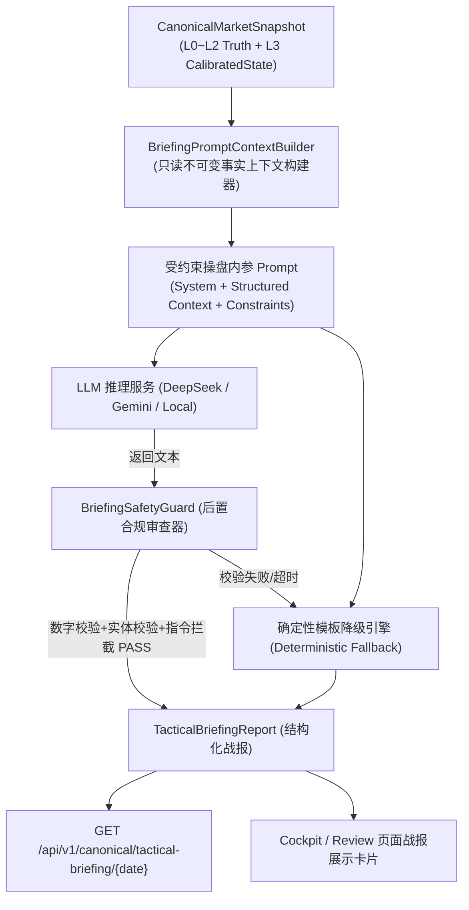

# DOC-80 · Phase 2D.3 受约束 LLM 实战战报生成器技术设计单

> **文档编号**：DOC-80-PHASE2D3-CONSTRAINED-LLM-BRIEFING-DESIGN-20261009  
> **文档性质**：Phase 2D.3 核心技术架构与实施方案设计单 (Technical Architecture & Engineering Specification)  
> **设计日期**：2026-10-09  
> **上位依据**：  
> 1. 《【最高董事会终审裁决令：PHASE 2D.1 FULL PASS & OFFICIAL ACCEPTANCE】》  
> 2. 《DOC-79 · Phase 2D.2 Market State 状态机自适应校准与多周期回放体系实施闭环报告》  
> 3. 《DOC-69 · Phase 2D 市场真相口径冻结与交易员驾驶舱技术设计单》  
> 
> **当前状态**：🔴 **PROPOSED / AWAITING BOARD REVIEW (设计待审定 / 生产代码零修改)**

---

## 一、架构背景与设计动机 (Motivation)

在 Phase 2D.0 (Market Truth 冻结)、Phase 2D.1 (Trader Cockpit 第一屏) 与 Phase 2D.2 (Market State 状态机自适应校准与多周期回放体系) 闭环后，系统已经具备了：
1. 底层坚不可摧的客观物理事实（L0~L2 Truth，23 项刚性门禁）；
2. 直观明晰的 1080P 倒金字塔交易员第一屏（30 秒 7 问零滚动）；
3. 确定性有限状态机（MECE 6 态）与多周期回放波普尔证伪能力。

然而，在面对真实交易员高强度盘后复盘与次日推演时，纯粹由模板拼接的定性文本依然存在表现力瓶颈：
> **交易员需要一份既严格扎根于客观事实、又具备资深游资操盘手/首席策略师视角的“操盘内参风格实战战报（Tactical Briefing）”，用高度专业、精炼、有血有肉的交易语言，将宏观流动性、微观天梯、主线战场、亏钱效应与次日观察哨熔于一炉。**

传统 LLM 应用的最大痛点是**“无约束胡言乱语 (Unconstrained Hallucination)”**：模型容易编造虚假成交额、捏造不存在的股票简称、给出违规的买卖投资建议。

因此，Phase 2D.3 的核心使命是践行：
> **“机器定状态，LLM 讲人话；强约束提炼，零自由编造。”**

---

## 二、架构刚性红线 (Hard Architecture Invariants)

在 Phase 2D.3 实施全流程中，必须严格恪守以下六项工程铁律：

1. **铁律一：设计先行，生产代码零修改**  
   在董事会对本设计单出具正式核准裁决前，严禁修改任何生产后端与前端业务逻辑。
2. **铁律二：输入单向消费，Truth 与 State 100% 只读**  
   战报生成器唯一合法输入是经过 Phase 2D.2 验证的 `CanonicalMarketSnapshot`，严禁逆向篡改底层任何事实与状态定性。
3. **铁律三：双轨制校验与零事实幻觉 (Zero-Hallucination Guard)**  
   战报文本生成后必须经过 AST/正则后置审查：文本中提及的成交额、炸板率、跌停数、最高板数必须与底层数值比特级完全吻合；股票代码与简称必须严格符合 Security Master 字典（如 `002242` 必须为九阳股份，严禁毅昌科技）。
4. **铁律四：零交易指令泄漏 (No Trading Directive)**  
   严禁输出任何买卖推荐、抄底指示或仓位建议（如“建议全仓杀入”、“积极做多”等违规用语），只能提供客观推演、风险揭示与次日观察条件。
5. **铁律五：双重优雅降级保底 (Dual Graceful Degradation)**  
   若大模型 API 出现超时、502 错误或生成文本未能通过后置审查，系统必须在 50ms 内无感降级为 Phase 2D.2 的确定性模板战报，绝不黑屏或中断服务。
6. **铁律六：存量 35 项门禁零污染**  
   继承运行已有 35 项 Freeze Gates，保证 100% PASS。

---

## 三、战报生成数据流与系统架构



---

## 四、核心模块工程规范

### 1. 不可变上下文构建器 (`BriefingPromptContextBuilder`)
从 `CanonicalMarketSnapshot` 中提取无歧义、去噪声的标准化量化输入字典：
- `trade_date`: 交易日
- `market_state`: 状态枚举与中文名（如 `HIGH_DIVERGENCE_TOPPING (高位剧烈分化期)`）
- `state_confidence`: 判定置信度
- `driving_factors`: 核心事实证据列表
- `total_turnover_yi`: 沪深总成交额（如 16821.09 亿）
- `star_divergence`: 科创50背离表现
- `max_height`: 连板最高高度（如 8B 新华传媒）
- `limit_up_count`: 真实涨停数 (43)
- `broken_limit_ratio`: 真实炸板率 (42.67%)
- `limit_down_count`: 跌停数 (13)
- `regulatory_anomalies`: 监管严重异动标的与家数 (11)
- `top_mainlines`: Top 3 主线核心梯队、龙头、反方证据与证伪条件

### 2. 受约束内参 Prompt 范式 (System Prompt Specification)
- **角色定位**：资深游资操盘手与头部券商特邀宏观策略内参首席顾问；
- **文风要求**：冷峻、精炼、穿透力强、直击资金本质，字数控制在 250~350 字；
- **结构规范**：
  1. **【大势定调】**：量能口径与指数背离定性；
  2. **【主线与梯队】**：指出核心做多战场与代表标杆；
  3. **【亏钱与监管负反馈】**：强调高位炸板、跌停大面与异动降温压力；
  4. **【明日推演与观察哨】**：列出空间标杆竞价承接点位与证伪触发条件，给出严格防守边界。

### 3. 后置合规审查器 (`BriefingSafetyGuard`)
代码层硬性校验生成结果，包含四大检查项：
1. **数字保真度检查 (Numerical Fidelity)**：提取文本中出现的关键量化数值，断言其与 Snapshot 对应字段误差 $\le 0.1\%$；
2. **实体身份单射检查 (Entity Master Binding)**：扫描文本中出现的股票简称与代码，必须在 `CanonicalSecurityMasterRegistry` 中且映射正确；
3. **交易指令阻断检查 (Illegal Directive Defense)**：扫描禁用词库（“买入”、“加仓”、“满仓”、“建仓”、“冲”、“梭哈”），一旦命中立即否决；
4. **长度与排版检查 (Length & Style)**：字数必须在 200 至 450 字之间。

---

## 五、契约模型设计 (`canonical_market.py` 扩展)

```python
class TacticalBriefingReport(BaseModel):
    """操盘手内参实战战报契约 (Phase 2D.3)"""
    model_config = ConfigDict(frozen=True, extra="forbid")

    trade_date: str = Field(..., description="业务交易日期 YYYY-MM-DD")
    generated_at: str = Field(..., description="战报生成时间 ISO-8601")
    market_state_label: str = Field(..., description="状态机标定中文名称 (如 '高位剧烈分化期')")
    tactical_briefing_text: str = Field(..., min_length=150, max_length=600, description="操盘内参正文 (250~350字)")
    key_battlegrounds: List[str] = Field(..., description="核心战场主线提炼")
    risk_warnings: List[str] = Field(..., description="主要亏钱效应与监管风险点")
    next_day_observation_posts: List[str] = Field(..., description="次日竞价核心观察哨与证伪条件")
    is_fallback_mode: bool = Field(False, description="是否处于确定性模板降级模式")
    safety_audit_passed: bool = Field(True, description="是否通过 BriefingSafetyGuard 合规审查")
    briefing_fingerprint: str = Field(..., description="RFC 8785 JCS 哈希签名")
```

---

## 六、Phase 2D.3 规划的 8 项刚性 Freeze Gates

| 门禁编号 | 门禁名称 | 校验要点与放行标准 |
| :--- | :--- | :--- |
| **GATE-2D3-01** | Structured Context Extraction Gate | 检验上下文提取器纯洁性，100% 忠实还原 Snapshot 事实 |
| **GATE-2D3-02** | Numerical Fidelity Guard Gate | 模拟错误数值（如虚高成交额/捏造炸板率），后置审查器必须 100% 拦截 |
| **GATE-2D3-03** | Entity Master Integrity Gate | 验证文本中 002242 必须为九阳股份，若出现毅昌科技立即拦截 |
| **GATE-2D3-04** | Illegal Directive Interception Gate | 模拟包含“建议买入/全仓”等违规用语，审查器必须坚决拦截 |
| **GATE-2D3-05** | Deterministic Fallback Gate | 模拟 LLM 异常/超时，系统在 50ms 内无感降级为确定性模板战报 |
| **GATE-2D3-06** | Tactical Briefing Generation (2026-10-08) | 针对 10-08 真实数据成功生成内参战报并通过全量审查 |
| **GATE-2D3-07** | Multi-Period Adaptation (2026-10-01) | 针对 10-01 主升日成功生成对应风格内参，验证文风自适应性 |
| **GATE-2D3-08** | Full Backward Compatibility (35/35) | 继承运行已有全部 35 项 Freeze Gates，继续保持 100% PASS |

---

## 七、分阶段实施里程碑

```text
[DOC-80 设计单审定] (当前阶段)
        ↓ 董事会签署核准令
[Phase 2D.3-A] 战报契约 Schema 定义与上下文提取器开发 (只读契约)
        ↓
[Phase 2D.3-B] 后置安全合规审查器与确定性降级引擎开发 (GATE-2D3-01 ~ 05)
        ↓
[Phase 2D.3-C] 受约束 LLM 实战战报生成服务与多周期测试 (GATE-2D3-06 ~ 07)
        ↓
[Phase 2D.3-D] 驾驶舱战报卡片展示对接与全量回归 (43/43 PASS)
        ↓
[提交 DOC-81 全量闭环与放行报告]
```

---

## 八、申请与裁决建议

系统现将《DOC-80 · Phase 2D.3 受约束 LLM 实战战报生成器技术设计单》呈交最高董事会：
1. **请董事会对本技术设计单的架构边界、双轨制审查器与 8 项 Freeze Gates 进行审阅**；
2. **在获得董事会书面核准前，保持生产代码零修改**；
3. **经董事会核准授权后，方可启动 Phase 2D.3-A 阶段的代码实施**。
