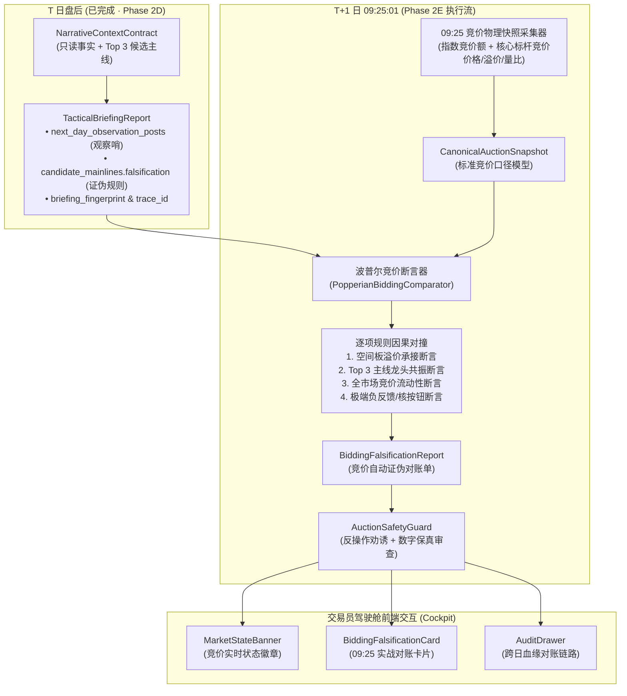

# 89-Phase-2E-0925集合竞价自动对账与次日波普尔证伪闭环技术设计单

- **设计单编号**：`SPEC-DESIGN-PHASE2E-20261009-V1.0`
- **状态**：**`PROPOSED / READY FOR REVIEW` (设计基线就绪，待团队终审评议)**
- **生效基线**：`v0.2.9` (Commit `fe4fe44`)
- **对应阶段**：**Phase 2E 盘前竞价对账与次日波普尔证伪自动化闭环**
- **上位依据**：最高董事会终审裁决令（`DOC-87 CLOSURE APPROVED & RELEASE RESTRICTION LIFTED`）
  1. 确认四项阻断任务全部通过独立审查穿透（VERIFIED / PASSED）；
  2. 正式解除 PRODUCTION RELEASE HOLD，固化生产版本基线 Commit `fe4fe44`；
  3. 正式解除 Phase 2E 冻结状态，授权编写 Phase 2E 技术设计单。

---

## 一、 立项背景与第一性原则

### 1. 核心痛点：认知闭环的“最后一公里”缺失
在 Phase 2D 中，系统成功重构了交易员驾驶舱（Trader Cockpit）并落地了受约束 LLM 操盘内参战报（Tactical Briefing）。在每个交易日（$T$ 日）盘后，系统不仅输出客观事实与 Top 3 主线，还在战报第四段输出冷峻的**“次日推演与防守红线”**，例如：
> *“次日竞价核心观察哨：重点观察 8B 空间标杆【新华传媒】、4B 核心先锋【时代万恒】的竞价溢价与承接动能；若核心龙头竞价大幅低开且承接无力，将触发短线情绪结构性证伪，绝对禁止盲目追高。”*

然而在实战交易中，交易员在 $T+1$ 日早上 **09:25** 集合竞价结束时面临致命痛点：
1. **认知延迟与精力分散**：09:25 到 09:30 仅有短短 5 分钟，交易员在看盘软件上要面对上百只跳动的竞价标的，必须靠人工记忆去回溯昨晚战报提到的空间标杆、梯队与主线；
2. **缺乏系统级反事实自动对撞**：波普尔科学哲学的核心是“可证伪性”。如果系统提出了证伪条件（Hypothesis Invalidation Rules），却不能在第一时间（09:25）由机器自动执行对撞比对，那么昨夜的假说就成了**“无法立即自动检验的事后诸葛亮”**；
3. **老旧竞价服务脱节**：现有 `backend/app/services/auction.py` 是早期版本编写的，消费的是旧版 `DailyReview` 与标量分，未接入 Phase 2D 建立的 `CanonicalMarketSnapshot`、`TacticalBriefingReport`、`CanonicalSecurityMasterRegistry` 与 JCS 数字指纹血缘。

### 2. 第一性原则与系统使命
**Phase 2E 的核心使命是：将 $T$ 日盘后战报设定的“次日证伪观察哨”，在 $T+1$ 日 09:25 转化为纯确定性、毫秒级、免人工干预的【机器反事实证伪对账单】！**

$$\text{T日盘后战报假说 (Hypothesis)} \xrightarrow[\text{09:25 真实竞价数据 (Evidence)}]{\text{波普尔自动断言执行器}} \begin{cases} 
\text{CONFIRMED} & \text{(主线共振强化 · 放行开盘推演)} \\ 
\text{DIVERGENT} & \text{(中性弱分歧 · 触发开盘承接观察)} \\ 
\text{FALSIFIED} & \text{(刚性证伪 · 触发一级撤退与防守警报)} 
\end{cases}$$

---

## 二、 总体架构与数据流管道



---

## 三、 核心业务数据契约设计 (Schemas)

### 1. 标准竞价快照契约 (`CanonicalAuctionSnapshot`)
严格继承 Phase 2D 实体单射与 Decimal 保真纪律：
```python
class StockAuctionQuote(BaseModel):
    model_config = ConfigDict(frozen=True, extra="forbid")
    
    code: str                  # 6位证券代码 (如 "600825")
    name: str                  # 权威规范名称 (如 "新华传媒")
    canonical_symbol: str      # 标准标识 (如 "SH600825")
    yesterday_close: Decimal   # 昨收价
    auction_price: Decimal     # 09:25 撮合开盘价
    auction_pct_change: Decimal# 竞价开盘涨跌幅 (%)
    auction_turnover_wan: Decimal # 竞价成交额 (万元)
    auction_volume_ratio: Decimal # 竞价换手率 / 占昨日全天成交额比 (%)
    bidding_status: str        # "LIMIT_UP_BIDDING" (一字涨停), "LIMIT_DOWN_BIDDING" (一字跌停), "NORMAL"
    open_order_imbalance_wan: Optional[Decimal] # 09:25 未匹配封单金额 (万元)

class CanonicalAuctionSnapshot(BaseModel):
    model_config = ConfigDict(frozen=True, extra="forbid")
    
    trade_date: str            # T+1 交易日
    observed_time: str         # "09:25:05" 观测时间
    prev_trade_date: str       # T 日 (绑定的基准复盘日期)
    bound_briefing_trace_id: str # 绑定的前夜战报 Trace ID
    bound_briefing_fingerprint: str # 前夜战报 JCS 哈希
    
    # 宽基与流动性竞价事实
    sh_index_open: Decimal
    sh_index_open_pct: Decimal
    sz_index_open: Decimal
    sz_index_open_pct: Decimal
    total_auction_turnover_yi: Decimal # 两市竞价总成交额 (亿元)
    auction_turnover_ratio_pct: Decimal # 占前日全天总额比例 (%)
    
    # 核心观测标的集合
    leader_quotes: List[StockAuctionQuote] # 前日空间标杆与 Top 3 主线领军标的
```

### 2. 证伪判定结论契约 (`BiddingFalsificationReport`)
```python
class FalsificationStatusEnum(str, Enum):
    CONFIRMED = "CONFIRMED"       # 假说得到强化 (龙头超预期/高开共振)
    DIVERGENT = "DIVERGENT"       # 中性分歧 (平开/微弱分歧，需盘中观察)
    FALSIFIED = "FALSIFIED"       # 刚性证伪 (龙头不及预期/跌停核按钮，触发撤退)
    INCONCLUSIVE = "INCONCLUSIVE" # 数据不完备或非交易日

class AssertionItemVerdict(BaseModel):
    model_config = ConfigDict(frozen=True, extra="forbid")
    
    rule_id: str               # 规则唯一标识 (如 "RULE-SPACE-LEADER-OPEN")
    target_entity: str         # 观测实体 (如 "600825 新华传媒 8B")
    expected_condition: str    # 前夜预设条件 (如 "竞价涨幅 >= +1.0% 或 平开弱转强")
    actual_observation: str    # 09:25 物理观测 (如 "开盘价 -3.25%，竞价成交 4200 万元")
    is_falsified: bool         # 是否被证伪
    evidence_delta: str        # 偏离度分析说明

class BiddingFalsificationReport(BaseModel):
    model_config = ConfigDict(frozen=True, extra="forbid")
    
    trade_date: str
    evaluated_at: str
    trace_id: str              # 承接前夜链路并派生: TRACE-{date}-AUCTION-{timestamp}
    bound_briefing_trace_id: str
    bound_briefing_fingerprint: str
    
    overall_verdict: FalsificationStatusEnum # 综合结论
    verdict_headline: str      # 简明一句话定调 (如: "空间标杆大幅低开，触发短线情绪结构性证伪")
    
    # 逐项对撞证据
    assertion_results: List[AssertionItemVerdict]
    
    # 机器推导行动边界 (客观事实条件，严禁 L5 交易劝诱)
    action_boundaries: List[str] # 如: ["核心龙头低开破位，前夜主升假说证伪，逆势追高面临极大亏损敞口", "防守板块高开，关注盘面防守避险轮动"]
    
    # 防伪存证
    falsification_fingerprint: str # RFC 8785 JCS SHA-256
    safety_audit_passed: bool
```

---

## 四、 波普尔竞价断言器算法规则 (Popperian Rules)

断言器核心类：`PopperianBiddingComparator`，执行 4 组完全客观且可量化的断言：

### 规则 1：空间标杆溢价承接断言 (Space Leader Premium Rule)
- **输入**：前日最高连板标的（如新华传媒 8B，昨收价 $P_{\text{pre}}$，09:25 竞价价 $P_{\text{auc}}$，涨跌幅 $\Delta\%$）；
- **判定逻辑**：
  1. $\Delta\% \ge +3.0\%$：判定为 `STRONG_PREMIUM`（强势超预期）；
  2. $-1.0\% \le \Delta\% < +3.0\%$：判定为 `NEUTRAL_ACCEPTABLE`（正常合理承接）；
  3. $-5.0\% \le \Delta\% < -1.0\%$：判定为 `WEAK_OPEN_BELOW_EXPECTATION`（弱开不及预期）；
  4. $\Delta\% < -5.0\%$ 或一字跌停：判定为 `COLLAPSE_FALSIFIED`（崩塌式证伪）。

### 规则 2：Top 3 主线领军标的共振断言 (Mainline Alignment Rule)
- **输入**：前夜认定的 Top 3 主线（如电池、医药、航运）各自的领军标的（梯队代表）；
- **判定逻辑**：
  - 计算 Top 3 领军标的竞价红绿开盘比例；
  - 若主线 1 领军开盘 $\Delta\% \ge +1.5\%$ 且竞价金额占昨全天 $>5\%$，判定主线 1 **获得增量开盘共振**；
  - 若全部领军标的集体绿开，判定**全市场主线共振假说全面证伪**。

### 规则 3：全市场流动性断崖监测断言 (Liquidity Cliff Rule)
- **输入**：两市 09:25 竞价成交总额 $V_{\text{auc}}$，前日全天总额 $V_{\text{pre}}$，比值 $R_{\text{vol}} = V_{\text{auc}} / V_{\text{pre}} \times 100\%$；
- **判定逻辑**：
  - 若 $R_{\text{vol}} < 0.8\%$：判定为 `LIQUIDITY_CONTRACTION`（流动性严重萎缩，开盘博弈需高度谨慎）；
  - 若 $R_{\text{vol}} \ge 1.5\%$：判定为 `ACTIVE_TURNOVER`（竞价交投活跃）。

### 规则 4：综合定调综合决策矩阵
$$\text{OverallVerdict} = \begin{cases}
\text{FALSIFIED}, & \text{若 规则1 崩塌 或 规则2 全部领军破位} \\
\text{CONFIRMED}, & \text{若 规则1 强势 且 主线1共振强化} \\
\text{DIVERGENT}, & \text{其余中间分歧状态}
\end{cases}$$

---

## 五、 UI 交互与交易员驾驶舱集成 (Cockpit Integration)

在前端驾驶舱界面（`TraderCockpitView`）中完成无缝集成：

1. **时段自适应识别**：
   - 当系统时间处于 **09:25 ~ 09:35** 时，驾驶舱顶部工具栏与第一层状态横幅自动高亮闪烁 **【09:25 竞价对账已就绪】**；
   - 其余时间提供历史竞价对账单回查与重放功能。
2. **第一屏竞价对账卡片 (`BiddingFalsificationCard.tsx`)**：
   - 采用冷色调专业金融终端风格；
   - 显著呈现红/绿/灰对账定调标签（`CONFIRMED` / `DIVERGENT` / `FALSIFIED`）；
   - 展示“前夜战报预设” vs “今晨 09:25 物理实测”的双栏对比表；
   - 明确列出机器推导的次日防守边界。
3. **与现有战报弹窗联动**：
   - 在 `TacticalBriefingModal` 中增加一个标签页：“次日 09:25 对账回执”，使昨夜战报与次晨开盘无缝缝合。

---

## 六、 实施规划与里程碑清单 (Phase 2E.1 ~ 2E.4)

```text
[ ] Phase 2E.1: 竞价事实快照采集与模型规范 (Canonical Auction Data Foundation)
    [ ] 重构/新建 backend/app/services/canonical_auction_service.py
    [ ] 接入实时/重放指数与重点股票 09:25 竞价行情接口
    [ ] 编写 2E.1 数据模型契约与单元测试 (覆盖休市/非交易日心跳守卫)

[ ] Phase 2E.2: 波普尔自动断言执行器与对账引擎 (Popperian Bidding Engine)
    [ ] 实现 backend/app/services/popperian_bidding_comparator.py
    [ ] 绑定前夜 TacticalBriefingReport 与 JCS 哈希跨日防伪
    [ ] 编写 2E.2 门禁测试 (含高开/低开/跌停核按钮全场景回放断言)

[ ] Phase 2E.3: 安全守卫与 REST API 交付 (Safety Guard & API Endpoint)
    [ ] 实现 AuctionSafetyGuard (严防买卖劝诱，确保纯客观边界输出)
    [ ] 提供 GET /api/v1/canonical/auction-falsification/{date} 端点
    [ ] 编写 2E.3 端到端 API 与幂等性门禁

[ ] Phase 2E.4: 交易员驾驶舱前端组件与全量回归 (Trader Cockpit Frontend & E2E)
    [ ] 编写 frontend/src/components/cockpit/BiddingFalsificationCard.tsx
    [ ] 将组件集成进 TraderCockpitView.tsx
    [ ] 路由平滑收口：将历史 /review 无缝重定向/引导至 /cockpit
    [ ] 针对 10-08 与 10-09 真实交易日数据执行全链路实弹回归
```

---

## 七、 铁律与约束

1. **绝对隔离 L5 交易信号**：竞价对账单仅输出“假说是否被证伪”、“客观市场承接状态”，严禁直接向用户下发“开盘买入”、“开盘卖出”等非法指令；
2. **单请求跨日血缘可追溯**：对账单必须显式记录并锚定前夜战报的 `Trace ID` 与 `JCS SHA-256 Fingerprint`，杜绝孤立假说；
3. **真实数据零 Mock 铁律**：全部测试必须基于 SQLite 真实回放数据或真实行情接口，严禁伪造测试通过证据。
