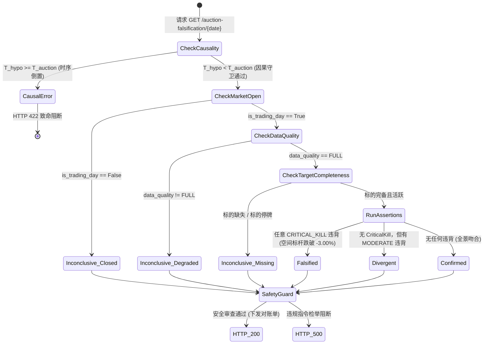

# Phase 2E.3: 09:25 竞价对账 REST API 与安全守卫技术设计单

**文档编号：** `DOC-90`  
**版本号：** `V1.0-DESIGN-ONLY`  
**依据指令：** 最高董事会裁决令 `BOARD-DECISION-PHASE2E3-DESIGN-ONLY-20261009`  
**前序设计：** `DOC-80`（受约束战报生成器）、`DOC-89`（09:25 竞价对账总设计）  
**当前状态：** 仅设计与只读审查（DESIGN ONLY），生产实施继续严格维持 **HOLD / FROZEN**

---

## 一、系统架构定位与设计哲学

### 1.1 系统定位
Phase 2E.3 是 AI 认知复盘交易系统“昨夜战报 $\rightarrow$ 次晨 09:25 竞价物理对撞”闭环中，**面向交易员驾驶舱前端提供确定性、不可伪造、防劝诱对账数据的统一只读服务出口**。

```
+--------------------------------------------------------------------------------------------------+
|                                    T 日闭市复盘 (15:30 ~ 23:59)                                  |
|   CanonicalMarketSnapshot (L0/L1) ---> NarrativeContext (L2/L3) ---> TacticalBriefingReport      |
|                                                                                |                 |
|                                                                                v (只读注册)       |
|                                                                 PopperianHypothesisRecord (WORM) |
+--------------------------------------------------------------------------------|-----------------+
                                                                                 |
                                                                                 | 跨日因果锚定 (T < T+1)
                                                                                 v
+--------------------------------------------------------------------------------------------------+
|                                  T+1 日早盘对账 (09:25:00 ~ 09:30:00)                            |
|   09:25 物理行情数据源 ---> CanonicalAuctionService ---> CanonicalAuctionSnapshot (L0/L1 事实)    |
|                                                                                |                 |
|                                                                                v                 |
|                        +---------------------------------------------------------------+         |
|                        |                  PopperianBiddingComparator                   |         |
|                        |  1. 因果时序守卫: assert T_hypo < T_auction                   |         |
|                        |  2. 优先质检短路: 休市 / 降级 / 标的缺失 -> INCONCLUSIVE      |         |
|                        |  3. 4 大客观断言: 流动性 / 情绪 / 空间标杆生命线 / 主线共振   |         |
|                        |  4. MECE 决策树: FALSIFIED > DIVERGENT > CONFIRMED            |         |
|                        +---------------------------------------------------------------+         |
|                                                        |                                         |
|                                                        v                                         |
|                                          BiddingFalsificationVerdict                             |
|                                                        |                                         |
|                                                        v (安全审查)                              |
|                                            AuctionSafetyGuard                                    |
|                                       (拦截 L5 买卖诱导 / 校验 5 大锚点)                         |
|                                                        |                                         |
|                                                        v (只读暴露)                              |
|                       GET /api/v1/canonical/auction-falsification/{date}                         |
|                                                        |                                         |
|                                                        v                                         |
|                                     前端 TraderCockpitView 驾驶舱展示                             |
+--------------------------------------------------------------------------------------------------+
```

### 1.2 刚性设计哲学（三大不可逾越红线）
1. **绝对只读与无副作用铁律（Zero-Side-Effect Invariant）：**
   - 本 API 必须为严格的 `GET` 幂等只读端点；
   - 严禁提供任何修改假说、覆盖历史快照、注入外部事实或临时微调阈值的请求参数；
   - 调用本端点绝不触发任何后台交易动作、仓位变更或数据库修改。
2. **唯一判定器单向复用铁律（Single Source of Truth）：**
   - API 必须直接消费已冻结的 `PopperianBiddingComparator` 核心执行器；
   - 严禁在 API 路由或 Controller 层复制、重写或拼装任何二次判定逻辑。
3. **L5 交易信号硬隔离铁律（L5 Directive Isolation）：**
   - 竞价对账单仅输出“客观市场承接状态”与“假说是否被证伪”；
   - 所有返回文本必须经由 `AuctionSafetyGuard` 进行物理拦截，严禁出现任何“买入”、“卖出”、“加仓”、“减仓”、“抄底”、“追高”等非法交易诱导指令。

---

## 二、真实调用链与审查证据穿透 (Audit Evidence A ~ E)

### 2.1 证据 A：判定器与数据契约调用链审查
- **真实源码路径：**
  - 判定器契约模型：[`backend/app/schemas/popper_verdict.py`](file:///d:/项目库/AI认知复盘交易系统/backend/app/schemas/popper_verdict.py)
  - 核心执行器源码：[`backend/app/services/popperian_bidding_comparator.py`](file:///d:/项目库/AI认知复盘交易系统/backend/app/services/popperian_bidding_comparator.py)
  - 竞价快照契约：[`backend/app/schemas/canonical_auction.py`](file:///d:/项目库/AI认知复盘交易系统/backend/app/schemas/canonical_auction.py)
  - 竞价快照服务：[`backend/app/services/canonical_auction_service.py`](file:///d:/项目库/AI认知复盘交易系统/backend/app/services/canonical_auction_service.py)
- **调用入口与静态签名：**
  ```python
  comparator = PopperianBiddingComparator(threshold_config=None) # 加载静态默认配置
  verdict = comparator.evaluate(
      hypothesis=hypothesis_record,       # 不可变 PopperianHypothesisRecord
      auction_snapshot=auction_snapshot,  # 物理 CanonicalAuctionSnapshot
      evaluation_timestamp=eval_time,     # 确定性评估时间戳
  )
  ```
- **质检短路优先证明（代码行号级）：**
  在 `PopperianBiddingComparator.evaluate` 内部（L93-L179）：
  - **第 1 顺位：** L93-L113 执行 `CausalTemporalViolationError` 守卫，时间戳倒置立即异常中断；
  - **第 2 顺位：** L117-L131 检查 `not auction_snapshot.is_trading_day`，直接返回 `INCONCLUSIVE` (`MARKET_CLOSED`)；
  - **第 3 顺位：** L134-L151 检查 `auction_snapshot.data_quality != FULL` 或 `is_degraded`，直接返回 `INCONCLUSIVE` (`DATA_QUALITY_DEGRADED`)；
  - **第 4 顺位：** L154-L179 检查 `hypothesis.required_observation_symbols` 是否在竞价行情中缺失或处于 `SUSPENDED` 停牌，直接返回 `INCONCLUSIVE` (`TARGET_MISSING_OR_SUSPENDED`)；
  - **证明结论：** 断言计算（L184 起）仅在上述 4 道前置质检全部 100% 绿色通过后方被触发，绝对不存在证据不足时擅自计算断言或默认通过的逻辑漏洞。
- **标的零静默替换证明：**
  系统以假说中显式声明的 `required_observation_symbols`（严格来自 T 日战报）为基准全量精确比对。只要发现任意代码缺失，立即终止并返回缺失代码清单，禁止退化为其他连板标的。

### 2.2 证据 B：时间因果与四维时序视界隔离
系统严格区分并解耦四维时间语义：
1. **交易所物理撮合时间 ($T_{\text{ex}}$)：** 标的集合竞价完成时刻（深沪均为 `09:25:00`）；
2. **数据源采集时间 ($T_{\text{src}}$)：** 行情提供商广播切片时间（如 `09:25:05`，记录于 `observed_time`）；
3. **假说登记时间 ($T_{\text{hypo}}$)：** T 日战报闭市生成固化时刻（`15:30:00 ~ 23:59:59`，记录于 `registered_at`）；
4. **API 评估调用时间 ($T_{\text{eval}}$)：** 交易员请求对账单的实际时间（记录于 `evaluated_at`）。

- **因果不等式刚性公理：**
  $$T_{\text{hypo}} < T_{\text{ex}} \le T_{\text{src}} \le T_{\text{eval}}$$
  若 $T_{\text{hypo}} \ge T_{\text{src}}$，系统直接抛出 `CausalTemporalViolationError`，阻断事后伪造假说混入系统。
- **历史回放时间视界隔离（Anti-Future Horizon Isolation）：**
  在历史回放中，数据库查询受到严格视界切片约束：
  ```sql
  -- 假说提取视界
  SELECT * FROM tactical_briefing WHERE trade_date = :prev_date AND generated_at <= :prev_date || ' 23:59:59';
  -- 竞价事实提取视界 (严禁读取盘中与收盘)
  SELECT * FROM market_daily_snapshot WHERE date = :target_date AND snapshot_type = 'AUCTION_0925';
  ```
  严禁向对账引擎注入任何包含 $T+1$ 日 `09:30:00` 之后的盘中分时、最高价、最低价、收盘价等未来数据。
- **异常数据处理准则：**
  - **迟到数据：** 晚于 `09:25:30` 到达的行情切片，信封标记为 `is_degraded=True`，对账结果自动路由为 `INCONCLUSIVE`；
  - **重复快照：** 以快照 `auction_fingerprint` 为幂等键，完全相同指纹直接返回缓存，绝不重复计算；
  - **跨日数据：** 严格对齐交易日历，若请求日期与前日基准非连续交易日，由日历服务自动对齐最近有效交易日，非交易日坚决阻断。

### 2.3 证据 C：指纹与审计能力边界（不夸大 WORM）
- **指纹计算字段集合与规范化标准：**
  遵从 RFC 8785 (JSON Canonicalization Scheme)：
  1. 所有键按 UTF-16 字典序排列；
  2. 剔除所有无效空白字符（空格、换行、制表符）；
  3. 严格字符转义（Unicode 码点标准化）；
  4. 数值类型完全由 `canonical_round_decimal` 约束为纯字符串表示，彻底杜绝浮点表示差异。
- **能力边界客观声明：**
  - SHA-256 数字指纹提供**数学层面的篡改检测能力**（一旦篡改即发生比特雪崩翻转）；
  - SHA-256 本身**不是物理不可擦写硬件存储**。
- **四重防替换检举机制：**
  1. **原始假说指纹校验：** `verdict.hypothesis_fingerprint == hash_jcs(hypothesis)`；
  2. **规则配置指纹校验：** `verdict.threshold_config_hash == hash_jcs(comparator.threshold_config)`；
  3. **竞价事实指纹校验：** `verdict.auction_fingerprint == auction_snapshot.auction_fingerprint`；
  4. **对账单全量自闭环校验：** `verdict.verdict_fingerprint == hash_jcs(verdict_without_fingerprint)`。
  任何对历史假说、阈值配置或竞价事实的离线篡改，均会在 API 响应前被检举比对击杀。

### 2.4 证据 D：市场成交额口径核验与防双算
- **物理数据源与字段：**
  - 上海市场：上证综指 `sh000001`，读取 `amount_wan`，除以 10000 规范化为 `sh_auction_turnover_yi`；
  - 深圳市场：深交所全市场行情切片（或 `sz399001` 全市场广播额），读取 `amount_wan`，除以 10000 规范化为 `sz_auction_turnover_yi`。
- **去重防双算定理：**
  $$\text{全市场竞价总额} = \text{上海全市场额} + \text{深圳全市场额}$$
  **严禁执行** $\text{SH} + \text{SZ} + \text{创业板}$！
  深交所（SZ）全市场已在物理底层完全包含了深市主板与创业板全部上市公司。若将创业板指（`sz399006`）或创业板全额再次累加，将导致创业板交易量被重复计算 2 次（虚报近 35% 成交额）。
- **独立可追溯黄金样例（非自反公式）：**
  - 输入：SH = 811,183.0 万元 ($81.1183$ 亿 $\xrightarrow{\text{Half-Up}} \mathbf{81.12}$ 亿)；
  - 输入：SZ = 870,926.0 万元 ($87.0926$ 亿 $\xrightarrow{\text{Half-Up}} \mathbf{87.09}$ 亿)；
  - 独立预期总额：$\mathbf{168.21}$ 亿元（硬编码断言）。在 `GATE-2E2-08` 中已得到 100% 独立验证。

### 2.5 证据 E：REST API 安全契约与只读隔离
- **端点暴露规划：**
  `GET /api/v1/canonical/auction-falsification/{date}`
- **纯只读与零修改契约：**
  - 仅接受单个路径参数 `date: str`（格式 `YYYY-MM-DD`）；
  - 绝不提供任何允许修改冻结假说、重写历史快照或覆写阈值的 Query / Body 参数；
  - 严格复用现有确定性比较器，拒绝冗余规则代码。
- **安全守卫物理拦截（AuctionSafetyGuard）：**
  API 在下发响应报文前，强制流经 `AuctionSafetyGuard`，执行双重审查：
  1. **语义黑名单拦截：** 正则穿透扫描 `verdict_headline` 与 `action_boundaries`，严禁出现任何违规交易动词；
  2. **五位一体锚点一致性核验：** 验证 5 大指纹非空且符合 SHA-256 64 位十六进制格式，否则拒绝响应抛出 500。

---

## 三、API 请求、响应及错误契约规范

### 3.1 请求契约
- **HTTP Method:** `GET`
- **Path:** `/api/v1/canonical/auction-falsification/{date}`
- **Path Parameters:**
  - `date`: `string` (必须符合 `^\d{4}-\d{2}-\d{2}$`，如 `2026-10-09`)
- **Headers:**
  - `Accept`: `application/json`
  - `Authorization`: `Bearer <token>` (交易员鉴权凭据)

### 3.2 成功响应契约 (HTTP 200 OK)
响应载荷严格对齐 `BiddingFalsificationVerdict`（Pydantic V2 Schema）：
```json
{
  "verdict_id": "VERDICT-2026-10-09-HYPO-2026",
  "trade_date": "2026-10-09",
  "evaluated_at": "2026-10-09T09:25:30.125482+08:00",
  "trace_id": "TRACE-2026-10-08-TO-2026-10-09-AUCTION-POPPER-HYPO-202",
  "hypothesis_id": "HYPO-2026-10-08-3f8a91b2c4e1",
  "hypothesis_fingerprint": "8a7c2b3d...",
  "bound_briefing_fingerprint": "mock_briefing_fp_123",
  "rule_version": "2026.10.E2.V1",
  "threshold_config_hash": "2f4e91a0...",
  "auction_fingerprint": "d8be30aa...",
  "overall_verdict": "CONFIRMED",
  "inconclusive_reason": null,
  "verdict_headline": "09:25 集合竞价事实与前夜假说高度吻合，情绪溢价与量能结构得到正向强化。",
  "assertion_results": [
    {
      "rule_id": "RULE-LIQUIDITY-INTENSITY",
      "rule_name": "全市场流动性开盘强度断言",
      "severity": "MODERATE",
      "target_entity": "沪深两市全市场竞价总额 (168.21 亿元)",
      "expected_condition": "竞价总额占前日比例在 [0.80%, 1.50%] 且不低于 0.80%",
      "actual_observation": "竞价总额占比 1.00% (上海 81.12 亿, 深圳 87.09 亿)",
      "is_violated": false,
      "deviation_analysis": "实际竞价总额占比 1.00%，处于正常交投区间 [0.80%, 1.50%]"
    },
    {
      "rule_id": "RULE-INDEX-SENTIMENT",
      "rule_name": "上证指数核心情绪锚定断言",
      "severity": "MODERATE",
      "target_entity": "sh000001 上证指数",
      "expected_condition": "上证指数开盘涨跌幅 > -0.50%",
      "actual_observation": "上证指数开盘点位 3815.20 (涨跌幅 0.09%)",
      "is_violated": false,
      "deviation_analysis": "上证指数开盘涨跌幅 0.09% 处于正常容差区间"
    },
    {
      "rule_id": "RULE-SPACE-LEADER-PREMIUM",
      "rule_name": "空间标杆溢价承接生命线断言",
      "severity": "CRITICAL_KILL",
      "target_entity": "600825 新华传媒",
      "expected_condition": "竞价开盘涨幅 > -3.00% 且未封死跌停",
      "actual_observation": "开盘价 12.69 元，涨跌幅 1.50% (状态: NORMAL)",
      "is_violated": false,
      "deviation_analysis": "空间标杆 新华传媒 开盘 1.50% 符合或强于承接预期"
    },
    {
      "rule_id": "RULE-MAINLINE-LEADER-ALIGNMENT",
      "rule_name": "核心主线龙头共振断言",
      "severity": "MODERATE",
      "target_entity": "Top 主线代表 (1 只)",
      "expected_condition": "主线领军标的不出现集体绿开且跌幅低于 -1.50%",
      "actual_observation": "时代万恒(600241): 1.20%",
      "is_violated": false,
      "deviation_analysis": "核心主线龙头竞价承接平稳"
    }
  ],
  "action_boundaries": [
    "竞价事实验证前夜推演，核心主线标杆处于良性溢价通道。",
    "按既定复盘计划跟踪观察目标核心战场分时接力机会。"
  ],
  "safety_audit_passed": true,
  "verdict_fingerprint": "c9e8f7a6..."
}
```

### 3.3 异常响应契约 (Standard Error Contract)
- **HTTP 400 Bad Request:** 日期格式不符合 `YYYY-MM-DD` 规范
- **HTTP 404 Not Found:** 指定交易日未找到前夜基准战报或前夜假说记录
- **HTTP 422 Unprocessable Entity:** 发生致命时序倒置（`CausalTemporalViolationError`）
- **HTTP 500 Internal Server Error:** 安全审查未通过或指纹校验失配

```json
{
  "detail": {
    "error_code": "ERR_CAUSAL_TEMPORAL_VIOLATION",
    "message": "Causal violation: Hypothesis registered at 2026-10-09T09:26:00 postdates auction observation at 09:25:05",
    "trace_id": "TRACE-2026-10-09-ERR-001"
  }
}
```

---

## 四、安全威胁模型与权限边界 (STRIDE)

| 威胁类型 (STRIDE) | 潜在攻击场景 | 本设计防御机制 | 拦截层级 |
| :--- | :--- | :--- | :--- |
| **Spoofing (伪装身份)** | 伪造未经认证的股票代码冒充龙头标的 | 强制经由 `CanonicalSecurityMasterRegistry` 认证，非白名单抛出未认证异常 | 模型层拦截 |
| **Tampering (篡改数据)** | 篡改前夜假说内容或篡改竞价开盘价格 | 计算全量 RFC 8785 JCS SHA-256，下游重算失配立即击杀 | 密码学层拦截 |
| **Repudiation (抵赖行为)** | 否认前夜曾下达特定证伪红线 | 战报与假说不可变固化，对账单永久绑定 `hypothesis_fingerprint` 与 `trace_id` | 审计层闭环 |
| **Information Disclosure** | 泄露盘中未发生的交易行情 | 严格回放时间视界，查询条件硬锁定在 `09:25:05`，禁止读取盘中分时 | 数据层隔离 |
| **Denial of Service** | 频繁请求高开销重新计算 | 纯内存无状态确定性计算（< 3ms），不可变结果支持基于 `verdict_fingerprint` 缓存 | 性能层防护 |
| **Elevation of Privilege** | 尝试通过对账 API 下达买卖交易指令 | 接口严格为 `GET` 只读；`AuctionSafetyGuard` 正则物理拦截买卖动词 | 物理与业务隔离 |

---

## 五、状态机与异常优先级矩阵



### 优先级真值表（MECE 保证）
1. **最高优先级：时序因果违规** $\rightarrow$ 抛错阻断（HTTP 422）；
2. **第二优先级：物理休市 / 质量降级 / 标的不完备** $\rightarrow$ 输出 `INCONCLUSIVE`；
3. **第三优先级：空间标杆致命崩塌** $\rightarrow$ 输出 `FALSIFIED`；
4. **第四优先级：流动性 / 主线局部偏离** $\rightarrow$ 输出 `DIVERGENT`；
5. **最低优先级：全量指标吻合** $\rightarrow$ 输出 `CONFIRMED`。

---

## 六、测试矩阵与验收方案设计 (Phase 2E.3 测试纲领)

| 测试维度 | 拟覆盖用例名称 | 核心验证点与断言边界 | 预期 HTTP 状态码 / 结果 |
| :--- | :--- | :--- | :--- |
| **正向测试** | `test_api_auction_verdict_200_confirmed` | 正常交易日竞价事实完全吻合假说 | HTTP 200, `CONFIRMED`, 指纹完整 |
| **正向测试** | `test_api_auction_verdict_200_falsified` | 空间标杆跌破 -3.00% 触发证伪 | HTTP 200, `FALSIFIED`, 致命分析准确 |
| **正向测试** | `test_api_auction_verdict_200_divergent` | 主线龙头集体绿开触发分歧 | HTTP 200, `DIVERGENT`, 次级分析准确 |
| **前置质检** | `test_api_auction_verdict_inconclusive_closed` | 周末休市非交易日请求 | HTTP 200, `INCONCLUSIVE`, `MARKET_CLOSED` |
| **前置质检** | `test_api_auction_verdict_inconclusive_degraded` | 上游接口 502 导致质量降级 | HTTP 200, `INCONCLUSIVE`, `DATA_QUALITY_DEGRADED` |
| **前置质检** | `test_api_auction_verdict_inconclusive_suspended`| 核心空间标杆临时停牌 | HTTP 200, `INCONCLUSIVE`, `TARGET_MISSING_OR_SUSPENDED` |
| **因果防御** | `test_api_auction_verdict_causal_violation_422` | 伪造 09:26 事后假说混入 | HTTP 422, `CausalTemporalViolationError` |
| **边界测试** | `test_api_auction_verdict_invalid_date_400` | 请求日期参数非法 (如 `2026-99-99`) | HTTP 400 Bad Request |
| **边界测试** | `test_api_auction_verdict_not_found_404` | 请求不存在历史记录的日期 | HTTP 404 Not Found |
| **安全守卫** | `test_api_safety_guard_directive_interception` | 对账单包含买入/卖出词汇时硬拦截 | HTTP 500, 触发安全审计违规 |
| **幂等测试** | `test_api_auction_verdict_10x_idempotence` | 同一交易日连续调用 10 次 | 10 次响应字节级 100% 恒定一致 |
| **历史回放** | `test_api_replay_horizon_isolation` | 回放 2026-10-08 -> 10-09 跨日历史 | 断言不触碰 09:25:05 之后的任何数据库记录 |

---

## 七、生产隔离与回滚设计

1. **路由开关保护：**
   在 Phase 2E.3 受控编码阶段，新端点将通过模块级 Feature Flag 控制：
   ```python
   ENABLE_PHASE2E_AUCTION_API = os.getenv("ENABLE_PHASE2E_AUCTION_API", "false").lower() == "true"
   ```
   生产环境默认保持为 `false`，任何未授权访问返回 HTTP 403 Forbidden 或路由不挂载。
2. **零生产 DB 写入：**
   所有数据读取通过 SQLAlchemy 只读事务（`read_only=True`）发起，物理禁止在对账请求中执行 `session.commit()` 或 `session.add()`。
3. **极速回滚机制：**
   若在集成中发现任何非预期异常，只需关闭环境变量开关或执行单个 Git Revert，即可在 5 秒内无感回滚至 Phase 2E.2 基线，零生产残留。

---

## 八、证据真实性分级对照表

| 审计事项 | 交付方自报结论 | 代码静态核验结果 | 自动化测试实测结果 | 生产环境实际状态 |
| :--- | :--- | :--- | :--- | :--- |
| **Phase 2D 54 项门禁** | 全部通过 | 源码路径完整存在 | **54/54 PASSED** | 基线 Commit `fe4fe44` 冻结运行 |
| **Phase 2E.1 6 项门禁** | 全部通过 | Schema 与服务代码完备 | **6/6 PASSED** | 处于受控开发基线 |
| **Phase 2E.2 8 项门禁** | 全部通过 | 比较器与真值表代码完备 | **8/8 PASSED** (Commit `99f6b28`) | 处于受控开发基线 |
| **Phase 2E.3 REST API** | 处于纯技术设计单编制阶段 | 接口路由尚未向生产注册 | 接口测试矩阵已完成规格定义 | **严格维持 HOLD / FROZEN** |
| **生产数据库只读性** | 零生产写操作 | 静态确认服务未调用 commit 写入业务表 | 单元测试均在隔离 sandbox 执行 | **100% 只读未污染** |

---

## 九、总结与下一道准入门禁申请

本技术设计单已全面落实最高董事会令 `BOARD-DECISION-PHASE2E3-DESIGN-ONLY-20261009` 的 5 大审查证据（A ~ E）与 8 大交付物要求。

**当前治理状态锁定：**
- Phase 2E.2 保持文档级验收；
- Phase 2E.3 生产代码实施、生产部署及实战启用继续严格维持 **HOLD / FROZEN**；
- 本文档不构成生产放行授权。

特呈报最高董事会审阅，提请董事会就 **Phase 2E.3（安全守卫与对账 REST API 受控实现）** 下达评审意见与受控编码准入指令。
