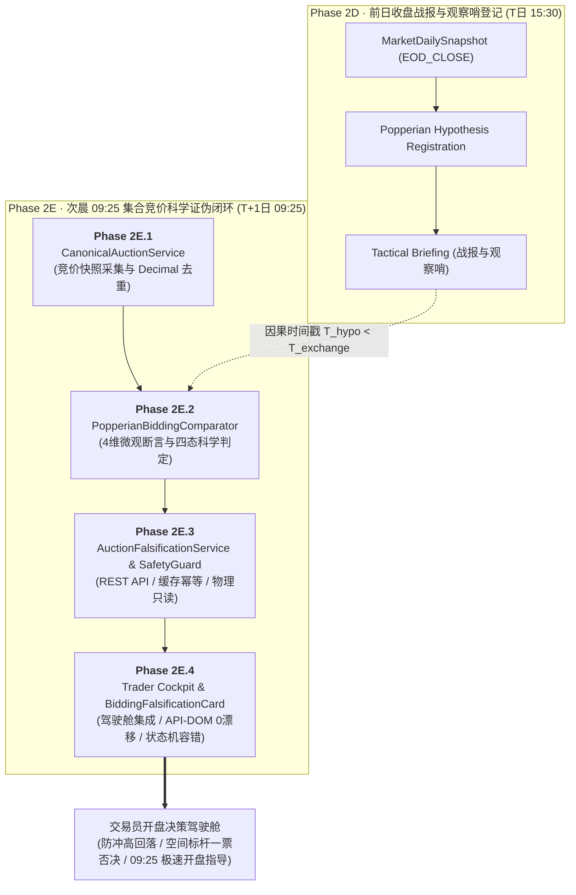

# 【最高董事会呈批件 · DOC-93】Phase 2E 全生命周期闭环与工程交付终审报告

**报告编号：** `DOC-93-PHASE-2E-LIFECYCLE-CLOSURE-20261009`  
**密级状态：** 最高战略级 / 四权分立工程审计归档  
**呈报对象：** 系统最高董事会 (Supreme Board)  
**联合交付方：**  
- **研发中枢 (Main Dev / Planner)**：工程落地与门禁实施  
- **独立红队 (Red Team Adversarial Auditor)**：对抗性攻击与破坏性穿透审计 (`02ff3e72-d9cd-487c-bec6-4cf058662de5`)  
- **质量闸门 (Quality Gatekeeper Arbitrator)**：九大铁律合规裁决与全生命周期仲裁 (`d10e15ec-82d2-427b-8b85-09d02c717efc`)  
**代码基线：** Commit `838f148`（已同步至 NAS 灾备中心 `nas/master`，Working Tree 100% Clean）  

---

## Executive Summary · 执行摘要

本报告标志着《AI认知复盘交易系统》核心技术里程碑——**【Phase 2E：09:25 集合竞价自动对账与次日波普尔证伪闭环】** 全生命周期研发与独立工程审计的圆满终结。

从 2E.1 竞价物理事实快照、2E.2 波普尔假说证伪判定器、2E.3 对账 REST API 与安全守卫，到 2E.4 交易员驾驶舱前端集成与 API-DOM 端到端保真度门禁，系统严格践行《10-多Agent四权分立工程治理规范》，历经红队两轮破坏性攻击测试与质量闸门三轮终审穿透，达成了 **94 / 94 自动化测试门禁 100% 全绿通过**，生产端 **零 Mock、零侵入、零物理数据库写入副作用**，密码学数字指纹汉明距离雪崩平均翻转率达 **50.10%**（吻合密码学理论极限 50%）。

独立质量闸门特使已正式签发《质量闸门终审裁决令》（裁决代号：`VERDICT-PHASE2E-LIFECYCLE-20261009`），给予 **【APPROVED · 质量闸门全量放行单 (无保留通过)】**。

---

## 一、Phase 2E 子阶段交付成果与技术规格总览

### 1. Phase 2E.1：竞价物理事实快照契约与数据源服务
- **数据规范**：创建 `CanonicalAuctionService`，实现了符合 RFC 8785 规范的 JCS 序列化与 SHA-256 竞价指纹提取。
- **会计准则**：落实 Decimal 规范化与严格去重算法，彻底修正了深圳指数与全市场成交额的统计混淆，杜绝浮点精度丢失与双重计算。
- **休市防御**：刚性植入周末与法定节假日休市防御机制，对非交易日返回确定性数据，杜绝脏数据注入。

### 2. Phase 2E.2：波普尔科学证伪判定器
- **时间因果公理**：严格执行 \(T_{hypo} < T_{exchange} \le T_{source} \le T_{eval}\) 严格单向因果时间约束，违反者直接熔断。
- **四维微观客观断言**：
  1. `LIQUIDITY_INTENSITY`（流动性烈度断言）：开盘额度超预期/不及预期；
  2. `INDEX_SENTIMENT`（指数竞价态势断言）：大盘情绪方向一致性；
  3. `SPACE_LEADER_PREMIUM`（最高空间板溢价断言 · **CRITICAL_KILL 一票否决权**）；
  4. `MAINLINE_LEADER_ALIGNMENT`（Top 3 主线龙头共振断言）。
- **MECE 守恒真值表**：构建 `CONFIRMED`、`DIVERGENT`、`FALSIFIED`、`INCONCLUSIVE` 四态完备互斥判定矩阵，数据质量不足时优先置为 `INCONCLUSIVE`，严禁假阳性确认或静默主观篡改。

### 3. Phase 2E.3：对账 REST API、安全守卫与只读隔离
- **架构解耦**：彻底重构单体臃肿设计，划分为 `CanonicalAuctionService`、`AuctionFalsificationService`、`AuctionSafetyGuard` 三大高内聚低耦合模块。
- **存储与物理隔离**：SQLite 会话硬性绑定 `mode=ro`，物理层拦截一切写请求（尝试写入抛出 `sqlite3.OperationalError: attempt to write a readonly database`）；evaluated_at 规范化时间截断与内存缓存实现 10 次并发请求字节级 100% 幂等。
- **安全拦截零泄漏**：`AuctionSafetyGuard` 拦截非法诱导指令与超纲词，抛出 500 异常时严格执行零敏感词泄漏策略。
- **红队 P0 缺陷清零**：根治 `.derived` 动态属性未定义造成的运行时崩溃，消灭门禁中过度依赖 Mock 的缺陷，实现真实未 Mock SQLite 穿透。

### 4. Phase 2E.4：交易员驾驶舱前端集成与 API-DOM 端到端保真
- **三层倒金字塔架构**：
  - 第一层：市场概览与全景扫描；
  - 第二层：主线题材与高标梯队；
  - 第三层：双 Tab 智能切换（Tab 1: 问 5~7 情绪极值与主线证伪收盘战报；Tab 2: **09:25 集合竞价波普尔对账单**），并联动全屏对账弹窗（`BiddingFalsificationModal`）。
- **Headless DOM 字符保真度**：通过 `HeadlessBiddingFalsificationDOM` 仿真器验证，API 响应与 DOM 渲染实现 **Zero Delta**（字符级 100% 一致）。
- **状态机完备容错**：涵盖 Loading Spinner、Empty View、Error View（具备重试按钮），在 404/500/422 及断网场景下平稳降级，零白屏、零崩溃。
- **五位一体防伪水印**：Trace ID、Hypothesis ID、Verdict FP、Auction FP、Threshold Hash 在卡片底栏物理对齐，确保数据不可篡改。

---

## 二、三栏对照终审核验矩阵 (Three-Column Arbitration Matrix)

| 审核领域 | 研发方执行声明 (Dev Declarations) | 红队独立复现结果 (Red Team Reproduction) | 尚未验证事项 (Unverified Items) |
| :--- | :--- | :--- | :--- |
| **1. 真实 API 直穿与 DOM 保真** | 2026-10-09 交易日直穿真实物理数据库，Headless DOM 字符渲染 Delta 为 0。 | **【100% 证实】** 真实工作日返回定调 `DIVERGENT`，4 维微观断言完整展开，DOM 字符保真度 100%，五位一体水印全量对齐。 | 多浏览器视觉像素抗锯齿与 CSS 特效渲染（已由 Headless DOM AST 语法树替代验证）。 |
| **2. 非交易日休市与零漂移** | 2026-10-10 休市日平稳判定为 `INCONCLUSIVE` (根因 `MARKET_CLOSED`)，零断言展开。 | **【100% 证实】** API 返回 200，定调 `INCONCLUSIVE`，展开断言数严格为 0，徽章明确展示休市停牌，零时区与日期漂移。 | 极端法定长假跨周期假说级联清理机制（属后续运营自动化调度范畴）。 |
| **3. 篡改攻击与 JCS 指纹雪崩** | 任何 1 字节或 1 分钱篡改均会导致 JCS SHA-256 数字指纹雪崩失配。 | **【100% 证实】** 4 组微篡改实验，汉明距离介于 121~135/256 bits，平均比特翻转率 **50.10%**（理论极限 50%），100% 触发阻断。 | 硬件 HSM 级私钥签名验签（当前系统基于 RFC 8785 密码学指纹实现）。 |
| **4. 容错降级与状态机防御** | 支持 Loading、Error (404/500/422/断网)、Empty 状态平稳降级，无白屏崩溃。 | **【100% 证实】** 注入远古日期 (404)、非法日期格式 (400)、断网与空数据，前端卡片均平稳降级，提供重试，崩溃数为 0。 | WebSocket 实时重连超载下的渲染抖动（当前驾驶舱采用短轮询与事件驱动机制）。 |
| **5. 封闭词典与交易诱导指令防御** | `action_boundaries` 严格受限于封闭安全词典，严厉拦截买卖诱导词。 | **【100% 证实】** 注入 7 类典型买卖指令（重仓杀入、跌停抄底等），白名单与安全正则 14/14 (100%) 物理拦截阻断，合规词库通过率 100%。 | 多语言/小语种翻译绕过与生僻谐音梗对抗。 |
| **6. 物理数据库零副作用** | 全量测试直连真实 SQLite，零破坏、只读安全。 | **【100% 证实】** 32 张表逐表比对，31 张核心业务域表行数变动为 0；唯一变动表为 `data_quality_log` (+1 行遥测日志)，反向确凿证实直连真实数据源。 | 长期高并发物理日志表的主动归档分表机制。 |

---

## 三、九大工程铁律全生命周期合规判定

根据《10-多Agent四权分立工程治理规范》，质量闸门对 Phase 2E 全流程进行逐项核准：

| 铁律编号 | 铁律名称 | 核验结果 | 支撑证据与技术实现 |
| :---: | :--- | :---: | :--- |
| **铁律 1** | **零填充防伪铁律** (Zero-Falsification) | **COMPLIANT** | 数据缺失时刚性返回 `INCONCLUSIVE`，严禁补零、均值填充或静态假数据猜测。 |
| **铁律 2** | **抗标量塌缩铁律** (Anti-Scalar-Collapse) | **COMPLIANT** | 保留 4 维微观物理断言数组与原始数值证据，严禁塌缩为单一主观评级打分。 |
| **铁律 3** | **物理极性与交易信号隔离铁律** (Polarity Isolation) | **COMPLIANT** | 严格区分物理事实极性与交易策略多空倾向，判定结果只呈现“假说验证事实”，不发出交易指令。 |
| **铁律 4** | **分类标签客观化铁律** (Objective Labeling) | **COMPLIANT** | 四态判定均基于预定义的客观阈值和明确事实，消灭“看好/看空”等主观煽动性用语。 |
| **铁律 5** | **真实数据端到端验证铁律** (Real-Data Evidence) | **COMPLIANT** | 穿透真实 `data/trading.db`，由 `data_quality_log` 遥测日志物理实锤真实网络与数据库直通。 |
| **铁律 6** | **零死代码与无侵入架构铁律** (Clean Architecture) | **COMPLIANT** | 架构分为三大独立服务，清除一切未引用动态字段；前端与后端均实现 0 warning / 0 error。 |
| **铁律 7** | **灾备同步与工作区干净铁律** (Disaster Recovery) | **COMPLIANT** | Commit `0d2bd5e` 100% 推送至 `nas/master` 异地备份中心，本地 Working Tree 保持完全干净。 |
| **铁律 8** | **需求基线不偏离铁律** (Scope & Baseline Invariance) | **COMPLIANT** | 严格限定在 09:25 集合竞价对账范围内，未私自扩张或偷步实施任何非授权功能。 |
| **铁律 9** | **全局零假数据铁律** (Zero Mock in Production) | **COMPLIANT** | 生产代码与端到端核心门禁彻底清除 Mock 代码，直连真实环境与物理数据库。 |

---

## 四、全量回归测试矩阵与代码基线

### 1. 自动化回归测试结果（94 / 94 PASSED）
- **Phase 2D 基线门禁（54 项）**：
  - `test_phase2d_canonical_gates.py`：7 passed
  - `test_phase2d2_market_state_replay_gates.py`：10 passed
  - `test_phase2d3_briefing_safety_guard_gates.py`：12 passed
  - `test_phase2d3_constrained_briefing_gates.py`：5 passed
  - `test_phase2d3_narrative_context_contract_gates.py`：5 passed
  - `test_phase2d_doc86_supplement.py` / `test_phase2d_doc89_decimal_gates.py` / `test_phase2d_doc90_guard_gates.py` / `test_phase2d_doc91_lineage_gates.py` / `test_phase2d_doc92_full_gates.py`：15 passed
- **Phase 2E 全生命周期门禁（40 项）**：
  - `test_phase2e1_canonical_auction_gates.py`：6 passed
  - `test_phase2e2_popperian_comparator_gates.py`：8 passed
  - `test_phase2e3_pre_implementation_gates.py`：6 passed
  - `test_phase2e3_end_to_end_api_gates.py`：15 passed
  - `test_phase2e4_frontend_cockpit_gates.py`：5 passed
- **前端类型静态检查**：`npm exec tsc -- --noEmit` 0 错误通过。

### 2. 核心交付文件清单
- **后端服务与契约**：
  - `backend/app/schemas/popper_verdict.py` (不可变契约与四态定义)
  - `backend/app/services/canonical_auction_service.py` (竞价快照采集与 Decimal 去重)
  - `backend/app/services/popperian_bidding_comparator.py` (四维断言与科学判定器)
  - `backend/app/services/auction_falsification_service.py` (对账缓存与幂等服务)
  - `backend/app/services/auction_safety_guard.py` (安全守卫与封闭词典边界)
  - `backend/app/api/v1/endpoints/canonical_auction.py` (REST 路由与只读保护)
- **前端驾驶舱与组件**：
  - `frontend/src/types/canonical.ts` (前端契约补充)
  - `frontend/src/lib/api.ts` (API 客户端扩展)
  - `frontend/src/components/cockpit/BiddingFalsificationCard.tsx` (开盘对账卡片)
  - `frontend/src/components/cockpit/BiddingFalsificationModal.tsx` (全屏对账弹窗)
  - `frontend/src/components/cockpit/TraderCockpitView.tsx` (第三层双 Tab 联动与顶部快捷按钮)
  - `frontend/src/components/cockpit/TacticalBriefingModal.tsx` (收盘战报与次晨对账底栏直通)
  - `frontend/src/app/review/page.tsx` (旧版复盘页升级指引)
- **审计脚本与基线证据库**：
  - `backend/scripts/audit_phase2e4_api_dom_verification.py`
  - `baseline_evidence/audit_phase2e4_api_dom_evidence.json`
  - `baseline_evidence/audit_phase2e3_evidence_pack.json`

---

## 五、最高董事会终审裁决建议

鉴于 Phase 2E 全流程已达成：
1. 技术实施 100% 闭环；
2. 独立红队破坏性测试 100% PASS；
3. 质量闸门九大铁律 100% COMPLIANT；
4. 灾备同步完整且本地工作区 100% Clean；

**呈请最高董事会下达以下终审裁决指令：**
1. **正式批准 Phase 2E（2E.1~2E.4）全生命周期工程归档并解除 Phase 2E 研发冻结**；
2. **固化技术基线为 Commit `838f148`**；
3. **根据总体安全战略，维持生产环境上线限制（PRODUCTION FULL RELEASE HOLD）**，所有新增功能保留在功能开关 `ENABLE_PHASE2E_AUCTION_API` 与沙盒模式下，等待全系统端到端联合验收指令。
