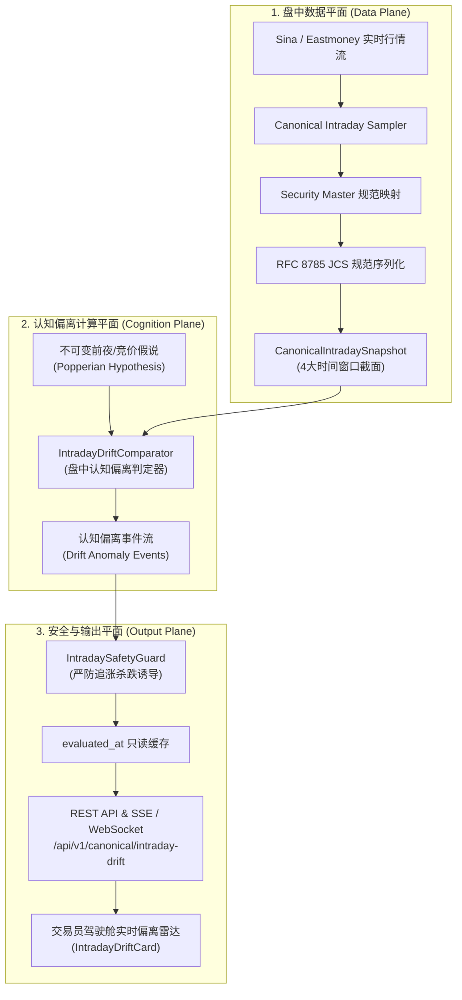

# 【技术方案设计单 · DOC-92】Phase 3A：盘中 4 阶段动态跟踪与认知偏离实时告警系统技术设计单

**文档编号：** `DOC-92-PHASE-3A-INTRADAY-DYNAMIC-MONITORING-20261009`  
**密级状态：** 最高战略级 / 四权分立工程设计基准单  
**编写特使：** 架构与主开发实施首席工程师 (`primary_developer`)  
**审计特使：** 独立红队特使 (`red_team_tester`) / 质量闸门裁判特使 (`quality_gatekeeper`)  
**状态：** 【草案呈批 · DRAFT FOR BOARD REVIEW】  
**依赖基线：** Commit `9792fa5`（已通过 Phase 2E 全生命周期验收）  

---

## 一、 背景与业务痛点分析

### 1. 现有体系的历史断层
在已全量交付的 Phase 2D 与 Phase 2E 中，系统成功构建了严密的日间双锚点闭环：
- **T 日 15:30（Phase 2D）**：收盘真相快照（`CanonicalMarketSnapshot`）$\to$ 不可变假说登记（`PopperianHypothesis`）$\to$ 受约束战报（`TacticalBriefingReport`）；
- **T+1 日 09:25（Phase 2E）**：开盘竞价物理快照（`CanonicalAuctionSnapshot`）$\to$ 波普尔科学证伪判定器（`PopperianBiddingComparator`）$\to$ 驾驶舱对账卡片（`BiddingFalsificationCard`）。

然而，**09:30 开盘以后的连续竞价时段（盘中）**，系统存在严重的工程断层：
1. **旧版 Monitor 架构孤立**：现存 `backend/app/services/monitor.py` 与 `frontend/src/app/monitor/page.tsx` 诞生于早期 MVP 阶段，采用未经校验的浮点数、缺少 `CanonicalSecurityMasterRegistry` 标的白名单校验、无 RFC 8785 JCS 数字签名；
2. **缺乏动态波普尔证伪机制**：09:25 判定为 `CONFIRMED` 或 `DIVERGENT` 的假说，在盘中若发生**“空间板炸板核按钮”、“主线板块冲高大幅回落出货”、“成交量雪崩式萎缩”**等突发异动时，系统无法进行连续的毫秒级/秒级科学证伪重算；
3. **交易员驾驶舱缺乏实时流**：现代交易员驾驶舱（`/cockpit`）目前仅拥有收盘复盘（Tab 1）与开盘对账（Tab 2），缺少对盘中 4 个关键时间窗口的实时偏离告警雷达。

---

## 二、 Phase 3A 核心技术目标与架构愿景



### 1. 划分盘中 4 阶段时间窗口（Four-Stage Intraday Horizons）
市场微观结构在连续竞价时段具有强烈的周期性特征，系统刚性定义 4 个时间窗口：
1. **STAGE 1（09:30 ~ 10:00）· 龙头确认与分歧承接期**：
   - 重点监测：09:25 竞价高标能否封死涨停，前夜 Top 3 主线是否有恐慌抢跑。
2. **STAGE 2（10:00 ~ 11:30）· 主线定型与量能趋势期**：
   - 重点监测：全天成交额投影（预估量能是否达标）、板块轮动与资金分流。
3. **STAGE 3（13:00 ~ 14:30）· 午后异动与情绪拐点期**：
   - 重点监测：午后指数探底回升或冲高跳水、连板梯队炸板率异动。
4. **STAGE 4（14:30 ~ 15:00）· 尾盘博弈与次日预设期**：
   - 重点监测：尾盘抢筹/砸盘、次日潜在假说边界的事先收集。

### 2. 盘中认知偏离三级预警体系（MECE Invariant）
- **NORMAL（正常演进 · 吻合假说）**：盘面各维度在预设容忍度以内；
- **DRIFT_WARNING（中度偏离 · 动态预警）**：主线出现轮动分歧，或量能偏离预估 10%~20%；
- **CRITICAL_BREACH（严重破位 · 盘中一票否决证伪）**：
  * 最高空间板破板且翻绿（`SPACE_LEADER_COLLAPSE`）；
  * 全市场成交额断崖式缩水超 25%（`LIQUIDITY_FLASH_DRY`）；
  * 前夜 Top 3 主线全面倒戈由涨转跌超 -3%（`MAINLINE_TOTAL_REVERSAL`）。

---

## 三、 数据契约与模型设计 (Schema Contracts)

### 1. 盘中微观快照契约 (`CanonicalIntradaySnapshot`)
```python
class IntradayStageEnum(str, Enum):
    STAGE_1_OPENING = "STAGE_1_OPENING"        # 09:30 - 10:00
    STAGE_2_MORNING = "STAGE_2_MORNING"        # 10:00 - 11:30
    STAGE_3_AFTERNOON = "STAGE_3_AFTERNOON"    # 13:00 - 14:30
    STAGE_4_CLOSING = "STAGE_4_CLOSING"        # 14:30 - 15:00
    OFF_MARKET = "OFF_MARKET"                  # 休市或非交易时段

class CanonicalIntradaySnapshot(BaseModel):
    trade_date: str                            # YYYY-MM-DD
    snapshot_time: str                         # HH:MM:SS
    stage: IntradayStageEnum                   # 当前时间窗口
    projected_turnover_yi: Decimal             # 依据时间衰减公式全天预估成交额 (亿元)
    actual_accumulated_turnover_yi: Decimal    # 截至当前真实累计成交额 (亿元)
    up_down_ratio: Decimal                     # 上涨下跌家数比
    limit_up_count: int                        # 涨停家数
    limit_down_count: int                      # 跌停家数
    broken_limit_ratio: Decimal                # 炸板率 (%)
    leader_intraday_quotes: List[StockIntradayQuote] # 重点观测标的实时切片
    snapshot_fingerprint: str                  # JCS RFC 8785 SHA-256
```

### 2. 认知偏离告警契约 (`IntradayDriftVerdict`)
```python
class DriftSeverityEnum(str, Enum):
    INFO = "INFO"
    WARNING = "WARNING"
    CRITICAL_KILL = "CRITICAL_KILL"

class IntradayDriftVerdict(BaseModel):
    trade_date: str
    evaluated_at: str
    stage: IntradayStageEnum
    overall_drift_state: str                   # NORMAL / DRIFT_WARNING / CRITICAL_BREACH
    breach_assertions: List[AssertionItemVerdict]
    preservation_boundaries: List[str]         # 封闭防守边界 (如: "空间板已炸坚决不低吸")
    verdict_fingerprint: str                   # JCS SHA-256
    trace_id: str                              # 单请求端到端 Trace
```

---

## 四、 实施子阶段拆分与里程碑规划 (Phase 3A.1 ~ 3A.4)

```text
[ ] Phase 3A.1: 盘中连续竞价行情切片与 Decimal 规范服务 (Intraday Data Foundation)
    - 建立 CanonicalIntradayService，封装 4 阶段时间窗口切片采集；
    - 引入基于交易分钟数的时间衰减预估量能公式；
    - 落实 SecurityMasterRegistry 标的严格白名单映射与 Decimal 精度；
    - 门禁测试：覆盖非交易时段、午间休市（11:30~13:00）及断网平稳回退。

[ ] Phase 3A.2: 盘中动态波普尔证伪判定器与偏离事件引擎 (Intraday Comparator)
    - 实现 IntradayDriftComparator，消费 CanonicalIntradaySnapshot 与 Hypothesis；
    - 实现空间标杆炸板一票否决（CRITICAL_KILL）与量能衰减偏离断言；
    - 编写 3A.2 判定器门禁测试（含 10 组典型盘中分歧场景与雪崩测试）。

[ ] Phase 3A.3: 盘中安全守卫与只读 REST API (Safety Guard & Readonly API)
    - 实现 IntradaySafetyGuard，彻底过滤一切追涨、抄底等买卖诱导指令；
    - 发布 GET /api/v1/canonical/intraday-drift 端点，严格挂载 mode=ro 物理只读保护；
    - 编写 3A.3 幂等性、只读拒止与零敏感泄漏门禁测试。

[ ] Phase 3A.4: 交易员驾驶舱实时偏离卡片与 API-DOM 端到端回归 (Trader Cockpit UI)
    - 研发 IntradayDriftCard 前端组件并集成进 /cockpit；
    - 实现 Headless DOM 字符保真度（Zero Delta）仿真测试；
    - 全量回归测试：确保 Phase 2D (54项) + Phase 2E (40项) + Phase 3A 整体 100% PASS。
```

---

## 五、 四权分立刚性铁律与安全红线

1. **绝对只读安全**：盘中监控全链路严格以 `mode=ro` 只读连接运行，严禁对生产数据库执行任何写操作；
2. **严禁交易指令**：系统只输出“认知是否偏离”、“风险边界提示”，严禁任何直接建议买入、卖出的违规行为；
3. **零假数据与防伪追溯**：必须附带五位一体防伪水印，严禁在生产和测试中使用静态假数据。
