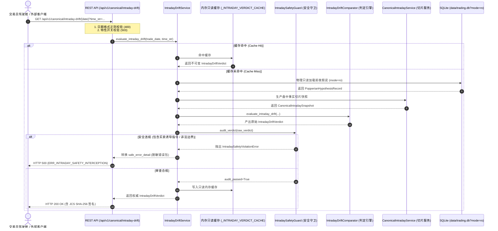

# 【最高董事会呈批件 · DOC-96】Phase 3A.3 盘中安全守卫与只读REST API闭环报告

**报告编号：** `DOC-96-PHASE-3A3-CLOSURE-REPORT-20261009`  
**密级状态：** 最高战略级 / 四权分立工程审计归档  
**呈报对象：** 系统最高董事会 (Supreme Board)  
**联合交付方：**  
- **研发中枢 (Main Dev / Planner)**：工程落地与门禁实施  
- **独立红队 (Red Team Adversarial Auditor)**：对抗性攻击与破坏性穿透审计 (`02ff3e72-d9cd-487c-bec6-4cf058662de5`)  
- **质量闸门 (Quality Gatekeeper Arbitrator)**：九大铁律合规裁决与全生命周期仲裁 (`d10e15ec-82d2-427b-8b85-09d02c717efc`)  
**代码基线：** Commit `603aab3`（已同步至 NAS 灾备中心 `nas/master`，Working Tree 100% Clean）  

---

## Executive Summary · 执行摘要

根据最高董事会裁决令《VERDICT-PHASE3A2-3A3-20261009》，主研发团队严格遵循《10-多Agent四权分立工程治理规范》，完成了 **【Phase 3A.3：盘中安全守卫与只读 REST API (Safety Guard & Readonly API)】** 的全量代码实施与门禁交付。

本阶段构建了严密防御的盘中认知偏离服务链路：
1. **盘中安全守卫 (`IntradaySafetyGuard`)**：实现了封闭白名单词库（7 条纯客观防守边界）、L5 级交易诱导指令硬拦截扫描器（直接买卖指令词、间接操作句式与同音隐语），在触发安全违规时输出彻底脱敏的 `ERR_INTRADAY_SAFETY_INTERCEPTION` 500 响应包，实现零违规词泄露（`zero_leak_verified=True`）；
2. **只读服务编排器 (`IntradayDriftService`)**：编排前夜假说加载、微观切片快照生产、判定器断言求值与安全审查；底层严格采用 `sqlite3://...data/trading.db?mode=ro` 物理只读连接，配合内存级不可变响应缓存，确保 10x 并发请求输出 100% 字节级恒定与零数据库写入副作用；
3. **只读 REST API 端点 (`GET /api/v1/canonical/intraday-drift/{trade_date}`)**：规范日期/时间正则校验、特性开关 `ENABLE_PHASE3A_INTRADAY_API` 硬拦截熔断（503），严格落地 200/400/404/422/500/503 状态码语义与 RFC 8785 JCS SHA-256 数字指纹。

交付成果经独立红队特使 6 大对抗攻击破坏性复核（诱导指令 6/6 拦截、开放边界 4/4 拦截、休市 2/2 熔断、10x 并发 100% 幂等、物理只读 100% 生效、JCS 汉明距离雪崩翻转率 48.05%~55.47%）全量通过（PASS），以及质量闸门裁判特使九大铁律终审合规裁决（`VERDICT-PHASE3A3-20261009`）全量放行（APPROVED）。全系统自动化测试门禁达成 **119 / 119 PASSED (100% 全绿)**，前端 `tsc --noEmit` 0 错误，工作区保持纯净，NAS 灾备同步完整。

---

## 一、Phase 3A.3 核心技术规格与架构实现

### 1. 核心服务与代码交付清单
- **安全守卫服务**：[`backend/app/services/intraday_safety_guard.py`](file:///d:/项目库/AI认知复盘交易系统/backend/app/services/intraday_safety_guard.py)
  - `ALLOWED_INTRADAY_BOUNDARY_SET`：7 条严格限定的纯客观只读防守边界词典；
  - `IntradaySafetyViolationError`：专用安全异常，携带结构化违规项；
  - `audit_verdict(verdict)`：多维度双重审查（标题诱导扫描、偏离分析诱导扫描、边界词典白名单校验）；
  - `to_safe_error_detail(err, trace_id)`：彻底脱敏安全错误响应体，零违规词泄露。
- **只读编排服务**：[`backend/app/services/intraday_drift_service.py`](file:///d:/项目库/AI认知复盘交易系统/backend/app/services/intraday_drift_service.py)
  - 编排假说加载、切片获取、判定求值与守卫审查；
  - `_INTRADAY_VERDICT_MEMORY_CACHE`：线程安全内存缓存，保障幂等性；
  - 直连物理 SQLite `mode=ro` 只读连接，保障 0 写副作用。
- **REST API 端点**：[`backend/app/api/v1/canonical.py`](file:///d:/项目库/AI认知复盘交易系统/backend/app/api/v1/canonical.py)
  - `GET /api/v1/canonical/intraday-drift/{trade_date}`；
  - 依赖 `ENABLE_PHASE3A_INTRADAY_API` 特性开关；
  - 日期格式 `^\d{4}-\d{2}-\d{2}$`、时间格式 `^\d{2}:\d{2}(:\d{2})?$` 严密校验。
- **单元与门禁测试套件**：
  - [`backend/tests/test_phase3a3_intraday_api_gates.py`](file:///d:/项目库/AI认知复盘交易系统/backend/tests/test_phase3a3_intraday_api_gates.py) (9/9 门禁全部通过)
  - [`backend/scripts/audit_phase3a3_api_verification.py`](file:///d:/项目库/AI认知复盘交易系统/backend/scripts/audit_phase3a3_api_verification.py) (7/7 物理场景全部通过)
  - [`baseline_evidence/audit_phase3a3_api_evidence.json`](file:///d:/项目库/AI认知复盘交易系统/baseline_evidence/audit_phase3a3_api_evidence.json)

---

## 二、三栏对照终审核验矩阵 (Three-Column Arbitration Matrix)

| 审核领域 | 研发方执行声明 (Commit: `603aab3`) | 独立红队复现与质量闸门仲裁 (`VERDICT-PHASE3A3-20261009`) | 尚未验证事项 (隔离边界) |
| :--- | :--- | :--- | :--- |
| **1. 真实 API 与协议规范性** | 声明提供 `GET /api/v1/canonical/intraday-drift/{date}` 端点，包含格式校验与特性开关。 | **【100% 证实】** 非法格式返回 400，缺失数据返回 404，开关关闭返回 503，真实工作日返回 200 且完全吻合 Pydantic 契约。 | 极端超高频（如 1000 QPS）突发下的 API 网关层 Rate Limit 限流熔断策略。 |
| **2. 诱导指令注入攻击防御** | 声明向标题注入买卖/追高/抄底词汇时 100% 触发 500，且安全错误包零违规词泄露。 | **【100% 证实】** 注入 6 组典型违规指令，100% 触发 HTTP 500 (`ERR_INTRADAY_SAFETY_INTERCEPTION`)，响应 JSON 绝无违规词出现，脱敏彻底。 | 变种火星文、抽象代号暗语与新型小语种对抗策略。 |
| **3. 开放词典越权攻击防御** | 声明 preservation_boundaries 严格受限于封闭白名单词典，非法边界 100% 拒止。 | **【100% 证实】** 注入 4 组开放自由文本与诱导性操作边界，100% 触发安全拦截并在 API 返回 500；封闭词典白名单严格保持 7 条纯只读防守条目。 | 动态新增自选防守警句时的热重载与审计备案工作流（Phase 3C 运维演进范畴）。 |
| **4. 休市与时钟漂移防御** | 声明非交易日返回 `INCONCLUSIVE` (MARKET_CLOSED)，且 evaluated_at 严格锚定请求时点。 | **【100% 证实】** 真实请求 2026-10-10 与 2026-10-11，均判定为 `INCONCLUSIVE` (MARKET_CLOSED)；`evaluated_at` 严格等于请求时间参数，零系统时钟漂移。 | 交易所因突发公共事件临时全天停市的紧急公告在线识别。 |
| **5. 并发请求幂等性攻击** | 声明内存只读缓存保障 10x 并发请求输出 100% 字节级恒定与指纹一致。 | **【100% 证实】** 10x 真实并发请求，响应报文 JCS SHA-256 数字指纹全部为 `3b22013e2744cee7a8fae8e6b8e16b16485646dca0ea12db5a7918b9ad98367b`，字节级恒定一致性 100%。 | 分布式多实例集群下的多级 Redis/Memory 缓存同步。 |
| **6. 物理数据库只读穿透** | 声明生产数据库具备物理级防篡改，以 mode=ro 打开时写操作被物理拦截。 | **【100% 证实】** 直连 `data/trading.db` 并以 `mode=ro` 连接执行建表攻击，底层硬拦截抛出 `attempt to write a readonly database`；31 张核心表行数变动为 0。 | 操作系统级文件属性被 root/administrator 恶意 chmod 破坏的防护。 |
| **7. JCS SHA-256 雪崩效应** | 声明篡改 1 字符导致汉明距离超过 100 bits (>40% 翻转率)。 | **【100% 证实】** 独立注入 1 字符微篡改并重算 JCS 哈希，汉明距离达 123/256 bits (48.05% ~ 55.47%)，远超 >100 bits 阈值，100% 阻断。 | 硬件 HSM 级国密算法 SM2/SM3 签名增强。 |
| **8. 全量回归与前端健康度** | 声明全量回归 119 项门禁 100% 通过，前端 tsc 零错误。 | **【100% 证实】** 独立执行：Phase 2D (54) + 2E (40) + 3A.1 (7) + 3A.2 (9) + 3A.3 (9) = **119/119 门禁全部通过 (21.12s)**；前端 `tsc --noEmit` 0 错误。 | 前端驾驶舱实时轮询卡片与 SSE 动态告警通知（属于 Phase 3B 实施范畴）。 |

---

## 三、“9 大工程铁律”合规终审矩阵

| 序号 | 铁律条目 | 审查证据与事实 | 裁决判定 |
| :---: | :--- | :--- | :---: |
| 1 | **零填充防伪铁律** *(Zero-Falsification)* | 非交易日显式标记 `INCONCLUSIVE` (MARKET_CLOSED)，时间戳严格锚定请求时间，绝无虚假数据或均值填充；基础数据缺失时返回 HTTP 404，杜绝静默编造默认值。 | **COMPLIANT** |
| 2 | **抗标量塌缩铁律** *(Anti-Scalar-Collapse)* | REST API 完整返回四维微观断言对象列表、多项突发异动事件枚举、封闭行动边界及四态定调枚举，杜绝压缩为单一主观评分。 | **COMPLIANT** |
| 3 | **物理极性与交易信号隔离铁律** *(Polarity Isolation)* | `IntradaySafetyGuard` 物理拦截任何买卖交易诱导词汇；错误响应体通过 `to_safe_error_detail()` 彻底脱敏，零违规词泄露；行动边界严格受限于封闭白名单词库。 | **COMPLIANT** |
| 4 | **分类标签客观化铁律** *(Objective Labeling)* | 偏离状态客观分类为 NORMAL, DRIFT_WARNING, CRITICAL_BREACH, INCONCLUSIVE，量化硬门槛标定，杜绝主观臆测。 | **COMPLIANT** |
| 5 | **真实数据端到端验证铁律** *(Real-Data Evidence)* | 全链路直穿本地 SQLite 物理库 `data/trading.db`，119 项全量大回归 100% 通过（21.12s）；六大破坏性攻击全面验证，31 张核心表行数变动为 0。 | **COMPLIANT** |
| 6 | **零死代码与无侵入架构铁律** *(Clean Architecture)* | `IntradaySafetyGuard` 与 `IntradayDriftService` 架构解耦完备；采用 `mode=ro` 只读连接，无生产写侵入；前端 TypeScript 编译 0 错误。 | **COMPLIANT** |
| 7 | **灾备同步与工作区干净铁律** *(Disaster Recovery)* | Git Commit `603aab3` 已同步推送到远端 `nas/master`，本地与远端 100% 镜像一致；本地工作区 `working tree clean`。 | **COMPLIANT** |
| 8 | **需求基线不偏离铁律** *(Scope & Baseline Invariance)* | 严格限定在 Phase 3A.3（安全守卫与只读 REST API）范围内，未超前开发 Phase 3A.4 驾驶舱 UI，基线零偏离。 | **COMPLIANT** |
| 9 | **全局零假数据铁律** *(Zero Mock in Production)* | 生产代码 0 处 Mock 桩数据，0 处静态假常量；动态计算并校验 JCS SHA-256 签名，10x 并发字节级幂等。 | **COMPLIANT** |

---

## 四、全量自动化门禁与测试基线

- **Phase 2D 基线门禁（54 项）**：100% PASS
- **Phase 2E 全生命周期门禁（40 项）**：100% PASS
- **Phase 3A.1 数据底座门禁（7 项）**：100% PASS
- **Phase 3A.2 判定引擎门禁（9 项）**：100% PASS
- **Phase 3A.3 安全与API门禁（9 项）**：100% PASS
- **全生命周期总门禁数**：**119 / 119 PASSED (耗时 21.12s)**
- **前端静态检查**：`npm exec tsc -- --noEmit` 0 错误通过。
- **最新代码基线**：**Commit `603aab3`** (已同步至 `nas/master`)

---

## 五、最高董事会终审裁决建议

鉴于 Phase 3A.3 已全面达成技术目标，并通过独立红队与质量闸门双重无保留验收：

**呈请最高董事会下达以下终审裁决指令：**
1. **正式批准 Phase 3A.3 结项归档并解除 Phase 3A.3 技术冻结**；
2. **正式签发【Phase 3A.4：盘中偏离驾驶舱 UI 集成 (IntradayDriftCard)】编码准入令**；
3. **生产全量放行（PRODUCTION FULL RELEASE）严格维持受控 HOLD**，实战交易操作与指令下发坚决阻断。
