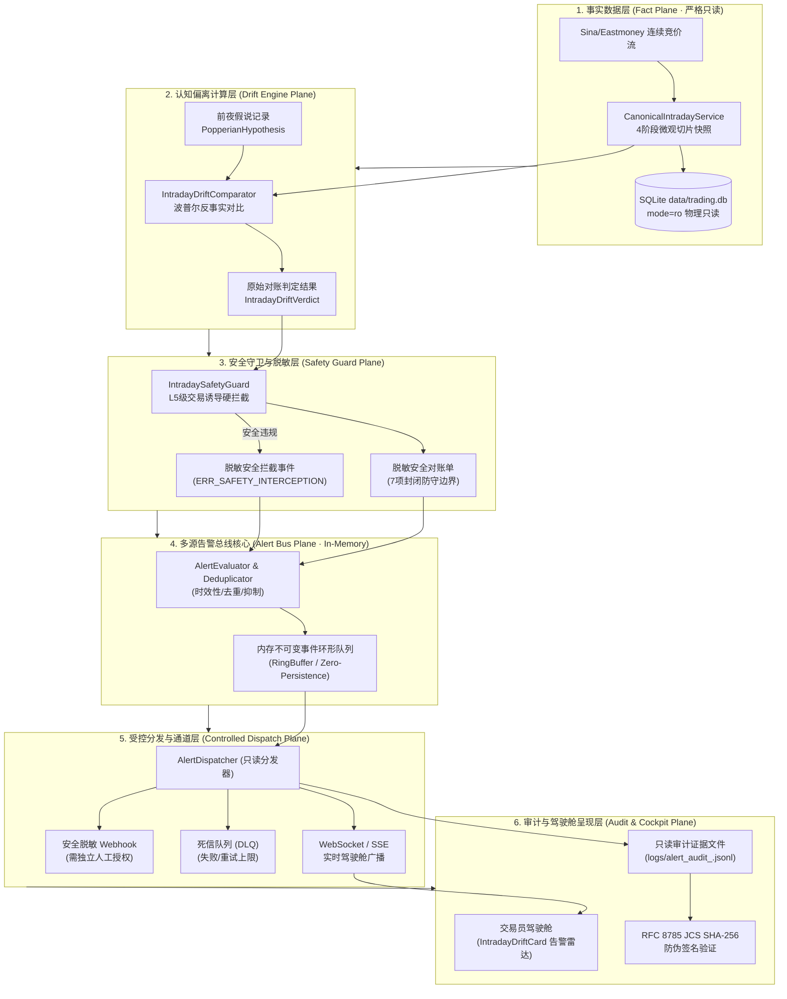
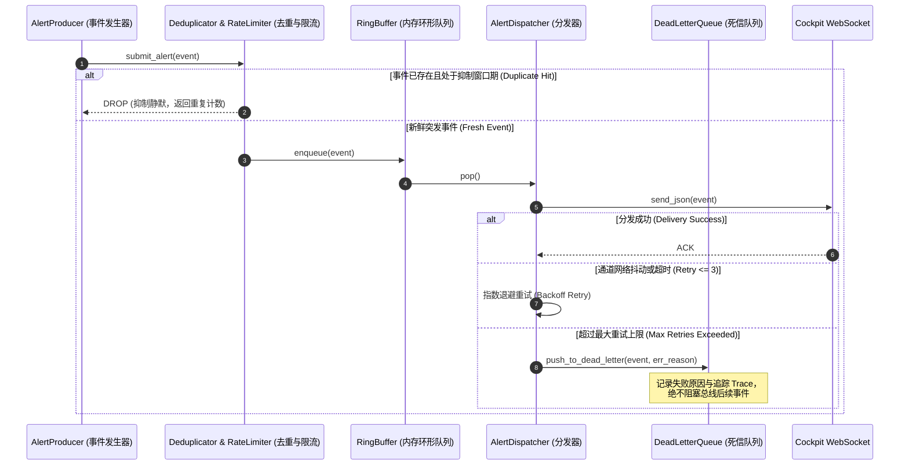
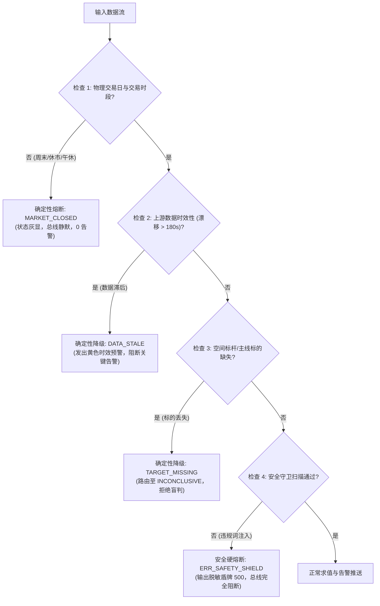
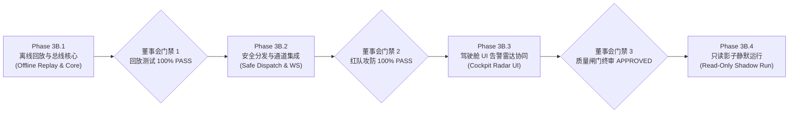

# 【技术方案设计单 · DOC-98】Phase 3B：盘中多源告警通知总线与受控防御编排技术设计单

**文档编号：** `DOC-98-PHASE-3B-ALERT-BUS-AND-DEFENSE-ORCHESTRATION-20261009`  
**密级状态：** 最高战略级 / 四权分立工程设计基准单  
**编写特使：** 研发中枢架构与实施特使 (`fe71a91e-b398-4fee-8916-0b6a1f009657`)  
**审计特使：** 独立红队特使 (`02ff3e72-d9cd-487c-bec6-4cf058662de5`) / 质量闸门裁判特使 (`d10e15ec-82d2-427b-8b85-09d02c717efc`)  
**呈报对象：** 系统最高董事会 (Supreme Board)  
**当前状态：** 【技术设计方案呈审 · DESIGN SUBMISSION FOR BOARD REVIEW】  
**依赖基线：** Commit `09e56d1`（已通过 Phase 3A 全链路实施与验收收口）  

---

## 零、 最高董事会治理红线声明 (Non-Negotiable Red Lines)

根据最高董事会裁决令《VERDICT-PHASE3A-CLOSURE-PHASE3B-DESIGN-20261009》，本设计单刚性落实以下 7 项治理红线，作为系统不可逾越的绝对工程宪章：

1. **红线 1（防绕过准则）**：Phase 3B 绝对不得绕过现有的事实准入、单向血缘追溯、`IntradaySafetyGuard` 安全守卫与 SQLite `mode=ro` 物理只读隔离规则。
2. **红线 2（交易指令物理阻断）**：绝对不得将盘中偏离事件、告警级别（INFO/WARNING/CRITICAL）、颜色标签（Emerald/Amber/Rose）或任何防御性描述，直接或间接转换为买入、卖出、加减仓、追涨、抄底或止损交易指令。
3. **红线 3（业务状态修改禁止）**：在未取得最高董事会独立书面授权前，系统绝对不得自动修改业务数据库、真实/模拟交易状态、投资组合仓位、订单报单或资金账户。
4. **红线 4（总线最小权限隔离）**：通知总线与事件分发引擎为纯无特权只读实体，绝对不默认拥有数据库写权限、不拥有交易通道执行权限，且不得持有任何与通知无关的敏感私钥或凭据。
5. **红线 5（副作用受控闭环）**：任何可能产生外部副作用的动作（如 Webhook 推送、本地通知弹窗、审计文件记录），必须具备明确的授权范围、唯一去重键幂等控制、不可篡改审计追踪、物理失败边界与一键全局熔断机制。
6. **红线 6（零伪装确定性降级）**：遇证据缺失、数据延迟/过期、时钟漂移、事实冲突或安全审查未通过时，系统必须确定性降级至 `INCONCLUSIVE` 状态，绝对严禁使用历史缓存冒充当前事实，绝对严禁将未知状态包装为确定性研判。
7. **红线 7（生产冻结常态化）**：生产环境全量发布、生产数据写入、自动化防御交易执行与实战联通，继续坚决保持 **HOLD / FROZEN**。

---

## 一、 架构与数据流设计 (Architecture & Data Flow)

### 1. 六层防御型系统架构拓扑
Phase 3B 盘中多源告警总线采用六层单向流式防御架构，层与层之间实行强类型与只读单向隔离：



### 2. 事实边界与数据流阶段契约
- **事实源边界**：仅允许消费 Phase 3A 已验收的标准切片快照 `CanonicalIntradaySnapshot` 与不可变前夜假说 `PopperianHypothesisRecord`，严禁从任何未经校验的第三方爬虫或外部裸接口直接触发告警。
- **事件生成边界**：仅当且仅当判定结果通过 `IntradaySafetyGuard` 的脱敏与合规审查后，方可由 `AlertEvaluator` 实例化为标准 `CanonicalDriftAlertEvent`。
- **存储副作用边界**：告警总线核心与分发器在运行时对 SQLite 数据库保持 **0 写入**。所有告警流水仅保存在内存循环缓冲区 (`RingBuffer`) 及独立的本地只读审计追加日志（`.jsonl`），绝不侵入修改核心业务数据表。

---

## 二、 动作分级与权限矩阵 (Action Grading & Permission Matrix)

根据系统风险程度，将 Phase 3B 的所有操作严格划分为四个等级（Level 0 ~ Level 3），明确权限边界：

| 动作分级 | 动作名称与标识 | 描述与行为范畴 | 自动化权限 | 审批与授权要求 | 约束与熔断机制 |
| :--- | :--- | :--- | :---: | :---: | :--- |
| **Level 0 (只读观测)** | `OBSERVE_MARKET_DRIFT` | 读取盘中行情切片、对比前夜假说、求值 4 项微观断言 | **允许 (AUTO)** | 系统默认内嵌 | 仅使用 `mode=ro` 连接，0 业务副作用 |
| **Level 0 (只读观测)** | `RENDER_COCKPIT_BADGE` | 前端驾驶舱刷新状态徽章、高亮偏离卡片与展示防伪水印 | **允许 (AUTO)** | 前端声明式渲染 | 仅消费只读 API，无交易交互按钮 |
| **Level 1 (只读通知)** | `DISPATCH_WS_ALERT` | 向交易员驾驶舱 WebSocket / SSE 广播客观偏离告警事件 | **允许 (AUTO)** | 系统守护进程托管 | 触发去重与滑动窗口抑制，限制最大推送频次 (1次/30s) |
| **Level 1 (只读通知)** | `APPEND_AUDIT_LOG` | 向本地只读审计日志追加 JCS 签名的告警流水凭证 | **允许 (AUTO)** | 仅限特定日志路径 | 仅追加写 `.jsonl`，严禁写入 SQLite 核心业务表 |
| **Level 2 (受控外发)** | `EMIT_EXTERNAL_WEBHOOK` | 向企业微信 / 钉钉 / 飞书推送客观风险提示卡片 | **需人工配置 (CONFIG)** | 需管理员显式开启 Webhook 开关并校验签名密钥 | 文本严格经过脱敏硬拦截，0 买卖诱导词，失败重试上限 3 次 |
| **Level 2 (任务调度)** | `SCHEDULE_WINDOW_SWEEP` | 在 4 阶段时间窗口交界处 (10:00/11:30/14:30/15:00) 调度定时巡检 | **允许 (AUTO)** | 内置无害定时器 | 仅触发只读重算，休市与周末强制静默 |
| **Level 3 (禁止动作)** | `MUTATE_BUSINESS_DB` | 向核心业务表执行 INSERT / UPDATE / DELETE | **绝对禁止 (FORBIDDEN)** | 任何审批均不豁免 | 数据库物理 `mode=ro` 连接层硬件级拒止 |
| **Level 3 (禁止动作)** | `EXECUTE_TRADE_ACTION` | 下发买入、卖出、补仓、止损、撤单等实盘交易指令 | **绝对禁止 (FORBIDDEN)** | 最高董事会全量冻结令 | 交易模块物理拔线，无通道，无私钥，0 端口暴露 |
| **Level 3 (禁止动作)** | `AUTOMATIC_POSITION_DEFENSE`| 依据“空间龙炸板”告警自动减仓或平仓 | **绝对禁止 (FORBIDDEN)** | 绝对禁止机器自动交易 | 机器仅能作为“认知镜子”客观提示，决策权归属于交易员人工 |

---

## 三、 事件契约与规范设计 (Event Contract & Schema)

### 1. 规范告警事件契约 (`CanonicalDriftAlertEvent`)
```python
class AlertSeverityEnum(str, Enum):
    INFO = "INFO"          # 提示级：正常对齐演进，或时间窗口状态切换
    WARNING = "WARNING"    # 预警级：中度偏离、量能偏离 10%~20%、主线轻度分歧
    CRITICAL = "CRITICAL"  # 严重级：空间龙炸板核按钮、主线全面倒戈、流动性断崖衰竭

class AlertCategoryEnum(str, Enum):
    SPACE_LEADER_COLLAPSE = "SPACE_LEADER_COLLAPSE"       # 空间标杆破位
    MAINLINE_TOTAL_REVERSAL = "MAINLINE_TOTAL_REVERSAL"   # 主线龙头反转
    LIQUIDITY_FLASH_DRY = "LIQUIDITY_FLASH_DRY"           # 量能断崖萎缩
    BREADTH_PANIC_DIVERGENCE = "BREADTH_PANIC_DIVERGENCE" # 炸板率与恐慌分歧
    STAGE_TRANSITION = "STAGE_TRANSITION"                 # 4 阶段窗口迁移
    SAFETY_INTERCEPTION = "SAFETY_INTERCEPTION"           # 安全守卫违规拦截

class CanonicalDriftAlertEvent(BaseModel):
    """
    Phase 3B 规范盘中多源告警事件契约 (不可变数据载荷)
    """
    model_config = ConfigDict(frozen=True, extra="forbid")

    # 事件全局唯一标识与血缘追溯
    alert_id: str = Field(..., description="事件全局唯一主键 ALERT-YYYY-MM-DD-<time>-<hash8>")
    trade_date: str = Field(..., description="归属交易日 YYYY-MM-DD")
    observed_at: str = Field(..., description="物理微观事实快照采样时戳 (ISO-8601)")
    generated_at: str = Field(..., description="告警事件实例化时戳 (ISO-8601)")
    expires_at: str = Field(..., description="告警事件有效期截止时戳 (过期自动作废)")
    trace_id: str = Field(..., description="单请求贯穿式 Trace ID")
    version: str = Field("1.0.0", description="事件契约版本号")

    # 去重与抑制键
    deduplication_key: str = Field(..., description="去重键: <date>:<stage>:<category>:<symbol>")

    # 告警语义与分级
    severity: AlertSeverityEnum = Field(..., description="告警严重度等级")
    category: AlertCategoryEnum = Field(..., description="告警事件分类")
    stage: IntradayStageEnum = Field(..., description="触发时所处盘中 4 阶段时间窗口")
    headline: str = Field(..., description="纯客观描述性标题 (绝对禁止包含买卖诱导)")
    detail_facts: Dict[str, Any] = Field(..., description="微观客观事实键值对 (数值/比率/阈值)")
    
    # 封闭防守行动边界条件 (纯负向防守限制)
    preservation_boundaries: List[str] = Field(..., description="系统推导的负向防守保留边界")

    # 防伪签名与证据绑定
    verdict_fingerprint: str = Field(..., description="绑定的 IntradayDriftVerdict JCS SHA-256 指纹")
    evidence_hash: str = Field(..., description="本告警事件全字段 RFC 8785 JCS SHA-256 防伪数字签名")
```

### 2. 时效性与去重键设计
- **去重键计算公式**：
  $$\text{dedup\_key} = \text{trade\_date} + \text{":"} + \text{stage} + \text{":"} + \text{category} + \text{":"} + \text{target\_symbol}$$
- **时效性与有效期 (`TTL`)**：
  - `INFO` 级事件：有效窗口 $TTL = 300\text{s}$（5 分钟）；
  - `WARNING` 级事件：有效窗口 $TTL = 180\text{s}$（3 分钟）；
  - `CRITICAL` 级事件：有效窗口 $TTL = 60\text{s}$（1 分钟，高频刷新）；
  - 超过 `expires_at` 后，事件自动标记为失效，驾驶舱雷达停止跳动提示，防止交易员依据滞后信息做决策。

---

## 四、 可靠性与容错设计 (Reliability Engineering)



### 1. 核心可靠性防御机制
1. **幂等性与去重保证**：
   - 内存维护滑动时间窗口 LRU 去重缓存（容量 10,000 条）；
   - 在相同 `stage` 内同一标的的同类偏离事件，在 180 秒冷却期（Cooling Period）内自动抑制，仅递增 `occurrence_count`，不产生重复通知风暴。
2. **乱序事件防御 (Out-of-Order Defense)**：
   - 每个事件强制携带微观物理事实观测时戳 `observed_at`；
   - 若接收到的新事件 `observed_at` 小于已处理最新时戳（迟到数据），该事件强制打标为 `IS_DELAYED=True`，严禁触发前向警报。
3. **超时与死信队列 (DLQ)**：
   - 单通道推送超时阈值刚性设为 `1500ms`；
   - 重试策略：采用带抖动的指数退避（300ms, 600ms, 1200ms），最多重试 3 次；
   - 3 次重试均失败者，转入内存死信队列（Dead Letter Queue），触发系统健康度降级事件，绝不阻塞主总线吞吐。
4. **断网恢复与影子重放**：
   - 驾驶舱 WebSocket 建立连接时，支持传入 `last_received_alert_id`；
   - 总线从 `RingBuffer` 中安全重放过去 10 分钟内的历史有效告警，实现前端刷新后的无缝无损续接。

---

## 五、 安全威胁模型与攻防设计 (Security & Adversarial Design)

针对最高董事会关注的恶意攻击场景，构建 7 大专项安全防御盾牌：

```
+----------------------------------------------------------------------------------------------------+
|                                    Phase 3B 攻防对抗安全矩阵                                        |
+----+----------------------+------------------------------------------------+-----------------------+
| 编号 | 威胁攻击向量         | 攻击形式与渗透手段                             | 系统刚性防御盾牌      |
+----+----------------------+------------------------------------------------+-----------------------+
| 1  | 提示注入与买卖诱导   | 在行情快照标题或板块名称中伪造“立即买入/满仓”   | IntradaySafetyGuard   |
|    | (Prompt Injection)   | 诱导大模型或规则引擎输出交易操作建议           | 正则与语义扫描硬拦截  |
+----+----------------------+------------------------------------------------+-----------------------+
| 2  | 告警文本越权与泄密   | 在告警 detail_facts 中泄露底层文件路径、        | 字段级白名单脱敏输出  |
|    | (Sensitive Leak)     | 数据库密码、NAS 访问凭证或服务器环境信息       | 错误仅返回标准错误码  |
+----+----------------------+------------------------------------------------+-----------------------+
| 3  | 虚假事件伪造攻击     | 攻击者向总线注入伪造的“空间板跌停”严重虚假事件 | RFC 8785 JCS SHA-256  |
|    | (Event Forgery)      | 企图制造恐慌信号                               | 数字签名校验 (失配即杀)|
+----+----------------------+------------------------------------------------+-----------------------+
| 4  | 时钟回拨重放攻击     | 截获昨日严重偏离告警并在次日盘中重放           | 交易日 trade_date 强绑 |
|    | (Replay Attack)      | 企图干扰当日正常交易                           | 与 expires_at 强制失效|
+----+----------------------+------------------------------------------------+-----------------------+
| 5  | 总线权限提权渗透     | 试图通过通知分发器获取数据库写权限或下单接口   | 权限沙箱与无特权隔离  |
|    | (Privilege Escalate) | 修改仓位或自动报单                             | mode=ro 物理拒止      |
+----+----------------------+------------------------------------------------+-----------------------+
| 6  | 告警风暴 DoS 攻击    | 构造毫秒级千万次微小抖动触发海量告警           | 滑动窗口限流与冷缩器  |
|    | (Notification Storm) | 打崩交易员浏览器或分发通道                     | (单分钟上限 30 条)    |
+----+----------------------+------------------------------------------------+-----------------------+
| 7  | 审计记录篡改攻击     | 删改本地审计流水以掩盖违规行为                 | WORM 模式 append-only |
|    | (Audit Tampering)    | 破坏事后追责证据链                             | 哈希前后级联校验      |
+----+----------------------+------------------------------------------------+-----------------------+
```

---

## 六、 熔断与降级设计 (Circuit Breakers & Degradation)

为防止不可靠数据导致系统输出误导信息，设立 4 级熔断降级阶梯：



### 1. 熔断触发与自愈规则
- **熔断状态标记**：当熔断发生时，事件流强制输出 `DriftStateEnum.INCONCLUSIVE`，严禁任何组件猜想或填补数据；
- **自愈机制**：熔断恢复不依赖人工重启，当下游重新接收到合格切片数据且连续 3 次验证通过（需 15 秒观察期）后，熔断开关自动恢复为闭合（Normal）。

---

## 七、 测试与验收计划 (Verification & Acceptance Plan)

在后续获得编码授权后，实施团队将执行包含 8 大维度的全景端到端验收套件：

| 测试大类 | 测试项编号 | 测试场景与目标 | 可复现验收标准 (Acceptance Criteria) |
| :--- | :--- | :--- | :--- |
| **正常路径** | `TC-3B-01` | 正常交易日微观偏离事件识别与总线入队 | 偏离事件毫秒级生成，格式 100% 吻合 Pydantic 契约 |
| **正常路径** | `TC-3B-02` | WebSocket / SSE 客户端实时事件订阅与推送 | 客户端建立连接后无损接收最新告警事件，延迟 < 50ms |
| **边界测试** | `TC-3B-03` | 非交易日与休市时段（周六日及午休） | 确定性返回 `MARKET_CLOSED`，总线保持 100% 静默 |
| **时效与过期** | `TC-3B-04` | 注入超过 TTL (180s) 的延迟微观数据 | 系统精准触发 `DATA_STALE` 预警，严禁冒充新鲜事实 |
| **并发与幂等** | `TC-3B-05` | 100 客户端并发订阅与相同事件高频投递 | 滑动窗口去重 100% 生效，重复事件被抑制，无内存泄漏 |
| **安全对抗** | `TC-3B-06` | 标题注入违规买卖词（如“立即全仓买入”） | 100% 被 `IntradaySafetyGuard` 物理拦截，零泄露 |
| **微篡改对抗** | `TC-3B-07` | 篡改告警事件 1 个字符（注入标点） | JCS SHA-256 签名立即失配，分发器拒止并记入安全告警 |
| **物理只读** | `TC-3B-08` | 验证事件生成与分发全生命周期数据库状态 | 核心业务表 Mutations = 0，数据库严格维持只读状态 |

---

## 八、 分阶段受控实施与发布计划 (Phased Rollout Plan)

Phase 3B 严格实行“四步走”渐进式推进，任何阶段之间设有刚性门禁，**绝对禁止自动升级**：



1. **Phase 3B.1：告警总线核心与历史离线回放 (In-Memory Engine & Offline Replay)**
   - 目标：实现 `AlertEvaluator`、`Deduplicator`、`RingBuffer`，使用 2026-10-08/09 历史真实行情进行全离线回放驱动验证。
   - 约束：纯内存计算与离线验证，不暴露任何网络端口，不修改前端。
2. **Phase 3B.2：安全守卫拦截强化与 WebSocket 分发通道 (Safety Guard & WS Dispatch)**
   - 目标：集成 `AlertDispatcher`，提供只读 WebSocket 端点，接入死信队列与 WORM 审计日志。
   - 约束：仅限只读广播，红队执行注入、微篡改、雪崩与拒绝服务对抗攻击。
3. **Phase 3B.3：全景驾驶舱告警雷达 UI 协同 (Cockpit Radar UI Integration)**
   - 目标：在交易员驾驶舱无缝挂载实时告警悬浮雷达与声音提示控件（支持一键静音）。
   - 约束：前端绝不添加任何交易下单交互按钮，异常受控平稳降级。
4. **Phase 3B.4：全链路只读影子静默运行与闭环封存 (Read-Only Shadow Run & Final Closure)**
   - 目标：在非生产沙盒环境中进行连续交易日盘中影子跟踪演练，验证系统稳定性与零数据污染。
   - 约束：继续坚决保持生产全量发布与实盘交易 **HOLD / FROZEN**。

---

## 九、 董事会呈请事项 (Board Petitions)

研发团队特此向最高董事会呈请：
1. **审查并批准 DOC-98**：审议本设计单关于架构、权限、事件契约、可靠性、安全性与分阶段实施的完整方案；
2. **确认 Phase 3A 结项证据收口**：核验已提交的测试差异解释、数据库只读边界澄清、四维时间因果契约与证据链映射；
3. **审议 Phase 3B.1 编码准入令**：在设计单通过独立红队与质量闸门双重前置审查后，批准启动 **Phase 3B.1（离线回放与总线核心）** 的受控隔离编码。

---
*呈报特使：研发中枢架构与实施特使 (Main Dev / Planner)*  
*呈报日期：2026-10-09*
