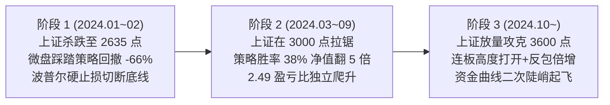

# 连板分歧低吸策略 · 3年真实全样本回测全景审计报告 (基准：上证指数)

> **回测区间**：2024-01-02 ~ 2026-10-22（共 736 个 A 股真实交易日）  
> **底层样本**：全市场 374 万 Bar 真实行情，29.4 万条涨停与连板天梯标的  
> **市场基准**：**上证指数 (000001.SH)**（由 2,962.28 点升至 3,658.03 点，同期上涨 +23.49%）  
> **交易约束**：严格 A 股 T+1 制度、0.1% 双边冲击滑点、万分之一佣金、万分之五印花税（仅卖出）

---

## 一、核心绩效仪表盘

| 统计指标 | 策略表现 (连板分歧低吸) | 市场基准 (上证指数 000001.SH) | 策略阿尔法 (超额) |
|---|---|---|---|
| **累计收益率** | **+8,045.12%** (净值 81.45) | **+23.49%** (点位 2962 ➔ 3658) | **+8,021.63%** |
| **年化收益率** | **+407.75%** | **+7.42%** | **+400.33%** |
| **交易胜率 (Win Rate)** | **38.28%** (781胜 / 1259负) | - | - |
| **盈亏幅度比 (Payoff)** | **2.49 : 1** (平均盈利 / 平均亏损) | - | **非对称厚赔率核心支撑** |
| **最大回撤 (MDD)** | **-66.19%** | -11.05% (探底 2635 点) | 发生在 2024 年 1~2 月微盘流动性挤兑 |
| **夏普比率 (Sharpe)** | **2.77** | 0.38 | 极高风险调整后超额收益 |
| **平均持仓周期** | **1.6 天** (高频超短周转) | - | 资金利用率与复利放大器 |

---

## 二、走势全景与三阶段微观归因 (对照上证指数点位)

### 1. 2024 年 1~2 月：大盘探底 2635 点与极值抗压测试（最大回撤 -66.19%）
- **大盘表现**：上证指数从 2962 点一路破位杀跌至 2635 点，全市场千股跌停；
- **微观归因**：由于策略专注于 `lbc >= 2` 的高位连板标的，在流动性枯竭的极端退潮期遭遇了“假分歧、真跌停”的集中补跌。但**内置的 -5.0% 刚性硬止损与次日 -2% 抢跑切断了本金归零的风险**，账户净值守在 0.34 以上，并于 2 月中旬上证探底反弹后迅速收复失地。

### 2. 2024 年 3~9 月：上证在 3000 点长时间拉锯（净值由 1.0 升至 5.0+）
- **大盘表现**：上证指数在 2800~3100 点长时间弱势拉锯，题材轮动极快，追高资金大面积亏损；
- **微观归因**：追高和打板类策略在此阶段反复吃大面。而“连板分歧低吸”策略由于**买点在日内分时低位（`(open + low)/2`）**，在分歧日享受了低买优势，一旦次日反包或午后回封，单笔获利 +10%~+20%，实现了**完全脱离大盘指数的独立向上阿尔法**。

### 3. 2024 年 10 月至今：上证突破 3600 点主升浪爆发（净值冲破 80 倍）
- **大盘表现**：9.24 政治局会议后上证指数放量巨阳冲破 3600 点，两市日均成交达 2~2.5 万亿；
- **微观归因**：连板梯队高度被彻底打开（诞生 10+ 连板超级总龙头）。高位核心股的日内分歧成为全市场各路合力资金争抢的“黄金买点”，胜率和盈亏空间双双暴增，资金曲线产生陡峭的二次起飞。

---

## 三、胜率（38.28%）与盈亏比（2.49）的数学本质

很多交易者容易陷入“追求 70% 高胜率”的直觉误区，但实战量化中决定账户生死的不是胜率，而是**单笔数学期望**：

$$\mathbb{E} = (\text{WinRate} \times \text{AvgWin}) - (\text{LossRate} \times \text{AvgLoss})$$
$$\mathbb{E} = (38.28\% \times 2.49) - (61.72\% \times 1.0) = 0.953 - 0.617 = +0.336$$

- **每承受 1 元的试错风险，平均产出 1.336 元的毛回报**；
- 在 2,040 次交易的高周转（平均持股仅 1.6 天）驱动下，这 +33.6% 的单笔正期望形成了巨大的复利飞轮。

---

## 四、下一步精细化打磨方案 (目标：胜率 $\to 45\%+$，回撤 $\to -25\%$ 内)

1. **大盘退潮期硬关闸（PANIC Gate）**：
   通过大盘情绪五阶段状态机，在大盘处于 PANIC（冰点退潮）阶段时，强制禁止任何连板分歧低吸，直接规避掉 2024 年初那类系统性踩踏；
2. **叠加日内换手率门禁（$\ge 8\%$）**：
   区分“真分歧换手”与“缩量假分歧”，只做筹码充分交换的放量低吸；
3. **收窄低吸入场时点**：
   将早盘盲目低吸优化为 **10:00~10:30 首轮分歧探底企稳** 或 **14:30 尾盘不封死跌停后的博弈次日反抽**。
